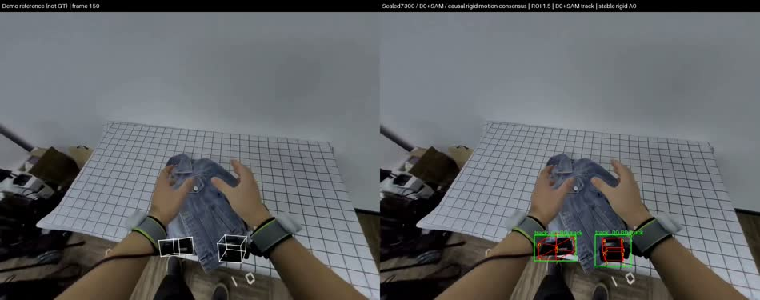

# DJI Action4 双机检测、八角点定位与视频跟踪

**2026-11-08 状态：用户暂停研究、训练与评估；本次仅整理和发布代码。真实全视频的角点准确性和稳定性尚未验收。**

项目复用固定尺寸 DJI Action4、canonical8 点序与已发布合成数据，采用 B0 完整机身检测 → 实例 ROI → A0 姿态/角点 → 几何与视频跟踪链路。数据、模型、环境和运行产物保留在服务器，普通 Git 只发布源码、配置、测试和文档。

## 当前可靠入口

- [执行与文件索引](docs/action4_execution_index.md)
- [第二阶段主计划](docs/stages/2026-10-24-1-plan-Action4第二阶段识别与八角点增强.md)与[进行中结论](docs/stages/2026-10-24-1-conclusion-Action4第二阶段识别与八角点增强.md)
- [结果登记](results/results.md)、[模型说明](models/README.md)、[输出索引](outputs/README.md)
- 当前暂停权威：configs/execution/action4_active.json → action4_execution_user_paused_r147.json。历史配置及 PID 不是重启授权。

## 模型与未完成工作

B0 已封存 step9500；阶段四 A0 的研究选择为 step7300、ROI1.5、corner_candidate，完整650图开发集 All8@2%=1116/1300。阶段四由用户提前停止，不能称完成原定80轮；quality_ready=false，研究试用与部署准入分开。

新 ROI1.15 的75轮适配在用户暂停时保留了完整 step400 状态，尚未完成训练与异步评估，也没有可替代1.5父模型的最终 best。评分入口和异步队列等待的修复有独立工程证据，不等于定位效果改善。models/default 未覆盖，仍保留历史默认组合；后续必须读取明确 selection，不能按文件修改时间挑权重。

已有2850帧 B0＋SAM、A0/PnP、跟踪和平滑开发视频；V5减少了诊断中的旋转跳动，但方向、厚度和遮挡问题尚存，不能把平滑当准确。六面/材料跟踪研究候选尚未完成精度验收。相机内参仍为未标定假设，demo只作参考。

## 目录职责

| 目录 | 内容 |
|---|---|
| src/data | 数据准入、预测框来源、ROI采样、K与标签变换 |
| src/model | A0/B0、SAM辅助、角点、几何与跟踪 |
| src/model/training | 优化器、有效监督分母、不可变运行、恢复和异步队列 |
| src/eval | 数值评分、推理编排、逐帧保存与只读渲染 |
| scripts / tests | 薄入口 / 工程验证 |
| configs | 无凭据的可追溯配置；旧配置不代表当前授权 |
| data/phrase1 | 历史2000张，1600/200/200 |
| data/phrase2 | 已发布6500张，5200/650/650，未重新划分 |
| models | 默认、封存候选、历史、外部预训练模型 |
| outputs/videos | 按时间与阶段命名的视频 |
| outputs | 需要保留的预测、缓存、回执和失败证据 |
| archive/legacy | 历史说明及整理前文档快照 |
| runtime / upstream | 项目内环境、不可变运行源码、外部实现 |

服务器项目根：/data/zy/vln/a-test。每条命令先进入并验证真实路径。仅物理GPU4–7及CPU24–95（最多72逻辑核）曾获授权；**当前已暂停，资源额度不构成自动恢复授权**。未修改正式数据和并行数据生成任务的资产。

## 复用与验证边界

仓库克隆不包含权重、6500张图像、SAM缓存和原视频。先按阶段文档核对数据/模型/依赖身份；不可通过旧控制器直接启动。训练、工程检查、开发成绩和真实验收分别报告。暂停后的恢复必须从记录的完整模型、optimizer、scheduler、RNG及数据位置继续，不能混接旧优化器。

保留 Apache-2.0 [LICENSE](LICENSE)。GDR-Net等复用部分遵守各自许可证及 provenance；第三方数据和权重授权不由本仓库许可证替代。

## 视频展示与下载

点击预览打开/下载完整MP4；GitHub页面可能不直接内嵌播放。两份视频均为2850帧、1900×750、29.97fps，约95.1秒；左侧demo为参考，右侧为本项目结果。V5含跟踪、PnP与平滑；baseline为同一A07300/B09500组合的平滑前对照。两者均为研究开发结果，未通过真实全视频精度验收。

| 文件 | 大小（十进制MB） | GitHub下载 |
|---|---:|---|
| V5完整视频 | 85.4 | [stage5-v5-stabilized-2850.mp4](https://github.com/woaijieyang/0003_Action4_Detect/releases/download/action4-research-20261108/stage5-v5-stabilized-2850.mp4) |
| 同模型baseline完整视频 | 88.2 | [stage5-baseline-2850.mp4](https://github.com/woaijieyang/0003_Action4_Detect/releases/download/action4-research-20261108/stage5-baseline-2850.mp4) |
| A0研究权重：step7300、ROI1.5 | 183.8 | [A0-stage4-step7300-roi1p5.pt](https://github.com/woaijieyang/0003_Action4_Detect/releases/download/action4-research-20261108/A0-stage4-step7300-roi1p5.pt) |
| B0完整机身检测器：step9500 | 140.0 | [B0-stage1-step9500.pt](https://github.com/woaijieyang/0003_Action4_Detect/releases/download/action4-research-20261108/B0-stage1-step9500.pt) |
| 实际源码/配置快照，4539文件 | 7.1 | [reproduction-snapshots.tar.gz](https://github.com/woaijieyang/0003_Action4_Detect/releases/download/action4-research-20261108/reproduction-snapshots.tar.gz) |
| 文件身份与校验 | 小文件 | [RELEASE_MANIFEST.json](https://github.com/woaijieyang/0003_Action4_Detect/releases/download/action4-research-20261108/RELEASE_MANIFEST.json)、[SHA256SUMS.txt](https://github.com/woaijieyang/0003_Action4_Detect/releases/download/action4-research-20261108/SHA256SUMS.txt) |

以上资产放在[GitHub Release](https://github.com/woaijieyang/0003_Action4_Detect/releases/tag/action4-research-20261108)，普通Git只跟踪代码、文档和本页预览图。权重合计约324MB，全部主要资产约505MB，不进入Git历史。

## 文件存放位置

服务器根目录为 /data/zy/vln/a-test。下表均为根目录下的相对位置。

| 内容 | 实际服务器位置 |
|---|---|
| 当前A0 | models/candidates/action4_improvement/stage4_user_stopped_all8_20261028/A0.pt |
| 当前B0封存包 | models/candidates/action4_improvement/stage1_B0_completed_20261024/B0.pt |
| 当前loader实际绑定的同SHA B0副本 | runtime/action4_runs/p2_a0_corner_prediction15_formal80_v003/source/inputs/B0_counterpart.pt |
| 模型组合、ROI1.5与decoder | configs/model/action4_stage5_selection_v001.json |
| V5视频 | outputs/videos/20261029-072034-stage5-sealed7300-coherent-stable-track-e1p50-track/comparison.mp4 |
| baseline视频 | outputs/videos/20261028-234802-stage5-sealed7300-tracking-baseline-e1p50-track/comparison.mp4 |
| 完整A0原始预测 | outputs/action4_stage5_sealed7300_video_v001/e1p50/predictions.jsonl |
| 完整V5最终预测 | outputs/action4_stage5_coherent_stable_v005/e1p50/predictions.jsonl |
| 视频推理配置与不可变代码 | outputs/action4_stage5_sealed7300_video_v001/CONFIG.json、source/ |
| V5配置与不可变代码 | outputs/action4_stage5_coherent_preparation_v006/CANDIDATE.json、source/ |
| 正式数据 | data/phrase2/{train,eval,test}：5200/650/650 |
| 原视频抽帧和PTS | data/action4_real/cache_v001/frames_manifest.json及frames/ |
| 本次Release打包及核验 | outputs/action4_github_release_20261108/ |
| 暂停及恢复身份 | configs/execution/action4_active.json；outputs/action4_stage3_native_prediction_v001/CONTINUATION.json |

A0 SHA256：b8ce72185e7ce46be29a1b62cf8d7086bb6167669959a76f870365b6f09e70b9
B0 SHA256：ce6ba1a58e9f16608d4a44923c5e36914fc764f05b4ba8764f2e9c6c0e5f2ca3

models/default仍是旧A014000/B03220；不得误当当前研究组合或自动覆盖。ROI1.15的last400是完整恢复状态，尚无最终best，不包含在本Release中。

## 复现和继续推进

### 1. 获取源码与已发布资产

已有服务器资产无需重复下载。新工作区可执行以下下载命令（不会启动模型）：

    git clone https://github.com/woaijieyang/0003_Action4_Detect.git
    cd 0003_Action4_Detect
    mkdir -p outputs/github_release_20261108
    gh release download action4-research-20261108 --repo woaijieyang/0003_Action4_Detect --dir outputs/github_release_20261108 --skip-existing
    cd outputs/github_release_20261108
    sha256sum -c SHA256SUMS.txt

仓库私有访问时先在自己的环境完成GitHub授权；不要将凭据写入项目。SHA清单覆盖两视频、两权重及源码包。实际视频源码身份在Release内的SOURCE_MANIFEST/配置回执中，不应仅用当前Git HEAD替代它。

### 2. 恢复文件布局，核查环境与数据

下载名A0-stage4-step7300-roi1p5.pt、B0-stage1-step9500.pt与实际加载路径不同。只有目标缺失且SHA正确时，才分别放到上表A0/B0封存路径；现有文件不覆盖。B0_counterpart.pt还受身份/路径合同约束，按[暂停交接](docs/action4_paused_handoff_20261029.md)恢复同SHA副本及回执，不随意改selection。

先用 tar -tzf 检查源码包清单；包保留outputs/.../source和runtime/.../source原相对结构。不要直接解压覆盖已存在的不可变源码。新机器应在独立暂存目录展开并建立新的运行快照；原SOURCE_MANIFEST覆盖完整历史环境，包内没有所有二进制，不能取消校验绕过它。

pyproject.toml提供Python和可选依赖声明（包括torch2.8/torchvision0.23）；完整SAM、CoTracker及native依赖仍需按原项目配置和各自许可准备。当前服务器使用.venv、runtime/surface_deps和runtime/ffmpeg/bin。不把本包称为已在新机器验证的一键环境。

重新计算需要原RGB/PTS、CAD canonical8、正式数据、冻结B0候选与SAM轨迹/特征缓存；它们通过INPUT_LOCK绑定，仍留服务器。SAM gated权重按官方许可获取，不在Release内。缺资产就保留缺失状态，不用GT框、伪mask或旧预测冒充输入。

### 3. 完整推理与视频入口

图片不启用track：
src/eval/action4_staged_pipeline.py中的from_corner_bundles → corner_context → predict_corner；
完整650评估使用src/eval/action4_stage2_eval.py及专用corner配置。stage5_selection不是旧staged_eval通用CLI配置，不能直接互换。

视频：
B0原始候选＋SAM当前支持＋实例历史 → bbox_for_a0 → 当前RGB/mask裁剪和K → A0 → PnP/回退 → 跟踪和平滑 → 保存 → 只读编码。
实际整片controller在outputs/action4_stage5_sealed7300_video_v001/source/controller.py，编排实现src/eval/action4_roi_video_job.py，参数来自同根CONFIG.json。该目录已完成，不能原地再次启动；新实验需新输出及不可变身份。

V5复用入口为scripts/action4_stabilize_video.py，参数：
--source-manifest outputs/action4_stage5_coherent_preparation_v006/source/SOURCE_MANIFEST.json
--config outputs/action4_stage5_coherent_preparation_v006/CANDIDATE.json --reuse。
该操作也只应在用户明确恢复后执行；同身份优先读已有视频和预测。编码实现src/eval/action4_roi_video.py::render_standard_six，严格读取保存结果与回执，不在渲染层修点或调用模型。

精确签名、数据流、配置和源码入口见[完整暂停交接](docs/action4_paused_handoff_20261029.md)与[资产复现说明](docs/action4_github_assets.md)。

### 4. 保持暂停与剩余工作

当前权威r147为USER_PAUSED，自动检查也暂停。本页命令不构成训练恢复授权；本轮仅文档、预览图和GitHub核验。
用户明确恢复后，先核查权重/数据/源码身份和资源，再处理ROI1.15的step400恢复及未完成eval；不重启终态v001/v002。
后续重点仍是质量头校准、真实方向/厚度与抖动、可靠材料XYZ/六面绑定、未标定K、track-assisted ROI兼容及完整视频验收。必须分别报告代码通过、训练完成和效果改善。
