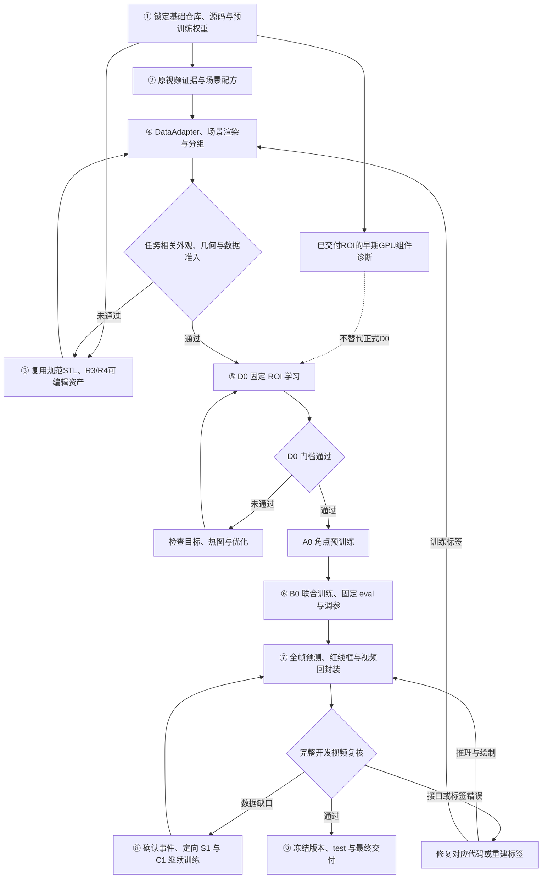

> 当前覆盖：r018，同2000五轮B0接改善后的A0，joint_refinement_v001，GPU4–7/48CPU；刚性候选仍仅离线对照，旧视频继续，未授权自动新test。

> 最新有效推进：r016，仅A0十轮角点完善，配置action4_corner_refinement_v001，GPU4–7/48CPU；原视频继续。先导test联合F1=0，原2000保持，不新增数据，不自动追加B0。

> 当前覆盖：r015/v007，FP32 D0v005验证后复用A0v002接B0v004。FP16 scale512的B0v003在73次有效更新后非有限退出，证据保留。

> 最新运行覆盖：r014；仅AMP初始scale改为512，D0v004验证新scale后复用A0v002接B0v003，配置v006。B0v002第二次更新因梯度非有限已停止。详见文末，历史r013/D0通过仅对应旧scale。

> 当前执行位置：configs/execution/action4_active.json，r013 / training。2000正式数据及data/action4_dataset_commit.json保持不变。四卡D0 v001在首同步异常、尚无记录更新/检查点时受控停止，现场保留；独立默认NCCL最小求和重现超时，仅本进程禁用P2P后四卡及六卡均通过。D0 v002已在500步未通过；实际对照确认并修复AMP几何精度错误，六卡新D0 template2000_d0_v003已经提交，是否收敛以真实gate/completion为准。A0/B0、eval/test、2850帧原视频与最终总存储仍未完成。

> 最新资源授权：GPU2–7、CPU总预算72，替代历史GPU4–7及GPU3仅quality限制；GPU0–1仍不使用。当前模型配置configs/model/action4_pilot2000_v005.json，6个DDP rank，每rank计算2线程、预检查10线程，A0/B0每rank10个CPU供数进程；D0固定32原图使用有界缓存、loader0。micro D0/A0=6、B0=1，ceil微步和零权重尾rank维持真实全局batch32/32/8，绝不把填充重复样本计入loss。不是每卡8份独立模型训练。用户要求按实际吞吐增加进程，不以空转或重复实验占满资源。

<details>
<summary>历史执行快照（保留证据，不作为当前命令入口）</summary>

> 当前执行位置：唯一机器权威 configs/execution/action4_active.json，r011 / training。固定模板2000已正式发布至 data/train、data/eval、data/test（1600/200/200），最终入口 data/action4_dataset_commit.json；28维参数及三个模板继续冻结，不重渲染。双机1856/2000，test全部双机；3802实例、30416有序角点已通过实际GPU3/Host/consumer与正式root/SPEC发布复核。四卡新D0任务template2000_d0_v001已启动，尚无通过结论；A0/B0、eval/test和2850帧原视频结果仍待完成。

> 当前配置 configs/model/action4_pilot2000_v004.json，绑定新正式数据/共享3模板独立样本协议。GPU4–7四rank：D0/A0每rank micro8、B0 micro2，全局batch仍32/32/8，原学习率、固定32ROI、最多500更新、A0两轮、B0五轮保持。D0通过之前不得进入A0/B0，不使用历史gate或ckpt。每小时检查；常规工作由root直接完成，仅必要独立发布审核使用一名Astra子智能体。历史段落均不能覆盖本段和活动指针。


> 当前执行位置：唯一机器权威为 configs/execution/action4_active.json，当前 r010 / fixed_template_full_pilot。新版128张已完成原生RGB、实际碰撞、GPU3掩码/八角点、真实consumer以及root全128图视觉复核；只放行剩余1872张先导生成，未放行正式训练。当前计划 configs/data/action4_template_pilot2000_v009.json；执行入口 scripts/action4_render_template.py，质量入口 scripts/action4_template_quality.py。每worker固定一个模板、一次加载后连续处理8张；GPU4–7最多28个渲染进程，GPU3最多8个质量进程，总CPU预算72。旧v006窄分布及cached/fast控制器均不再启动。正式accepted2000、D0/A0/B0、eval/test及2850帧原视频预测仍待完成。

> 本轮有效参数与证明：configs/data/action4_random_sampling_v005.json（28维，场景不是随机量）；configs/data/action4_template_environment_v001.json（每worker一次背景布局）；outputs/action4_template_preview128_v001/ROOT_ACCEPTED128.json（仅先导生成许可）；outputs/action4_template_full2000_v001/SCHEDULE.json / PROGRESS.json / QUALITY_PROGRESS.json（当前运行）。分布按独立联合抽样扩大，不做逐对相似度筛选。正式训练采用待完成的显式共享3模板、独立样本协议，不能伪改背景ID或复用旧D0 gate。下文旧状态均为历史证据，不能覆盖本段及活动指针。


> 历史执行位置（2026-10-21T09:56:06.728362+08:00）：release_v004的11项源码安装与3项保留源已完成，fresh独立校验及root复核通过；完整发布标记为`outputs/action4_execution_source_release_v004/FORMAL_PUBLICATION_RECEIPT.json`，source语义摘要e517b0f944c5598a87142ed1ac360b33607f94781566e10037af185ca4c49919。当前实际生成入口仍须验收：16-entry/8-family/四presence候选plan已由原create_plan生成，Host opening/closing及封存正在进行；经独立审查后由原scripts/action4_synthesis.py render-shard经Dispatcher调度GPU4–7。候选数据与正式2000分离，不继承v003实际场景结论。后续顺序保持实际16接口核验→固定128准入→合格2000→D0/A0/B0→2850帧预测与存储评估。正式accepted=0。

> 历史执行位置（2026-10-21T08:59:02.943061+08:00）：两组release_v003 cloth_lift10原生诊断均exit0，root已完成32个角点独立重投影、实际PNG/掩码、精确153+45配对/20对象名单、20mm间距、恢复及两张叠图目检。只接受这两个离散诊断预设，不把它们充作正式2000。根报告`outputs/action4_current_native_root_review_v001/current_derived_lift_root_review.json`。正式integration v002两项host绑定问题已独立关闭；下一步同轮11文件统一迁移前，最小同次snapshot复用引用候选已通过独立窄审和root质量检查，11文件最终封包及独立发布审查正在推进；禁止跨call缓存或跳过实际检查。正式accepted=0，128/2000、pilot、完整2850帧预测与实际规模存储评估仍待完成。

> 历史执行位置（2026-10-21T08:28:57.134781+08:00）：release_v003下两组cloth_lift10真实诊断已由root Dispatcher派发至GPU5/6，worker及child存活；当前已写出原153与源16点预检，完整组合/原生图像/掩码/恢复及host审核尚待结果。有效包仅`outputs/action4_derived_lift_actual_prepare_v001/HANDOFF.json`所列native_v004两包，场景层使用已复审v002。source540执行段带cProfile，source960不带；Dispatcher两例显存profile与cProfile分别记录。新正式八类composition候选尚未激活，独立发现的两项host几何来源/精确pair覆盖绑定问题正在窄修。已验证机身/尺寸/固定佩戴/canonical8保持；正式accepted仍0，128/2000、pilot及全片预测未完成。

> 历史执行位置（2026-10-21T07:15:59.257779+08:00）：release_v003已实际合入两份已审源码并完成fresh metadata迁移；主控核对267项引用及其余5份源码不变。当前factory=`outputs/action4_execution_source_release_v003/sampling_factory.json`，常规11预设配置为同目录`pose_bank_config_v4.json`，增加两组离散衣物抬起预设的13预设配置为`pose_bank_config_v5.json`；后者不能当作连续全域已验收。typed独立重载及来源接口窄审已通过，derived几何映射独立审核与当前版本实际场景仍在推进。release_v002的四presence及新entry完整桌面原生结果保留为历史实证，不直接转写为v003 actual通过。正式accepted仍0张；128/2000、先导训练、存储评估和完整2850帧预测仍须执行。

> 历史执行位置（2026-10-21T05:26:44.896438+08:00）：release_v002来源下两个遮挡案例及完整table/garment/双机/续接案例已完成实际native与主控角点/掩码/外观检查；固定机身/佩戴/原8点不变。完整场景优化的单次同GPU对照606.459→439.138秒，几何/标签/掩码精确一致，但衣物法线摘要差异待小型CPU诊断，尚未作为正式生成版本。下一步接入可接受新entry/seed的参数化续接，再完成8family与0/1/2 presence的正式数据接口、固定128/2000、pilot及全片预测。当前正式accepted仍0张，不把离散诊断当全范围验收。详细证据见当前结论及 `outputs/action4_current_native_root_review_v001/`。

> 历史有效入口（2026-10-21T04:21:57.464504+08:00）：七个已审源码文件已合入并完成 fresh-process release_v002；主控独立重载验证205项依赖、11个pose bank、18项冻结资产及两组variant/baseline的全部非身份序列化字段。当前factory为 `outputs/action4_execution_source_release_v002/sampling_factory.json`，pose配置为同目录 `pose_bank_config_v4.json`，来源摘要 `fbc89500fa72d9a188562ea869ca6e6e15ae59334cf620b0f17817d99b9006e5`。原失败v001和旧入口保留为历史。当前仅完成源码/metadata迁移，下一步须以显式bridge接入当前source的真实scene/render验证；正式accepted2000仍0，训练和全片预测待执行。证据：`outputs/action4_execution_source_release_v002_root_review/root_review.json`。以下带日期状态按历史解释。

> 历史源码状态（2026-10-21T04:02:24.063128+08:00）：七个已审源码文件已合入，旧factory/pose配置仅保留历史身份，不能直接当当前执行入口。新source release v001已完成七层引用包装和物理上下文同值检查，但历史参数重绑被派生浮点末位逐值比较拒绝；正在以保留历史数值序列化＋现有完整typed校验修复，禁止放宽容差或重写旧证据。完整新release通过前，不启动正式生成/训练。

> 历史增量验收状态（2026-10-21T01:42:46.281170+08:00）：pose-bank v3 的9个实际原生案例已终止，8条完整入口成功、1条因新消费端误拒原规则允许的1个掩码边界像素而失败；18实例/144角点及全部实际PNG独立复核通过，但前臂开放末端外观未通过生产验收。当前配置为 `outputs/action4_pose_bank_registry_forearm_prepare_v003/pose_bank_config_v003_for_activation.json`。先修复掩码语义并完成独立前臂延续/姿态约束，再做正式family接入与128/2000；已验证DJI、尺寸、固定佩戴、canonical8保持冻结。正式训练数据仍0张。

> 历史可执行主线入口（2026-10-21T00:09:04.929361+08:00）：使用 `src/data/action4_modular_pose_controls.py` 的 pose-bank＋controls 接口；诊断配置为 `outputs/action4_pose_controls_actual_v001/pose_bank_config.json`，factory 为同目录 `source_release/sampling_base_v001.json`。代表性6状态实际CPU及双机原生标签已验；完整桌面/衣物2状态实际CPU与原生图像/掩码已验。旧v015配方和单帧layout solver仅留历史/诊断，不能用来启动新2000生产。正式entry/family接入、范围覆盖及128/2000验收仍未完成。


</details>

> 当前建模验收定位（2026-10-20T22:59:51.514818+08:00，用户最新澄清优先）：以基础设计、真实尺度、固定佩戴与环境类型合理，以及稳定、正确、可批量生成的八角点合成为目标；不要求复刻原视频任何一帧。原视频只界定场景覆盖及合理参数范围；具体像素位置、姿态、手形、衣物细节和光照无需逐帧一致。下文历史exact-frame布局/拟合仅为诊断，不能继续作为生产必经门槛。真实穿插、错误点序、比例或安装错误仍必须拒绝。

> 当前实例配额（2026-10-20T20:36:23.586086+08:00，用户最新要求优先）：正式test **200张全部双机**；train/eval保留92%双机。2000总配额按0/1/2为54/90/1856（双机92.8%）：train48/80/1472、eval6/10/184、test0/0/200。机器约束`configs/data/action4_pilot2000_presence_quota_v003.json`取代v002及历史80%规则；四presence接口诊断不属于正式test。

> 当前建模主线（2026-10-20T11:27:44.497282+08:00）：按用户最新要求采用独立部件、统一比例与坐标系的模块化装配。DJI、腕带/支架、必要腕前臂、实际入画或遮挡环境分别验证后组合；完整人体头/躯干、精细手指及无关衣物操作不是前置。旧全身FK失败记录保留，不作为局部腕部模型必须解决的任务。

> 最新优先级（2026-10-20T10:28:13.691990+08:00）：用户明确手指非重点；当前核心为DJI与腕部固定安装、运动联动及机身/腕部/前臂比例。精细指缘、掌缘、指关节拟合不再作为主线或生产前置门槛；手部仅保持基本自然外观、粗尺度和不明显穿插。原相关精细手形实验保留为历史，不再继续扩展。

> 当前执行约束（2026-10-20）：用户已否定v015场景的比例、固定佩戴关系、双机间距与环境，128准入已撤回。当前先修正统一场景并经实拍对照验收，再按用户后续要求生成2000张先导（1600/200/200）、有界训练/完整视频评估和实际存储评估；较早10,000张等数值保留为历史方案，当前不得据此自动批量执行。着色/数值/投影检查通过不代表完整场景或训练数据通过。当前校准、修正范围见末尾增补，实际已完成状态见本阶段conclusion及outputs/action4_server_bootstrap_v001/execution_status.json。

# DJI Action 4 八角点锚定：实现、实验记录与复现流程
> 执行授权记录：用户已批准按本技术文档实施。落盘时间 2026-10-19T16:14:27.237185+08:00。下文审核稿中的“待审核/尚未执行”保留为编稿时状态；当前执行状态以[本阶段结论](2026-10-19-1-conclusion-Action4角点复现增补.md)为准。技术要求未变更。


## 本次增补的任务约定与阅读入口

**版本：R3 原文服务器增补审核稿 v1；日期：2026-10-19；当前记录时区：Asia/Singapore（UTC+08:00）。状态：文档待用户审核，尚未据本稿解包、部署、修补、渲染或训练。本文本身就是后续执行 plan，不另设一份具有不同规则的实施计划。**

本稿在原《DJI Action 4 八角点锚定：实现、实验记录与复现流程》上增补，保留原九阶段、附件A–H、已有接口、默认预算和历史结果。原文件SHA-256为 `26d63c690a80e7a973d0f33413543e267424a158f54a9b520f4a319d9071fe81`。原始文件保持不变。附件I给出本次核查后的恢复、修补、调度和逐阶段验收细节；正文已同步更正会导致执行错误的入口，不要求执行者自行在两套矛盾规则间选择。

### 用户已确认的任务、预算与授权

| 项目 | 本次执行约定 |
|---|---|
| 目标与输出 | 在 `head_left_rgb_raw.mp4` 中定位DJI Action 4机身，逐实例预测固定编号的8个包围盒角点，连接12条边，交付与 `demo_standard.mp4` 类似的贴合、连贯可视化视频 |
| 方法 | 延续已有ResNet50、定位头、ROI角点头、合成数据和训练实现；参考HCCEPose渲染及BoxDreamer角点表示，不调用两篇论文的整模型替代当前网络 |
| 三维资产 | 用户截图已确认可寻找并使用现成相机三维模型；复用已有STL与R4可编辑工程，不再把重新做图片生成三维设为必经步骤 |
| 验收 | 老师要求看视频可视化，不要求论文式量化指标、毫米级6D位姿或世界坐标锚定。原内部几何、D0、eval/test检查继续用于排错和选择，不宣称其阈值是老师规定 |
| 原预算 | 用户已选择“保留默认，分批验证”：保留128张原尺寸先导、10,000张S0、8,000/1,000/1,000划分及D0/A0/B0/C1默认预算；不得自行缩小后称完成原预算 |
| 增量原则 | 在R3补丁恢复的已有实现上最小修改；保留历史源码快照、失败图、诊断权重与原记录，不从零重建同功能系统 |
| 显卡 | 仅物理GPU 4–7；显存足够时允许同卡多进程，也允许与既有任务共存；不终止或修改其他任务，不向GPU 0–3派发 |
| 执行顺序 | 先完成本文审核；审核通过并进入执行后，按本文恢复资料、补齐实现并逐阶段推进，常规已授权步骤不重复索取许可 |
| 文件边界 | 本地新增文件仅在 `C:\Users\20240\Desktop\投彭思达的资料\002_项目面\workplace`；服务器所有项目读写仅在 `/data/zy/vln/a-test`，包括暂存、环境、缓存和工具 |
| Git | 可以恢复和审查补丁；本次不自动commit或push，后续发布需用户明确指令 |

角点是**相机本体规范三维包围盒的8个顶点在图像中的投影**，不等于可见轮廓的四角或黑白标记的四角。遮挡角点仍保持固定身份；图外坐标保留，绘制时裁线。衣服、手、腕带、底座和线缆仅作为背景、遮挡或负例。主线不通过复制demo框线、GT补点、旧帧补框或伪造review记录制造结果。

### 原视频与demo的关系

既有对照记录显示：`demo_standard.mp4`与原视频具有对应的场景和时间轴，demo在同一段画面上展示相机八角线框，是本项目的输出效果参照。按1秒步长取95个样本，对应时刻均属于容差0.1内的最佳匹配，平均8bit像素绝对差约3.137；这些数值来自本地 `video_timeline_comparison.json`，只支持画面/时间对应关系，不能证明每帧逐像素一致或demo角点是真值。验收时比较原片、demo与新预测的同帧目标ROI及连续片段；不把demo叠加线框提取后当训练GT，也不要求复制示例的线条颜色。原片不带可供直接训练的八角点真值，合成标签由规范3D角点和渲染相机投影生成。

### 事实、待实现接口与历史证据

- 附件A及H中“本轮/当前”若未另加日期，指**R3交付时的历史执行**。38项测试及两组CPU诊断均为该次记录；本次只读审查未重新运行这些模型实验。
- 原文已有CLI在恢复代码和环境后使用；附件I明确标为“待实现”的接口必须先实现并通过所列检查，不能直接照抄为已存在命令。
- 本次新增检查点按 `S01→S09` 推进，对应原九阶段；代码修补按 `U01→U07` 定位到已有模块。每步的完成判据和失败去向见I8/I9。
- 正式文档审核后存入服务器 `docs/stages/YYYY-MM-DD-N-plan-Action4角点复现增补.md`。N按当日已有文件取下一个序号，排他创建，保留包中2026-10-18的历史阶段文件。同阶段维护一份对应conclusion；本技术文档就是该阶段plan。
- 审核稿为便于阅读，只附其直接引用的小型证据图/JSON。部署到 `docs/stages` 后将Markdown链接中的 `artifacts/…` 换为 `../../…`，指向恢复后的真实资产；只允许这类链接重定位，不改已审核技术内容，记录审核版和部署版各自SHA。

### 本次只读核查快照

2026-10-19已连接 `codex-server` 并在授权根内核查：服务器HEAD为 `d88d61eede18382b788fa452054a19450bc5e19a`、工作区干净；原视频和原STL与交付源同哈希。Python为3.12.3，venv模块存在但pip/ensurepip/uv不可用；PATH未发现Blender/FFmpeg/FFprobe，不能据此断言服务器其他目录没有安装，也不得越界寻找。项目所在文件系统当时剩余约664GiB。GPU 4–7均为RTX A6000、总显存49140MiB，驱动615.71.09；GPU 7当时有其他计算进程。本快照不构成资源预留，启动前重新采样允许卡的状态。

| 物理卡 | 固定身份UUID |
|---|---|
| 4 | `GPU-1648afa2-3e25-b1c7-b149-38b07306eb8f` |
| 5 | `GPU-8c93aadc-2a0a-665c-46c3-dbd3f063e0d8` |
| 6 | `GPU-b1ae5be6-1dba-7343-e233-59df41402f33` |
| 7 | `GPU-a68477c3-1c2a-d557-58f5-405d80e5383e` |

### 增补索引

原文的模型、几何、优化器、split和历史证据为基础；本次增补集中在：I1输入身份与路径、I2解压传输恢复、I3环境、I4最小代码修补、I5机身与数据覆盖、I6显存调度、I7学习与视频接口、I8阶段顺序、I9测试和停止条件、I10审核与交付。执行者不应把附件I当成可选建议，也不应把待实现功能当成已恢复即具备。

## Workflow



> **R3历史交付说明（UTC，2026-10-18）与本次增补范围。** 原包已有数据、网络、训练、eval、调参、test、视频及反馈代码，并完成有界CPU诊断，但正式数据准入、D0收敛及最终视频尚未完成。原包的“无CUDA、无服务器入口”仅描述其历史工作环境；本项目已在2026-10-19核查服务器及GPU 4–7，实际环境尚待按I3建立。本文只在原实现上增补，HCCEPose增强标注仍暂停。本稿待审核；既有产物见A/H，本次待执行项目见I。

## 阶段一：固定基础仓库、运行环境与真正需要拉取的内容

以用户的 [0003_Action4_Detect](https://github.com/woaijieyang/0003_Action4_Detect) 为基础，实际核查基线是 `main@d88d61eede18382b788fa452054a19450bc5e19a`；[template-code-repository](https://github.com/woaijieyang/template-code-repository) 只提供目录规范参考，不能用模板覆盖已经存在的业务仓库。把配套补丁应用到可核实的基础版本，保留服务器已有工作树；新数据处理代码放 `src/data/`，网络与训练分别放 `src/model/`、`src/model/training/`，推理、计分、调参与视频反馈放 `src/eval/`，`scripts/` 仅作薄入口，测试用现有 `tests/`。R3历史原片位于其旧工作区 `materials/head_left_rgb_raw.mp4`；本次直接核验并复用服务器 `data/final_test_data/head_left_rgb_raw.mp4`，补齐安装器暂存源的办法见I2；三维资产、合成集、权重、预测视频分别放 `data/DJI_Action4_construct/`、`data/action4_synth/`、`models/action4/<run_id>/`、`outputs/action4/<run_id>/`。先执行附件 B 的锁定拉取：五个 `upstream/` 源码用于逐项参考，真正加载到主模型的初始权重只有官方 ResNet50 `IMAGENET1K_V2`，不下载 HCCE、BoxDreamer 全模型或 COCO 人体角点模型来替代本任务。`action4_sources.py` 校验 origin、完整 SHA、已跟踪改动和文件哈希；已有未知改动保留，不使用浮动分支 `git pull`。R3历史环境为Python 3.12.14、Torch 2.8.0+cpu、Torchvision 0.23.0+cpu、8核/8GiB、无CUDA；该信息不能代表本服务器。当前服务器Python 3.12.3与GPU快照见开头，按I3建立项目隔离环境，保持Torch2.8.0/Torchvision0.23.0及Blender3.6.23；后续任务仅用物理GPU 4–7。**验收：**基础提交、源文件与预训练权重可重建，目录职责正确、导入无下载/训练副作用、输入未覆盖；CPU 组件验证可执行，正式训练须另外满足数据与 GPU 条件。[S1][S2][S3]

## 阶段二：用原片证据细分数据类型，并控制环境与遮挡关系

原片实测为 `3248×2464`、2,850 帧、`2997/100 FPS`、`time_base=1/11988`，PTS 为 `0,400,…,1139600`，每帧 duration 为 400，无音轨，视频 SHA-256 为 `016628eca2887220080d823f65d4f9c520ded71be363dbbbee95e175df7bd3e8`。已检查 96 张时间轴代表图和另外导出的 20 张原尺寸细节图；这属于场景分析，尚不是全帧模型准确性验收。开头灰墙前的大后屏/标记、随后桌面扣衣与转腕、`f1200/1290` 深色衣物前的双机靠近、`f1980` 自身前臂遮挡、`f2550` 提起折叠衣物、末尾灰墙前的下边缘截断形成八类配方，见附件 D。每个相机固定在对应腕部安装结构上，旋转整个连接结构；遮挡通过自身前臂、另一腕部、真实连接线缆或受夹持的衣料产生，不能在图上随意覆盖黑矩形。白色腕部模块、灰绿腕带、黑色底座、纽扣与格线参与困难负例；这些配件不属于 Action4 本体标签。以室内软光和原场景构图为基准，光强扰动限制在基准的 0.9–1.1，曝光偏移 ±0.15 EV；R3 已实现的灯光参数、固定姿态与位置扰动逐项记录，不把它们称为实测照度或三维姿态。原视频采集相机 K/畸变未知，当前 K 是明确标记的合成先验，不能拿画面中被检测的 Action4 官网 FOV 当采集相机内参。姿态、尺度、遮挡和背景须联合统计；仅命名为 `self_forearm_occlusion` 不代表已生成该遮挡，必须检查实例 mask、投影尺度及实际图像。**验收：**每一重点类型有原帧证据和实现参数，生成结果覆盖对应现象且接触关系合理；未实现的白平衡随机化、曝光积分运动模糊、真实衣料动力学不能写成已实现。[S4][S5][S6] **本次增补：**原有八类继续使用，增加左右目标存在模式、衣物状态、机身尺度、遮挡者、截断和运动条件的组合记录（I5）；尤其补上仅右机、近邻不重叠、明显机身截断。原片已做2850帧低分辨率变化统计及重点帧查看，这不等于逐帧姿态真值或真实遮挡频率。

## 阶段三：保留有依据的 STL 修复，生成可编辑且有来源记录的 .blend

原 `Osmo_Action_4.stl` 有 51,511 个三角面、26,556 个唯一顶点、34 个连通分量，X/Y/Z 尺寸为 `70.500542/32.423782/44.552218 mm`。已完成的修复把原 AABB 中心 `(125.031895,105.044731,21.171317)` 平移到原点，保持轴向和毫米尺度，删除 8 个面积低于 `1e−8 mm²` 的数值退化面，得到 51,503 面的新 STL；删除源面、阈值、变换和哈希都有记录。六个正交视图已确认原网格包含机身、镜头、屏幕、按钮和侧面结构；本轮没有证据支持进一步改变外壳尺寸、重新雕刻孔深或整体重网格，所以 R3 复用同一修复几何，新增工作集中在有原帧依据的屏幕/标记/顶部标签、材质与场景资产。官方 `70.5×44.2×32.8 mm` 用于量纲交叉检查，不执行非等比缩放去强行贴合官网数字。规范轴固定为 X=机身宽度、+Y=后屏、−Y=前镜头、+Z=顶部；本体 AABB 八角点固定编号，腕带、手臂、底座、外露线缆不扩大本体包围盒。`.blend` 是正确工程扩展名，须打包贴图、保留材质节点、规范几何和来源说明，再在干净 Blender 进程重开。R3 引入 Blender Human Base Meshes v1.0.0 中 Dan Ulrich 的 CC0 手网格，保留源包与资产元数据；它是通用解剖基础网格，当前弯指、前臂接缝、皮肤和衣物仍需视觉修正，不能因资源名含 “Realistic” 就验收。**验收：**每个几何变化能追到源面/测量证据，每张贴图能追到源图哈希和像素域；重开工程资源完整，RGB、mask 与同一物体几何一致；候选场景未通过真实外观与接触验收时，不生成正式 S0。[S6][S7][S8] **本次增补：**优先接入已有R4机身基础工程，保持R3规范几何与点序，不重新从零建模。R4不是完整双腕场景，其构建脚本未随R3补丁提供，且R3程序化 `_core()` 不会自动消费R4；必须完成I4/U02的接入与独立重开检查。手、衣物的改动以目标附近的遮挡/接触缺口为依据，完整衣物动力学和完整人体重建不是统一前置要求。

## 阶段四：以 DataAdapter 统一图像、标签和数据准入，再按固定计划生成 S0

`DataAdapter` 已实现 probe、extract、profile、二维样本校验、分组、固定角点投影、像素中心仿射和精确 CFR 回封装；`Action4Dataset` 进一步实现真正的 RGB letterbox、虚拟 ROI 采样、检测目标与角点热图，训练和推理共享这套代码。采用整数像素中心，图像边界为 `[−0.5,−0.5,W−0.5,H−0.5]`；letterbox 使用实际整数 resize 比例与 padding，ROI 不裁窄到原图边界，越界部分填黑，图外角点仍保留。检测锚点取可见 mask 框中心，完整框由八角点投影包络得到，二者不得混用；隐藏的虚拟角点正常监督，仅落在离散热图中心域 `[0,63]²` 外的角点在该 ROI 的热图损失中无效，标签本身不 clamp。分别计算纯画内遮挡 `1−A_visible/A_inframe_amodal` 与出画 `1−A_inframe_amodal/A_full_amodal`，同时保存实际 mask 和无效分母状态。`action4_synthesis.py` 已实现冻结 plan、显式 CPU/CUDA/OPTIX 分片渲染、独立投影/mask 校验和 assemble；plan 记录代码、资产、配方、种子、来源组与 split，变动后重新建版本，不混合旧 shard。正式 10,000 张 S0 先分配 8,000/1,000/1,000，再保证各 split 的 0/1/2 目标配额为 5%/15%/80%；困难负例消耗零目标配额。每组四个相关视图留在同一 split，共享背景来源的传递关联不能跨 split。至少 128 张实际原尺寸先导用于图像准入，正式图固定为 `3248×2464`；二维字段或投影通过不能代替材质、接触和覆盖验收。**验收：**全量文件可读、哈希一致、独立投影误差不超过既定容差、遮挡与截断可复算、配额和来源组正确；正式 Dataset 默认拒绝所有 `diagnostic`/`render_candidate` 状态，当前旧 pilot 与新版候选不得进入正式训练。[S9][S10][S11] **本次增补：**保留原默认规模，采用“少量局部候选→冻结同一10k计划中的128张代表图→剩余样本”的分批执行，128张不重复渲染、不作为另一独立验收计划的替身（I8/S04）。旧10k计划与旧候选继续归档；本次代码、R4资产、GPU后端或协议改变后创建新计划。显存允许同卡多worker，但每个worker绑定一个物理UUID，并保证样本仅领取一次。

## 阶段五：实现共享网络与损失，并把 D0 学习收敛作为独立门槛

已实现 `Action4Net`：官方 ResNet50 空间主干、共享的三层 `ConvTranspose2d(4,2,1)+GroupNorm+ReLU`，正式 decoder=256、head=64；全图 `1024×768` 输出 stride 4 的中心 logits、二维 offset 与四个非负归一化 l/t/r/b，原图虚拟方形 ROI 扩展 1.25 倍后采样为 `256×256`，使用同一主干/decoder 输出八通道 `64×64` 角点 logits。V2 指 ImageNet 权重版本，网络没有套用会 detach 特征的上游包装；BN running statistics 固定，affine 与其他主干参数按阶段优化。定位参考 CenterNet 的 Gaussian/focal/峰值/gather 数学，框改为可见中心到完整本体框的边距；角点参考 BoxDreamer 的距离指数热图与每通道 top20 位置均值，删除不适合本任务的参考图输入与重复坐标变换。中心 focal 在 FP32 稳定计算，回归只在有效实例锚点计算；角点 SmoothL1 对峰区/背景平衡，逐角点、ROI、完整图像归一化，空图/空 ROI 仍有合法计算图。D0 使用 32 个固定非 ignored GT ROI、无增强、最多 500 次更新，先要求理想热图解码 P95≤1 热图像素，再要求学习结果 P95≤2 且相对零热图误差降低至少 80%；代码梯度正确、loss 下降或理想解码通过都不能替代学习门槛。本轮实际完成了同一正式网络宽度的 **两组独立 4 ROI×64 更新 CPU 诊断**：相同初始化/样本/seed，仅把新模块 LR 从 `1e−4` 改为 `1e−3`；两组均未收敛，完整负结果保留，不能作为正式 D0 通过。D0 通过后，A0 重新从 ImageNet 初始化而不是接着诊断权重，按附件 F 的十轮 ROI 预训练执行。**验收：**实际主干梯度、参数更新、空/双目标和坐标边界检查通过，D0 的两项数值门槛独立达标，A0 权重与数据版本可追溯；未通过时先分析热图峰和解码行为。[S3][S12][S13] **本次增补：**在批量生产前利用已交付R2 ROI做独立GPU诊断，扩展原诊断逻辑而不修改历史helper；新实验标 `component_diagnostic`，不签发正式D0 gate。正式D0仍遵守本段原预算和门槛。gate新增源码/目标/损失/解码协议绑定，修法后旧gate失效；学习失败按I7的有界诊断顺序处理。

## 阶段六：执行 B0 联合训练，以固定 eval 选择权重并完成有界调参

B0 从 A0 加载模型参数，新建 AdamW 与调度器；主干 LR `1e−5`、新模块 `1e−4`、weight decay `1e−4`，bias/norm 参数不衰减，全局图像 batch=8，最多 60 epoch，500 次更新 warmup 后 cosine 到初始 LR 的 1%，按成功 optimizer update 推进。头五轮使用抖动 GT 框，第六轮起以 50% 概率尝试一对一 IoU≥0.5 的预测完整框，未匹配仍用抖动 GT；框选择 detach，但全图与 ROI 在同一次 DDP forward 内经过同一网络。AMP 先 unscale 再 clip=1，所有 rank 对非有限梯度共同判定，尾批按实际图像数加权，不丢样本、不把 padding 当真样本。固定 eval 必须从整幅 RGB 自行检测再预测八角点，GT ROI 只作单列诊断；实例成功要求同编号全部八角误差均≤GT 完整框对角线的 5%/2%，最大一对一匹配，坏角点同时产生 FP 和 FN，ignored GT 在有效匹配之后一对一处理，空分母记 null。按 F1@5%、F1@2%、成功匹配角点平均 EPE 依次选 best，保留 top3、last 和第 20 轮基线，周期日志不可覆盖。调参入口在固定 eval 上运行明确的六组 score/严格重复阈值组合，保留每组报告、原始预测与 `selected_config.json`，不读取 test 来选择。B0默认每5轮及训练结束生成绑定当时best的完整开发视频任务，采用I7规定的队列/同步兼容方式，第20轮另保留阶段基线权重；自动 checkpoint 并不表示视觉正确。**验收：**训练、eval、调参和视频版本一致，恢复能重现完整 epoch 边界，各场景漏检/坏角点/FP 均可查，选定权重的全帧视频已审查；本轮 CPU 控制夹具和 Gloo 测试只验证工程行为，不构成 B0 成绩。[S14][S15][S16] **本次增补：**默认仅比较2卡与4卡短程吞吐，不使用3卡破坏全局batch整除关系。同run固定world size；原全局batch、LR和更新预算不变。B0的视频检查频率保持，每个任务绑定不可变checkpoint并按I6/I7调度，避免在DDP barrier内长时间编码全片。

## 阶段七：完成原帧推理、红色八角线框与精确视频输出

先显式执行 `extract --all` 建立 2,850 张原尺寸 PNG 与完整 manifest，再用 `action4_video.py` 加载指定 checkpoint/config，逐帧仅输入该帧 RGB，允许 0/1/2 个目标；真实视频推理不接收合成 GT 框、HCCE 输出或人工补点。每行 `predictions_raw.jsonl` 保存 frame_id、PTS、duration、图像/权重/推理配置哈希、置信度、完整框与固定顺序八角点；低峰标志仅提示复核，不是真实正确率。用红色 `(255,0,0)`、原图线宽 6 像素画十二条固定边，输出 `drawn_frames/frame_%08d.png`，绘制只裁线段，原始坐标不 clamp，不按画面位置重排角点。当前主线不做时序补框、实例关联或平滑，以便看到真实逐帧误差；后续确需平滑时另存衍生输出并检查滞后与再入画。运行器调用 `DataAdapter.encode_video`，按精确 `2997/100` 帧率、`1/11988` track timebase 回封装，再重新探测并逐项比较 2,850 个 PTS/duration、尺寸和尾帧，产出 `full_red_raw.mp4` 及验证 JSON。当前编码路径支持本片的零起点、无音轨、严格 CFR，其他媒体特性会明确拒绝。诊断权重必须显式打开组件模式且视频加水印，不能用于最终演示。**验收：**原帧、预测、绘制和 MP4 一一对应，完整视频可播放、时序无丢帧/重排错误；`review_coverage.csv` 覆盖每帧，正常速度看全片并放大复核所有疑似区间，编码成功与视觉准确分别登记。[S4][S5][S17] **本次增补：**正式入口须同时核对B0/C1阶段、训练scope和完整epoch资格；A0只受过ROI训练，不得被误放行为合格全图视频权重。增加保留原frame_id/PTS的代表帧预览供排错，完整交付仍走原2850帧路径。红色/线宽为原实现默认，老师验收的是同类角点贴合效果，不把颜色当精度标准。

## 阶段八：把视频失败转成明确的修复或 S1 请求，再继续训练

`action4_feedback.py` 读取完整 raw 预测，按低分、数量变化和角点跳变产生待复核事件并保存原图截图；真实转腕或出入画也会触发，因此候选不能自动升级为模型错误。人工确认事件须写起止帧、reviewer、现象与证据：全局偏移/时序错误先修 DataAdapter/推理/绘制，角点交换先查语义与资产，GT ROI 好而全图差先查检测与 ROI；只有已确认的域差距才新增定向合成。反馈与生成器现已统一 JSONL：精确 quota、train-only split、scene_family、局部腕部旋转、通过采集相机距离调节的尺度、已实现的连接遮挡类型、允许的位移/光强/曝光范围及参考帧。未实现的遮挡对象和任意覆盖坐标被拒收，不存在“读取了参数却静默不用”的入口。生成器从自身几何重新计算 GT，模型预测不成为标签；失败事件保留关联，单一事件的候选配额限制防止大量近重复。C1 从 B0/C1 选定模型参数开始新 run、新 optimizer/scheduler，默认每虚拟 epoch 6,000 个轮换 S0＋2,000 个 S1，全局 batch=8，主干 LR `3e−6`、新模块 `3e−5`、200 更新 warmup、最多 20 轮；固定 eval/test 与角点定义保持原版本，每第五轮复核完整视频和普通场景回退。`resume` 则只恢复同 run 的最新 last.pt、相同数据/代码/配置/拓扑和完整 epoch 随机状态，不能拿旧优化器衰减末期冒充新数据继续训练。**验收：**每轮有“原片事件→归因→变更→S1→checkpoint→同帧视频对照”的闭环；确认问题减少且普通段不退化，若事件不足以支撑当前 S1 配额，报告欠额而不复制样本凑数。[S15][S16][S18] **本次增补：**增加持续零检出的待复核候选，防止全程空预测却没有事件；零检出不自动等于真实漏检。S1新增左右目标存在模式，仍保持精确事件配额、train-only和重新渲染GT。C1仅在确认数据缺口且合格S1满足原配额时启动，不为跑齐阶段而制造事件。

## 阶段九：冻结最终选择，执行 test 并交付有证据支持的结果

在完整开发视频中已确认、可判断的错框/漏检/角点翻转均处理后，用 `--freeze-selection` 固定 checkpoint、网络/预处理/解码、代码和 test manifest 哈希，再通过正式 `--split test --selection ...` 运行 1,000 张未参与选型的 synthetic test；test 不接受组件权重、D0/A0 权重、GT ROI 或 diagnostic 数据。报告整体与场景分组 F1、TP/FP/FN、坏角点与漏定位数，成功匹配 EPE 的条件范围必须写明，不能把漏检算成零误差。本片已用于材质、场景设计和反馈，无论其目录名是否含 `final_test_data`，都属于 `development_video`；没有独立可靠实拍三维姿态时，不能从人眼观感、稳定轨迹或 marker 推出隐藏角点零误差或毫米精度。最终交付应包含可恢复代码、锁定配置、源/派生资产和数据清单、权重与训练日志、调参所有候选、test 报告、完整 raw 红线视频、时间轴校验、全帧复核及未解决列表；有任一确认失败就不能宣布视频完全正确。当前 R3 包交付真实代码与实际诊断产物，明确保留正式数据准入、正式 D0/A0/B0/C1、test 和最终视频的未完成状态；继续执行需要接入用户 GPU 服务器，并完成下述资产/收敛修正，不能把缺少硬件当成唯一问题。**验收：**独立执行者能按相同输入和配置重建结果，文件身份可核对，完整视频达到demo同类可视化效果，无持续明显漏检、漂移或角点错连，疑难和残余问题如实披露；如果使用过 test 后再修改方案，保留原报告并把后续结果标为复查。[S2][S17][S19] **本次增补：**最终外部验收以截图确认的“达到demo类似效果”为准，内部合成test沿用原配置但不作为教师指定评分标准；不要求无真值隐藏点达到可证明的零误差。完成全片检查并如实保留疑难区间，禁止由编码通过或平滑轨迹宣称全部角点精确。

## 执行附件 A：交付状态与证据索引

本表保留R3交付时的实际状态；工程检查、学习诊断与正式模型成绩分别记录。服务器部署和新实验在本文件对应阶段及后续conclusion中追加，不以原表的历史“已执行”代替本次验收。

| 环节 | 当前已执行 | 当前未完成 / 不应宣称 |
|---|---|---|
| 上游与初始化 | 五份锁定源码已拉取并核查；官方 ResNet50 权重已下载、完整 SHA 严格校验且加载 | 没有加载 HCCE/BoxDreamer 整模型，没有运行增强标注 |
| STL 与 .blend | 保守修复 STL、规范 NPZ、真实源图贴图、带来源记录的 .blend；R3 通用手资产与场景可编辑 | 没有凭证据不足的外观猜测改变 CAD 尺寸；通用手/衣物尚未通过真实性 |
| 数据 | R2 32 张/55 实例/440 角点诊断数据；R3 新版八类候选、mask、场景、失败历史与独立 QA | 正式 128 张先导与 10,000 张 S0 均未验收；S1 未由真实模型失败生成 |
| 代码 | DataAdapter/Dataset、网络/loss/decode、D0/A0/B0/C1、eval/六组调参/test、视频、反馈与 S1 计划接口 | 代码存在不等于模型效果达标；CUDA/AMP/NCCL 未在 GPU 上实测 |
| 学习实验 | 正式宽度 ResNet50+decoder256，两组各在相同 4 个固定 GT ROI 上独立更新 64 次；保存参数对照、权重、曲线与可视化 | 该诊断未通过学习精度门槛；不是 32 ROI 正式 D0，也不是全图检测训练 |
| 视频与 test | 用控制夹具实测推理→绘制→FFmpeg→PTS 比对；test 冻结与拒收门槛已实现 | 未对原片产生可用模型的 2,850 帧最终视频；没有正式 test 成绩 |

精确本轮测试数量、候选版本、指标与包文件身份见附件 H 和包内 `handoff_manifest.json`，其记录优先于笼统的“已完成”描述。

## 执行附件 B：先拉取什么、复用什么、怎样修改

### B1. 来源锁定与实际加载边界

| 来源 / 项目内目录 | 正确的首次拉取地址 | 锁定身份 | 本项目的实际用途 |
|---|---|---|---|
| `upstream/HCCEPose` | `https://github.com/WangYuLin-SEU/HCCEPose.git` | `f75cc4d5db2fc298fc7b853f8c75273757872382` | 对照资产居中、渲染组织和 BOP writer 假设；当前不运行其模型 |
| `upstream/BoxDreamer` | `https://github.com/zju3dv/BoxDreamer.git` | `106f3c16c746770cbad80720ce4a557eb31f30f5` | 对照投影、热图构造、top20 解码数学；不使用参考图/角点与整体模型 |
| `upstream/CenterNet` | `https://github.com/xingyizhou/CenterNet.git` | `4c50fd3a46bdf63dbf2082c5cbb3458d39579e6c` | 对照中心 focal、Gaussian、局部峰值与 gather；自行适配完整框边距 |
| `upstream/BlenderProc` | `https://github.com/DLR-RM/BlenderProc.git` | `76bd8b82ee19489843578ff045298642197bf883` | 对照对象/材质加载、采样失败和 BOP 输出；当前后端用原生 bpy |
| `upstream/bop_toolkit` | `https://github.com/thodan/bop_toolkit.git` | `cea62d651c7e395b2e1962b9749e4e89693c6ac4` | 对照坐标、单位和投影；当前不跑 BOP 榜单 |
| ResNet50 官方权重 | `https://download.pytorch.org/models/resnet50-11ad3fa6.pth` | 102,540,417 bytes；SHA `11ad3fa62ca79e40addfd354a8ec4b7c75143b3038b8d2a807fbc68deab379ca` | 严格加载 23,508,032 个主干参数，只去除 `fc.weight/fc.bias`，新增任务头自行训练 |

本项目复现对象是锁定的 Action4 适配流程；HCCEPose/BoxDreamer 的论文数据、完整网络和原论文实验协议未运行。附件内所有 Python/Blender 命令均从项目根执行，先完成 F1 的隔离环境安装并激活。源码锁在 `configs/data/upstream.lock.json`，权重锁在 `configs/model/pretrained.lock.json`。以项目根为工作目录执行：

```bash
python scripts/action4_sources.py --root . upstream
python scripts/action4_sources.py --root . weights
python scripts/action4_sources.py --root . upstream --audit-only
python scripts/action4_sources.py --root . weights --audit-only
```

首次 clone 在新的临时目录完成后检出固定 SHA；已有 origin 不符、已跟踪改动或权重哈希不符都会停止并保留原文件。此处“拉取模型”包含源码和权重两种对象，五个上游源码并不意味着有五个网络参与最终推理。项目运行时不导入这些上游的旧训练环境，也不编译旧 DCNv2。

### B2. 精确的复用与改动映射

| 已读上游文件 / 函数 | 已实现的目标 | 实质改动与验证 |
|---|---|---|
| HCCE `s1_p1_obj_rename_center.py`、`s1_p3_obj_infos.py` | `data.action4_render.prepare_asset` | 独立解析只读二进制 STL，仅平移、按可追溯面积阈值删除退化面；保留轴/尺度/源面。不是执行原脚本硬编码路径 |
| HCCE `s2_p1_gen_pbr_data.py` 与 writer；BlenderProc pose sampler | `data.action4_render`、`data.action4_synthesis` | 替换通用随机姿态/掉落物体/室内随机材质，建立成组腕部场景，输出本任务 JSONL、mask、矩阵和版本；源场景仅作对照 |
| BOP `misc.py::project_pts`；BoxDreamer `camera_utils.py::reproj_pytorch` | `DataAdapter.project_corners` | NumPy 独立针孔投影；统一 mm、OpenCV +Z、proper rotation、正深度，和 Blender 原生投影交叉核对 |
| CenterNet `image.py::gaussian_radius/draw_umich_gaussian` | `build_detection_targets` | 统一像素中心矩阵；中心为可见 mask 框中心；同格双实例明确报错；ignored 完整框只屏蔽负项 |
| CenterNet `losses.py::_neg_loss` | `focal_center_loss` | FP32 logsigmoid 稳定正负项，逐完整图归一化，空图仍学背景；不沿用全批次实例归一化 |
| CenterNet `decode.py::_nms/_topk/ctdet_decode` 和 gather | `decode_detections` | `wh` 改为 normalized l/t/r/b，保留未截断完整框，score/topk 后严格双条件去重，最多两实例 |
| BoxDreamer `bbox_utils.py::make_bbox_features` | `make_corner_heatmaps` | 只使用距离指数数学；取消上游 `[-1,1]` 映射和跨 batch 最大值归一化，保持 `[0,1]`，使用 sigmoid+SmoothL1；每 ROI/角点 H/W 归一化、尺度下限1，并处理离散支持域与空集合 |
| BoxDreamer `box_utils.py::recover_bb8_corners` | `decode_corners` | 八通道各自 top20 像素位置均值，移除重复归一化，以 DataAdapter 仿射直接回原图；不作为可微坐标损失 |
| Torchvision `resnet50` | `Action4Net`、`load_backbone_weights` | 联合训练在一次 `Action4Net.forward(...,roi_builder=...)` 内两次调用共享主干/decoder；本地权重完整 SHA 与 state keys 严格校验，不隐式下载 |

上游许可证原文与归属见 `docs/action4_reuse_map.md`、`src/model/THIRD_PARTY_NOTICES.md`：HCCE 根许可 LGPL v2.1、BoxDreamer 为 **PRL v1.0**、CenterNet/BOP 为 MIT、BlenderProc 为 GPL v3。不要把 BoxDreamer 写成 MIT，也不要用 HCCE 打包的 BOP 子模块许可替整个 ZIP 改标。以上区分“数学参考的独立实现”和“调用/复制代码”，不是简单重命名后的归属声明。[S7][S12][S13]

## 执行附件 C：资产修改、证据与 .blend 重建

| 文件 / 证据 | 当前身份与解释 |
|---|---|
| 原 STL | `Osmo_Action_4.stl`，2,575,634 bytes；SHA `bd3846af32695c40e5dc9588bb4b6db5fce38a632e0f47882a9286f69eda0bd6` |
| 修复 STL | `data/DJI_Action4_construct/v001/Osmo_Action_4_repaired_v001.stl`；SHA `a78598a95c504ffe61b0e91255e5d4818c6ca0a676102c812ce0d7349bad0795`；R3 几何与此相同 |
| 规范几何 | `mesh_v001.npz` 保存毫米顶点与三角面，`asset_manifest.json` 保存 source→object、bounds、点序、源面和哈希 |
| 真实贴图 | 后屏/黑白标记、另一台后屏、顶部白标签来自 `outputs/video_analysis_r2/first_frame.png`，1624×1232；源图 SHA `126978f3c8426179bfd9e1b6686d6dd936b9e6f342f98ec25cb0f3d38c666bdc` |
| 贴图像素域 | 原四边形是上述半尺寸图的坐标。旧 `native_quad=2x,2y` 是显示近似，已加来源更正；新代码跨像素中心域必须用 `x_native=2x+0.5`、`y_native=2y+0.5`，不重写旧资产掩盖历史 |
| 已核查外观工程 | `v001/Osmo_Action_4_appearance_v003.blend`，SHA `f85f2f33ad7ea3cc527ea4c59df0e1aac89eb14a8615ce2e2758b3544150b536`；独立重开核对 51,503 面、scale=1、3 张 packed image 和内嵌来源文本 |
| R3 工程 | `r3_v001/Osmo_Action_4_appearance_r3_v001.blend`；同一规范机身几何，新增外观资产清单。场景 `.blend` 与本体工程分开存，不把桌面/手臂导出进本体 STL |
| 通用手资产 | `data/action4_scene_assets/hand_r3_v001/hand_realistic_cc0.blend`；原包 `human-base-meshes-bundle-v1.0.0.zip` 为 34,586,814 bytes，SHA `46a912c0524072ac3b78c35d5d2471df7b8df102394a050ca8cd7184e3393648`；选用 `Hand  - Realistic` 的 CC0 元数据，不等于被摄者扫描 |

首次从只读 STL 重建时使用新目录，已存在的资产版本直接复用并校验，不覆盖：

```bash
python scripts/action4_render.py prepare \
  --source data/DJI_Action4_construct/source/Osmo_Action_4.stl \
  --asset-dir data/DJI_Action4_construct/rebuild_v001
python scripts/action4_render.py textures \
  --source-frame outputs/video_analysis_r2/first_frame.png \
  --asset-dir data/DJI_Action4_construct/rebuild_v001

ACTION4_BLENDER="$PWD/runtime/blender-3.6.23-linux-x64/blender"
"$ACTION4_BLENDER" --factory-startup --disable-autoexec --background --threads 2 --python-exit-code 1 \
  --python scripts/action4_render.py -- diagnose \
  --asset-dir data/DJI_Action4_construct/rebuild_v001 \
  --output-dir outputs/action4_asset_rebuild_v001
```

R3 场景资产构建入口如下；源手包的 `.blend` 路径须按实际解压结果填入，包内清单记录了源下载和选取对象，不从不明站点替换同名网格：

```bash
"$ACTION4_BLENDER" --factory-startup --disable-autoexec --background --threads 2 --python-exit-code 1 \
  --python scripts/action4_synthesis.py -- build-assets \
  --source-asset-dir data/DJI_Action4_construct/v001 \
  --hand-bundle data/action4_scene_assets/blender_human_base_v1_0_0/human_base_meshes_bundle.blend \
  --output-asset-dir data/DJI_Action4_construct/r3_rebuild_v001 \
  --output-hand-dir data/action4_scene_assets/hand_r3_rebuild_v001
```

进一步修复的顺序固定为：在源正交视图与原片局部定位问题→记录原文件/面/材质→说明尺寸或图像依据→只改对应部件→输出新版本→重开并比较轮廓、AABB、点序、RGB/mask。无证据的补孔/加螺钉/改曲率只会制造伪细节，应留作未知；若新增真实本体几何超出旧 AABB，必须升级角点与所有标签版本，旧指标不能直接横比。[S6][S8]
## 执行附件 D：场景类型、具体参数与覆盖验收

### D1. 原片对应的八类场景

下表的权重是训练采样先验，不是视频发生频率；原片观察能支持“需要覆盖什么”，不能唯一恢复表中的三维锚角、灯具功率或材质参数。

| `scene_family` / 初始权重 | 原帧依据 | 具体要生成的组合 | 必须检查的真实关系与失败条件 |
|---|---|---|---|
| `wall_rear` / 10 | f0、f105 | 灰墙背景，两台较大的后屏斜视；屏幕图案、顶部白标签、暗机身与腕带 | 手部应接近实拍的放松/握拳姿态；屏幕不是两台完全相同的复制图；检查前臂接缝、底座高度、线缆连接与反射，不能接受切平状手指 |
| `table_fastening` / 22 | f540、f960 | 格纹桌面、牛仔服扣合区域、腕部内侧/下侧小相机；一台或两台 | 衣物衣领/袖子/门襟应有连续结构和厚度；手指与扣合区域接近，衣服不能是互相分离的刚性平板 |
| `table_turn` / 20 | f1080、f1590、f1770 | 在桌面场景改变腕部旋转，侧面、顶面、后屏转换，保留小尺度 | 机身随腕部整体转动；不单独旋转相机导致安装结构分离；前后/左右虚拟角点编号始终按物体轴，不能按画面顺序交换 |
| `near_double` / 16 | f1200、f1290 | 深色衣物前双腕靠近，改变横向间距、前后深度与相对转角 | 两台均可辨认时不能由 NMS 合并；若声称“另一台相机遮挡”，须有遮挡者归因 mask/深度证据，不能用总遮挡率替代；还应保留近邻但不重叠对照 |
| `self_forearm_occlusion` / 16 | 原记录f1980；真实前臂遮挡归因目前未确认，见下方修订 | 一台被自己的腕/前臂从安装侧挡住，另一台相对清晰；同侧小幅转腕恢复 | 控制连接结构产生约 40–75% 画内遮挡的候选区间并检查实际 mask；<10% 可见支持按冻结规则 ignored，不能当普通空目标；禁止手臂穿过本体 |
| `cloth_lift` / 4 | f2550 | 双手提起折叠衣物，主体相机多数仍可见；具体局部接触须对照原帧 | 实拍不支持高频重度布盖相机；从指端/夹持点驱动衣料位置，保留接触点与表面交叉检查；解析 drape 只表示几何构形，不声称已求解布料动力学 |
| `wall_transition_truncation` / 7 | f2820、f2849 | 末段灰墙、较大侧视，右设备下边缘部分出画与重新入画 | 保留完整角点/完整框和画内可见框；改变位置造成真实出画，不能只裁标签；检查前臂截面是否被错误暴露在画面中 |
| `hard_negative` / 5 | f1980、f2550 中的配件/环境 | 保留手、腕带、白色模块、黑色底座、纽扣与格线，移除 Action4 本体及其连接头/附着线缆 | 必须有与目标相似的真实干扰物；并非纯空背景；只占用 0 目标配额，不再额外增加 5% 的零目标图 |

R3 中这些类别均有可执行分支。**类别已实现与该类图像已验收是两回事**：在 r3_v005 中实际观察到 `self_forearm_occlusion` 遮挡不足、`cloth_lift` 未形成上抬，后续 r3_v006 依据图像与 mask 修正；r3_v008 又修正手指截面弯曲、前臂端部及双机前后重叠，仍存在明显人工姿态、皮肤和衣服平片问题。近邻图的总遮挡与“由另一台相机造成”的遮挡必须分别报告。全部失败候选保留，不以删除旧图或改名字制造覆盖。

### D2. 参数、分层与不可混淆的数值域

| 参数 | 已实现规则 / 正式验收要求 |
|---|---|
| 实例配额 | 正式 10,000：train 的 0/1/2 为 400/1,200/6,400；eval 与 test 各为 50/150/800。预览不足 128 张时可优先八类覆盖，但 plan 必须标记例外并登记实际数量；不得把该预览比例写成正式统计 |
| 锚姿态 | 具体 `anchor_positions_m`、`anchor_rotations_xyz_deg`、采集相机位置/目标点在版本化 JSON 中。以物体和腕部共同父节点变换，不在采样时对本体做任意 SO(3) 随机翻转 |
| 局部扰动 | 原尺寸 S0 候选默认腕部 XYZ 角各在锚姿态 ±8°，位置每轴 ±0.004 m；最新 r3_v006 小图局部验证配方暂将抖动置零，用于单独比较锚点修复。S1 可以另加经证据请求的每轴 ±8° 局部均值偏移，随机幅度单独限定 ≤8°，两项的总范围应在复核时一起检查 |
| 目标尺度 | S1 `scale` 为 0.9–1.1 的名义投影尺度，通过采集相机到目标点距离除以该值实现；不同深度物体的实际比例不完全相同，仍要记录投影 bbox/图宽分层；不改变 STL 尺寸 |
| 灯光与曝光 | 每类中性大面积 area light；原尺寸 S0 的 gain 随机 0.9–1.1、EV ±0.15，局部零抖动候选以实际配方为准。S1 采用请求中的固定 gain/EV，替换对应扰动，不叠加到 0.81–1.21 或 ±0.30 造成未声明漂移 |
| 色彩与纹理 | RGB/255 后固定 ImageNet mean/std；Blender 色彩管理、look、exposure 记入场景。前后屏贴图来源明确。R3 未启用任意颜色抖动、白平衡随机化、镜像或 AI 自动改图 |
| 运动模糊 | 尚未实现真实曝光积分及中点标签；正式配方不得把一个未读取的 blur 字段当作执行结果。需要补时保存曝光起止/中点姿态，按原尺寸投影长度核查，先做 0–6 像素少量候选 |
| 遮挡与出画 | 纯遮挡使用画内 amodal 作分母；截断使用扩展画布全 amodal 作分母。扩展画布为 3W×3H、原点 (−W,−H)，目标必须完整落在扩展范围；无画内投影的实例单列 outside_image |
| 可训练支持 | 使用真实 letterbox 的 `sx×sy` 将可见 mask 面积换到 1024×768 输入域；面积<16 或画内可见比例<0.1 标为 ignored。布尔 `ignore`、布尔 `unobservable`、`status=unobservable` 用一个数据层函数解释 |
| 几何质量 | OpenCV 与 Blender 投影误差 ≤0.001 原图像素是本实现的数值一致性门槛，不是实拍角点精度；BVH 检查已求值三角面的表面交叉，不能证明软组织受力、衣料平衡或穷尽所有包含式穿模 |
| 真实亮度 | 原片代表图全图亮度用于粗核查构图：开头均值约120/255、桌面阶段均值中位数约100/255。正式应另看机身及周边局部亮度/反射，不以全图均值反推唯一光照 |

至少按 `scene_family × 0/1/2 × bbox宽/图宽(<0.06、0.06–0.12、≥0.12) × 遮挡(<0.1、0.1–0.4、≥0.4) × 是否出画` 统计已生成实例。先画实际联合分布并列空格子，再判断原片支持的缺口；不强行把无证据的所有笛卡尔组合都填满。当前 `scene_family` 报告完整 TP/FP/FN/F1 与成功匹配 EPE；`per_gt_stratum` 对尺度、遮挡、截断报告有效 GT 数、TP 与 recall，不为这些层虚构 FP/F1。完整四维交叉覆盖表仍需从 manifest 汇总并人工解释。

### D3. 可运行生成流程

先运行现有候选配方的新版 plan 和少量 shard。所有输出目录必须是新的，历史失败保留；相同样本 ID 只有与同一 plan、代码、资产对应时才可合并。

```bash
python scripts/action4_synthesis.py plan \
  --recipe configs/data/action4_synthesis_r3_v006.json \
  --output data/action4_synth/plans/review_new_v001.json \
  --count 128 --seed 20261019

python scripts/action4_synthesis.py render-shard \
  --plan data/action4_synth/plans/review_new_v001.json \
  --output data/action4_synth/review_new_v001_shard0 \
  --blender "$ACTION4_BLENDER" --shard-index 0 --num-shards 1 \
  --limit 8 --threads 2

python scripts/action4_synthesis.py validate \
  --output data/action4_synth/review_new_v001_shard0
```

`--limit 8` 的结果只覆盖该 shard 的前八条，不可拿来 assemble 128 条完整 plan。通过局部外观/接触检查后，冻结修正后的原尺寸正式配方，明确 CUDA 或 OPTIX、服务器枚举到的 Blender device IDs、原尺寸与采样数，再建立新 plan；当前低分辨率候选的 `native_resolution_pending` 不能靠改一个布尔值验收。GPU 不存在或 ID 不匹配时明确失败，不静默回落 CPU。10,000 张生产计划的入口如下，**本轮没有执行这组正式生产命令**：

```bash
python scripts/action4_synthesis.py plan \
  --recipe configs/local/action4_synthesis_s0_accepted.json \
  --output data/action4_synth/plans/s0_v001.json \
  --count 10000 --seed 20261019

python scripts/action4_synthesis.py render-shard \
  --plan data/action4_synth/plans/s0_v001.json \
  --output data/action4_synth/s0_v001_shard0 \
  --blender "$ACTION4_BLENDER" --shard-index 0 --num-shards 1 --threads 4

python scripts/action4_synthesis.py assemble \
  --plan data/action4_synth/plans/s0_v001.json \
  --shards data/action4_synth/s0_v001_shard0 \
  --output data/action4_synth/s0_v001 \
  --acceptance outputs/action4_s0_review/acceptance.json
```

多分片时显式指定 `--shard-index/--num-shards` 和独立目录，每个进程读取同一冻结 plan，最终 `--shards` 列出全部 shard。R3交付代码中每个Blender worker会使用plan配方选定的全部 `gpu_ids`，尚无每worker覆盖；**恢复后不能直接启动多个worker并假定自动分卡**。先完成I4/U05的单卡覆盖、分片不重叠与I6调度验证，再按显存余量多进程执行。该新增能力目前未实现，原单worker入口作为兼容基线保留。`configs/local/action4_synthesis_s0_accepted.json` 和真实验收报告是后续生成的本机文件，当前包不伪造它们；验收 JSON 的精确字段见下方 D4 及包内模板。缺失或不合格验收时只能产生 candidate 状态。


### D4. 原尺寸配置、验收文件与运行边界

包中正式尺寸候选是 `configs/data/action4_synthesis_r3_native_v002.json`：`resolution_wh=[3248,2464]`、Cycles RGB samples=64、mask_samples=1、默认显式 CPU；`native_resolution_pending=false` 只说明配置选用了原尺寸，**没有表示已经渲染或验收**。已创建但未渲染的最终 10,000 条计划位于 `outputs/synthesis_s0_native_v003/plan10000.json`，其代码/资产/配额均冻结。只有代码、资产、配方完全不变时才能继续使用；修改外观、修手或换 GPU 配置后，按新版本重新生成 plan。若服务器采用 GPU，将该候选复制到 `configs/local/action4_synthesis_s0_accepted.json`，依据 Blender 实际枚举的 ID 设置 `render.device="CUDA"` 或 `"OPTIX"` 与 `render.gpu_ids=["ACTUAL_DEVICE_ID"]`，其余字段保留；文件名中的 accepted 不产生准入权限。不得把此示例 ID 当成实际 GPU ID。 例如可在目标服务器显式枚举CUDA设备，若选择OPTIX则同时替换枚举类型和配方类型：

```bash
"$ACTION4_BLENDER" --factory-startup --disable-autoexec --background --factory-startup --python-expr \
"import bpy; p=bpy.context.preferences.addons['cycles'].preferences; p.compute_device_type='CUDA'; p.get_devices(); print([(d.id,d.name,d.type) for d in p.devices])"
```

`configs/data/action4_synthesis_acceptance.template.json` 默认 `pending_review`、六项 false、空 reviewed_samples，不能批准数据。真实审核后才生成自己的 acceptance 文件，字段如下：

```json
{
  "schema_version": "action4.synthesis_acceptance.v1",
  "decision": "pending_review",
  "plan_sha256": "REPLACE_WITH_ACTUAL_FROZEN_PLAN_SHA256",
  "criteria": {
    "anatomy_and_pose": false,
    "mount_and_cable_attachment": false,
    "cloth_contact": false,
    "lighting_and_material": false,
    "native_roi_detail": false,
    "collision_and_masks": false
  },
  "reviewed_samples": []
}
```

每条真实 reviewed_samples 应包含 `sample_id`、该原尺寸 PNG 的 `rgb_sha256`、`reviewer`、具体 `observations` 和 `decision`。只有不少于128个不同样本实际查看、覆盖本 plan 出现的全部场景家族、六项标准均通过、每条与总 decision 均为 `accepted` 时才提交准入文件；不能复制一句统一评语制造128条复核。assemble 同时要求 plan 与每一条实际图片都是3248×2464，完整计划每个样本恰好一次、目标数与分配配额一致、shard 的 launch/源码身份一致、RGB及全部 mask 哈希一致。它拒绝把812×616预览仅靠改布尔值升为正式数据。程序核验字段与身份，真实观察与物理合理性的判断仍须由执行者完成。

通过少量局部图的外观检查后，先用原尺寸 plan 的至少128张代表样本核查机身边缘、后屏、安装接触、强遮挡和画面边界；本轮没有跳过这一环节去批量渲染10,000张。当前后端只为全局索引0–7的代表样本保存可编辑场景.blend，全部样本仍保留冻结参数、矩阵和mask；不能声称10,000张都各有一个场景工程。若一个 shard 因进程/设备故障中途失败，保留旧目录，在身份未变时用同一计划和新目录重跑该完整 shard，assemble 时只列一次成功的 shard。若是确定性的几何/接触错误，须修正配方并新建计划，反复运行同一种子不会解决；当前不支持失败目录原位追加，也不接受漏样本或任意替换为更容易的图。

## 执行附件 E：DataAdapter、模型张量与坐标合同

### E1. 文件和调用方向

| 位置 | 主要接口 | 用途 |
|---|---|---|
| `src/data/action4_adapter.py` | `DataAdapter.probe/extract/read_samples/project_corners/letterbox_affine/crop_affine/encode_video` | 媒体、几何、分组与数据 IO |
| `src/data/action4_dataset.py` | `Action4Dataset`、`prepare_full_images`、`prepare_rois`、`build_detection_targets`、`build_corner_targets` | 实际 RGB 采样和训练目标，推理复用；不导入 model/eval |
| `src/data/action4_render.py` | `prepare_asset`、`extract_reference_textures`、`diagnose` | 保守 STL 与既有基础外观/原生渲染 |
| `src/data/action4_synthesis.py` | `create_plan/create_s1_plan/render_shard/validate_shard/assemble` | 配方、独立 shard、mask/投影与准入 |
| `src/model/action4_network.py` | `Action4Net`、`Action4Net.load_backbone_weights/forward/forward_rois` | 正式共享网络与本地权重加载 |
| `src/model/action4_losses.py` | `focal_center_loss/detection_losses/corner_heatmap_loss/joint_loss` | FP32 focal、回归与角点监督 |
| `src/model/action4_decode.py` | `decode_detections/decode_corners` | 像素中心与完整框/固定角点解码 |
| `src/model/training/` | `train`、epoch sampler、optimizer/scheduler、checkpoint/RNG | D0/A0/B0/C1；可调用 data/model 和 eval 进行验证 |
| `src/eval/` | `predict_images/evaluate_records/run_evaluation/run_video/run_feedback` | 模型仅接受 RGB；标签供独立计分与诊断 |

### E2. 样本 JSONL

每图 `schema_version=action4.v1`、唯一 sample_id、相对项目根 image、width/height、group_id、background_source_id、scene_family、split、status、rgb_sha256、代码/资产身份和 0–2 个 instances。每个实例至少保留以下内容：

```json
{
  "instance_id": 1,
  "object_id": 1,
  "corners_px": [[0,0],[1,0],[1,1],[0,1],[0,0],[1,0],[1,1],[0,1]],
  "bbox_full_xyxy": [0,0,1,1],
  "bbox_visible_xyxy": [0,0,1,1],
  "corner_visible": [false,false,false,false,false,false,false,false],
  "ignore": false,
  "occlusion_inframe": 0.0,
  "truncation": 0.0
}
```

上例只说明字段形状，**不是训练样本**。真实数值全部从渲染的规范 3D 角点、相机与 mask 得到，包含 `object_to_world_m`、`camera.K/camera_to_world_m`、mask 路径、三种面积、来源帧和参数。规范角点按 `(xmin,ymin,zmin)→(xmax,ymin,zmin)→(xmax,ymax,zmin)→(xmin,ymax,zmin)`，上层 4–7 同顺序取 zmax。图外点保留，背后点拒收；`corner_visible=false` 不关闭虚拟角点监督。正式 Dataset 构建时要求每个 accepted 行提供小写64位十六进制 `rgb_sha256`，并流式核对实际文件；诊断行只要提供哈希也会验证。图像变动会使原训练/恢复身份失效。

### E3. 精确坐标关系与张量

令原图整数 resize 为 `(Wr,Hr)`，源尺寸 `(W,H)`，左/上 padding 为 `(l,t)`，则 `x_full=(x_orig+0.5)Wr/W−0.5+l`，y 同理。stride 4 热图满足 `x_hm=(x_full+0.5)/4−0.5`。虚拟 ROI 边界为 `[L,T,R,B]` 时，`x_roi=(x_orig−L)×256/(R−L)−0.5`；256→64 再用同样像素中心比例。所有矩阵组合后只做一次逆变换回原图。`F.interpolate(...align_corners=False)` 处理 letterbox，`F.grid_sample(...align_corners=False,padding_mode='zeros')` 处理虚拟 ROI；黑色 RGB padding 后才做 mean/std，不在归一化域填零。真实 RGB 坐标渐变图的采样测试覆盖该约定，不能只验证矩阵与其自身逆矩阵相乘为 I。[S10][S11]

| 张量 / 参数 | 形状、定义与归一化 |
|---|---|
| 全图 | `[B,3,768,1024]`，归一化 RGB |
| center logits | `[B,1,192,256]`；末层 bias=`log(.01/.99)`；局部 3×3 峰值、top20、初始 score≥.3 |
| center target | 同形状 Gaussian，真正锚点峰为1；每图按 max(有效实例数,1) 归一化。完全出画 ignore 框不能用负数切片错误屏蔽图内背景 |
| offset | `[B,2,192,256]`；真实连续热图中心−实际选定整数锚点，允许负值；索引固定在合法网格 |
| l/t/r/b | `[B,4,192,256]`，非负；从可见中心到完整八角投影包络的距离分别除以全图 W/H；不是可见框宽高 |
| ROI | `[N,3,256,256]`；N 可为0；按完整框长边×1.25 的正方形，从原图采样 |
| 角点 | `[N,8,64,64]` logits→sigmoid，固定通道身份；`Hk(u)=exp(−||u−pk||/ak)`，`ak=max((||pk−mean(p)||/10)^2,1)`，每通道再除以 H/W 最大值+ε |
| 角点损失 | SmoothL1 beta=1；H≥.1 的峰区与其余背景各平均后等权，缺少区域单列有效性；按角点→ROI→完整图平均，空 ROI 返回与计算图相连的零 |
| 解码 | 每角 top20 像素位置均值；不按热图值加权，不交换通道，不由 GT 修正；边缘峰有向内偏差，先验 ROI margin 与理想热图测试必须核查 |
| 总损失 | `Lcenter + Loffset + Lbox + Lheatmap`，首版各权重1。分支日志单列，不能只看总 loss；优化超参数变更必须新 run/对照 |

### E4. Blender、OpenCV与毫米的明确变换

当前合成采集相机使用26mm焦距与32mm sensor_width的针孔先验，方形像素、无lens shift、无径向畸变；`fx=fy=(26/32)×W`、`cx=(W−1)/2`、`cy=(H−1)/2`。这些是已实现的合成设置，不是从原视频标定得到的参数。原图3248×2464送入1024×768时，真正resize为1012×768、左右各补6像素；使用DataAdapter返回的矩阵，不能把x轴当作直接缩到1024。

规范STL/NPZ以毫米存储，写入Blender网格时顶点乘0.001并保持对象scale=1；`object_to_world_m`与`camera_to_world_m`的平移为米。先算 `T=diag(1,−1,−1,1) @ inverse(camera_to_world_m) @ object_to_world_m`，再仅将 `T[:3,3]` 乘1000，使其与毫米3D角点同单位，然后以K投影。旋转必须为proper rotation、角点在OpenCV相机+Z前方，不能把相机的world矩阵直接当成外参、把米制平移配毫米顶点或重复乘object.scale。

每个目标的可见mask来自包含全部遮挡物的同一场景；amodal仅保留该本体，在3W×3H扩展画布中保持原成像尺度渲染。扩展画布中的原图窗口是 `[W:2W,H:2H]`，分别计算全amodal、画内amodal、全场景可见面积；超过扩展范围的目标应拒收，分母为0单列无定义。每条原生记录存实际K、对象/相机世界矩阵、三种面积、mask及SHA，可以在独立Python中重算几何和遮挡。虚拟AABB角点不全是机身真实表面点，因此其visibility不能替代面片mask，也不用于删掉隐藏角点的训练监督。

## 执行附件 F：训练、eval、调参、test 与视频的准确入口

### F1. 环境安装与输入准备

本项目的有效恢复与环境入口见I2/I3。解压暂存在授权根内；不能照旧示例在项目外另建目录，也不重置现有工作树。当前服务器缺少pip/ensurepip，不能直接假定 `python3 -m venv .venv` 会自带pip。环境安装先建立无pip的项目venv，再在该venv内引导pip；正式安装Torch2.8.0/Torchvision0.23.0 CUDA12.8组合，其他依赖沿用交付声明并冻结实际解析版本。历史CPU环境的版本及验证保留在H1，不把CPU wheel安装到正式CUDA环境。

正式服务器安装同版本、与实际驱动兼容的官方 CUDA wheel，不能在 CPU wheel 上仅修改 `runtime.device=cuda`。先做 `torch.cuda.is_available()` 与设备枚举，再设定本机 `configs/local/`；现有环境不覆盖升级。基础配置为 `configs/model/action4_train.json`，可使用 `--local-config` 做递归合并，run 保存合并后的完整配置与哈希。正式 train 入口执行数据准入和 `runtime.require_cuda` 检查；eval、调参与视频按各自数据/模型/完整帧合同校验，`device=auto` 在无 GPU 时可以选择 CPU，显式请求不可用的 CUDA 才会拒绝。probe/extract 本来可在 CPU 执行。不能添加 `--component-smoke` 后仍登记为正式结果。以下F/G命令均使用已激活的项目 `.venv`，是完成I2–I4后的CLI模板，不能在bootstrap环境直接启动GPU作业。每个新shell和worker均先进入并核验 `/data/zy/vln/a-test`，继承I3的项目内缓存环境。U06建立并冻结 `configs/local/action4_server.json`：保留原模型/优化器/预算，设置 `runtime.device=cuda`、`runtime.require_cuda=true`、项目内工具路径和 `video.execution=queued`；各正式train/eval/video命令显式合并此文件。其SHA进入run身份，恢复时不可改动。I6 launcher负责资源准入、检查允许UUID及所需卡数，设置子进程CUDA_VISIBLE_DEVICES；四卡torchrun示例必须映射四个获准UUID，单卡命令只映射一个。未完成这些前置条件时，只运行相应CPU检查，不能用裸命令绕过调度。原片由包安装器复制到约定路径；若使用绝对输入路径，必须仍解析在 `/data/zy/vln/a-test` 内；不得读取目录外资源。

```bash
python scripts/action4_data.py probe \
  --source data/final_test_data/head_left_rgb_raw.mp4 \
  --output outputs/action4_source_probe_v001.json
python scripts/action4_data.py extract \
  --source data/final_test_data/head_left_rgb_raw.mp4 \
  --output data/action4_real/cache_v001 --all
```

`extract --all` 的 manifest 只有全帧成功后才标 `complete=true`；观察抽帧 manifest 不可用于完整视频。已导出的20张原尺寸观察PNG平均4,578,438.2 bytes，按相同压缩/内容粗估完整源缓存约12.15GiB；绘制PNG还需要额外空间，实际大小须在服务器预查，不能只按290MB原MP4预留。当前任务只生成必要观察帧，未把2,850张完整缓存伪装成交付数据。

### F2. 训练参数与命令

| 阶段 | 输入 / 初始化 | 固定预算与 optimizer | 验收或输出 |
|---|---|---|---|
| D0 | S0 train 中32个有效 GT ROI；官方 ImageNet；无增强 | 500个单更新 epoch，全局ROI batch32，micro1；主干1e−5、新模块1e−4、AdamW、无warmup、clip1 | 理想P95≤1、学习P95≤2、相对零热图降低≥80%、几何/RGB采样/梯度/空损失门槛；component run不能产正式gate |
| A0 | D0通过后重新从ImageNet初始化；全部有效S0训练ROI | 10 epoch，global ROI batch32；前500成功更新冻结主干优化、同时计入500 warmup；余下正常微调 | GT-ROI固定eval诊断选best；不是全图系统F1 |
| B0 | A0参数；新 optimizer/scheduler | 60 epoch；global image batch8；主干1e−5、新模块1e−4、warmup500；第6轮起50%预测ROI尝试 | 全图eval选top3/best；每5轮当前best完整视频；第20轮checkpoint与基线；训练结束完整视频 |
| C1 | B0/C1参数；S0池+新的S1；新 optimizer/scheduler | 最多20虚拟epoch；每轮6000轮换S0+2000S1；主干3e−6、新模块3e−5、warmup200 | initial_eval与逐epoch对比；默认每5轮完整边界暂停供视频核查，核查后同run resume继续原20轮计划 |

B0/C1 的 GT 框抖动明确为：中心 x/y 分别加 `Uniform(-0.05,0.05)×原框宽/高`，宽高共同乘 `Uniform(0.9,1.1)`，然后按长边×1.25采样虚拟 ROI。D0/A0 均 `jitter=False`；不能给 A0 擅自增加该增强。B0 第六轮起的预测 ROI 一对一匹配以 IoU≥0.5 为门槛，未匹配回到对应抖动 GT ROI。

micro_batch×world_size必须整除global_batch。本项目最多4卡；micro1时B0的4卡/2卡累积次数分别为2/4，A0的4卡/2卡分别为8/16；单卡D0全局ROI batch32、micro1时累积32次。这个配置只描述等效批大小，尚未实测 A6000 显存占用；正式启动前用一个完整更新测实际峰值与吞吐。学习率按成功更新推进、bias/norm无weight decay、梯度按有效完整图权重累积；D0仅32 ROI，所以500 epoch就是500更新，而不是误读成500遍整个S0。

```bash
python scripts/action4_train.py --config configs/model/action4_train.json --local-config configs/local/action4_server.json \
  --stage D0 --run-id D0_s0_v001

python scripts/action4_train.py --config configs/model/action4_train.json --local-config configs/local/action4_server.json \
  --stage A0 --run-id A0_s0_v001 \
  --d0-gate outputs/action4/D0_s0_v001/d0_gate.json

python scripts/action4_train.py --config configs/model/action4_train.json --local-config configs/local/action4_server.json \
  --stage B0 --run-id B0_s0_v001 \
  --d0-gate outputs/action4/D0_s0_v001/d0_gate.json \
  --init-weights models/action4/A0_s0_v001/best.pt
```

多卡使用同一入口，例如：

```bash
torchrun --standalone --nproc_per_node=4 scripts/action4_train.py \
  --config configs/model/action4_train.json --local-config configs/local/action4_server.json --stage B0 --run-id B0_s0_v001 \
  --d0-gate outputs/action4/D0_s0_v001/d0_gate.json \
  --init-weights models/action4/A0_s0_v001/best.pt
```

单卡、2卡与4卡是互斥的启动方式，不对同一run同时启动。本项目只可映射物理GPU4–7；先按I6选择并锁定world_size及UUID，命令中的逻辑卡0–3不代表获得物理GPU0–3授权。下面裸 `python ... --resume` 只用于单卡；多卡恢复必须沿用该run实际冻结的 `torchrun --nproc_per_node=<2或4> ... --resume`，同一 run 不允许改变 world_size。每个 rank 的 Python/NumPy/Torch/CUDA RNG、ROI RNG、epoch/sampler、model/optimizer/scheduler/scaler/global_step 都保留；恢复只接受同run最新 `last.pt`，源代码/数据/配置/卡数变化不得冒充 exact resume。每个恢复尝试的日志另存目录，保留未完成 epoch 的旧日志；不可恢复的中间更新按上一个完整 epoch 边界重跑。PyTorch 完整恢复遵循“先初始化/恢复scheduler，再恢复optimizer，最后恢复随机状态”；视频验证保留训练 RNG，不因新建推理模型扰动后续抽样。[S14][S15]

```bash
python scripts/action4_train.py --config configs/model/action4_train.json --local-config configs/local/action4_server.json \
  --stage B0 --run-id B0_s0_v001 \
  --d0-gate outputs/action4/D0_s0_v001/d0_gate.json \
  --resume models/action4/B0_s0_v001/last.pt
```

解码候选按 score 降序，只有 `IoU(bi,bj)≥duplicate_iou` **且** `||ci−cj||≤0.05×min(diag(bi),diag(bj))` 同时满足才去重；随后最多保留两实例。默认 duplicate_iou=0.95，不能单用大 IoU 去掉靠近的另一台相机。

### F3. 固定 eval 与有界调参

```bash
python scripts/action4_eval.py --config configs/model/action4_train.json --local-config configs/local/action4_server.json \
  --checkpoint models/action4/B0_s0_v001/best.pt \
  --split eval --run-id B0_eval_v001

python scripts/action4_eval.py --config configs/model/action4_train.json --local-config configs/local/action4_server.json \
  --checkpoint models/action4/B0_s0_v001/best.pt \
  --split eval --gt-roi --run-id B0_gtroi_diagnostic_v001

python scripts/action4_eval.py --config configs/model/action4_train.json --local-config configs/local/action4_server.json \
  --checkpoint models/action4/B0_s0_v001/best.pt \
  --split eval --tune-grid configs/eval/action4_decode_grid.json \
  --run-id B0_decode_tuning_v001
```

实际六组网格为 `score_threshold={0.2,0.3,0.4}` × `duplicate_iou={0.95,0.98}`，中心距离系数固定为0.05；保留所有候选的原始预测和报告，按相同 selection_key 选择，输出 `selected_config.json`。不要改 topk、ROI尺寸、网络宽度、ignore 等多项后仍称“只调检测阈值”；那些属于新的实验配置。无真实角点GT的开发视频不编造 EPE。GT-ROI 指标只排查定位与角点分支的责任，不参与全图F1，更不能送入正式test。

### F4. 全帧视频与图片重新整合接口

```bash
python scripts/action4_video.py --config configs/model/action4_train.json --local-config configs/local/action4_server.json \
  --checkpoint models/action4/B0_s0_v001/best.pt \
  --frame-manifest data/action4_real/cache_v001/frames_manifest.json \
  --run-id B0_fullvideo_v001
```

如果 eval 调参改变了解码，以对应 `selected_config.json` 替换 `--config` 并新建 run；模型训练时的配置仍保留。视频运行器自行完成回封装，无需再执行 encode 覆盖既有文件。单独编码入口用于已有绘制帧且 MP4 尚不存在的情况：

```bash
python scripts/action4_data.py encode \
  --manifest data/action4_real/cache_v001/frames_manifest.json \
  --frames-dir outputs/action4/B0_fullvideo_v001/drawn_frames \
  --output outputs/action4/B0_fullvideo_v001/full_red_reencoded.mp4 \
  --fps 2997/100
```

固定十二条边为 `01,12,23,30,45,56,67,74,04,15,26,37`。一帧图像损坏、哈希变化、尺寸变化、预测缺帧或时序不一致都会导致失败，保留失败目录以定位；不会自动插上一帧框或重复PNG凑帧数。编码通过输出 `.verification.json`，与人工 `review_coverage.csv` 分别报告。

### F5. 冻结选择与 test

```bash
python scripts/action4_eval.py --config configs/model/action4_train.json --local-config configs/local/action4_server.json \
  --checkpoint models/action4/C1_s1_v001/best.pt \
  --freeze-selection outputs/action4/final_selection_v001.json

python scripts/action4_eval.py --config configs/model/action4_train.json --local-config configs/local/action4_server.json \
  --checkpoint models/action4/C1_s1_v001/best.pt \
  --split test --selection outputs/action4/final_selection_v001.json \
  --run-id final_test_v001
```

若最终采用B0则两条都换同一个B0权重；采用调参后配置时两条都换同一 `selected_config.json`。freeze 只是冻结技术身份，不自动证明视频已正确；必须同时保留完成的复核记录。test 后改了配置/代码/权重/test文件就不能复用该 selection。现有 `results/results.md` 仅登记经核查的正式模型成绩，组件测试、诊断图和失败的D0实验放 outputs，不填伪正式分数。

## 执行附件 G：视频失败、S1 参数与继续训练

| 真实复核现象 | 先检查的证据 | 落实到代码/数据的干预 |
|---|---|---|
| 所有角点同方向偏移、比例或帧号错误 | source frame_id/PTS、整数resize、half-pixel、ROI逆矩阵、RGB通道、绘制原图域 | 修对应接口，同checkpoint重跑；如训练标签同样有错则重建受影响数据 |
| 两台变一台、近邻时丢失 | 原始center score/top20、严格重复条件、同格锚点、GT-ROI与全图差异 | 先修定位/去重能力；补真实近邻与前后关系，不能把大IoU一律NMS |
| 框附近但角点互换、前后翻面 | 点序、物体轴、STL/blend身份、八通道对应、理想热图解码 | 先修语义；再补侧视/转腕/前后纹理差异，禁止按二维位置重排 |
| 在腕部遮挡/深色衣物/反光处失效 | 可见支持、局部亮度/反射、遮挡者、同尺度清晰对照 | 修改有证据的环境基准或连接几何，生成定向S1并保留普通S0回放 |
| 快转腕、出入画抖动或恢复失败 | 原始每帧结果、实际目标运动、ROI截断、confidence与任何后加时序模块 | 先验证单帧；需要时另行实现曝光积分，不用上一帧旧框装作恢复 |
| loss下降但角点仍聚集 | 每角热图峰、GT位置值、峰区/背景均值、分支梯度与输出spread | 优先D0有界优化对照；不能由loss下降推出“增加S1就会好” |

```bash
python scripts/action4_feedback.py --run-dir outputs/action4/B0_fullvideo_v001 \
  --output outputs/action4/B0_feedback_candidates_v001

python scripts/action4_feedback.py --run-dir outputs/action4/B0_fullvideo_v001 \
  --reviewed-events outputs/action4/B0_reviewed_events_v001.jsonl \
  --output outputs/action4/B0_feedback_reviewed_v001 --total-quota 2000
```

第一条只生成候选和截图。第二条中的 `reviewed-events` 是真实复核后的新文件，必须有 `status=confirmed_failure`、reviewer、evidence、observation、起止帧和类别；不要把示例字段或自动候选批量改成“已确认”。事件行的实际字段名是 `event_id/start_frame_id/end_frame_id/status/category/reviewer/evidence/observation/synthesis`；`evidence` 应指原图/原始预测证据，类别使用代码枚举 `coordinate_or_timing`、`missed_or_merged`、`corner_semantics`、`wrist_or_cable_occlusion`、`material_or_lighting`、`motion_or_truncation` 或 `domain_gap`。只有真实复核确认后才把status写成 `confirmed_failure`；接口类直接生成repair请求。一个支持的 `synthesis` 参数片段如下，数值仅为 schema 示例，**不是已发生事件**：

```json
{
  "scene_family": "self_forearm_occlusion",
  "view": {"wrist_delta_xyz_deg": [0, 3, 0]},
  "scale": 1.03,
  "occluder": "scene_default",
  "occluder_location": "linked_geometry",
  "allowed_perturbations": {
    "rotation_jitter_deg": 4,
    "position_jitter_m": [0.002, 0.002, 0.002],
    "light_intensity_gain": 0.95,
    "exposure_delta_ev": -0.05
  },
  "reference_frame_ids": [1980],
  "quota": 200
}
```

反馈器验证真实区间后把 quota 移到请求顶层，输出 `synthesis_requests.jsonl`；当前生成器只接受已实现的 `scene_default/linked_geometry`，不接受随意新增的手、布片位置或2D遮挡矩形。需要新的遮挡资产/自由度时，先实现新schema、几何与验证，再生成，不能悄悄忽略请求。已支持的S1入口如下：

```bash
python scripts/action4_synthesis.py plan-s1 \
  --recipe configs/local/action4_synthesis_s0_accepted.json \
  --requests outputs/action4/B0_feedback_reviewed_v001/synthesis_requests.jsonl \
  --output data/action4_synth/plans/s1_v001.json --seed 20261020

python scripts/action4_synthesis.py render-shard \
  --plan data/action4_synth/plans/s1_v001.json \
  --output data/action4_synth/s1_v001_shard0 \
  --blender "$ACTION4_BLENDER" --shard-index 0 --num-shards 1 --threads 4

python scripts/action4_synthesis.py assemble \
  --plan data/action4_synth/plans/s1_v001.json \
  --shards data/action4_synth/s1_v001_shard0 \
  --output data/action4_synth/s1_v001 \
  --acceptance outputs/action4_s1_review/acceptance.json

python scripts/action4_train.py --config configs/model/action4_train.json --local-config configs/local/action4_server.json \
  --stage C1 --run-id C1_s1_v001 \
  --d0-gate outputs/action4/D0_s0_v001/d0_gate.json \
  --init-weights models/action4/B0_s0_v001/best.pt
```

S1 的每个事件配额精确执行，只分配 train；当前 hard_negative 产生0目标，其余家族产生2目标，尚未实现单独 target_count=1 的S1请求控制（S0已实现单机配额）；参考帧必须处于该事件区间，模型角点绝不成为GT。默认 C1 要求至少6,000个不同S0和2,000个不同S1样本；若只确认了少量事件而新增配额不足，生成器报告实际欠额，训练器不会重复抽样伪装成2,000个独立样本。可以在后续有依据地冻结更小规模继续训练协议，但必须新配置、新run并明确与原计划预算不同，当前不自动改协议。

每第五轮训练返回视频核查边界。执行者完成原片/新视频的全局与问题段对照后，按既有授权继续同run，不需要为了代码中的暂停状态再次向用户索取训练许可；若存在新失败则保留当前版本并回到归因。继续命令与恢复合同一致；下例是单卡，多卡必须沿用原来的 torchrun 与 world_size：

```bash
python scripts/action4_train.py --config configs/model/action4_train.json --local-config configs/local/action4_server.json \
  --stage C1 --run-id C1_s1_v001 \
  --d0-gate outputs/action4/D0_s0_v001/d0_gate.json \
  --resume models/action4/C1_s1_v001/last.pt
```

可选S0-only继续训练对照用于区分“更多训练时间”和“S1内容”的作用；当前CLI没有单独C0阶段，不把它写成已运行或直接可用命令。主任务优先验证真实视频改善，必要新增C0时应明确数据窗口与同预算配置。
## 执行附件 H：R3历史真实实验、失败分析与交付恢复

### H1. 执行环境和工程验证

实际资源为有效8核CPU与8 GiB内存，CUDA设备数为0；记录在 `outputs/action4_implementation_r3/environment.json`。已下载的官方权重、五份上游源码和本地 Blender 均有身份记录。本轮没有对用户服务器执行命令，既没有 GPU 训练时长，也没有 GPU 显存、AMP 或 NCCL 实测结果。

最终统一命令为：

```bash
PYTHONPATH=src python -m unittest discover -s tests -p 'test_action4_*.py' -v
```

**2026-10-18 17:51:24–17:51:31 UTC 实际执行，38项全部通过，unittest计时5.991秒。** 七秒左右的外层墙钟还包括Python导入等开销，两者不混写。测试期间所有纳入记录的源码、CLI与测试文件字节不变；最终日志 SHA256 为 `91bb2e21667139874cf294241c542a34c8b55d1ba02c9ceea9cc14ca9ef20608`。证据为 `outputs/action4_implementation_r3/unified_tests_final_r3.{log,json}`。

| 工程检查范围 | 实际数量 | 证明什么 |
|---|---:|---|
| DataAdapter | 8 | 路径/软链边界、固定点序、传递分组、源视频内容身份、真实7帧FFmpeg精确PTS回封装、渲染委托失败合同 |
| Dataset | 6 | 实际RGB采样与half-pixel矩阵一致、越界黑色补边、完整框解码、ignore边界、隐藏角点、正式状态与PNG哈希拒收 |
| 网络/loss/decode | 8 | 实际ResNet主干梯度和参数更新、BN统计固定、空ROI、极端focal数值、逐图损失、理想角点及权重严格加载 |
| 合成合同 | 5 | S0精确配额与组隔离、S1精确事件配额/边界、拒绝未知控制和伪标签、拒绝只改布尔值将预览升为原尺寸数据 |
| 训练/eval/test/video/feedback | 11 | A0→B0→C1控制流程、有界调参、按epoch恢复、DDP尾样本、2进程Gloo真实更新、test资格门槛、实际3帧模型视频与反馈 |

原先隔离权限下Gloo不能创建本机socket的失败日志仍保留；最终统一运行通过正常权限流程执行了该项，没有删除断言或跳过测试。Gloo使用小型控制网络，验证梯度同步、空ROI、零权重尾项与两rank参数/缓冲区哈希一致；不把它说成正式34.6M参数网络的GPU分布式训练成绩。模型单元检查使用小输入及测试用解码宽度；下述学习诊断才使用正式256通道decoder。

本轮已修正并验证的具体问题包括：出画ignore框负数切片错误、RGB实际字节未纳入准入、画内面积换算未使用真实letterbox比例、amodal渲染中断后的相机状态恢复、0/1/2比例与困难负例重复计数、反馈/渲染schema不一致、正式test误接受组件、旧checkpoint恢复、无限权重保留、视频调用扰动训练RNG，以及last已发布但当前epoch alias尚未创建的恢复窗口。修复后仍保持原精度和真实性门槛。

### H2. 两组实际学习诊断与单变量对照

两组都使用34,586,639参数的正式网络：ResNet50+decoder256/head64、官方ImageNet V2初始化、全部主干参数可训练、BN running statistics固定、四个相同源图中的GT ROI、ROI256、热图64、相同seed=20261018、micro1/全局ROI batch4、AdamW、weight decay1e−4、clip1和预先定义的500-update cosine schedule。每组实际只执行64次成功更新，单独从相同初始权重开始；没有把第二组接在第一组后面，也没有把调度总长改成64。无增强、无预测框、CPU两线程、缓存四个ROI；数据来自尚未接受的R2 pilot，scope明确为 `component_diagnostic`。

| 相同四ROI、最终权重重算的量 | 基线：新模块LR=1e−4 | 候选：新模块LR=1e−3 |
|---|---:|---:|
| 主干LR | 1e−5 | 1e−5 |
| 成功optimizer updates | 64 | 64 |
| 角点EPE P95，64×64热图像素 | **33.105297** | **33.381298** |
| 角点EPE均值，热图像素 | 23.197279 | 23.235056 |
| 最终权重重算loss | 0.059679893 | 0.012931805 |
| 前景概率均值 | 0.421299 | 0.208964 |
| 背景概率均值 | 0.449983 | 0.174634 |
| 四ROI内八个预测点的平均半径 | 1.462 / 0.463 / 0 / 1.477 | 0 / 0 / 0 / 0 |
| 每次更新耗时中位数 | 1.851秒 | 1.822秒 |
| 峰值RSS | 1.128 GiB | 1.146 GiB |
| P95≤2学习门槛 | 未通过 | 未通过 |

基线初始P95约38.25，64步后虽降到33.11，角点仍聚集。候选只修改 `stages.D0.lr_new` 一项；配置对比、初始角点/热图峰/误差、GT坐标、ROI affine逐项精确一致，模型/数据文件字节和实际调用的optimizer/scheduler函数AST也核验一致。候选loss显著下降，P95却比基线高0.276001热图像素，四ROI的八个点均重合。**正式默认LR保持1e−4；没有将候选选成“best模型”。**

基线的loss改善主要来自概率均值下降，空间残差略增；候选已经有部分前景/背景区域拟合，其重算loss低于同标签相关的最优常数图loss约0.017090，因此不能把候选解释成“只有整体概率变小”。但是区域拟合仍不等于八个通道各自形成正确峰。额外热图与梯度诊断都只读取权重或计算预测/梯度，没有再执行optimizer更新。不能由这两次短诊断推断方法最终必然失败、一定需要更多合成图，或完整D0已经收敛。

候选的实际输出如下；每行第一列是固定合成GT ROI，第二列为初始预测，第三列为64步后的预测。红线与黄色序号来自模型预测，第三列的重合正是本次拒绝学习验收的依据。


`outputs/action4/D0_cpu_fixed4_r3_v001/` 与 `outputs/action4/D0_cpu_fixed4_lr1e3_r3_v001/` 均保存 protocol、逐更新loss、逐阶段EPE、初始/最终预测、热图诊断、loss分解、源码/helper快照、可视化和README；候选另有 `paired_control.json`、`comparison_with_lr1e4.json`。正式源代码之后增加的PNG身份检查没有改写这些历史源码快照。准确重放历史实验须使用对应快照；基于当前最新源代码另跑时应记录新run，不伪装成历史字节完全相同的实验。

另一个实际检查把R2已复核32图的440个真实标签点构成理想热图，再通过同一top20解码：P95=0.245140596、最大=0.301335398、均值=0.126578612热图像素。它只说明本批标签/解码组合的离散误差，不是模型的33像素误差，更不是实拍原图误差。证据：`outputs/action4_implementation_r3/pilot_ideal_heatmap_decode.json`。

### H2.1. 用交付代码再跑一组CPU诊断

下列入口使用包内保留的实验helper，仍调用当前项目的真实模型/数据实现，创建**新run**；它们不改变正式默认配置，不签发正式D0 gate，也不覆盖已交付结果。两次运行之间保持src/config/data字节不变，候选的 `--baseline-run` 指向刚刚运行的新基线，不能指向旧基线去绕过源码差异检查。要逐字节重放历史实现，应在独立新检出中恢复该历史run的七个 `source_snapshot/src/` 文件及protocol内base_config；不能覆盖正在使用的主项目。新代码复查和历史精确重放分别登记。

```bash
ACTION4_DIAG_HELPERS=outputs/action4/D0_cpu_fixed4_lr1e3_r3_v001/source_snapshot
python "$ACTION4_DIAG_HELPERS/action4_cpu_d0_diag_r3.py" \
  --root . --manifest data/action4_synth/pilot_v003/reviewed_manifest.jsonl \
  --run-id D0_cpu_recheck_lr1e4_v001 --updates 64
python "$ACTION4_DIAG_HELPERS/action4_cpu_d0_diag_r3.py" \
  --root . --manifest data/action4_synth/pilot_v003/reviewed_manifest.jsonl \
  --run-id D0_cpu_recheck_lr1e3_v001 --updates 64 \
  --lr-new 0.001 --baseline-run D0_cpu_recheck_lr1e4_v001
python "$ACTION4_DIAG_HELPERS/action4_diagnose_roi_heatmaps_r3.py" \
  --root . --run-id D0_cpu_recheck_lr1e4_v001
python "$ACTION4_DIAG_HELPERS/action4_diagnose_roi_heatmaps_r3.py" \
  --root . --run-id D0_cpu_recheck_lr1e3_v001
python "$ACTION4_DIAG_HELPERS/action4_compare_roi_lr_runs_r3.py" \
  --root . --baseline-run D0_cpu_recheck_lr1e4_v001 \
  --candidate-run D0_cpu_recheck_lr1e3_v001
python "$ACTION4_DIAG_HELPERS/action4_export_component_weights_r3.py" \
  --root . --run-id D0_cpu_recheck_lr1e4_v001
python "$ACTION4_DIAG_HELPERS/action4_export_component_weights_r3.py" \
  --root . --run-id D0_cpu_recheck_lr1e3_v001
```

helper固定CPU两线程，最多64更新，默认每次600秒及3GiB检查预算；实际计时口径不含数据加载等待，不能据此直接推算全图B0或GPU吞吐。两次新的完整诊断checkpoint会额外使用约824MB空间，另有weights-only与日志；已有结果不删除。需要扩展为正式32ROI收敛验证时使用F2正式D0入口及其数据准入，而不是修改此有界helper的限制后仍称原实验。

### H3. 实际数据、几何证据与真实性结论

R2有效诊断清单仍为 `data/action4_synth/pilot_v003/reviewed_manifest.jsonl`：32图、55实例、440角点，SHA `720a30026bdc3234551d5af85e862f0fbc74665a70ad090f76e0af61eaa901ef`。其中引用了单独修正的3张末段图，原始候选没有覆盖删除。独立几何最大差 `7.5531435e−5` 原图像素；所有数据仍为 `diagnostic_pilot_not_training_accepted`。

R3各版本累计实际完成23张候选、42个目标实例，另有1张S1参数工程fixture；这不是24张独立训练数据，更不是原片失败驱动的S1。v007两次尝试在手/机身表面交叉时被拒绝，清单和RGB数均为0，失败日志保留。清单总表：`outputs/synthesis_realism_qa_r3/final_render_inventory.json`。

| 实际候选 / 证据 | 已证实的改善 | 仍不满足的地方 |
|---|---|---|
| `r3_v006_preview8`，8图/14实例/112角点 | 最大独立投影差约5.70e−5px；左侧自身前臂遮挡63.3984%；衣摆已按手指接触点抬起 | 手指旧形变、前臂接缝、皮肤与分离衣片不真实 |
| `r3_v008_near_double`，1图/2实例 | 后方机身画内amodal2425px、可见985px；前方机身可见mask相交1110px，即另一机身遮挡45.7732%；其余遮挡330px，总遮挡59.3814% | 手姿与皮肤仍人工，衣料是分离面片；投影关系正确未获得视觉准入 |
| `r3_v008_wall_transition`，1图/2实例 | 改用较小腕部俯仰，使前臂连续朝下，不出现悬空断端；截面随手指中心线弯曲 | 本体实际截断仅约0.117%，不足以覆盖原片较明显的边缘出画；配件出画不能充当机身截断 |
| `s1_contract_r3`，1图/2实例 | 实际消费旋转、相机距离尺度、位置、光强、曝光控制并重新生成GT | 仅是接口fixture，无真实确认失败、无新增合格S1、无C1效果 |

机身遮挡的45.7732%来自实际深度实例mask；此前27次光线搜索得到的约46.13%是便宜几何估计，分别保留，不能互相冒充。v008手指形变同步旋转截面，修正了此前弯到约90°时末端塌平；曲率3.9触发实际穿模，七个曲率候选筛选后局部采用3.4。该参数是解析形变强度，不是从视频恢复的真实指关节角。r3_v006配方名与v008输出名不同：前者是最新代码使用的配置版本，后者是两次局部验证的输出版本；历史目录不重命名掩盖关系。


R3当时提出的改善建议为（原记录保留；本次必需范围按正文任务约定及I5执行）：把衣服从分离的长方片改为有连续拓扑、缝合边、袖口/门襟和有依据比例的网格，按原图操作使用约束接触点与布料求解，分别检查抬起、放下和扣衣阶段；把解析弯指完善为关节约束下的手部姿态，保留掌指/指间关节轴、指节长度与腕部连续性，在f0/f540/f1980/f2550局部对照；在腕部接触结构正确后调节原尺寸皮肤、牛仔纤维、塑料和屏幕响应，不能先加强噪声遮住几何问题；末段通过连接腕部位姿和采集相机的联合调整恢复**机身**有证据的边缘截断，重新计算mask。以上是下一轮明确待实现/验收项，不宣称当前已做真实衣料动力学、人物扫描或唯一光照反演。

正式原尺寸S0计划已经写出10,000条，8,000/1,000/1,000的实例配额见D2；具体场景数为wall_rear1002、table_fastening2193、table_turn2028、near_double1610、self_forearm1559、cloth_lift399、wall_transition709、hard_negative500。它们是**计划数，不是已渲染数据数**。计划SHA为 `a06dd11ac0fc4812bb626039fbd214b538e2c48d9315e8708b9f3c329dd9d84e`；修改场景后应建立新计划，不直接消费旧计划并冒称同一实验。

### H4. 从失败结果继续推进训练的具体顺序

本次先执行I7规定的独立早期GPU组件诊断；该诊断不签发正式gate。资产与原尺寸S0准入完成后，再按F2跑原定32ROI、500更新的正式D0；当前64更新诊断的失败不足以替完整预算作结论。每次D0同时看每角热图、同编号GT位置处概率、峰位置、八点spread、坐标采样和主干梯度，使用已经定义的P95与80%改善门槛。如果D0仍失败，先在相同固定ROI上做**一项明确变更**的新run，优先区分训练尚不充分、宽热图/损失未形成通道峰、模型特征分辨率或decoder能力；保留旧配置与全部曲线，禁止通过交换角点、从GT修正预测、删掉困难ROI或放宽2像素门槛过关。更换热图目标/损失或decoder属于模型方法变更，需重跑D0和A0，不能接着旧B0 optimizer混训并称等价恢复。

D0与A0通过后才执行B0；先比较同一eval中的GT-ROI和全图结果。GT-ROI好而全图差时针对center、box、预测ROI匹配及近邻去重；两者都差时针对角点学习和真实外观域差距。开发视频先用原始逐帧预测定位问题，再按G生成确认事件。S1回到相同几何与图像准入标准；C1保留原S0回放及同一eval，不能只看被补数据的失败片段。每5轮查看完整新视频并与起点相同帧对照，若普通段退化或错误未减少，保留该负结果并回到归因，不自动替换最终权重。

当前0/1/2槽位保证的是几何本体实例数，ignored实例仍有明确记录；训练有效实例数要另外统计。合成eval/test是同一对象与程序化场景分布下按来源组留出的图像，不等于跨人物、跨拍摄环境或独立实拍盲测。原片作为开发视频可以衡量已确认的可见错误是否消除；无可靠真值的隐藏角点和毫米级6D精度仍不能从“框看起来稳定”确认。全帧review中的 `pending` 或无法判定项不能被批量当成通过。

### H5. 权重与代码包实际包含什么

完整交付集合包含可恢复的完整代码改动、数据和已经产生的实验结果，**没有已训练可用的全图Action4模型或正式最终视频**。R3原始分包设计按三个独立ZIP提供：`DJI_Action4_Reproduction_Core_R3.zip` 放代码、生成资产和实验记录，`DJI_Action4_Source_Video_R3.zip` 放原视频，`DJI_Action4_Model_Weights_R3.zip` 放官方初始化与两组诊断权重。本项目实际收到Core和Weights两个ZIP，已有同哈希原片单独位于本地及服务器；按I2补齐安装暂存源后同样得到863项资产，无需再次下载视频分包。当前两ZIP内862项资产已逐项通过大小和SHA校验。包内 `handoff_manifest.json` 逐文件记录项目相对路径、字节数和SHA；`patch_verification.json` 记录补丁确实应用到上述基础提交并逐文件比对一致；`download_set_verification.json` 记录三个下载包合并后的完整性，`README_DOWNLOAD_SET.md` 说明组合恢复方式。

| 包内内容 | 恢复后的职责 / 当前实际内容 |
|---|---|
| `changes.patch` | 所有本轮源码、CLI、无凭据配置、模型/数据/训练说明和测试的累计补丁；从用户基础仓库的准确基线可重建代码，不复制Git元数据或整套upstream |
| `artifacts/data/final_test_data/head_left_rgb_raw.mp4` | 原视频本身，290,381,862 bytes，哈希已在正文给出；复制到约定输入路径，源内容不改变 |
| `artifacts/data/DJI_Action4_construct/source/Osmo_Action_4.stl` | 原STL；修复版本、NPZ、贴图、来源清单与本体.blend在相邻版本目录 |
| `artifacts/data/action4_scene_assets/` | CC0手资源原包与选定可编辑工程、元数据；不是原人物的扫描 |
| `artifacts/data/action4_synth/` | R2诊断pilot、R3各轮实际候选/失败目录、mask与场景.blend；均保持真实候选状态 |
| `artifacts/models/pretrained/` | 官方ResNet50 ImageNet V2初始权重，可离线严格加载 |
| `artifacts/models/action4/D0_cpu_fixed4.../` | 两组已运行学习诊断的weights-only导出，各138,689,049 bytes；用于诊断推理与权重核验，明确 `resume_supported=false` |
| `artifacts/outputs/` | 原片分析证据、几何/外观审核、38项测试与历史失败日志、CPU实验曲线/预测/源码快照、未渲染生产计划及S1接口fixture |
| `artifacts/runtime/blender_portable/installation_manifest.json` | 实际使用Blender发行版本、来源与安装身份；运行二进制按该记录在服务器复用/安装 |
| `install_artifacts.py`、`README.md` | 逐项哈希预检后只复制新路径或复用完全相同文件，不覆盖不同内容；准确恢复和继续步骤 |

两组完整含optimizer的原始checkpoint各411,997,933 bytes保留在本次工作目录；便携包用严格等值的weights-only避免重复打包optimizer状态。两次导出均验证347个tensor的key、shape、dtype和数值完全相同，正式模型构建器strict加载成功。原始完整checkpoint的SHA及导出父子关系在各实验目录的导出报告中。weights-only不支持 `--resume`，本轮诊断也不是正式阶段继续训练的初始化候选。

| 诊断权重 | SHA256 |
|---|---|
| `D0_cpu_fixed4_r3_v001/component_weights_only.pt` | `1595beef6225c363a0b24daf9097eaedd61d523881996ef51d5b94e754e8c052` |
| `D0_cpu_fixed4_lr1e3_r3_v001/component_weights_only.pt` | `5f22f5ca6a9ffe78be1c16f5c4a81f866b8a8da8cbf0e4eb5226c5efdfb056dc` |

包中不包含可凭空补出的项目：未验收的128原尺寸先导、10,000张正式S0、已确认真实失败的S1、正式D0/A0/B0/C1权重、正式test结果、2,850帧最终模型视频和全帧通过记录。完整原片PNG缓存与GPU/Blender/Python二进制环境也没有重复打包；根据F1和安装清单显式生成或安装。代码源于基础仓库加本轮补丁，版本校验后可完整恢复。

### H6. 本项目恢复入口与历史记录边界

R3原文的“项目外解压、另行克隆、三个ZIP必须齐全”的示例不适用于本项目边界，现由I2的原位增量恢复流程替代。准确基线已经存在时直接预检并恢复补丁；若基线变化，先核对差异，不用reset、强制checkout或重复apply覆盖用户工作。历史包本身不修改，恢复回执作为新证据保存。

R3交付时的最终状态仍为：代码和实际诊断产物可恢复，正式全流程未完成。原环境无服务器和GPU的限制已不适合作为本项目当前阻塞说明；本次实测服务器入口、环境缺项和显卡授权见本文开头。本稿审核通过后，I8列出的下一步才进入执行，不能将本次文档完成写成部署或训练完成。


## 执行附件 I：服务器增补执行细节（本文的当前执行plan）

### I1. 输入身份、目录与当前起点

本地原材料目录为 `C:\Users\20240\Desktop\投彭思达的资料\002_项目面\my_model\技术文档及初步代码库_初版`。本地 `workplace` 中另有同名资料副本，只读核对后才可使用，不因文件名相同认为同版本。本文原始底稿采用前者，所有新文件仅写入workplace。

| 输入 | 字节数 | SHA-256 |
|---|---:|---|
| 原技术文档 | 88351 | `26d63c690a80e7a973d0f33413543e267424a158f54a9b520f4a319d9071fe81` |
| Core R3 ZIP | 361424440 | `ffd92a1805a10a21da504d2d26abfb2472a9a341cb650430364efcc523e5cb16` |
| Weights R3 ZIP | 352938722 | `bc1c9a3b5142ed567e42d8e2c438d5eb505681e46f1e65772c55eb6a43a1b2df` |
| 独立R4 blend | 2903300 | `e8144fd87b78f2e72b57e8c82a780f8e6f43b88889b228d0b1c430c2e82391cf` |
| 要求及流程.png | 175840 | `997e5cc2c61e58974fa041da8a45fd1f4408f352dcc7ddbe6c7aa92de610c19c` |
| 原片 | 290381862 | `016628eca2887220080d823f65d4f9c520ded71be363dbbbee95e175df7bd3e8` |
| demo_standard.mp4 | 77105273 | `2d932e2928d6cacfc06b7b5f6e701fdb87f8a61c2b8cc0d851464d642eddb392` |
| 原STL | 2575634 | `bd3846af32695c40e5dc9588bb4b6db5fce38a632e0f47882a9286f69eda0bd6` |
| changes.patch | 595170 | `eea1c8eb36f8db8b6f2871ba1a62786d7d9a5e8211012065cb277cf95d096784` |

服务器原片已在 `data/final_test_data/head_left_rgb_raw.mp4`，原STL另有 `data/initial_DJI_Action4_construct/Osmo_Action_4.stl`。二者原位保留。包内资产目标仍按manifest中的 `data/DJI_Action4_construct/source/` 等路径恢复；已有别名路径不自动移动或删除。

目录分工固定如下（服务器路径均相对于 `/data/zy/vln/a-test`）：

- `.cache/handoff/action4_r3_v001/`：接收本次已解压交付包，保留原manifest、patch与安装器；不同内容冲突时新建版本目录，不覆盖。
- `runtime/`、`.venv/`、`.cache/`：项目工具、Python环境、下载及缓存。禁止sudo、系统包升级、写用户全局配置。
- `data/DJI_Action4_construct/r4_input_v001/`：独立R4输入及其接收清单，保持输入blend只读；新改动另存 `r4_integrated_v001` 等版本。
- `data/reference/`：demo和要求图，仅供人工对照，不进入网络推理或作为伪GT。
- `data/`、`models/`、`outputs/`：继续使用原包职责；原始证据不为了文档整理而移动。
- `docs/stages/`：审核后的本文和对应结论；不把权重、数据缓存和完整运行日志放进文档目录。

每个远程shell命令先执行 `cd /data/zy/vln/a-test && test "$(pwd -P)" = /data/zy/vln/a-test && …`。系统命令和运行时可以调用，但不得借此浏览其他项目文件、模型、环境配置或日志。启动前记录HEAD、工作区差异、输入SHA、执行文档版本和允许GPU UUID。

### I2. 本地解压、传输与原位恢复

以下是实施步骤，**本稿编写时均未执行**。不得将下载包的通用说明理解为对项目外目录的授权。

1. 在本地 `workplace/handoff/action4_r3_v001/` 排他创建暂存目录，先检查两个ZIP条目：禁止绝对路径、`..`、盘符、链接、特殊文件、大小异常及跨包不同内容同名项；随后解压到同一目录。已有目录只允许核对后复用相同文件。
2. 在内存/流式读取中核对所有862项包内资产、patch和原技术文档的大小/哈希；原技术文档与 `document_verification.json` 的当前SHA一致。`handoff_manifest.json` 的旧主文档SHA保留作历史，不篡改原manifest；新增接收回执注明文档修订链。
3. 本地缺失的第863项从本项目已有原片复制到暂存包要求的 `artifacts/data/final_test_data/head_left_rgb_raw.mp4`，核对哈希；这只是补齐安装来源，不创造新的训练或标注数据。
4. 使用单连接SSH传输已解压目录的tar流到服务器独占暂存目录。传输manifest中标记原片为 `reuse_existing_server_input`，跳过其网络负载；服务器从已核验原片复制一份到暂存包所需位置，供原安装器校验。复制是新文件，不建立可写别名、不改变源权限。
5. 独立传输R4、demo及要求图到I1对应位置，先写临时文件，大小与SHA通过后在目标不存在时发布；网络失败保留partial，新尝试不覆盖已验证输入。
6. 在服务器重新核对863项资产、原片、原STL及R4；再核对现有HEAD是否为 `d88d61eede18382b788fa452054a19450bc5e19a` 且相关文件无并行改动。保存原文件清单及SHA后执行 `git apply --check`。若已应用同一补丁，验证57个文件哈希并跳过重复应用；若既非原基线也非已恢复状态，停止自动apply并给出具体差异。
7. 在满足上述条件后应用原 `changes.patch`，对57个变更文件逐项核对 `patch_verification.json`。保留中文路径和末尾换行事实；`upstream.lock.json` 原文件没有末尾换行，不以格式化制造身份差异。
8. 使用原安装器先 `--check-only`、再实际恢复；源哈希必须全数通过。目标相同内容复用，不同内容报冲突；不删除原输入或失败产物。
9. 写本次恢复回执：来源文件身份、57文件核验、863资产核验、复用/复制计数、R4独立身份、原片/STL前后SHA、当前工作区差异。复跑38项工程测试的结果在环境建立后记录，不能借用包内旧日志代替。

服务器已准确恢复且环境建立后的原入口示例（暂存路径须已通过上述预检）：

```bash
cd /data/zy/vln/a-test && test "$(pwd -P)" = /data/zy/vln/a-test || exit 1
ACTION4_HANDOFF="$PWD/.cache/handoff/action4_r3_v001"
python3 "$ACTION4_HANDOFF/install_artifacts.py" --project-root "$PWD" --check-only
# 只有预检全数成功、且未发现并行修改时才执行：
python3 "$ACTION4_HANDOFF/install_artifacts.py" --project-root "$PWD"
```

### I3. 运行环境与可重建工具链

在第一次安装前创建项目内bootstrap、缓存和临时目录；已有环境不覆盖重建。安装在本阶段获准执行后进行，本文中的命令不表示已经安装。

```bash
cd /data/zy/vln/a-test && test "$(pwd -P)" = /data/zy/vln/a-test || exit 1
export PYTHONDONTWRITEBYTECODE=1
export PYTHONNOUSERSITE=1
export CUDA_VISIBLE_DEVICES=""
export PIP_DISABLE_PIP_VERSION_CHECK=1
export PIP_CONFIG_FILE=/dev/null
export PIP_CACHE_DIR="$PWD/.cache/pip"
export TMPDIR="$PWD/.cache/tmp"
export XDG_CACHE_HOME="$PWD/.cache/xdg"
export XDG_CONFIG_HOME="$PWD/runtime/config"
export HF_HOME="$PWD/.cache/huggingface"
export TORCH_HOME="$PWD/.cache/torch"
export MPLCONFIGDIR="$PWD/.cache/matplotlib"
export BLENDER_USER_CONFIG="$PWD/runtime/blender_user/config"
export BLENDER_USER_SCRIPTS="$PWD/runtime/blender_user/scripts"
export BLENDER_USER_DATAFILES="$PWD/runtime/blender_user/datafiles"
export CUBLAS_WORKSPACE_CONFIG=:4096:8
```

上面的环境变量必须由所有worker继承；各目录仅在授权根内创建。bootstrap默认隐藏全部GPU；只有I6准入通过的GPU任务才由launcher覆盖为获准UUID子集，不能清空限制后默认使用全部卡。`/dev/null`仅作为系统空设备屏蔽pip外部配置，不是可读写的项目资产目录。不重设HOME；需要额外缓存路径的工具在启动前显式约束。

Python采用已有3.12.3。因为当前没有ensurepip，首次创建 `.venv` 使用 `python3 -m venv --without-pip .venv`，然后从PyPA官方 `https://bootstrap.pypa.io/get-pip.py` 将bootstrap保存到 `runtime/bootstrap/`，记录来源和下载SHA，经审查后用 `.venv/bin/python` 运行，绝不调用系统pip安装。已有 `.venv` 时先读取本项目环境身份，不覆盖重建。

在venv安装 `torch==2.8.0 torchvision==0.23.0`，索引固定为 `https://download.pytorch.org/whl/cu128`；再安装现有 `.[data,train]` 声明的依赖。安装后验证torch/torchvision版本、CUDA可用性、GPU映射和实际小张量运算，冻结包版本、wheel来源和环境回执。原包CPU环境不冒充本次CUDA环境。[S20]

Blender保持3.6.23，采用原包登记的官方Linux x64发行包，SHA-256为 `0e9a18af4d0060b825e9617e24a775f759e0f9f67271c062f3d53a539030af00`；官方端点不可用时只允许使用原记录的镜像且必须匹配同一SHA。不更换新大版本来规避现有材质/API问题。下载、解压、用户配置和临时渲染均在runtime/.cache内。命令使用 `--factory-startup --disable-autoexec --background --python-exit-code 1`，显式运行经审查的项目脚本。

FFmpeg与FFprobe必须来自同一已核验Linux x64构建。默认选择FFmpeg官网链接的BtbN 8.1静态GPL包 `ffmpeg-n8.1-latest-linux64-gpl-8.1.tar.xz`，本次查询到SHA-256为 `e6520f7195aa2e841e61b36c7a93faaf588ece22c99006eb0fba01925060d3b9`。`latest` URL可变，因此实际下载必须与此SHA匹配；不匹配时先解析不可变发行记录并更新安装回执，不能静默接受。工具解到runtime并仅在本项目PATH前置；先通过既有7帧精确PTS与3帧视频夹具，再消费原片。[S21]

服务器访问下载源受限时，允许在本地workplace下载已锁定工具包后通过SSH传输，仍需双端SHA一致。缺系统库时不自动sudo/apt或修改全局环境；优先项目内可移植依赖，仍不可用则报告明确阻塞。

### I4. 已有代码上的最小增量修补清单

所有条目当前均为**待实现/待验证**。先恢复原R3并验证身份，再逐项修改正式模块。历史 `outputs/.../source_snapshot` 只作证据，不就地修改。新增入口必须是调用正式模块的薄CLI；默认导入不创建环境、不下载、不启动GPU。

| 编号 | 原实现位置与问题 | 必需增量 | 独立完成判据 |
|---|---|---|---|
| U01 | `DataAdapter._source`、runtime `input_path/read_config` 等允许根外读取 | 输入、输出、配置、manifest、恢复路径统一检查resolve后位于授权根；工具二进制按显式登记路径调用 | 根外绝对路径、`..`、根外软链均拒绝；正常根内输入仍可用；不访问其他项目 |
| U02 | R4不在R3构建补丁内；`_core()`仍按NPZ重建 | 在现有asset loader增加 `procedural_r3` / `blend_r4` 两种后端，默认兼容旧模式；正式新版配方明确选择R4，加载机身和附着贴图，不加载检查灯/背景/引导点进目标 | 从干净Blender重开验证、几何/轴/8点与R3规范一致，4张packed图片可用；RGB/mask可证明使用同版本资产 |
| U03 | `target_count=1`固定保留左机，S1不支持单机 | 新计划增加 `target_presence=[left,right]`，count为其和；每split单机配额左右等分，奇数余项按固定seed分配；S1请求可明确左右存在模式 | 0/左1/右1/2四种实际图像与标签一致；S0总配额不变；旧历史计划不被重写 |
| U04 | D0 gate缺源码绑定，视频仅查claim_scope，反馈长零检出盲区 | 新gate绑定协议、模型/热图/损失/解码/采样源码SHA、数据和有效配置；正式视频只接受B0/C1完整epoch权重；连续30帧零检出生成待复核候选 | 改任一相关实现旧gate即失效；A0和组件权重不能混入正式视频；空预测也能进入人工检查，不能自动生成S1真值 |
| U05 | 多worker会共享recipe中的全部gpu_ids | 给现有render-shard增加单worker物理UUID覆盖，plan保留允许UUID集合与固定后端；真实设备与可见集合记录进launch/manifest | 两worker可分别只落在指定GPU；同卡两worker不重样本；GPU0–3无法被分配；不改变场景随机种子 |
| U06 | 尚无同卡多进程的统一显存准入和长视频任务管理 | 在现有执行层增加轻量任务登记/调度入口，复用render/train/video CLI；按I6预留显存、管理独占输出和不可变checkpoint；默认inline兼容，服务器配置显式queued | 模拟资源竞争不超额承诺；实际小任务多进程完成；中断可识别任务归属，失败不覆盖；C1审核边界保持 |
| U07 | 接口新增后旧工程测试覆盖不足 | 保留原38项有效检查，新增U01–U06对应反例、GPU及数据合同检查；更新必要入口README和依赖锁 | 旧检查和新增检查分别报告，无删除断言/虚构跳过；测试临时文件只写项目内 |

协议版本统一为本次新增 `action4.server_extension.v1`；该标识和对应JSON配置的SHA写入新数据验收、gate、任务和运行记录。原 `action4.v1` 样本的几何含义不变；旧历史记录可只读查看，不能仅补版本字段晋升为正式数据。新增acceptance保留原六项criteria键，同时要求协议身份和真实review；原R3拒收图继续拒收，重新渲染的新版本独立判断。

U06拟新增 `scripts/action4_dispatch.py` 及对应执行模块；子命令固定为 `profile`（实测峰值/吞吐）、`enqueue`（登记参数和输入身份）、`run`（按资源规则运行队列）、`status`（只读任务状态）。这是待实现的接口规格，不是现有CLI。任务最小字段为job_id、kind、argv、cwd、输入/代码/配置哈希、允许GPU UUID、显存预留、独占输出目录、PID/启动身份、状态与退出码；状态为queued/running/succeeded/failed，不以进程启动作为成功。启动命令使用参数数组，不执行来自文件的任意shell字符串。

### I5. Blender完善与数据覆盖的具体范围

**优先级为机身与标签→目标附近外观→遮挡与边界→必要场景细节。** 保留R3已形成的规范几何和来源；R4作为机身可编辑基础，不重做已有相机。该R4是Zstandard压缩的Blender3.6格式，静态检查有18对象、3网格、7材质、4张packed图片、8个命名角点及4份内嵌文本；没有完整手臂骨架或衣物场景。静态检查不代替本次独立重开和实际渲染。

R4导入时只纳入 `Action4_core`、其本体附着贴图及规范父级关系；检查背景、三台review相机、灯、角点引导对象不进入目标mask或本体AABB。不得改变原角点编号或把腕带/底座计入机身。核对实际world transform和已求值顶点；将顶点/三角面、变换、贴图和材质身份写入新版asset manifest。只要几何或规范框确有改变，就升级标签版本并重建受影响数据，不混训旧标签。

采用“打开已有工程→改单个对象/材质→另存新版本→渲染代表视角→查看原图与渲染的目标ROI→复验mask和投影”的迭代。不安装Blender MCP作为必经依赖，默认用服务器Blender+bpy后台执行。连续衣物、关节手、曝光积分只在当前简单场景确实不能覆盖已确认错误时按顺序补充；不得把未实现物理过程写成已完成。

八类scene_family继续保留。新增组合字段描述：`garment_state`（展开/扣合/折袖/折身/提起/放下）、`hand_action`（放松/捏合/握持/压平/松手/举手）、target_presence、视角锚点、尺度、遮挡者、截断方向、运动状态。字段必须被生成器实际消费；只标注而不实现的字段写 `annotation_only`，不能计为已覆盖。

当前补充优先覆盖：左右单机对称情况；双机近邻不重叠与真实前后遮挡对照；自身前臂遮挡及恢复；f2550的折叠衣物被提起，而非只画整件衣摆变形；末段机身明显出画。相机尺度和遮挡统计来自实际投影/mask，不把家族名称或全图亮度当成数值证明。0/1/2指画内记录的物理本体数，ignored数量另记；完全出画目标列excluded，不静默用它充抵计划的画内配额。

六项图像准入保持全部需要证据，具体采用：

| criteria | 当前任务中的通过含义 |
|---|---|
| anatomy_and_pose | 目标附近手/前臂遮挡形状合理，无明显穿模或断端造成错误视觉线索；不要求被摄者精确扫描 |
| mount_and_cable_attachment | 机身、安装座、腕带及可见线缆连接一致，转动不分离；配件不扩大本体标签 |
| cloth_contact | 影响目标的衣物遮挡、提起和接触关系合理；远离目标的服装细节或完整动力学不是统一门槛 |
| lighting_and_material | 机身轮廓、后屏/标签和局部对比度可辨，覆盖实际暗色/反光变化；不是仅匹配全图均值 |
| native_roi_detail | 原尺寸图的目标及256 ROI仍有足够有效像素，边缘与贴图不因低质放大失真 |
| collision_and_masks | 同一版本几何的RGB/mask/8点一致；实际遮挡/截断可复算，无已发现的严重交叉 |

保留原native尺寸和默认sample数，不因任务仅看视频而跳过真实验证。3W×3H的amodal为约72.03M像素，当前 `_mask_array()` 的单个RGBA float32缓冲约1.07GiB；渲染及读mask的主机内存峰值也要测。先采用现有可验证方法；若需区域渲染优化，必须用同场景完整mask逐像素/面积对照，不直接降低输出尺寸冒充等价。

### I6. GPU 4–7的显存准入、多进程与性能选择

仅使用I开头登记的四个物理UUID。每次派发重新核对UUID→索引，设置子进程 `CUDA_VISIBLE_DEVICES`；Blender还要在进程内枚举并确认实际使用的单设备。无关的RANK/WORLD_SIZE/LOCAL_RANK不继承给独立渲染或推理worker。已有进程不是排除该卡的理由，也不是停止该进程的授权。

**显存准入默认：**每类任务先实测单进程峰值（包括Blender渲染/读取mask、训练、推理），预留 `R=ceil(1.25×实测峰值)`；每卡另留8192MiB。调度器以本任务登记的PID/进程组估计自身当前占用，`外部占用=max(0,设备已用−本任务当前已用)`；只有 `总显存−外部占用−所有本任务存活任务的预留−8192 ≥ 新任务预留` 才启动。尚未建立profile时不得一次并发启动多个未知峰值作业；先单独测量。无法可靠归属时保守计为外部占用。预留登记与派发由单一调度器原子处理，禁止两个launcher同时承诺同一余量。

同卡允许渲染/推理多进程，也可与训练共存。先按1、2、4并发阶梯测同一代表批次总吞吐；满足显存规则且增加并发带来至少10%吞吐提升时才上调，选择实测最快档。渲染每worker默认2个CPU线程，本任务渲染线程合计上限32；若已被CPU/磁盘限制，不继续增加相同worker。后台作业只能使用明确独占的输出和分片，不能以利用率高代替样本正确。

训练保持原全局batch与LR；B0/C1比较2卡和4卡，各从同一初始化以组件scope执行10个热身、20个计时更新，不将profile权重带入正式训练。记录包含数据读取和约定并发负载的images/s、峰值显存与等待；4卡端到端吞吐高于2卡至少10%且所有卡均满足显存准入则选4卡，否则选2卡。卡组从允许卡中按可用预留余量排序确定；并列优先4、5、6、7。正式run固定world size及映射，不能在7号卡余量变化后偷偷更换拓扑恢复同一run。micro_batch首轮仍为1；后续若需优化，作为单独profile配置验证等效全局batch与梯度权重后建立新run，不悄然改变正式配置。

Blender后端先核对OPTIX与CUDA是否可用，并在同一小批次上比较耗时；选择通过几何/图像检查且较快的后端，后端写入新冻结计划；并列优先CUDA。不可用时明确记录原因，不静默退回CPU。worker的物理UUID属于执行身份，允许在plan准许的卡集合内单卡覆盖；场景entry、种子、资产、源码、后端和采样数不能因换worker而改变。

优先级：几何与学习阻塞诊断→待审核代表图/128先导→当前阶段视频复核→依赖已通过的生产/训练。早期可GPU4做诊断、其余余量渲染；S0生产按分片多worker；训练时在不使总吞吐下降的情况下利用余量处理独立视频或渲染。没有合法独立任务时不虚构工作来占满卡。

运行中每15秒采样本任务资源和存活状态；空闲排队时30秒重新准入，不创建聊天之外的自动化。出现OOM不推进训练更新、不合并失败shard；保留证据，降低该任务并发后在新目录按同一身份重试一次。再次OOM或确定性几何错误则停止相应队列、分析原因。其他任务占用突然上升时停止新派发，不杀外部进程。主机内存压力、磁盘速度也纳入profile；磁盘剩余低于100GiB，或不足预计剩余产物的1.5倍加100GiB时不启动新生产批次，不能清理目录外数据腾空间。

### I7. 学习检查、gate及视频调度的实施合同

**早期GPU诊断**是新增检查，不修改原CPU helper或其64更新限制。抽取其现有的网络/采样/损失/记录逻辑到正式诊断模块，薄入口为待实现的 `scripts/action4_diagnostic.py`，参数包括root、manifest、config、run-id、device、roi-count和updates；数据仍为已交付R2诊断清单。首次固定seed和32个有效ROI，无增强，最多500更新，模型宽度/LR与正式D0默认一致；有效ROI不足32时报告实际数并停止该配置，不重复凑数。每50更新输出同编号GT、峰值位置、八点spread、loss、EPE和主干梯度。其scope永久为component_diagnostic，不能产生可供A0使用的正式gate。

该新增协议有助于在扩大生产前区分“环境没准备好”和“网络没有学会”。达到原D0的数值参考仅允许继续资产/生产检查；正式D0仍须在accepted S0上重新从ImageNet开始。失败时先核对像素采样/点序→目标热图与valid→参数组/梯度/更新→解码，每次仅修已定位问题并新建运行。不要自动换ViT、删除困难ROI或放宽门槛。没有定位到实现错误而仍失败时，保留证据并停止大规模训练，提出有界单变量方法试验后在本文记录修订；禁止无限加步数或反复调整多项参数。

正式gate使用新schema `action4.d0_gate.v2`，额外绑定protocol SHA、相关src源码SHA、network/preprocess/decode、heatmap/loss配置、初始化权重身份、训练manifest与固定ROI身份。A0/B0/C1加载gate时逐项核对；仅通过布尔值或相同network宽度不够。改损失、热图、采样、解码或本体标签版本后必须重做对应gate。历史R3 gate/结果保留只读，不自动迁移成v2。

正式视频复用 `run_video` 和原编码路径，新增阶段检查：B0/C1、accepted_data_model_training、完整epoch边界、global_step>0；诊断入口仍允许显式组件权重并水印。代表帧预览另标partial，不得把其manifest改complete后用于最终视频。原始预测、低峰标志、绘制结果和最终MP4分别保留。

**队列视频接口（待实现）**：配置 `video.execution` 支持inline/queued，旧配置默认inline；服务器正式配置用queued。B0在原每5轮/结束时固定当时best的不可变快照（同run目录内独立硬链接或核验复制），记录checkpoint SHA、配置、代码和epoch到video job；现有top3退休不能删除这些在途快照。worker调用原视频函数，结果目录必须独占。B0最多允许一个未完成视频检查间隔，积压到两个则在完整epoch边界暂停新的训练进度，优先处理视频。C1第5/10/15轮保持原复核暂停：提交任务、保存last并退出DDP，视频完成且普通段/问题段已查看后才同拓扑resume；第20轮也须完成视频后交付。

长视频不放在其他rank无限等待的barrier内部；如兼容inline路径需要等待，显式设置合理超时并记录，超时报告失败而非卡住。视频worker不占用训练run的optimizer或RNG；所有异步任务完成、身份一致且已复核后才冻结最终选择。无需同步等待的局部图检查可并行，但不能跨越数据/学习/视频验收门槛。

反馈新增连续30帧零检出候选、保留原低分/数量变化/跳变候选；真实出入画也可能触发，因此始终是pending_review。S1新增target_presence控制，保持事件配额、每事件上限、train-only和渲染GT；不足2,000个独立合格S1时不伪造配额。B0已达到目标且无确认的数据缺口时可直接进入阶段九，原阶段八记录为条件不触发，而不是强行制造C1。

### I8. 对应原九阶段的执行检查表

| 检查点 | 输入及具体动作 | 完成证据 / 下一步 | 失败处理 |
|---|---|---|---|
| S01 恢复与环境 | I1/I2核验并恢复R3；建立I3工具；保留现有输入；更新入口说明 | 57文件/863资产回执、R4接收记录、环境锁、原38检查本次结果 | 哈希/路径冲突停止恢复；不覆盖或重复apply |
| S02 需求与覆盖 | 保留八类及原配额；记录源帧、左右存在、视角/尺度/遮挡/截断和必要衣物状态；冻结本次协议 | 新配方/协议身份及源帧对照；无未消费却宣称已实现的字段 | 缺证据的参数标先验，不虚构测量 |
| S03 资产及代码修补 | 完成U01–U07；接入R4；8类少量局部预览；并行执行早期GPU诊断 | 新资产清单、重开与同版本RGB/mask/8点检查、回归与资源profile | 机身/标签错误先修对应模块；诊断失败不扩大训练 |
| S04 分批S0 | 在修正完成的native配方上创建新10k plan；固定4个逻辑shard；先每shard的前32条，共128条 | 128条真实原尺寸审核；继续同plan余下9872条；全量assemble | 先导失败停止生产，保留原plan/失败图，新版本重新冻结 |
| S05 D0/A0 | accepted S0上原32ROI/500更新D0；通过v2 gate后A0重新ImageNet初始化、原10epoch | gate、loss/热图/预测、A0权重及内部ROI eval | 未通过停止B0，按I7诊断；不复用CPU诊断权重 |
| S06 B0 | A0参数初始化，新optimizer/scheduler；原global batch8、60epoch上限；锁定2/4卡 | 内部eval/top3/last/epoch20；按频率完成视频任务 | 训练/视频失败保留；不能以排队代替完成 |
| S07 原片结果 | 指定B0/C1完整权重，2850原帧推理、绘制、时间轴回验，与demo对照 | 完整视频、raw预测、身份、review_coverage及问题区间 | 漏帧/错序硬失败；视觉问题进入S08归因 |
| S08 有条件反馈 | 已确认数据缺口才定向S1并执行原C1预算与回放；接口错误先修接口 | 同帧前后对照、普通段回退检查、每5轮复核 | 无独立S1配额则报告欠额；不复制凑数，不跳过review |
| S09 冻结交付 | 选定模型/config，完成原合成test内部检查，完整视频达到同类效果 | 技术文档、代码/配置、权重、完整视频、复核与限制、阶段结论 | 不确定隐藏点不冒称真值精度；实质方案变更先记录修订 |

S04的128张来自**同一10k计划**：规划时确保4个shard首32条的并集覆盖八类、左右单机/双机/困难负例及主要尺度/遮挡/截断条件，不改变既定split和0/1/2配额；不能渲染后挑掉难图替换。首次局部8/16张仅是便宜检查，不充当128原尺寸审核。U05在现有取模shard划分上增加 `--entry-start/--entry-count`，两参数作用于确定的shard条目序列；每次输出新目录，launch保存准确sample_ids。先导完成后，从每shard序号32开始分段执行；不同chunk通过同plan的唯一sample_id合并。原 `--limit` 保留兼容，但不足覆盖的旧shard不能当作完成。

每个生产chunk默认64张，首个native chunk实测吞吐/磁盘/主机内存后再按I6确定并发，**不根据预计耗时填写真实耗时**。确定性几何错误触发当前配方队列停发；进程/设备故障可在新目录重跑同chunk一次。最终只选一次成功产物，核对全10000个ID恰好一次，保留失败尝试。

### I9. 验证、故障边界与证据

- 恢复：源文件、两ZIP、patch、57文件及863资产逐项校验；服务器已有原片和STL前后SHA不变。原 `handoff_manifest.json` 的文档旧SHA与新文档身份在回执中并列，不能伪装成文件损坏或直接篡改旧清单。
- 工程：先复跑现有38项，记录实际通过/失败/未运行；新增反例覆盖根外读取、R4真实消费、左右单机、协议/gate过期、视频阶段拒收、长零检出、worker设备限制、重复分片、显存并发预留及队列checkpoint保留。失败先定位，不删除有效测试或改写预期以制造通过。
- GPU：实际ResNet50/decoder256的完整更新、AMP、2rank/4rank同步及epoch恢复分别验证；CPU/Gloo记录不能替代CUDA/NCCL。配置、软件版本、卡映射或world size变更后不声称同run exact resume。
- 图像：检查不同视角的同编号角点、遮挡与出画、R4材质、mask和数值投影；128审核的reviewer、具体观察和图片SHA逐项保留。不能批量复制“通过”评语。
- 学习：保留原理想热图P95≤1、模型P95≤2、相对零图改善≥80%、实际主干梯度/更新等D0检查。失败权重不标成可用全图模型；不把loss下降替代八角峰位置。
- 视频：逐帧数量/PTS/duration/尺寸对应；正常速度完整观看，关键片段放大/慢放。review区间必须覆盖0–2849，每段标明已看、疑难或待修，不能仅抽帧后写全片审核。以demo同类贴合效果为目标，不制造“隐藏点零误差”的不可证结论。
- 资源：只管理本任务登记的进程和目录；出现外部负载变化时重新排队，不杀外部任务。出现路径逃逸、输入被改、并行工作冲突或资源反复失败时停止受影响操作并报告具体证据。

原默认预算执行完仍未达到门槛时，提交失败证据和最小修订建议，更新同一技术文档的修订表后再进入新版本实验；不无限加预算，不自动另起一条未约定方法。单纯等待资源不改变目标，也不允许到GPU0–3或根目录外寻找替代。

### I10. 审核、落盘与最终交付

本稿先在本地workplace交给用户审核。审核通过后，按服务器 `docs/stages/AGENTS.md` 的真实日期/序号规则保存定稿，并建立对应conclusion；保留R3历史两个阶段的plan/conclusion。未审核前不将本稿写成“已批准”，也不开始本文的实施步骤。

落盘前验证：九阶段与A–H仍完整、历史数值未被改成成功、所有新增接口标注实现状态、命令从授权根开始、现有命令参数与恢复后CLI相符。将审核稿的 `artifacts/` 证据链接重定位为 `../../`，逐项检查指向真实恢复文件；保存两个文档SHA和“仅链接变更”的差异回执。临时本地文档检查脚本不是另一份plan。

执行后每一步在同一conclusion追加实际命令、时间、输入/代码/配置/模型身份、产物和验收；本文仅在技术决策改变时修订，保留原因与版本。供用户验收的核心产物是完整角点视频；代码、配置、权重和必要证据作为可复现支持。正式成绩只按既有results规则登记，历史诊断失败仍留在outputs，源视频、demo和已有资产不上传Git。

### I11. 本次修订记录

| 日期 | 变更 | 依据与影响 |
|---|---|---|
| 2026-10-19 | 明确本文为唯一执行plan，保留九阶段/A–H并新增服务器附件I | 用户要求“原来的基础上继续完善”“技术文档就是plan” |
| 2026-10-19 | 区分教师视频验收、内部数值检查、原默认规模 | 用户提供截图及“保留默认，分批验证”的明确选择；不把工程预算冒称考核标准 |
| 2026-10-19 | 替换项目外恢复、第三视频包依赖、ensurepip假设和8卡示例 | 当前授权根与只读环境核查；输入和历史记录保持原位 |
| 2026-10-19 | 指定R4增量接入、左右单机、gate/video/feedback修补 | 对R3补丁和R4结构的静态审查；均未宣称已实现 |
| 2026-10-19 | GPU4–7按显存余量允许同卡多进程 | 用户明确授权；增加预留、吞吐选择、样本独占和故障保留规则 |

## 来源与证据说明

外部资料只使用原作者仓库和官方文档；具体源码复用的权威身份是项目锁定文件与本次源码审计，不依赖浮动HEAD。下列链接中的官方数值与API支持相应背景事实；本项目的阈值、数据量、模型设计与验收标准由本文和版本化配置明确定义，不是借用论文成绩。内部证据路径在代码包内可打开，安装后去掉 `artifacts/` 前缀即为项目路径。

- [S1] 用户基础仓库；本地实际基线与更改列表见包内补丁校验。
- [S2] 用户模板仓库；只用于核对目录职责和协作规则。
- [S3] Torchvision 0.23 ResNet50官方文档，区分V1.5结构与V2权重、确认RGB归一化。
- [S4] 原视频实际ffprobe/逐帧分析证据；视频观察与实际模型测评分开。
- [S5] FFprobe官方媒体/帧信息接口。
- [S6] DJI官方Action4尺寸与外观规格；被检测物规格不代表采集相机内参。
- [S7] HCCEPose作者仓库，具体复用路径与归档边界见项目复用表。
- [S8] Blender官方Human Base Meshes资产来源；本包选定对象的CC0/作者证据在资产清单和源包README。
- [S9] BOP工具作者仓库，投影/单位对照，不将BOP位姿指标充当本项目八角点指标。
- [S10] PyTorch 2.8 interpolate官方文档。
- [S11] PyTorch 2.8 grid_sample官方文档。
- [S12] CenterNet作者仓库，中心热图/focal/解码/gather数学来源。
- [S13] BoxDreamer作者仓库，距离热图/top20解码参考与PRL原许可。
- [S14] PyTorch 2.8 AMP示例，梯度累积、unscale与clip顺序。
- [S15] PyTorch 2.8 Optimizer加载接口，优化器/调度状态恢复的边界。
- [S16] PyTorch 2.8 DistributedDataParallel官方接口；本轮具体Gloo工程证据另见H1。
- [S17] FFmpeg官方编码/时序接口；本片精确帧率来自S4，不用文档举例代替实测。
- [S18] 本项目反馈与S1实际跨模块schema桥接报告；该报告本身不是确认的模型失败。
- [S19] 本项目最终38项工程检查与source身份记录；test门槛、视频和恢复的具体代码在changes.patch及恢复后的src中。

[S1]: https://github.com/woaijieyang/0003_Action4_Detect
[S2]: https://github.com/woaijieyang/template-code-repository
[S3]: https://docs.pytorch.org/vision/0.23/models/generated/torchvision.models.resnet50.html
[S4]: ../../outputs/video_analysis_r2/frames_probe.json
[S5]: https://ffmpeg.org/ffprobe.html
[S6]: https://www.dji.com/osmo-action-4/specs
[S7]: https://github.com/WangYuLin-SEU/HCCEPose/tree/f75cc4d5db2fc298fc7b853f8c75273757872382
[S8]: https://download.blender.org/demo/asset-bundles/human-base-meshes/
[S9]: https://github.com/thodan/bop_toolkit/tree/cea62d651c7e395b2e1962b9749e4e89693c6ac4
[S10]: https://docs.pytorch.org/docs/2.8/generated/torch.nn.functional.interpolate.html
[S11]: https://docs.pytorch.org/docs/2.8/generated/torch.nn.functional.grid_sample.html
[S12]: https://github.com/xingyizhou/CenterNet/tree/4c50fd3a46bdf63dbf2082c5cbb3458d39579e6c
[S13]: https://github.com/zju3dv/BoxDreamer/tree/106f3c16c746770cbad80720ce4a557eb31f30f5
[S14]: https://docs.pytorch.org/docs/2.8/notes/amp_examples.html
[S15]: https://docs.pytorch.org/docs/2.8/generated/torch.optim.Optimizer.load_state_dict.html
[S16]: https://docs.pytorch.org/docs/2.8/generated/torch.nn.parallel.DistributedDataParallel.html
[S17]: https://ffmpeg.org/ffmpeg.html
[S18]: ../../outputs/feedback_synthesis_schema_bridge_r3/schema_bridge_report.json
[S19]: ../../outputs/action4_implementation_r3/unified_tests_final_r3.json

[S20]: https://pytorch.org/get-started/previous-versions/
[S21]: https://ffmpeg.org/download.html

## 执行中修订：标注图片统一目录（2026-10-19）

依据用户追加要求，所有本次及后续角点标注PNG统一保存到 `data/action4_annotations/`，按 diagnostics、video、asset_review及运行批次分目录。已有本次图片已按哈希迁移，回执为 `data/action4_annotations/migration_20261019_v001.json`；历史R3交付证据不改写。视频编码从对应的集中PNG目录读取，逐帧时间轴和预测输出合同不变。不得再在运行日志目录随意保存新的标注PNG。

### 用户追加约定：阶段隔离与服务器权威存储

2026-10-19用户进一步指定检查阶段与正式训练标注分开，并默认直接保存在服务器。当前全部新生成图属于 `data/action4_annotations/checks/`；正式训练标签可视化仅入 `formal_training/`；最终模型视频标注仅入 `final_inference/`。开发视频默认checks；只有显式 `video.annotation_stage=final_inference` 且权重满足B0/C1、accepted_data_model_training、完整epoch和正global_step才允许最终目录。目录位置不改变训练数据准入或GT来源。停止创建本地图片镜像。

## 有界单变量诊断修订：角点头初始化（2026-10-19）

只读审计 `outputs/action4_corner_collapse_audit_v001/audit.json` 发现初始角点末层全部权重梯度为正，500更新后94.92%权重为负，256个预测峰全部位于隐藏特征全零的位置；数据采样/理想解码通过而学习失败。新增候选 `corner_probability_bias=0.1`，原默认0.5保持兼容；唯一变化是角点末层bias初始化，从ImageNet重新初始化同32 ROI、相同seed/损失/学习率/解码，仍限500更新。配置 `configs/model/action4_diag_bias01_v001.json`。独立run `gpu_diag32_bias01_v001`，仅component scope，不发正式gate，不覆盖baseline。必须核对逐参数初值只有corner_head.3.bias不同，并报告P95/峰值及GT误差；失败继续按定因流程，不扩大正式训练。

## 当前生效的目录职责修订（2026-10-19，用户最新指令）

**本节取代前述将运行图片放入data/action4_annotations的两项临时修订。** data只存原始数据、真实/合成标注数据集和Blender等模型资产；outputs存运行结果。模型预测、学习对照、GT审核可视化、开发/最终推理视频、运行日志均属于outputs，不因图上画了框就称为训练标注。当前统一规则：诊断图为 `outputs/action4/<run_id>/visualizations/`，视频逐帧图为相应 `outputs/action4/<video_scope>/drawn_frames/`，标签审核图为 `outputs/action4_label_audit_<version>/visualizations/`。检查、正式训练、最终推理通过独立run和scope字段区分，绝不互相冒充。原始标签仍是对应数据集JSONL及其RGB/mask/规范几何；图表目录不是训练入口。所有权威产物在服务器，停止本地镜像。

### 已核查GT后继续的单变量实验（2026-10-19）

标签审核报告 `outputs/action4_label_audit_v001/report.json`：32图55实例的独立几何投影及mask覆盖检查通过；这只证明现有合成标签对其渲染图的几何一致，不是实拍精度或真实感准入。绿色GT与红色预测严格分列，所有审核图在outputs。

bias=0.1实验500更新将P95从53.72755降至8.90067、平均EPE从30.96646降至1.249，仍未达到2像素门槛；每50更新的曲线持续改善到学习率衰减区间。下一独立run仅将新模块学习率从1e-4改为1e-3，backbone保持1e-5，bias=0.1及其余32ROI、seed、500预算、loss/decoder不变，从同ImageNet初始化重新训练。配置 `configs/model/action4_diag_bias01_lr1e3_v001.json`；保留两次原结果，仍为component，不签正式gate。该测试完成后必须检查失败角点集中在哪些ROI，不能靠平均值掩盖P95失败。

## 服务器多卡运行参数修订（2026-10-19）

实际2rank NCCL检查原P2P路径在模型参数broadcast超时；新run只禁用P2P并保留SHM_DISABLE=1后通信正常。采用项目进程环境 `NCCL_P2P_DISABLE=1 NCCL_SHM_DISABLE=1`，不修改服务器PCIe、驱动或全局配置，不声称已查明IOMMU/ACS物理根因。[NVIDIA官方排查说明](https://docs.nvidia.com/deeplearning/nccl/user-guide/docs/troubleshooting/gpu_troubleshooting.html)支持以P2P禁用作传输路径对照。

默认AMP初始缩放65536在真实2rank/global8/micro1出现center_head.3.weight非有限梯度；新run仅将初始缩放改8192后2rank成功，继而4rank成功，均完成完整ResNet50/decoder256更新、梯度有限、主干改变、所有rank模型SHA相等。服务器配置明确 `runtime.amp_init_scale=8192`，代码默认65536兼容旧记录，不放宽nonfinite门槛，不以跳过失败更新伪装通过。runtime环境回执记录GPU UUID与NCCL白名单环境。此为工程检查，正式D0及2/4卡稳态吞吐选择仍需按原协议执行；一次更新耗时不能用于确定最优卡数。


## 原生渲染性能增量与准入顺序（2026-10-19）

保持原128张原生审核、10k规模、RGB64/mask1、全部几何/材质及验收标准。现有native64每张约86–91秒，完整扩展amodal与CPU去噪占主要耗时；允许在既有实现上进行两个显式、可追溯优化：amodal_mode=crop（默认full兼容旧配置）和denoiser=OPTIX（默认OPENIMAGEDENOISE兼容旧配置）。前者需完整mask/GT/状态精确等价、求值几何覆盖检查和异常恢复；后者需真实原生RGB细节复核、mask不变及资源重测。不能因速度而降低分辨率、采样或标签标准。

顺序：各自隔离对照 → 实现 → 独立spec/quality复核 → 组合流水线验证 → 冻结新recipe/plan/source → canonical dispatcher新profile与并发吞吐测试 → 同一10k计划前128张逐图审核。历史plan/hash不回填为当前源码，源文件变化后旧profile不复用。OptiX去噪实测显存增加，必须采用组合流水线新测量加安全余量，不沿用旧2.2GiB峰值。性能样本不算128张接受；失败与RGB非逐位一致记录保留。


## 用户追加：先导2000张、真实场景完善及存储实测（2026-10-19T19:37:37.887083+08:00）

用户明确先完成2000张、大概训练，再评估最终存储；同时重申Blender真实细节及真实场景渲染必须完善。本轮执行顺序调整为：对照实际原视频完善目标邻近与视角 → 冻结独立2000候选计划 → 同计划固定128张原生逐图审核 → 生成并审核剩余候选 → 1600/200/200训练验证测试 → 有界先导训练及完整原视频初评 → 按实占核算最终扩展空间。当前不启动10000批量。原10000与A010/B060预算作为后续完整方案背景保留，不再作为本轮先导必须先生成的数量。不得将现有8张profile/像素一致/去噪PASS冒充真实感或128准入。

真实性优先补可观察的目标附近差异：腕部相机挂载方向/可见面/尺度、前臂与手姿态/近处遮挡、线缆连接、实际视角和roll、衣服提起/折叠与接触、桌布及局部光照材质；继续复用R4、本体几何、真实照片与来源可查纹理。不要求为先导重建无关完整房间，但不能让所有动作仍是同一张开C形手和平铺衣形。具体参考取自原帧0/540/960/1200/1980/2550/2820，均为外观/场景设计依据，不称测得真实6D或隐藏角点GT。

先导预算单独配置/命名，不修改正式默认：D0保持32有效ROI、最多500更新及原gate门槛，采用已验证corner bias0.1及D0新模块LR1e-3；A0 2epochs、warmup20、freeze_backbone20；B0 5epochs、warmup100、predicted_roi_after_epoch=1（第2轮起，概率仍0.5），以短试验实际覆盖预测ROI路径。其余架构、globalbatch A032/B08、micro1、LR/loss/decoder保持，服务器AMP8192。启动前根据实际valid ROI计算A0 total>20，B0在1600训练图时1000更新；失败不改标签/门槛、不自动加预算。D0通过并且数据明确接受后可用正常accepted-data训练，所有run与报告明确pilot2000，不称最终60轮成绩。末轮B0完整2850帧视频用于初步评估；S1/C1及全目标验收仍按证据决定。

空间报告区分实际与估计：逐项统计2000数据RGB/mask/场景、原始/参考帧、训练与不可变视频checkpoint、绘制帧/MP4、日志/缓存/失败尝试，避免重复计硬链接；给每样本/每训练轮/每视频增量和未来规模估算。现有8样本保守未压缩2000预算约280.19GB（含样本20%余量、1.5倍剩余量及100GiB保留），当前可容纳；不是全流程实际占用。无损blend压缩原型可作为后续选择，现不作为2000阻塞。


### 用户追加的环境遮挡细节准入（2026-10-19T12:14:14.983500+00:00）

当前2000先导继续要求环境遮挡贴近原视频：以实际观察的前臂、手、腕带/支架、插头/线缆、其他相机以及真实发生影响的衣物局部为依据，检查前后层次、来源方向、接触阴影、遮挡边缘和可见机身范围。背景相邻不等于遮挡，出画单独记录truncation，不用出画或随机遮挡块替代真实近场关系。没有视频证据时不添加桌沿横挡或无关杂物遮挡。

同一真实渲染几何生成RGB、visible mask、完整amodal、完整机身八角点及其视线可达性；附件保持非机身标签。corner_visible指到虚拟cuboid角点的视线可达性，不冒称圆角机身实际表面点可见。没有真实amodal标注/标定时，不能把参考帧的目视遮挡估计当测量GT。逐图审核需区分无/弱遮挡、自身前臂遮挡、邻近双机、衣物接触及边界截断，保存实际参考与仿真对照、差异和接受/拒绝理由。明显拉扯、悬空接触、异常画面或未解释的穿插不准入；仍采用有限稳定姿态，不扩展为完整人体/房间/布料模拟任务。


### 数据流、checkpoint、eval/test执行约束补充（2026-10-19T21:59:24.480311+08:00）

按用户要求，正式先导训练之前完成从样本身份、坐标变换、训练监督到保存/恢复、固定评估、完整视频的联合检查。复用现有接口与算法，不另建训练系统。权重初始化与完整恢复严格区分；恢复必须验证完整epoch边界、同run/config/data/source/topology、成功更新数与scheduler/AdamW状态、AMP、逐rank随机状态及采样进度。当前/历史top checkpoint与epoch20快照必须保留可验证的内容身份；只可从精确提交状态修复可重建别名，不能由更新权重冒充旧快照。部分epoch不得破坏最后可恢复提交引用的文件。分布式恢复由rank0发布修复结果，所有rank一致获知错误后复核；未审核的视频不能因resume而越过。

固定eval/test清单必须与checkpoint中对应split的字节哈希一致；allow_diagnostic不授权替换split。冻结前仅允许既定decode调参；正式test绑定选择的checkpoint、配置、数据和代码，严格核验完整epoch及正整数global_step。缺少历史恢复/数据身份证据明确拒绝，不手工补造旧证据；历史文件保留，并仅在原有合法范围作为weights-only使用。

检查分两层：真实CPU/Gloo控制流及反例回归；再由canonical Dispatcher在允许GPU上进行完整ResNet CUDA连续训练与epoch边界恢复比较。后者使用独立component数据/配置/run，不签D0、不当作模型精度结果。检查通过后继续同一2000计划前128张准入、剩余候选、D0、A0与B0先导及完整视频。工程测试通过不能保证真实画面准确，最终仍以逐帧角点覆盖及稳定性审核判定。


### 根据用户资源利用反馈调整调度（2026-10-19T22:11:11.779306+08:00）

在当前源冻结并完成fresh profile后，固定128生成采用既往实际验证过的有界4workers/GPU，跨物理4–7卡共16workers、每worker2CPU和8192MiB预约，保留dispatcher GPU/CPU/磁盘准入。生成与独立CPU审核并行。新实际峰值5136MiB支持该保守预约；尚未声称新真实场景下4workers为性能最优，不为重新比较同图并发而再次串行等待所有候选生成。后续依据实际完成吞吐/显存/异常决定并发，不为填满96CPU硬加无收益线程，也不改变全分辨率、采样、几何、验收或训练预算。首128确认后才扩剩1872，源码稳定期间可保持队列持续派发。


### 批量随机姿态碰撞的局部修复与证据连续性（2026-10-19T22:53:45.458258+08:00）

真实生产在s20261019_0001234触发既有BVH拒绝，CPU原几何复现right_wrist_core与left_wrist_anatomical_hand的797个三角形交叉。保留既有碰撞门槛与失败产物，不跳过样本凑数量。增加最多8个单线程、禁用GPU的独立几何预检进程，按原plan构造全2000姿态，优先near_double；保留每entry源身份和判定，不渲染RGB、不修改原plan。额外CPU用于必要的批量缺陷定位，现有32渲染线程与GPU任务继续。

若确认仅有局部无效随机seed，采用显式版本化子计划修复：同一sample_id/index/split/group/background/presence/target_count/recipe/source/assets保持，只替换经有界CPU几何检查通过的失败entry随机seed，并保存parent SHA、前后entry SHA与失败/修复证据。不得手工改旧launch或completion，也不得伪称旧图是在新计划下重渲染。新组装路径须验证parent/child真实来源、逐entry与最终子计划一致；parent中的被修复ID必须拒绝，未改变的parent entry可保留。失败分片缺completion的prefix不直接冒充完整分片，必要时按原计划重新渲染不含失败ID的分段。最终仍需exact2000、原配额/隔离、全量几何与128逐图准入，所有正常来源证据保留。

上述新增组装能力仅在隔离outputs中实现和验证；当前冻结渲染任务全部终态后，才应用通过spec/quality的代码，并刷新后续profile。renderer synthesis.py保持原字节，避免无关组装逻辑修改迫使全部图片重新生成。


## 用户纠正后的当前主线：全局场景架构与比例校准（2026-10-19T23:18:38.001507+08:00）

本节优先于此前128签收、2000继续生成及局部seed修复方向。用户指出固定安装关系、手臂/手/相机/环境比例、双机间距及光照不符合实拍，因此当前v015数据不能用于训练。保留已有代码、模型资产、视频抽帧、mask投影、checkpoint/eval工程检查；不得把它们当作当前仿真真实性通过。原acceptance128决定已备份并撤回。

### 先建立一套统一物理场景

1. **统一米制与实体比例。** 官方Action4外形70.5×44.2×32.8mm作为已知尺寸基准；在资产坐标轴中明确对应，检查mesh、变换后尺寸及附件边界。相机尺寸一经校准在所有动作/场景中固定，不允许按画面需要逐场景缩放。手掌、手指、腕部、前臂、安装座、衣物、桌面、格纹及房间采用同一米制关系；视频不能识别的真实长度标为估计/未知。投影大小由固定实体、拍摄内参、距离与姿态产生，不通过改变物体尺寸补偿。
2. **固定人体骨架与形态。** 同一被试的一套掌宽/掌长/指骨长度/腕宽/前臂长度和截面形态，跨场景不变；关节运动可以改变投影轮廓，骨长和身体实体尺度不得随scene family变化。超出画幅用正常裁切，不拉长前臂凑满图。先检查手部源网格语义、左右手镜像与骨骼/关节变形，再建立实拍支持的张手/自然弯曲/拇指食指捏合/抓衣边姿态，禁止统一大弯曲量造C形爪代替所有动作。
3. **佩戴层级固定。** 世界/人体→左右前臂的佩戴段→腕带→安装底座→固定球头姿态→Action4。手掌/手指作为腕关节后的关节链，不能用手指姿态独立转动相机。左右佩戴局部变换分别从实拍校准；各自跨动作恒定。相机不能逐场景改局部朝向，也不能继承负scale把镜头/USB/标识镜像。每台实体保持scale1与proper rotation。
4. **双机关系由双臂共同产生。** 先设实际可达姿态、双腕间距、前后层次与动作范围，再由固定佩戴变换推导两台相机位姿。三维实体禁止穿插；投影遮挡只保留实拍支持的情形，不混同三维碰撞与二维遮挡。不独立随机两台相机位置/方向，不靠异常靠近去凑遮挡百分比。
5. **共享环境与观察相机。** 首先建立真实墙面、桌面及边缘、格纹、衣物尺度和摆放关系、背景主结构与光照基线；采集相机内参未知时以多帧联合拟合并报告不确定性，不能把目标Action4的155°镜头参数套给head_left观察相机。共用基线内参/材质/光照，动作差异通过头部观察姿态与手臂运动形成。亮度用实际区域像素分布与渲染对照校准，不能从像素亮度伪称测得灯的瓦数或绝对曝光。

### 在真实基础上组合场景

全局基线通过后，才组合动作阶段、双臂姿态、观察视角、合理距离、衣物状态、实拍范围内光照/背景变化。每个自由度标明 observed（视频确认）、estimated（拟合）、augmentation（训练扩展）。扩展不能改变固定尺寸和安装关系、违反人体运动学或碰撞约束。实际场景分布与扩展场景分布分开记录，保留主任务可见尺度与遮挡支持。

### 新的准入顺序

先完成实际帧证据表与坐标/尺寸审计 → 固定全局参数和允许变化的自由度 → 复用R4资产修改统一rig与环境 → 少量同视角实拍/渲染对照（全画幅、目标原生crop、手腕/手掌/前臂上下文） → 检查固定尺寸/局部变换/双机最小距离与碰撞 → 再审核多动作组合 → 才恢复批量。检查至少包含frame0/540/960/1200/1290/1980/2550/2820及有解释价值的邻帧。仅像素投影正确或三角形不碰撞不能替代这些视觉/物理条件。不得复用被撤回的v015接受文件签新数据。

本轮先完成可复核的全局架构与校准证据，不在参数未确定时制造新的大批量图片。实际观测与未知参数不能靠资料外猜测填成事实。


### 用户确认的拟合依据与全局变量合同

用户已答复“暂无，先按官方相机尺寸和原视频拟合”，因此不等待额外尺量/采集内参，也不编造这些值。采用同一个人体/腕带/桌面/衣物/观察相机基线，以官方Action4已知尺寸作为米制锚；可识别的量由多帧联合拟合，不可识别的量保留敏感性范围。机器可读架构在 `outputs/action4_realism_reassessment_v001/global_scene_architecture_v001.json`，其状态是architecture_defined_multiframe_fit_pending，不能当可执行生产recipe或拟合已完成。

设世界到左/右腕带位姿为B_L(t)、B_R(t)，固定腕带到相机装配为A_L、A_R，则相机位姿C_i(t)=B_i(t)A_i。两相机相对位姿C_L(t)^(-1)C_R(t)由两手运动产生，会随时间改变；不把双机间距设成全片常数，也不把相机独立于人体随机摆放。手掌经腕关节运动，指骨经关节运动；佩戴相机留在前臂腕带分支，不随手指姿态改变装配。

拟合先几何后外观：原生帧可见机身边/轮廓、腕带边界和连接点、手背/掌朝向、可见关节/前臂轮廓、两机图像占比/相对位置、桌布格线透视作为2D观测；标注坐标、可见性和不确定性，不填隐藏角点GT。共享人体尺寸、装配、K/畸变及静态环境，逐帧仅优化观察位姿、合法关节和衣物接触状态。以未参与拟合的邻帧检验共享参数能否解释新画面，再冻结基线并做有界增强。


### 可复用的全局人体先验与必须保留的证据边界（2026-10-19T23:56:16.651868+08:00）

现有 `data/action4_scene_assets/blender_human_base_v1_0_0/human_base_meshes_bundle.blend` 中存在连续的GEO-body_male_realistic网格（作者Julien Kaspar/CC0），可以复用手—腕—前臂—上臂的统一形态。该对象没有armature或vertex_groups；整数sculpt面分区可作一次性语义与关节定位起点。源网格1.8003m高度、两侧前臂区域边界质心距243.4/244.3mm、腕边界主平面跨度64.84×41.61mm只作初始化先验，不等于视频人物身高/骨长/腕宽。移除其陈列平移后保留统一米制形态，再联合拟合共享人体比例；不得把旧独立手的0.78或可变解析前臂当成已有真人标定。

旧代码的wrist对象原点实际与机身参考原点重合，而腕带中心约在旧rig(0,−0.060,−0.064)m。故旧wall的单位矩阵只能说明旧body/root重合，不能作为真实腕带到相机外参。新模型先定义前臂/腕带的物理语义坐标，再将旧几何重定基作为初值。

真实基线保留两台物理佩戴相机；图像中0/1/2台可见由出画与遮挡解释。若保留“移除一台机身”等独立负样本增强，必须标明合成反事实、与实拍重建分开，不能冒充本片事件。遮挡百分比是合法姿态及真实相对位置的结果，不是独立任意采样的控制参数。


## 校准后统一封装参数范围、约束与场景覆盖（用户追加，2026-10-20T00:27:37.983621+08:00）

### 1. 模块位置与启用前置

本节纳入当前执行计划，继续复用已有R4资产、全局rig、渲染/八角点投影、数据格式和训练流程。先完成物体基本大小、人体/环境比例、固定佩戴关系及多帧对照验收，再冻结参数上下限并启用统一采样模块。**G1初始化模型、未完成拟合的参数、当前被撤回的v015数据均不能用来签发范围配置或恢复生产。** 模块不能靠给错误基础模型加随机范围来实现泛化。

计划新增 `src/data/action4_scene_sampling.py`，由薄CLI或既有生成入口调用；物理全局契约引用已验证的global rig/环境/观察相机版本。范围及场景配置分别放 `configs/data/action4_parameter_bounds_<version>.json`、`configs/data/action4_scene_profiles_<version>.json`。此处是接口与实施约定，不能把尚未存在的文件写成已实现。

### 2. 固定量、可控量和结果量分开

固定量：Action4本体物理尺寸与八点定义、同一人体的骨段/掌指比例、左右各自腕带到机身的安装外参、基础桌面/衣物/格纹实体尺寸、基线观察相机内参。它们只能在明确的新校准版本中修改，场景配置不得覆盖。

可控量：合法关节姿态、观察相机/人体相对位姿、衣物状态与接触、受限照明/外观变化。结果量：两台相机的实际位姿和间距、画面占比、遮挡比例、出画比例；这些必须由同一场景几何和实际渲染计算，不能作为互相独立的随机变量硬凑。可以指定结果分层目标，由合法可控量求得满足条件的候选。

| 参数组 | 统一定义与单位 | 上下限和联合约束 |
|---|---|---|
| 远近/尺度 | 到**采集RGB观察相机光心**的欧氏距离m；另记光轴深度m | 深度为正且满足近裁面；距离变化通过位姿实现，禁止缩放机身。还须落入目标投影占比区间 |
| 画面占比/位置 | 完整机身框宽/W、高/H；可见mask面积/(W×H)；画内amodal面积/(W×H)；中心x/W、y/H | 完整与可见定义分别记录，不能用被遮挡的小碎片代表本体尺度；出画情形单独校验，不篡改原投影坐标 |
| 前臂/手腕旋转 | 前臂旋前旋后、腕屈伸和尺桡偏等关节量，度或弧度须显式 | 骨长不变、关节范围及动作上下文合法；相机随佩戴段运动，安装A_L/A_R固定；不直接随机camera-head角度 |
| 光照/成像 | 相对已拟合基线的灯光增益、方向扰动及经说明的曝光/白平衡变化 | 每项有范围且受材质区域统计约束，避免所有极值叠加；这些是仿真控制量，不冒称实测灯瓦数 |
| 双机关系 | 两机中心距离m、最小表面间距m、相对旋转及前后顺序 | 由双臂与固定装配推导；同时满足人体可达性、表面不穿插/不包含、相机与手臂/桌面等约束；中心距离不能替代几何碰撞检查 |
| 遮挡/出画 | o=1−A_visible/A_amodal_inframe；t=1−A_amodal_inframe/A_amodal_full | 分母非零才定义；来源与遮挡顺序可追溯。禁止把出画算作遮挡或用随机黑块凑比例；低支持面积按既有ignore规则处理 |
| 衣物/局部背景 | 位置、褶曲/接触状态、经批准的轻微材质或背景变化 | 基础物件尺寸固定，衣物由动作与接触驱动；布料/手/相机几何合法，不能让场景切换重写整个物理世界 |

计量约定：距离基点为冻结canonical8的机身局部中心，经object_to_world变换后到观察相机光心的距离；光轴深度另记。完整框为同一组八角点投影的未裁剪轴对齐外框，中心为该框中心，均使用原始W/H归一化；它与实际mesh的amodal mask包络分别记录，不能混用。图外坐标和宽高占比可超出[0,1]。若任一角点穿越或位于近裁面后，该候选拒绝并标明原因，不计算失真的完整框。

真实基线逐样本分别记录physical_present_count（固定2）、inframe_count（A_amodal_inframe>0）、visible_count（A_visible>0）和trainable_count（按原有ignore规则）；有几个可见像素但被ignore的目标不能直接当作无目标负例。A_amodal_inframe=0时遮挡比例为null并记录out_of_frame；A_amodal_full=0时标记不可测/投影失败并拒绝，不写0或1掩盖。完整amodal捕获画布若截断目标，必须拒绝或按已有可验证方法扩展，不能低估分母。

### 3. 范围的来源与冻结

每个参数必须记录：name、语义、unit、baseline、观察支持范围、物理/工程硬范围、轻微增强范围、采样分布、依赖变量、来源帧/测量/拟合证据、估计不确定性、适用场景、版本和hash。区分“实拍观察”“多帧估计”“训练增强”；单位不能靠字段名字猜。

配置分为三层：物理硬约束始终成立；获准采样范围限制允许生成的候选；覆盖配额指定本样本所属的可行分层。覆盖不足不等于单张几何无效，各分层不能同时取交集。每个scene profile在生成前登记可行组合与禁用组合；某个配额在给定物理条件下不可实现时，报告欠额及原因，先修订并重新审核计划，不自动放宽硬约束或转移到容易的分层。

上下限来自通过验收的基线、多帧拟合及合理物理约束，**现在不填写没有依据的距离、角度、遮挡或亮度数字**。先冻结一个共享配置，再测试上下边界和组合边界；实际存在但罕见的极端帧须单列审核，不能仅用分位数把困难真实情况删掉。若结果不可识别，保留估计区间并通过多帧预览检验；证据不足的控制量保持锁定，不开放随机增强。

### 4. 统一模块接口与生成工作流

- `load_parameter_bounds(path, calibration_receipt)`：检查范围、单位和基线版本；缺校准/验收证据或min>max、NaN/Inf等直接拒绝。
- `propose_scene_state(profile, bounds, seed)`：按场景上下文联合采样合法物理控制量，返回可复现状态；不接受场景级机身scale、骨长、安装外参等覆盖。
- `preflight_scene_state(state, rig_contract, environment, capture)`：在RGB渲染前检查FK/可达性、固定关系、投影尺度、双机及其他几何相交/包含、接触、粗可见性。提前筛除无效候选，减少GPU浪费。
- `render_and_measure(state)`：复用正式渲染与角点投影，得到同一几何下RGB、visible/amodal masks、完整八点和实际覆盖量；mask预估不能替代实际结果。
- `validate_rendered_candidate(record, bounds, profile)`：检查实际占比、遮挡、出画、支持面积、哈希与几何。越界明确拒绝；不得裁改角点、缩放目标或改标签伪装通过。
- `audit_parameter_coverage(records, scene_registry, split_groups)`：输出场景/参数分层/关键组合的目标与实际覆盖、拒绝原因、重复与缺失、范围/资产/源码/seed身份。

所有场景共用该模块与全局契约，场景profile仅选择动作/状态及允许的条件分布。采用有界重采样预算；无法满足某个分层或配额时明确报错和诊断，不能无限重试、悄悄删除难例或放宽硬条件。随机状态、输入版本与实际参数逐样本保留，使失败场景可重现。

每次尝试从冻结基线或完整显式场景状态开始，不能继承上一候选残留。使用sample_id、attempt_id及由版本/主seed/身份确定的attempt seed；失败后的姿态、相机、材质、灯光、可见性、渲染设置与临时mask状态必须恢复，并在成功与异常路径检验。重试上限在生成前冻结。只有RGB、标签、mask和身份记录完整且全部验证通过，才原子登记accepted manifest；失败和半成品留在outputs对应attempt目录，不能由目录存在判断为训练数据。

### 5. 合理覆盖与少量增强

“覆盖各类场景”落实为**覆盖版本化场景注册表中全部已声明场景族**，不能承诺覆盖无限现实情形。注册表包括原视频支持的动作/环境，以及少量合理扩展：同一物理布置下略偏左/右或远/近的观察、合法的小幅腕姿组合、衣物局部位置/折叠变化、相近背景外观与小幅照明变化。每个扩展注明事实依据、变化项和幅度来源，不改变Action4实体尺寸、人体身份比例或固定安装关系。

本轮2000张先导的**默认规划为90%参考支持配置、10%轻微扩展配置**，是针对“稍微变化、不用增强过多”的保守实施选择，不是已验证的最优比例；不增加2000总量，train/eval/test仍为1600/200/200。精确的场景与分层数量在全局校准完成后、生成前登记。初始扩展样本最多放开一个超出参考核心范围的主要控制量，其余保持已支持范围；派生的占比/遮挡随之变化不另算独立控制量。更复杂的组合须先通过小批实际预览，不能把各参数上下限任意做笛卡尔积。

在每个场景族中做分层覆盖：近/中/远与占比、不同合法旋转、弱/中/较强遮挡、双机接近/分开、正常/轻微偏暗/偏亮；分层边界由校准数据确定。重点检查距离×旋转、旋转×遮挡、双机关系×遮挡、尺度×亮度等关键组合。目标是覆盖可行空间，而非堆积大量近重复图；无效组合、极端不真实组合不进入数据。

真实参考基线始终两台设备固定佩戴，0/1/2台图像可见由视野和遮挡解释。不同负样本来源必须说明，不把拆除相机的反事实增强冒充原片。既有target-count配额需要与新的物理可见性定义核对后冻结，不照搬已撤回v015的presence设置。

### 6. 组间隔离与泛化验证

先按基础动作/轨迹片段、背景来源与场景组合分组，再分train/eval/test；同一基础样本的轻微扰动、相邻姿态、不同光照副本不能随意散到三个split。group_id绑定base_action_instance_id、trajectory_segment_id和augmentation_parent_id，同一父样本及相邻轨迹窗口必须同组；共用同一固定CAD、rig或全局环境基线不把整个数据集强行合成一组。背景的具体采集图、裁剪与衍生变体按共同来源分组；不同背景来源留出若不可行，应明确该维度未独立验证。生成前冻结分组、1600/200/200分配及留出组合，检查父身份交集和近重复，不能渲染后为满足配额重分split。保留未参与训练/调参的合法参数组合检查插值与组合泛化；边界测试与范围外拒绝测试分别记录，不能用拒绝范围外输入冒充范围外预测能力.

在原有先导预算内分别报告参考支持场景、轻微扩展场景、困难遮挡/小目标分层的检测与角点表现，并检查完整真实视频的遗漏、错位和时序稳定性。不得仅凭平均分掩盖困难分层失败。原视频用于场景校准时，其结果应称目标场景适配验证；没有独立真实场景视频时，不能把合成留出通过写成“跨真实环境强泛化已证明”。不因“参数更多”就预设效果更好，泛化结论由留出评估与真实可视化证据决定。

### 7. 启用验收条件

A. 基础模型与多帧实拍对照通过，固定尺度、骨段、安装外参与观察相机合同已冻结。
B. 参数表完整且每个范围有依据；单参数边界与联合不可行反例能被正确处理；相同seed/版本复现同一状态。
C. 所有场景调用同一模块；原比例/安装关系不可被局部scene配置覆盖；物理碰撞、包含与可见性检查有实际反例测试。
D. 小批覆盖预览检查全部场景族及关键边界/组合，GT完整覆盖机身；范围与质量不能由布尔开关自行提升。
E. 再冻结正式生成计划，按新profile使用GPU4–7并行生成；自动输出覆盖报告，达到已登记配额并经人工复核后才训练。

执行顺序固定为：**统一物理基线 → 多帧拟合与模型验收 → 参数范围模块 → 小批覆盖验收 → 新2000先导数据 → 训练/真实视频评估 → 存储与泛化结论**。不能跳回未校准模型直接批量随机化。

补强合入时间：2026-10-20T10:15:17.274686+08:00。

### 8. 参数范围的发布与覆盖验收（在既有1–7节上补强）

本节细化现有参数采样设计，不建立第二套plan，不改变先校准、后采样的顺序。基础模型完成与否以几何、装配、动作、外观和多帧对照验收为准；不能仅凭平均拟合误差下降签收。

**参数登记与冻结。** 每条参数记录稳定parameter_id、role（fixed/control/derived）、frame（world/capture/brace/joint/image）、unit、definition、dependencies、evidence_refs（路径/SHA/帧号）、uncertainty、hard_bounds、reference_bounds、augmentation_bounds、distribution、applicable_profiles和status。边界明确开闭区间；角度记录旋转轴、顺序、正方向、零位，跨±180°须用圆周区间。证据缺失填null并说明原因，null不等于无限范围。fixed禁止profile覆盖；derived只用于目标分层和实际验收，不能独立改写。状态draft→evidence_checked→preview_verified→frozen，每次转换引用实际回执；状态字符串不能单独授权生产。冻结回执绑定资产、rig、K、源码、范围配置和观测SHA，相关身份改变即重查受影响范围和组合。

**未知与增强分开。** 人体尺寸、观察相机K和安装A的多解表示校准不确定性，不自动成为训练增强范围。先用多帧证据确定本轮基线，不能逐图随机K、骨长或安装角补偿拟合错误。若确需多基线假设，必须另行版本化并说明评估含义，不混入当前单一固定基线的2000计划。用户暂无额外实测尺寸，因此继续以官方机身尺寸和原视频拟合为依据，其他长度、内参等标为estimated或unknown。

**双机与旋转。** 两台实体不得相交、相互包含或占据同一物理体积；二维投影重叠可以是真实前后遮挡，不能一律拒绝。最小表面间距不能由中心距离代替；腕带/支架设计接触与非法穿插分别登记接触区域和公差。通过实际visible/amodal mask及深度检查遮挡来源，区分手/衣物/另一机身遮挡与出画，不能用框IoU冒充遮挡率。前臂佩戴段运动驱动相机，腕关节屈伸驱动其后的手掌和手指，不将所有动作转成相机自由旋转。

**逐项验收。** 可见机身、腕带、指缘/掌缘、前臂、可确认的空白背景、桌面透视和光照区域分别核对适用证据及门槛。优化可用汇总目标，验收不得相互抵消：例如拇指更接近但其他手指进入实拍空白墙面，仍不通过。缺失可见边界保留unknown/null，不能记成零误差；不把隐藏关节、手形或角点补成人工真实GT。训练8点来自已验收场景几何的统一投影，并检查全机身范围、点序和遮挡状态；检查叠图不能直接成为训练标签。

**场景与覆盖冻结。** 每个profile登记scene_family_id、动作/接触状态、reference_or_augmentation、依据、允许控制量、禁止组合、派生分层、split/group规则及数量。逐项核对原八类与新物理基线的对应：可用部分复用，不成立的注明替换理由；不继承v015独立随机朝向和presence。既有固定128仍来自同一2000计划，生成前确定sample_id，覆盖全部声明场景族、关键合法边界与指定参数对，并保留常见和困难真实情况。清单逐项标required、not_applicable（物理原因）或pending。所有required条目达到预登记数量与验收门槛、pending清零后，才可发布整批可训练accepted manifest；逐样本通过只进入待整批审核记录。not_applicable须附物理理由与审核回执，不得用于消除欠额。若固定128或2000不能容纳必要覆盖，报告容量和缺口、修订有界计划，不自动扩量或删要求。

覆盖报告按场景族、split、参考/增强、距离/占比、旋转、遮挡、双机关系、亮度及预登记关键组合，给出提案数、物理拒绝数、渲染后拒绝数、接受数和欠额。同维度分箱明确边界归属，unknown独立列出。样本只有一个主配额身份，可参与多个审计维度，不重复计入2000。困难层可通过合法控制量的条件提案提高效率，不能换成容易样本。分层采样频率和原视频频率分别报告，不将人为平衡分布说成实拍分布。

**实施顺序与验证。**

1. 多帧几何、佩戴、可见手形、附件接触与环境外观验收，冻结带内容身份的校准回执。比较全画面、原生机身crop及手臂上下文。
2. 在现有global_scene/global_rig/global_render上实现action4_scene_sampling.py及bounds/profiles，保持旧接口与固定尺寸。纯schema/拒绝逻辑可先开发，用明确标为test_fixture的状态验证；真实范围冻结和生产必须等待步骤1通过。导入不得启动GPU、下载或进程。
3. 验证同版本/seed的场景状态确定性、派发顺序独立、非法单位/NaN/null范围、固定字段覆盖、近裁面、碰撞/包含、二维重叠但三维分离合法例、遮挡与出画区分、联合不可行例、异常完整状态恢复、split泄漏及原子发布。不要求不同GPU的RGB逐位相同来替代场景确定性。
4. 锁定待审候选范围、profiles、预算及内容身份；候选不可变，但尚无生产frozen状态。完成小批原生边界/组合预览并取得preview_verified回执后，冻结生产版本，再完成同一2000计划的固定128准入和剩余样本。重试上限运行前填写并校验，耗尽输出欠额。CPU先筛几何，GPU4–7由现有Dispatcher按fresh profile预约并行，兼顾CPU、显存、主存和磁盘。
5. 审核exact2000、1600/200/200、全量标签/覆盖/分组隔离，再执行原D0/A0/B0有界pilot。内部eval按既定规则选型；test用于最终评估，若据此继续调参，应登记为development并失去独立test结论。完整2850真实帧可视化和分层失败分析后，报告实际存储及泛化证据。

**产物与当前状态。** 模块在src/data，范围和场景定义在configs/data；正式原始/标注数据及三维资产在data。校准叠图、检查标注、预览、失败候选、覆盖审计、评估视频和运行回执在outputs各run目录，检查与训练标注分开。训练仅消费原子发布且身份验证通过的accepted manifest，不扫描outputs自动收图。当前是规范补强，模块尚未实现、生产范围尚未冻结；既有90%参考/10%轻微增强是保守规划，不是最优比例或强泛化证明。


### 联合拟合失败后的分解诊断（2026-10-20T01:24:02.892396+08:00）

G2a四初值出现局部边残差小但整机大盒错误，以及face级提示被增强解释为具体cuboid边的错误；不得通过继续增大求解预算或降低视觉标准掩盖。保留该失败分支，先检查机身本身能否用真实CAD特征正确投影。新增body-only诊断模块action4_body_projection_fit，仍复用原mesh和8点定义，不修改人体/安装外参或K合同。

只用v002检查包final版中的frame0双机近完整轮廓和有序后壳边图，先核实实际component4后壳边界与可见观测的语义；component6屏幕材质薄片不自动等于LCD，canonical8虚拟角不等于可见实体角。原生检查图已明确贴纸后屏幕边未知，不闭合推测。固定3个观察K工程候选f/W=0.6、0.8125、1.1，中心主点/方像素/零畸变均为假设；每机每K至多2个方向初值、150nfev，共最多12starts，只优化机身SE3。它们是诊断搜索初值，不是校准或生产增强范围。

先做实际CAD特征forward overlay与已知姿态检查，再运行有序对应/整机轮廓约束；所有模糊方向或焦距候选保留，不因loss最低就冻结真值。判断依据是完整机身相对原图的实际对齐及误差，而非仅局部线段。通过机身独立诊断后才重新加入brace与固定A的联合约束；真实遮挡后方不能按visible mask错误禁止完整amodal投影。1980/2820已因查看失败用于开发诊断，不称盲测；后续可用未参与拟合的1200/2550检查新视角，并说明其原图此前已观察。


### 连续手指控制与外观整合的落地约束（2026-10-20T01:36:23.944824+08:00）

继续复用现有连续人体source mesh；已从face-set邻接及两侧正交图确认四条指链，不能再用统一curl将整手弯成C形。新增独立finger_rig模块，在原7骨下衍生每侧四指各3段与保守拇指2段，共28根指骨。拇指源数据只有连续表面与指甲区域，闭合环位置仅作源几何代理，不能伪称真实CMC/MCP/IP测量。原控制顶点/拓扑、原骨段长度及腕带-相机分支保持；不覆盖G1资产。

控制网格15093点经原Multires后为60270求值点，单指隔离、碰撞及变形检查必须使用求值网格与实际插值权重，不能误用控制点ID。neutral控制几何严格不变；若新双四元数蒙皮求值仅有float32舍入，单独记录最大差值并采用1µm工程数值容差，不扩大为尺度、安装关系或视觉质量容差。实际检查单指/对侧隔离、固定骨长/装配、自然弯曲及拇食指靠近候选；产生严重塌陷/穿插的姿态不得进入可用范围。关节生产范围仍待多帧拟合，不把初始化诊断角度当人体实测。

当前G1人体实际material_count=0，后续统一衍生场景必须补上来源已核实的皮肤/腕带材质；复用既有_skin、apply_photo_material与source_photo_manifest，不重新生成无法追溯的所谓真实纹理。原视频裁片含拍摄光照，不等于albedo/BRDF；先对齐几何与观察成像，再用区域统计和实际渲染校准材质/光照。相关合同须在整合后重新冻结，不沿用未包含材质的初始化合同签最终场景。


### 整合资产、共享安装诊断与可行接触推进（2026-10-20T02:47:42.841664+08:00）

整合输入以已审finger资产为实际来源、G1为祖先几何来源；复用源皮肤/腕带照片，新增绿边、白腕模块、球头/连接/快拆/线缆，附件保持非目标。原支撑proxy只在派生场景隐藏并从贡献列表排除。Action4真实快拆安装面固定为CAD-Z，不能因当前朝腕方向而改到镜头前面-Y。原始canonical8必须直接绑定R3 manifest路径/SHA/order/mm坐标；米制仅乘0.001，不以重新遍历bounds取代索引语义。

f540_R暂定+Z/+X/-Z壳边与三面来源证据经检查后，已执行3K×2curve变体的6次有界body-only诊断；partial可见区域外保持unknown，不用5%背景门槛。下一步固定每K的f0_R与f540_R机身候选C，只求共享A_R六自由度，由B_t=C_t inv(A_R)导出brace姿态；3K×2初值、每次最多200nfev。K/C/brace尺寸/人体均不优化，保留180°对称候选；左侧本轮不拟合。source截面/OBB只作先验与代理物理筛查，不等于完整人体FK或皮肤准入。

手部旧8起点及原路径均未获得接触；诊断定位thumb根局部过渡。A候选保持骨位与rest控制几何，局部掌部增加24控制点/手的权重支持，未触及其他指根和腕边界；同角12状态证明根部压缩改善。随后固定index、仅移动thumb的8状态最小真实pad间距仍24.76mm，未触发二分。下一有限求解沿用A、固定全部骨位/腕/相机，只在实际可行域联合调整6角；每手一个已验证起点、最多120候选状态（含基线/回退），20确定方向包含单轴与成对耦合，步长8/4/2/1/0.5度及每层至多3次已选方向延伸/回退。每接受点须实际Blender当前triangulation通过原面积/局部伸长/运输方向、无新增稳定polygon穿插及基线风险检查；0距离穿插永不接纳。主目标真实局部指腹三角间距0.5–2mm，法向只作弱软项，最终须主控看图和独立复核。禁止继续旧质心重合surrogate或新增随机起点。

为下一轮原生预览准备薄global_render适配器，只加载整合场景并复用原mask/amodal/设备 helper，不重建旧family。配置只允许diagnostic_preview输出到outputs，保持原生3248×2464、RGB64/mask1及crop/OPTIX选项；三个工程观察位姿不冒充视频拟合。先CPU前置/源身份/投影与临时状态恢复检查，再SPEC/QUALITY，最后由主控canonicaldispatcher建立freshGPU profile；子智能体不自行启动GPU或入队，不因预览能渲染就开放训练数据生成。


### 全局双臂前向、接触续算与皮肤条带隔离（2026-10-20）

在既有诊断基础上继续三条有界任务，均不开放生产。全局前向复用已用实际Blender核对的骨链P_parent inv(M_parent) M Q及brace变换；固定同一人体比例、K和各侧A，使用唯一人体到观察相机E。先枚举R已审核34mm branch0与L两分支、同3K共6组合，在原±25°工程域做neutral及小姿态前向，E=B_L inv(F_L)锚定左侧，同时显示右机、全骨架和掌面方向。hand-only不能移动brace/camera；右侧偏差必须保留，不分别设两台观察相机。尚不运行优化或放宽动作域。f0实际可见双掌且拇指在图像外侧，作为定性检查；f540视面混合，掌法向/隐藏关节保持未知。原生观察记录在hand_mount_visible_evidence_v001。允许若干有依据的工程假设，不将唯一恢复未知K/人体作为无限求解目标。

index根局部修复经SPEC和QUALITY核对固定状态后，续算使用thumbA+index修复，从原每手唯一accepted_final起步；步长0.5/0.25/0.125度，沿用原20方向顺序、目标和形变/无新增交叉门槛。每手总上限80次候选及准备求值（77计数候选+3准备），不增加随机起点或放松门槛；输出包括拒绝与完整手形，不能只展示局部ROI。实际指腹0.5–2mm仍是本组件诊断目标，不等于真实捏衣；后续需要衣物实际接触与厚度/法向/不穿透证据。

原生整合v005预览已显示皮肤条带，源160×160真实裁片并非无缝albedo，重复边界亮度跳变明显。新增窄appearance diagnostic复用设备和临时状态接口，同left_wrist/原生RGB64/seed/几何/光照下对比原photo与源patch逐像素sRGB转linear后精确平均色，仅替换photo颜色输入，保留mix0.65。先验证原基线，finally恢复shader与渲染状态后原验证仍须通过；不改原asset/helper和三视角校验，不把常量肤色直接签最终材质。两张仅用于定位颜色贴图影响，不改mask或标签，GPU仅由主控在CPU与独立审核后通过canonical队列派发。


### 当前证据驱动的后续修正（2026-10-20）

可行接触v002细步结束仍沿同一联动方向改善，因此另做单方向有界验证：从v002final沿index近节与thumb opposition同增，2°步进、上界截步及必要1/.5/.25/.125回退；每手总≤20实际状态含准备/失败，不越原75°。这次方向验证是独立记录，不覆盖此前预算或结果；不等同捏衣。下一步真实衣物接触须针对原片折叠袖口的几何厚度与接触面，保留该空手组件未达0.5–2mm事实，不能仅把布放到间隙内冒充物理抓持。

真实皮肤GPU消融确认非无缝照片平铺造成周期条带，另有继承flat polygon shading造成面片明暗。下一最小着色修复只在衍生诊断资产启用人体smooth，固定网格/细分/权重/其他材质/相机/灯光，显式冻结控制及求值smooth计数和normal状态（旧geometry hash未涵盖use_smooth），做原生同条件对照；不覆盖source bundle/G1/finger历史资产。之后处理来源照片的照明/拼接重复问题时必须保留来源和派生过程，不能直接用常量肤色签真实材质，不能将照片伪称实测albedo/BRDF。

全局FK初始前向已完成，图像轨迹L/R与source左右经实际掌背/拇指几何核对目前保留direct映射；不依据命名猜观察相机在头部。下一步优先使用解析前臂姿态P_fore=E^-1 B F_rest_new^-1 M_fore，导出肘/腕与双侧上臂长度闭合；两长度标量不足唯一解6D E，观察者近头部只作显式工程先验。不能将固定B产生的图像投影重复计成E独立观测。所需较大动作应另做版本化诊断适配与实际蒙皮/连续性/碰撞路径检查，原±25°初始化接口保持不变，不凭小姿态失败宣布人体不可达。


### 实际表面证据与浮点皮肤接入（2026-10-20）

新增f0双侧可见thumb/外侧手轮廓检查包hand_mount_visible_evidence_v002，全部点为原生像素的人工开曲线；隐藏腕关节、相机遮挡后边界和具体指关节角保持unknown。15px是人工工程容差，不是统计精度或训练GT。必须把真实求值表面投影与观察比较，不能用bone tail代替物理指尖，也不能只凭掌面/拇指符号通过选安装分支。

用原finger资产9个HAND局部X/Z∈{-20,0,20}、Y=0姿态缓存实际求值表面，先只对K1.1的L1/R0/R1做27个前向。排除手/前臂与thumb/palm分区切口，不将截面当空气轮廓；分开记录thumb子表面投影与完整手空气轮廓支持，没有支持时值为null而非0。小腕域和finger-rest不相符不能唯一归因A或人体比例，更不能证明全部真实动作不可行。

解析双臂初始化采用固定观察旋转下的两上臂球面交圆求精确长度闭合，选最靠近明确工程观察点的圆上点；保持共同E、尺寸、骨长及纯旋转Q。该几何选择不增加独立实拍证据，数学闭合不等于大姿态皮肤/关节验收。当前没有因手部capture误差而继续优化E；后续安装与腕/指姿态需联合核查。

皮肤周期候选采用单次线性RGB P+S数值分解，保留原PNG、零DC平滑残差、算法与作者来源、float候选及量化误差。PNG8仅预览；实际接入使用已独立回读验证的32bitZIP Linear EXR。新增global_scene v2显式derived_skin引用保留原PNG/photo_manifest来源，原v1 raw路径仍可查；原helper的sRGB设定不得错误套用EXR，wristband保持原sRGB。通过真实活动ImageTexture与链接/packed身份/Linear反例核验，在新build_v007和新scene/preview config中使用，不覆盖v006或历史身份。只变皮肤图像输入/色空间，其他smooth、geometry、骨、CAD8、灯光与相机保持；经独立审核及原生GPU/实际mask对照后才确认外观修复，不签整场景准入。


### 固定安装下的实际手姿态相容性实验（2026-10-20）

先只检验K1.1/R0这一工程候选，不把它选为生产K/A。固定已审f0 body C、A、34mm参考框、源人体/相机尺寸；源finger资产基础上明确采用已审thumbA+index局部根权重派生，不混同原9腕姿态缓存。六变量为HAND局部X/Z（Y固定0）、thumb根屈曲/末节屈曲/opposition、四个非拇指的共同curl；后三节耦合[1,1,.7]是工程选择。搜索边界X±25°、Z±60°、thumb两屈曲0..45°、opposition−20..75°、共同curl0..45°仅是诊断边界，不是人体实测范围，也不改原±25°公开接口。

使用原生可见开曲线v002，thumb只能对实际thumb支持的完整手外空气边评分；先排除手腕分区截面，再形成thumb支持，最后排thumb/palm分区切口。无空气支持为null/不接受；两曲线分别计算MSE后等权，不让点数主导，不添加隐藏轮廓、IoU或背景GT。已发现旧cut顺序反例并修为score_native_v003，原2neutral数值未受影响，旧证据保留。

每个状态必须实际求值，并通过原面积/伸长/运输方向、腕连续性、活动HAND/finger三角对完整skin的新增稳定polygon自交及原交叉增长检查；静态内部原自交不追加为新拒绝理由。固定A的原core实际三角与skin不得相交。因原core非封闭，不能用简单parity解释实体包含；保守core凸包H必须与完整skin全体积严格无接触，并有正厚度通道到完整skin bbox外，完整三角半空间检查作为外域证书，完整signed winding仅旁证。失败/歧义仍不接受，不修原core填洞。已对缓存2neutral及嵌套/相交/抵消壳/近接触反例独立核验该路线。

最终入口outputs/action4_realism_reassessment_v001/hand_pose_compatibility_v001/run_actual_v004.py，绑定frozen_config_v004.json（SHA1164add89470f61b473669461457957e42538c4688c773398e6d10cf1a89ae0b）、metric v003及新证书；旧runner保留不得恢复。单neutral起点，12轴正负方向，10/5/2°各最多2整轮，只接受几何可行且数据改善的状态；累计最多100个实际状态，已用2不重置，准备/探针/异常重试/最终复演都计入。先通过2个预定小probe才进入搜索，保留最终同姿态实际复演预算。CPU2，无GPU/资产保存/生产准入；输出全部尝试与实际全手起终图。结束时区分预定步长结束、预算耗尽、几何拒绝与达标，不把一个固定A单起点失败称为物理不可能。


### 完整可见手形约束补充诊断（2026-10-20T10:16:13.566322+08:00）

固定A诊断与径向相位调查之后，先在新outputs诊断目录实现已有评分器的可见非拇指开放弧和实拍空白墙面负区域测量，输入为已主控逐图审核的hand_mount_visible_evidence_v003及其controller_review.json。继承v002可见thumb/outer曲线和实际mesh缓存，不回写旧冻结评分或历史结果。六条弧不指定手指/骨点身份；只匹配实际可见手空气边，排除腕截面和手指分区切口，机身遮挡需核对深度。空白墙统计可见手投影污染面积，不把完整隐藏手mask冒充实拍GT。新度量先在既有径向调查的24缓存前向上复算，各指标分别报告，不以平均值抵消局部失败。先独立SPEC及主控QUALITY检查，禁止新姿态搜索、GPU或修改正式资产；新联合搜索变量和预算须据此另外冻结。安装相位必须跨帧共享，人体和机身尺寸保持原候选固定，当前K/A不视为校准接受。


## 用户调整：以腕部安装、运动与整体比例为核心（2026-10-20T10:28:13.691990+08:00）

本节优先于此前完整可见指缘拟合和7个HAND局部X候选设想。用户明确手指不是重点，其他细节稍微处理即可。取消未启动的精细手指/掌缘联合搜索和7轴角候选，不再把15px指缘误差、逐指对应、精细抓握接触等作为当前2000先导准入的硬前置。保留已审数据流、完整8角点、尺寸一致、物理不穿插及基本自然手部外观；明显不合理的整体手臂大小仍要修正，但不追逐具体指端。

核心验收改为：一套固定米制机身/腕部/前臂比例；左右各自固定安装A；跨f0/540/960/1290及必要邻帧的可见机身边界、位置/朝向/画面占比、腕带/前臂方向与连接关系一致；双机不穿插且相对位置由双臂运动产生。逐帧只改变合法运动和观察位姿，不逐帧缩放机身或改变安装。头部观察相机K及不可识别参数保持候选/估计身份，不用目标Action4镜头参数代替。机身与腕部遮挡/出画、运动模糊分别记录，不补隐藏腕关节GT。

执行：盘点已存在的body/brace多帧观测及拟合入口→复用f0/f540固定安装候选向f960/1290做前向一致性或共享参数拟合→全画幅+原生机身/腕部crop核对→将通过的共享尺寸/装配接入统一Blender rig并用自然粗手姿作场景上下文→多动作小批预览→参数范围模块与2000先导。附件接触与手部仅检查明显漂浮/穿插/比例，不能由精细手指子任务无限延后相机主任务。

新增complete_surface_metric的独立审核发现三层近深度tie的绘制顺序反例，当前实现未通过SPEC；原冻结产物保留并标为不可用于拟合/验收。此辅助分支暂不修复或继续全24前向，不将其输出当作合格训练证据。


## 用户追加：八角点定位与训练数据链同步核验（2026-10-20T10:36:50.350518+08:00）

与腕部安装/比例/运动主线并行推进固定编号canonical8的完整可收集性。8点始终读取原R3 manifest的object坐标（mm显式转m）和既定点序，依同一actual物体变换、观察相机外参/内参投影，输出每实例的object/world/capture/pixel坐标、图像尺寸、单位/坐标系、深度/有限数/出画状态及输入身份。虚拟包围盒角不必位于真实mesh表面，不把其射线状态伪称可见实体角点；遮挡机身仍保留完整8点，不按visible小碎片重新包框。未知/behindcamera按现有协议明确拒绝或标记，不伪填0点，不裁改GT。

三条有界工作并行：A）f960R front壳及镜头真实CAD特征forward身份检查，无优化；同图并列raw/CAD/canonical8。通过审核后才另冻结最多3K×2start×150nfev的6D C拟合，并用同K共享A独立检验brace，当前未授权直接启动该拟合。B）在原35骨资产上准备K1p1_L0_R0解析初值的actual FK诊断适配；先neutral/反例和独立SPEC，再跑0/25/50/75/100%路径，同一E、纯matrix_basis局部旋转、固定尺度，保留source-A实际机身与fitted-A诊断候选两条链，逐侧逐态导出8点并核关节/brace/尺寸；不优化、不GPU、不保存覆盖资产，几何未检项不得签通过。C）只读原canonical8到render标注再到训练loader/ROI/heatmap的完整链路，用既有v007 RGB/label CPU复算并出8点叠图，发现缺失或坐标错误再最小修复。新产物都在outputs，训练accepted=false；正式data只接收后续场景与标签共同通过的版本。


## 用户补充：模型接口与刚性几何改进的优先级（2026-10-20T10:47:08.697558+08:00）

用户指出8热图独立解码尚未强制同一固定尺寸刚性长方体投影，随后明确“能改进尽量改进；首先保证角点正确预测、锚定、较精准框住整机”。因此保留原ResNet/8热图/检测与ROI训练主线，刚性一致后处理仅为可选有界对照，不作为首轮2000数据/训练的硬前置，不新增pose head或擅自扩大训练预算。现有decode/损失/ckpt接口先核查实际源码再最小补强。

接口需区分raw_corners_px[8,2]、固定corner_order/canonical身份、各点模型置信信息（不冒称已校准概率）、实例检测置信与全机身框、可选rigid_corners_px与SE3、rigid_status/残差/失败原因以及最终display_source。原始预测永远保留；几何失败可继续显示原始预测，但标为raw，不能说已通过刚性检查或定位准确。可选几何解算只使用推理RGB产生的预测点、冻结canonical3D和明确版本的观察相机K/畸变；不得读取GT、逐实例自调K、改变机身尺度或点序。缺可靠K时说明estimated/unknown，不能使用目标Action4镜头参数替代。

候选路线是OpenCV PnP类SE3求解并重投影固定8点；官方API要求3D/2D对应、cameraMatrix和畸变信息，参考https://docs.opencv.org/4.12.0/d9/d0c/group__calib3d.html 。实施前须检查本项目安装版本，不因此升级环境。需检查对应数/几何退化、有限数、正深度、proper rotation、重投影误差及所用内参身份；不能只因函数返回成功就接受。先做真实导出数据上的CPU已知投影/可控扰动反例，不能把此检查当训练效果。是否用于最终视频，取决于同一模型/同一帧下raw与rigid对照能否改善完整机身贴合、错误率和时序稳定，保留失败样本。优化显示规整程度不等于准确。

任务特定训练仍监督同一固定编号完整8点，隐藏虚拟角不因ray-clear=false被移除；GT必须与RGB实际几何一致，ROI使用完整投影范围，已有预测ROI路径、eval/test隔离、checkpoint保存/恢复检查继续执行。rigid仅推理后处理时不得悄悄变更训练损失或破坏旧ckpt加载；如以后增加几何训练损失，须先单独版本化协议与有界对照，不能混入当前pilot冒称同配置比较。当前先补全角点导出/身份与训练数据验收，优先得到真实视频可评估的准确raw8结果。


### f960R前向身份通过后的拟合准备修订（2026-10-20T10:58:21.206126+08:00）

独立SPEC/root确认front原网格特征与八点链可用，但c11外92/内94和c13玻璃24边在图像差小于人工18px容差，不能选唯一rim。把原3K×2start×150nfev候选预算重排为3K×3rim×100nfev，总900不增加；每例仅6D C、固定真实rim身份，使用已核primary方向，roll90保留作未选初值历史，不声称穷尽或其优化必失败。primary旧ID含plus_xside但实际矩阵是−X侧朝观察者，按矩阵/源轴命名判定。先准备目标函数/实际壳边对应和配置经审核再运行；body partial positive外部未知不当背景，brace不入body拟合目标，随后用同K共享A独立检查腕带。无新增训练/GPU。


### 当前执行范围补充：导出闭环、单端点与视频身份（2026-10-20T11:08:03.087484+08:00）

八点导出最小修复限global_render元数据/pure canonical helper/关联测试及新派生CPU配置，不变场景、RGB/mask、原corners_px/可见性/完整框。所有kept/excluded实例保留8点几何，源身份+实际矩阵/K+点序逐点重投影核验；正式loader继续拒诊断数据。跨NumPy派生数值可用有证据的1e-10m/1e-6px复算容差，源身份、点序、原始矩阵/K/旧字段/状态类型仍精确比较；不能退化为shape检查。最终独立SPEC/root通过后才把导出补全标为工程通过。

腕部FK在已审neutral基础上只准备一个alpha=1解析seed端点实际诊断，累计最多1次actual（失败应用也计入），不开放五路径。新的wrapper明确执行许可及核验逻辑，不改旧guard；actual后比较双臂后代活动三角对完整skin的新稳定polygon自交、原交叉跨度增长、面积/伸长/运输方向、腕连接和两种安装链实际CAD表面关系。未知witness/包含/附件保持pending，不称全物理通过；无优化/GPU/资产写入。代码/配置先独立SPEC/root审核，再执行一次收集实际证据。

已查当前predict_images的instance_id是每帧检测枚举，action4_video输出association=None/smoothing=None。它不代表跨帧稳定track_id，不能将它与合成资产的物理instance_id混同。完整视频先保留逐帧raw结果，按漏检、角点贴合、抖动和跨机切换检查锚定效果；若需关联/平滑，作为后续显式版本化、保留raw的有界改进，不能靠延续过期框掩盖丢失。刚性后处理同样不是稳定跟踪的替代品。


## 用户明确的模块化装配与最小必要场景（2026-10-20T11:27:44.497282+08:00）

继续在原R3/R4、已构建腕带/安装件、来源人体mesh和环境资产基础上分拆/组合，不从零替换资产。分别建立四类模块：1）固定官方尺度基准和canonical8的Action4机身；2）腕带、快拆、球头/支架与连接接口；3）必要腕部/前臂及基本自然手部；4）确实进入画面、改变光照背景或遮挡目标的桌面/衣物局部等。每个模块记录源SHA、实际尺寸、局部轴、锚点、部件身份及目标/非目标贡献。

统一world/capture/brace/object坐标和米制，模块组装只用proper rigid变换，不在场景中缩放相机或随意改腕粗/臂长。同一左右安装A分别跨帧固定，左右间距由合法部件运动产生并检查真实surface关系，允许二维遮挡但不允许三维穿插。腕带解析宽度与实际mesh宽度必须一致：历史候选参考34mm但旧实际腕带28mm，不能混用签生产，须在新版本中统一并复核。不可测尺寸仍为估计，借官方机身尺寸和原视频多帧关系校准，不假称实测。

现有forearm源mesh可提取为局部模块，保持原截面和长度，原始完整人体保留不改。截断接口必须不进入有效画幅/遮挡目标，必要封口明确属于派生非目标几何；不得靠在图内硬截断或拉伸臂长凑画面。仅对会实际挡住机身、改变标签/局部阴影或造成明显穿插的手/衣物处理，其他操作细节用自然粗姿态/静态布置即可。不能以“忽略细节”为理由移除实拍存在的关键遮挡。

停用未通过的完整人体解析seed作为当前生产装配途径，不修头/躯干或精细指关节来延后相机任务。原endpoint说明该全身工程解会将候选机身与静止头部相交，不能简单称局部腕安装错；采用局部模块合同重新装配与检查，而非隐藏头部后宣称原全身解通过。校准可在统一观察相机坐标中表达局部B_t与C_t=B_t A，所有模块再按同一capture→world变换进入环境；不得左右各自偷偷更改K或观察相机。

下一关键步骤是将独立验证的C0/C540/C960候选固定，重估三帧共享A（而非逐帧A），并对组装后的真实机身/腕带/前臂尺寸、连接、投影和遮挡复核。共享A未过时不发布训练数据；精细手指/无关衣物操作不阻塞。整机8点导出与标签重投影核验始终同步。


### 模块派生与三帧共享安装实际推进（2026-10-20T11:42:30.642148+08:00）

独立SPEC和root复核后执行共享A有界诊断：固定3K×3rim对应的C0/C540/C960，9候选各最多100solver nfev、总900；只6DOF共享A，原18/40、34mm解析半径/参考保持，不以proxy正间隙当实际接触通过。所有失败保留，不重跑扩大。另两智能体并行派生source-based左右腕前臂模块和实际34mm右腕带模块：保留source-body mesh坐标+child invFnew的刚性层级以保持原Object材质空间，保留源尺寸和原faces、UV/法线及肘44edge口；无头躯干。右带体采用原半径/厚度参数的72段闭合薄壳，使真实外rim逐点等于解析73点闭环，绿边作为同壳材质条而非额外外凸管，显式记录与旧Solidify构造的区别；旧28资产不改。新资产只为独立模块初始化，未经局部组装/实际可见性/碰撞/标签验证不得生产，无GPU或训练。


### 用户要求冻结已完成模块（2026-10-20T12:10:57.109728+08:00）

已建立configs/data/action4_frozen_modules_v001.json并经独立摘要/路径反例核验，v002在保留v001基础上加入已独立审查的左右局部腕部build_v003和右34mm腕带build_v002。运行scripts/action4_verify_frozen_modules.py检查冻结文件，未通过不得继续消费。DJI R3几何/单位/原0–7点序和已验证纹理来源不改；模块资产字节不覆盖，必要修复须新版本及复核，场景只调整版本化的位姿/装配参数。冻结初始化库不代表实拍被试尺寸已测得或完整场景通过。

左右库同场导入实际probe发现重复image命名使右库材质身份不符；两库冻结材质合同完全相同，绑定已核的同一共享材质后两个原验证器均通过，未编辑shader/图像/资产。这是装配时显式共享材质的要求，不以忽略名称或放宽内容校验掩盖变化。


### 单代表联合装配校准的有界执行（2026-10-20T12:21:28.253778+08:00）

旧三帧固定C的9个共享A候选均未过逐点环门槛，不能重复固定估计C当真值。现经独立SPEC/root核对，在新joint_body_attachment_threeframe_v002执行一个既定K=.8125/inner代表、最多100solver nfev的联合诊断：共享A6及三C各6小修正，R=Exp(delta_r)R0、t=t0+delta_t，每轴±3deg/±5mm；K/机身/点序/腕带34/半径均固定。原body观测和18/40腕约束均保留，六数据块固定RMS归一，prior/barrier单列；每项后验仍单独检查。f540原API无FN数字门槛，保持待review，不能造5%。全部C/8点同步导出，但没有匹配渲染RGB，非训练标签；联合使用的观测不能称独立验证。只一个起点不重启/追加预算，结果无论成功失败均留档。

并行准备右腕模块组合接口：冻结forearm/brace/DJI组件只做无损提取与实例摆放，所有模块共用同一world-from-capture变换；初始C/A明确来自未通过装配的诊断候选，仅验证接口/标签与接触，不宣称真实对齐。省略未建好的支架时必须标pending，不能以悬空模型签生产。无GPU/RGB或训练；原资产字节保持。


### 三帧联合标定的语义权重修正（2026-10-20T12:50:40.990090+08:00）

v002实际运行38次solver评估/542次含有限差分调用：三帧腕带进入原容差，但f0机身端点最大18.84px超过12px，未通过。审查发现机身稀疏边与大量零区域残差共用归一化会稀释边约束。v003只分开anchors/support固定归一化，原sigma、unknown、最终门槛及24变量/初值/边界保持。经17测试、独立SPEC及主控源码/源身份复核，执行一个原初态、最多100 solver nfev的新CPU诊断，保留旧失败。不得扩大搜索或以均值下降替代每项后验通过；f540 FN门槛未定义仍待审核。冻结15文件本次重新核对一致。


### 固定部件下的局部装配关系候选（2026-10-20T12:54:21.022399+08:00）

九roll缓存诊断及独立SPEC/root复核仅支持一个后续装配候选S=Trans(0.537085882,-6,-0.807264881 mm) RotY(-5deg)。不改DJI、腕部或腕带尺寸，不逐帧改S，不扩角度。候选皮肤在当前实际72分面带内孔的最小余量0.1mm且两端截面闭合；缓存表面交叉为0，但不代表实测佩戴、全局包含或机械支撑。下一步在联合标定结果检查后，用同一S与一套共享A进行一次实际Blender组合诊断，复核真实矩阵、完整8点、截口可见性与core-skin/带关系，再与原视频并列检查。A更新须重新查core-skin。原有快拆/固定件先盘点无损复用；跨不同frame的连接件不能照搬旧端点，必要外观连接按新关系处理，避免扩大为无关机械精密设计。


### 实际三姿态模块组合诊断执行（2026-10-20T13:12:30.389946+08:00）

完成6项纯检查、独立SPEC与主控源码/身份复核后，仅运行action4_modular_relation_actual_v001一次CPU Blender实际采集（0/540/960，共3姿态），固定v003A与已审S，原scene先后均原验证，期间独立合同检查WB/WBS/WC、完整原8点、实际相机投影、冻结网格/UV/材质/尺度及完整局部BVH。三个姿态局部几何相同才复用BVH；截口每帧单独检查。新A后的接触此前未知，不预签0交叉。后续.venv生成原生几何边界/8点对照，明确忽略组件遮挡且不是渲染RGB/训练标签。无GPU、优化或保存正式资产。


### 冻结模块上的必要连接、左带与双机组合（2026-10-20T13:22:24.384197+08:00）

上一轮已完成实际右侧三姿态工程检查，本轮推进两项互不重写资产的实施准备。安装件沿用原core固定快拆/USB、brace固定白模块/ball及原连接管构造/厚度；保留ball固定源childscale=.006或经逐点等价确认的米制烘焙。新共享A使旧跨frame路径失效，允许在新版本中重定位必要link/cable两端及外侧最短合理路线，锚点属于原代码工程先验而非实测端口；不得将全部相交白名单化，设计接合候选与异常穿插分列。不增加不可见精密机械/完整人物细节。

左侧原inner radii约28.775637/32.600062mm，与冻结右侧28.699144/32.565201mm不同；准备新左34mm带模块，复用旧纯网格/材质算法，保留原右源码/库字节，明确同34mm宽、32mm参考、72段及原厚度。左f0 K=.8125两个已有A分支保留，先完整缓存forward/原16点/双机间距和穿插检查；左S先identity候选，不自动照搬右S。双机同f0/commonK/W，right取已审v003A/C/S；无新优化。准备/纯验证经独立SPEC/root后，各执行一次CPU必要派生与组合诊断，失败不重启旧目录。无GPU/训练；后续渲染用现有核心加薄的独立模块场景合同，不绕过旧全身validator。


### 左腕局部接触的有限复用诊断（2026-10-20T13:25:09.554222+08:00）

同f0/commonK两分支缓存前向实测左identityS均124对band-skin交叉，其余已查跨侧/机身表面关系为0。保持所有冻结尺寸及A/C不动，在独立新outputs/action4_left_band_skin_relation_v001复用已审实际72内孔LP算法，仅固定Ty=-6mm、rollY九值[-5,-3.75,-2.5,-1.25,0,1.25,2.5,3.75,5]deg、Tx/Tz各±2mm、工程余量0.1mm；每角一次LP，总最多9，不扩角度/位移或改变几何。每个可行候选核完整左band-skin、两A分支各自core-skin和边界截面，失败保留。此S是装配候选非实测腕点，不自动应用或生产通过；原identity诊断保留。无GPU/新body拟合。


### 用户再次强调佩戴方式必须对齐视频（2026-10-20T13:36:15.766153+08:00）

佩戴取舍须同时看实拍掌/背侧、拇指侧、腕带相对腕关节位置、相机LCD/镜头/USB朝向、支架和白模块位置及跨动作固定关系；2D局部误差小和0BVH只是必要工程证据，不能单独选A分支。原f0左两个A在掌面/拇指投影上不同，保留两者并做有界3参考帧的视觉/粗解剖轴核查。区分前臂上的固定安装A与手掌相对前臂的粗腕关节姿态：弯腕/捏取不能令DJI随意旋转，不恢复精细指关节或全人体拟合。未经实拍对照不能把任意正交无穿插姿态签为真实佩戴。

左9LP有+3.75/+5两可行候选，经独立缓存复核；主控首个预览偏好+3.75（较小角度且不贴角域边界），其工程选择不是唯一真实姿态证明，+5保留。实际应用前检查float32几何。右mount准备发现碰撞上下文错用identity皮肤（与当前已审S最大顶点差8.4455mm），独立SPEC已阻断，先仅修S源绑定/上下文再窄复核，不执行错误构建。


### 真实佩戴径向歧义的一次保C前向对照（2026-10-20T13:42:17.054683+08:00）

三帧实拍/源粗手代理检查提示：f0左start1拇指图左更符合实拍，start0相反；当前右中性thumb图左与实拍右拇指图右冲突。不能只用2D环/0BVH签佩戴。固定所有C/K/尺寸，仅授权原右与一个P=diag(-1,1,-1,1)径向替代的缓存前向，Aprime=P A、Bprime=B P，三帧仍C=BA，椭圆环点集合应通过索引shift36保持投影且Y轴不变；检查皮肤/机身/带完整几何、右3帧各8点及粗掌/拇指代理并实际看图。无新优化、场景求值、GPU或原参数写回。

两种等价表述必须区分：在原硬件B/A下使用新的skin相对Sprime=P S，或使用Aprime/Bprime且将原硬件局部坐标按P重表达，才能保持原机身/带/硬件物理位置。不能因参考轴改变把球头翻到相机对面再称正确连接。当前仅比较佩戴假设，未选生产关系，不任意弯手或改尺寸补偿。


### 原有HAND整体控制的最小前向准备（2026-10-20T13:55:39.399064+08:00）

只读核实原rig存在独立right_hand（手指子链保持rest），不必新增rig。source_vertex_ids/triangle_ids对应Multires后的60270V/120536T，冻结局部模块8663V/17280T映射逐点一致。global_rig.apply_pose有明确逐localXYZ±25deg硬边界且会清零未提供控制；因此仅从冻结neutral源求值HAND皮肤，再按既有模块映射接入组合层，不在已pose的forearm上稀疏调用。

下一最小准备仅f0右原A/B/C/S的三个HAND局部Euler Z状态[-25,0,+25]deg，X/Y0、全部手指rest、forearm不动，继承原guard，不扩角度/优化。局部Z作为屈伸候选仅依据源掌面代理，非已标定生理解剖轴。先neutral逐点对照源module，再检pose同拓扑、原8/C/硬件不变、皮肤变化和实际带/机身接触、原video腕掌整体对照。不改restmesh/权重/尺寸；HAND权重进入slab不自动判不可用，也不新增零皮肤形变门槛，实际穿插须记录。派生实例/检查均outputs，不覆盖冻结资产；代码准备独立SPEC/root后至多一次3状态CPU前向，无GPU/新训练或全人体/精细手指拟合。


### 并行补齐真实RGB诊断入口（2026-10-20T14:01:57.304124+08:00）

为避免只停留在几何线框，沿原global_render的RGB64/visible1/expanded amodal crop/mask统计/canonical导出准备薄modular入口，旧renderer和已冻结资产保持。首个视图只右f0、同已审joint A/C/S与实际观察K；新模块scene合同独立验证，不能冒旧完整G1合同通过。必要灰墙/格桌材质、几何和光源复用原实现，初始摆放参考rawf0可见墙/底部桌面，不用含目标raw贴图；参数明确estimated。实际RGB与mask/整机8点一并检查才可讨论后续场景接受。

该诊断入口准备可与HAND三状态并行；缺mount和粗腕姿差异明确保留，不授训练准入，不因为预览就改A/尺度。代码/CPU检查先SPEC/root，再由主控在GPU4–7授权内经fresh profile/dispatcher执行一个native视图，无批量生成或旧profile复用。当前尚无新GPU调用。冻结v003本次再次核18文件一致。


### 子智能体额度策略更新（2026-10-20T14:26:45.054602+08:00）

按用户要求，后续新派发默认gpt-6.1-sol/high或gpt-6-astra/medium，精简任务包而不继承长历史；当前已启动检查收尾，后续不向旧高档位实例续派新任务。保持原任务/验收范围，仅降低派发上下文和不必要的并行开销。


### 原生RGB结果后的最小修正与腕轴取舍（2026-10-20T14:39:39.769239+08:00）

GPU5首个native64单右f0 RGB/visible/amodal/8点诊断已实际完成，27.384秒、采样峰值3168MiB、profile建议保留3960MiB；仅该工作负载，不外推最终2000集。像素复核visible与amodal-inframe完全一致234023px，完整8与CPU preflight完全相同；真实RGB显示墙/皮肤明显过亮及方向性梯度过强，wearing/缺mount仍未过，不能生成正式训练数据。只准备/评估一次环境照明改进配置，不改CAD/纹理源/pose/标签算法，仍freshprofile，保存旧RGB。

Astra Medium的有界源轴分析复现既有actualZ结果，f0 localZ几乎沿观察射线（dot约-.9702），故主要旋转图内轮廓。localY的±1deg解析掌面/拇指响应更强，但线性导数不证明+25结果。下一准备仅原f0右HAND=[0,+25,0]单一实际姿态（原25guard、fingers rest、forearm/ABC/S/K/尺寸不改），复用已经验过的neutral/Z0缓存作为基线，不重跑3状态。执行前SPEC/root，至多一次新mesh提取，完整映射/接触/形变/8点与骨状态恢复检查保留。无新增优化/轴角扩展/手指拟合；不依代理预签佩戴。后续子任务以6.1Sol-High精简交接实现，现有分析继续按Astra-Medium。


### 单次照明修正对照（2026-10-20T14:42:58.303024+08:00）

首RGB背景3墙块中位约(235,240,250)/(228,233,243)/(165,169,177)，对应实拍约(119,124,132)/(123,125,131)/(118,122,127)；前臂参考块合成R通道全剪裁、实拍无剪裁。保留旧图；只新config photometry_v002把近前向40W灯换为capture[0,-.25,.60]朝[0,-.25,.85]、5W/1.4m大面光，环境光、纹理/材质、曝光/颜色管理、网格/pose/8点保持。灯位在已验前景深度上界之后，目的是检验墙面照明与前景强直射分离，不冒测得物理灯参数。仅一次native RGB+2mask对照，GPU5 freshprofile，代码不变、运行入口先重复实际scene/setter守卫，不额外重复独立CPU流程。未开放训练。


### 照明标量平衡的一次补充（2026-10-20T14:56:57.729927+08:00）

v002实际去掉强光斑和皮肤剪裁，墙块RGB约111/114/120、114/117/123、110/113/118，接近但略低于raw；前臂约62/51/42低于raw109/94/73。由近似inverse-sRGB外观比例，准备并执行仅一次v003标量平衡：ambient world .35→1.12、wall-directed key5→3.5W，其余位置/geometry/material/pose/label算法完全保持。该近似不冒线性光度标定，实际图另审。仍单native/新profile/GPU5，无训练，保留旧图，不自动扩采样。


### 必要安装件诊断构建继续（2026-10-20T14:58:50.051316+08:00）

原A仍作为保留候选，pi未采用；HANDY25实际在不动硬件的情况下改善掌面/拇指方向，尚未签完整wearing。现在解除仅主控先前对一次mount诊断构建的等待，以便RGB中检查连接外观：执行既审v002一次CPU六件独立库+cleanreload，所有source部件/半径/route/A保持。36pair当前对应已审neutral S皮肤，不能冒称Y25接触；若接入Y25场景，需另用其已存cache核查，不新增pose。真实端口/机械接合和训练均不因此通过。保留历史held判断及本次推进依据，不新建生产资产。


### 下一次同场RGB组合的实施范围（2026-10-20T15:11:21.917348+08:00）

把已实际检验的右HANDY25缓存、已CPU构建/回读的右mount六件和photometry_v003环境组合，先仍单右f0诊断。保留旧modular_render及全部asset字节，新增薄composed入口；像素流程从现有已验RGB64/visible1/amodal crop/8点导出提取复用，不能重写标签数学或运行时monkeypatch旧validator。先原neutral模块验证，再按Y25缓存和原source IDs/tri/loop/UV映射构造派生skin；冻结REST库不改。需辨别原quad库与已验triangulated派生表面，不能把51840tri-loop normals错灌入quad-loop。源纹理、Object texspace和材质保持，只有派生positions/normals改变，并用实际Y25 capture顶点反核WB/S/F坐标。

导入独立mount库，newbrace root乘同一WB，原A子root和ball固定.006保留；先核原库合同/单件状态，再记录组合expected矩阵。所有附件/skin/env pass0，core+decal仍ID2/原8。先用已有cache重算mount对Y25skin接触，不能拿neutral36pair替代；已定义设计接合区只候选，不扩白名单，出现未解决接触先报告。新scene合同独立检查，不调用已被派生变更破坏前提的旧neutral全scene verifier来假通过。

准备/最小pure检查及独立SPEC/root通过后，再一次实际CPU组合preflight与fresh GPU单图profile；root统一派GPU4–7。当前不批量、无训练，不为精细指动作增加前置。后续在该可维护组合入口上扩同帧双机/场景类型/范围采样，避免从零另建数据流。


### 组合预览后的双机收敛与数据接入（2026-10-20T15:55:41.069631+08:00）

右HANDY25+原mount六件+photometry_v003组合已实际CPU/GPU验证；下一步继续同帧f0/common K的左右模块组合，保持原固定尺寸、左右独立A/S和原canonical点序。左Y25唯一实际产生28对band-skin表面pair，故不作为组合输入；保留已审左neutral+S3.75候选，不扩腕轴搜索或精细手指拟合。左mount复用源left部件和原route算法做独立适配，右源及冻结资产不改。双侧实际场景接触/标签/图像仍须验证，不能直接宣布训练准入。

现2000计划的group为防split泄漏组，不能无依据称同一固定场景的四视图；保持原1600/200/200及0/1/2配额。沿原plan/shard/assemble增加明确modular backend，整帧RGB一次、visible一次、逐实例amodal及原8导出；补齐正式record必需字段，不能仅替换asset路径或把诊断manifest直接训练。实施设计与代码阶段分离，128代表预览/正式2000接受及pilot仍待后续验证。


### 左安装件附件基座相位修正（2026-10-20T16:12:39.459579+08:00）

左mount v001单次实际构建成功但175对unresolved，不能进入双场景。独立cache定位：固定左A使camera/quickrelease在brace-Z，而旧source球座在+Z、white在-Z，导致link横穿腕与quick/white冲突。仅准备一个有几何依据的phase-v002候选：附件sourcebrace子frame Ty(-3mm)@Ry(pi)，原sourcepoints同frame重表达；CAD A/B/C/K、skinS、band/core/原8、source固定件mesh/basis及ball.006不变。保留原0.137mm有效短段和1e-7 guard、原joint zones，不增加搜索或白名单。新版本保留旧失败，须独立SPEC/root后一次实际build/reload及全部pair检查，再纳入同帧双机RGB。原视频可见球座位于camera下方同腕侧支持该粗关系，180deg及隐藏white位置非实测。


### 实际双机通过后的像素入口收尾（2026-10-20T16:59:32.532561+08:00）

左rail-v003与双机scene-v003已实际通过各自几何/来源门槛。下一步像素入口必须读取实际assembly_observer的既验K，不能复用硬编码旧g1b相机名的包装函数；只适配metadata上下文，原canonical build/verify与标签数学不改。修复后先核实际像素几何再单GPU双机RGB+visible+两份amodal，检查原生画面/16点/标签一致。诊断输出全部outputs；正式数据候选在data，最终接受仍按原计划逐项验证。


### 从已验双机基底推进有界采样（2026-10-20T17:36:49.515656+08:00）

双机native_profile_v005已端到端通过实际RGB/掩码/16点和host校验，允许以此作为有界代表预览的模块基底，不自动开放量产。按既有batch integration设计并行实现纯参数模块与scene消费层，冻结local geometry/尺寸/A/S/8，只有整套刚性位姿、明确环境与coarse遮挡控制可变。确定性沿entry index/seed/group/split，2000及0/1/2配额不改；初始工程小范围不得冒实测。双目标先用同f0配对锚点，单右可使用已验0/540/960，单左f0；跨帧拼接不冒同真实帧。8family必须有真实消费控制，缺失者pending并拒绝生产；之后接原shard/validate/assemble及128代表预览，不重建训练框架。


### 参考覆盖与条件布局提案的具体化（2026-10-20T18:09:03.544324+08:00）

再次明确90%参考支持不等于90%delta0：reference核心内也要有非零有效布局/姿态/遮挡覆盖，不能把重复首帧计1800有效参考样本。原始数据/demonstration配准及7paired帧0/540/960/1200/1590/2250/2550的整机框proxy提供图像范围，1980/2820不进入本次拟合依据。该proxy不是真实8点GT，不进入训练标签。允许读取报告exact成对布局簇做条件提案/验收，不独立拼接各维极值。

新增纯条件提案的计算上限C.z=[0.15,1.2]m仅为工程搜索域，并非已测运动范围；固定K/W/A/S/F/尺寸及3D8，固定有来源的方向模板，仅求真正capture平移/距离以满足布局条件，再重算derived占比/间距/近裁面。每锚点中心±0.01画幅、bbox尺度±5%只是初始工程扰动建议，待实际预览验证；深度/碰撞/图像包围范围不符则记录拒绝。此mode须独立声明，不把大于4mm的条件平移伪装旧小扰动。当前都只是LAYOUT_CONDITIONED_PREVIEW_CANDIDATE，不自动计正式参考覆盖或生产冻结。

并行补全真实family controls：near_double由实际两目标近距/占比证明；truncation必须真的部分出画；self_forearm必须实际前臂遮挡；cloth三族实现有限patch/fold/lift并区分背景上下文与前景遮挡。硬负例须真实无相机，保留合理非目标context，不以尚未训练证明困难度为实现阻塞。固定128仍覆盖全8族，2000/split/presence配额保持；未满足项保持pending，不能缩范围或只改标签。


### 七布局实际检查前的跨运行时来源一致性修复（2026-10-20T19:03:32.477848+08:00）

首次CPU检查在prepare阶段因source_context摘要不同退出，实际布局0、渲染0；保留outputs/action4_modular_layout_actual_v001/runs/cpu_probe_v001。逐字段比较仅9个base_B派生浮点数不同（最大1.1102230246251565e-16），84个来源身份无漂移。采用固定Python双精度运算顺序生成身份metadata，不舍入、不忽略字段，实际bilateral矩阵运算不变。两次factory prepare-only验证后host/Blender上下文全字段精确一致，33项pure检查通过；证据outputs/action4_modular_context_portability_v001/preparation_handoff.json。

下一步仅刷新版本化布局/执行入口身份，原7个C/B与布局求解结果保持；独立复核后一次执行0/540/960/1200/1590/2250/2550的实际scene、完整16点、动态碰撞及恢复验证，再做RGB对照。正式2000张接受数量仍0，未启动pilot。


### 前臂遮挡来源语义的纠正（2026-10-20T19:05:48.333492+08:00）

此前将f1980直接概括为“自身前臂遮挡”的记录证据不足。对1950/2010及1970/1975/1985/1990邻帧的实际查看未能明确分离同侧前臂皮肤遮挡与黑色安装件/腕带遮挡，因此该归因当前标为未确认；不能将黑色配件当皮肤，也不能宣称整段视频不存在前臂遮挡。1980/2820本轮未打开，但相关邻帧已用于分析，不能宣称该片段完全未见。证据outputs/action4_modular_geometric_effects_prepare_v002/raw_semantics_gate.json及nearby_semantics.json。

保留self_forearm_occlusion场景能力要求；已有shaft_y-0.06_edge+1只作为固定安装关系下的工程增强预览候选，42条有效稀疏射线中25条前臂优先、16条本体可见、1条安装件优先，不能代替全像素mask或真实视频频率。原8族覆盖要求不变，未经实际渲染不能计接受；新2000计划生成前须公开登记精确场景配额，未证实来源的工程方向只计轻微扩展，不沿用旧v015的337项数量后又谎称均属90%参考。原1600/200/200和0/1/2实例配额保持。


### 按用户新截图纠正佩戴基准及参数层次（2026-10-20T19:16:38.815760+08:00）

用户明确指出当前相机相对腕部径向偏转偏大，应位于腕正下方或仅轻微偏转，图像左侧掌背方向疑反。保留已好的相机几何/尺寸/纹理/原canonical8；旧A/S是诊断装配候选，不是已验真实佩戴，允许独立新版本修正。暂停按旧A扩展渲染和训练准入，原结果保留。root再次实际并排查看raw0与native_profile_v005：合成掌面更侧立，图像右拇指相对腕中心的左右关系与实拍有差异。单独thumb-minus-palm标量不能签佩戴通过。

下一最小诊断：依据源掌侧/背侧法向，每侧最多两个局部径向装配候选（总4），仅缓存前向，不优化/Blender/渲染；保持C/K、单位尺寸，参数化A的径向相位并用B=C inv(A)保持机身投影，先固定S避免同时改变多个关系。检查掌面法向、拇指相对腕中心、前臂轴、腕带/机身整体位置及几何关系。候选角度属于源轴构造而非实测，不能拿原A的约90度相位差直接声称实拍修正角。安装件仍需新A下复核及必要route适配，不能复用旧穿插通过结论。

统一采样模块必须分三层：固定资产尺寸/canonical8；经多帧核对的左右安装基准及小幅安装偏移；整套腕-相机共同运动、双机相对关系和环境参数。安装偏移在同一连续序列/同一装配实例内保持一致，不能逐帧抖动或让相机独立漂移；新基准确定前不虚构具体角度上下限。参数范围合法仅是必要条件，每样本仍需几何/碰撞/视锥/完整8点/真实mask及场景效果检查，不能声称范围内任意组合都可靠。

本轮7布局CPU检查已实际进入首case0，动态合同与16点/0render探测通过，但恢复后对历史base合同的独立检查失败（RIGHT state mismatch），因此该case未整体通过，其余6未执行。原日志在outputs/action4_modular_layout_actual_v002/runs/cpu_probe_v001，正在定位具体字段；不放宽比较、不重复原7、不与本次佩戴问题混为一谈。


### 佩戴径向候选的实际缓存接触检查（2026-10-20T19:27:59.447096+08:00）

每侧掌/背共4个缓存候选已保存outputs/action4_wearing_revision_v001，root已实际查看原帧与两掌侧投影对照并核C=BA、正旋转、同侧core顶点/拓扑完全不变。两掌侧候选纠正掌面/拇指的粗方向，但手掌整体仍比实拍竖直，未签完整佩戴。源proxy对齐角不是实测范围，不能作为后续±90度随机增强。

单次CPU纯缓存153对检查：左右各36内部对、81跨侧对；跨侧表面候选0，左右core-skin/core-band/skin-band均0。保持安装件world位置的显式相位假设Bnew P=Bold允许复用固定几何；新变化关系中发现right skin-cable44对，须修必要线缆路径，不能隐藏/缩细线缆或直接接受。固定硬件的498个BVH候选另列，其中29个triangle-ID相对旧world记录变化，坐标原点/float32候选敏感性仍保留，不把原设计接合全判新穿插或自动放行。皮肤/机身网格非全封闭，不能据表面0交叉签完整solid包含验证。证据contact_probe_v001/report.json。

后续顺序：只修有证据的right cable局部路线并复核；用原bilateral初始化后建立显式新佩戴装配层，冻结相机mesh/尺寸/原8不变；再做新基准实际RGB对照和必要粗腕屈伸，之后才冻结安装小偏移与整腕运动范围并接2000样本流程。当前训练接受0。

此前restore误报已唯一CPU观察定位：fresh premutation与restored完整state精确相同；历史JSON与runtime仅48处shader links list/tuple表示差，canonical值全同，未发现实际恢复漂移。仅观察副本恢复links类型后原验证通过；正式类型规范化patch仍待整合，旧失败不改为成功。证据outputs/action4_modular_restore_diagnosis_v001/observation_result.json。


### 新佩戴基准的单一线缆修正与可复用装配层（2026-10-20T19:32:35.767146+08:00）

右皮肤/线缆44个表面候选集中于原控制折线[4,5]长段。按完整新右皮肤17280三角在原mount坐标系的全路线Y slab支撑，复用已有左rail算法，得到单一外移候选X=-50.447793995674mm（原-40.699144427347mm）；仅控制站公共rail X外移9.748649568327mm，USB端点/首lead/全部Y/Z/1.7mm半径保持。余量1mm为工程约束非实测，AUTO曲线实际扫掠仍须检查。已授权一次CPU构建/cleanreload及新cable对另外17件完整检查，输出新outputs/action4_wearing_revision_v001/right_cable_actual_v001，失败不扩搜索；不修改冻结asset、不GPU/render。

装配实现复用原bilateral初始化和原完整验证，新增显式wearing层：P=Anew inv(Aold)，Bnew=Bold inv(P)，skin/band根按新B、core局部按新A以保持C/8；安装件父级记录相位P，因此原world位置可以保持。只允许独立新cable实例替换已检查路线，原材质/半径/USB接口继承。新装配合同从变换前state解析预测，禁止以变换后snapshot反定义期望；保存恢复原状态，仍用原验证和规范表示的历史合同验证。两侧相同语义但独立参数，不镜像右手替代左手。新代码准备/pure/独立复核后执行一个实际新双机CPU检查及GPU原生对照，再确定后续参数范围。


### 新佩戴原生结果与角点数据流专项核验（2026-10-20T20:05:37.488268+08:00）

新wearing base已实际CPU通过完整153对、16角点及原内存/typed历史恢复；GPU5 wearing_palmar_f0_native_profile_v001原生4次render成功，exit0，107.7564秒，采样峰值4522MiB。host实际解码并核验RGB/2visible/2amodal共5PNG。root查看原片/新RGB/16点12边叠图，掌面和外侧拇指方向改善，完整框包住DJI机身；手掌抓握与raw不同，按用户要求，未影响目标/遮挡的细指差异不重新加入关键路径。此为单f0诊断，不签所有场景或真实视频预测通过。

角点证据：CPU/GPU16点数值完全一致；两实例全部visible及expandedamodal正像素严格处于8点投影凸包内，越界像素0（不只是轴对齐bbox）。独立由mm→m、实际物体/相机矩阵/K重投影，对训练消费corners_px最大差左0.00007978px/右0.00017485px。native→ROI256→HM64→native连续逆变换误差<=2.27e-13px；理想热图经过真实top20离散解码最大3.523nativepx，是量化/解码偏差，不冒神经网络预测结果。当前hidden角点仍全部valid；将corner_visible全false不改变target/valid，16通道CPU loss梯度皆非0。证据outputs/action4_wearing_dataflow_audit_v001/report.json及native_profile_v001/root_corner_mask_audit.json。

实际数据流缺口已明确：原backend patch尚未应用且仍调用旧base，不能继承新A/B/P/cable；候选formal=false而旧patch正式接受要求true导致晋升不可达；实际diagnostic默认dataloader拒绝，训练配置四manifest不存在。因此下一步直接落实源码：local负责原sampling接新wearing factory及0/1/2实例、恢复/ID正确性；left负责沿原synthesis/backend应用最小接入和严格可达状态机；完成代码后由local统一发布新配置/source闭包，旧来源/失败保留。正式accepted由独立已审generation release、固定plan、实际128和全部record验收共同决定，不能改候选标志自声明通过。6pendingfamily仍阻断生产，原2000/split/presence/group不变，不创建伪正式清单。


### 用户调整双机比例：2000张的92/5/3精确配额（2026-10-20T20:18:22.557216+08:00）

用户要求两台相机同时存在的合成图占90%以上。新执行比例设为2/1/0=92%/5%/3%，以满足高于90%且保留少量单机和困难负例。

| 划分 | 总张数 | 双机 | 单机 | 零目标 |
|---|---:|---:|---:|---:|
| train | 1600 | 1472 | 80 | 48 |
| eval | 200 | 184 | 10 | 6 |
| test | 200 | 184 | 10 | 6 |
| 合计 | 2000 | 1840 | 100 | 60 |

总量、三个split、group防泄漏和8family范围保持，hard_negative只消耗60张零目标配额，不能另加旧100张或恢复旧80%双机。新recipe.instance_weights按0/1/2顺序为[0.03,0.05,0.92]，planner/参数quota_contract/assemble分别核exact counts；单机覆盖左右两侧。当前只更新计划，不创建真实2000计划或称已有1840图。新参数发布必须绑定新entry authority，不能继续用旧v015 entries只改统计标题。最终双机占比以实际通过验收的两实例ID/掩码/完整8点记录计数，不能把一台忽略或缺失的样本充数。场景参考支持/轻微增强90/10是另一维度，不能与双机92%混淆。已有历史plan、失败数据和检查记录不改写。


### 用户调整正式测试集为全双机（2026-10-20T20:36:23.586086+08:00）

最新要求“测试集只保留双机”立即覆盖此前test184/10/6。训练/验证的数量和92%双机保持，新2000如下：

| 划分 | 双机 | 单机 | 零目标 | 总数 |
|---|---:|---:|---:|---:|
| train | 1472 | 80 | 48 | 1600 |
| eval | 184 | 10 | 6 | 200 |
| test | 200 | 0 | 0 | 200 |
| 合计 | 1856（92.8%） | 90（4.5%） | 54（2.7%） | 2000 |

planner及参数契约需支持显式per-split配额：test权重[0,0,1]，不能把全局aggregate比例再次均摊到test；首批场景覆盖保留逻辑不能强迫test生成hard_negative。8family在整体数据/检查中覆盖，test只包含合法正目标场景，困难负例仅占train48/eval6共54张。正式test每张须实际两实例有效、ID1/2和各8点完整；缺失、ignored/unobservable或不满足原可见支持规则的实例不能凑双机数。

当前运行的none/left/right/both四模式属于工程接口诊断，其样本不发布为正式test，不受test全双机分布限制，也不计入2000配额。当前source/session保持直到该次诊断结束，修正补丁先在outputs准备再统一应用与重绑；旧v002政策、计划及日志原样保留。新policy_v003已落盘，但未生成任何新2000数据或正式manifest。


### 四种目标数量的实际数据流与test全双机实现（2026-10-20T21:00:26.941609+08:00）

四presence CPU及GPU实际诊断均完成。none/left/right/both分别导出ID集合[]/[1]/[2]/[1,2]及0/8/8/16角点，实际GPU调用1+3+3+4=11，host完整校验1+3+3+5=12PNG，每case双层恢复成功。root实际查看四图，零目标无DJI、单机只显示对应侧机身、双机同时显示，腕带/固定底座保留；白模块保留在scene，是否被腕遮挡另计，不因肉眼未见误称删除。GPU5 job wearing_presence4_native_profile_v001 exit0、370.2795秒、采样峰值3180MiB；仅诊断，不纳入正式test或2000配额。证据outputs/action4_wearing_presence_actual_v001/runs/native_profile_v001。

GPU终态后已一次应用经过独立SPEC的combined+parameters补丁，旧源完整快照在outputs/action4_testsplit_support_apply_v001/source_before。实际canonical backend14项CPU通过，新采样release_v004真实host prepare通过117来源；相对已渲染v3，W/K/A/B/S/P、环境和隐藏策略逐值相同，geometry8a54未改，不重复渲染未变几何。

正式晋升现在按原10%可见比例/16个full-input像素规则，从host已核mask面积与letterbox仿射重算支持度，拒绝ignore/unobservable、低支持、伪造支持值或缺visible bbox，不能按ID数充双机。已把四张实际native记录送入新增support guard，返回有效IDs与真实presence一致；这只验证guard，不授真实accepted数据。

新per-split权重已接入原planner及backend：train48/80/1472、eval6/10/184、test0/0/200，总54/90/1856。首8family覆盖不再强塞test负例，旧无override计划保持相同行为。新policy43cda生效；新正式recipe/plan、实际generation review和accepted数据仍未生成，6pendingfamily继续阻断生产。后续以新palmar几何重新生成有限layout提案，并实施桌面/衣物等效果，不沿用旧佩戴的碰撞/遮挡结论。


### 首个桌面候选失败与有界解析修正（2026-10-20T21:22:04.139055+08:00）

f540 image-conditioned base+左foreground cloth单次CPU已执行，0render，未进入正式数据。原60度桌面与左band/skin/cable/white产生1073项表面候选/box内点；cloth没有新增冲突；动态/原场景均已恢复。原始failure在outputs/action4_table_foreground_actual_v001，不能因纯测试通过签场景成功。f540 LEFT方向来自RIGHT f0工程fallback、RIGHT取960方向，明确不是实拍同帧3D。

只调整桌面倾角的一个解析候选：固定table1.4×.65×.025m、top backedge Z=.8及像素v616、25mm物理格纹、全部actor和cloth；根据18组件既验缓存和f540刚体delta，计算每顶点正面半空间2mm工程间隙要求，在预声明60–85度区间取最大 atan2(dy,dz)+asin(.002/hypot(dy,dz))，得到68.8815246941度。该角度为工程几何解，非实测桌角。代码9732不变，仅新增配置与derived notes，先窄复核，再唯一一次实际CPU重新核完整table/cloth/actor/wall接触、effect remove及原场景恢复；不降低碰撞门槛、不缩相机/手腕/桌面、不自动扩大搜索。实际像素遮挡/桌面覆盖仍待后续RGB，6family仍pending。


### 修正桌面候选的实际CPU结果（2026-10-20T21:34:54.876947+08:00）

唯一68.8815246941度候选在outputs/action4_table_foreground_actual_v002实际CPU通过：新table/cloth与active actors/wall共43对、cloth self与box内部检查无未解决项；base/effect两次真实像素几何探测的16个角点坐标完全相同，0render；effect移除、wearing及原场景恢复全部通过。原60度失败保留，不改为成功。

该结果只证明当前f540候选的几何/恢复/角点合同。桌面实际可见覆盖、cloth是否真正减少目标visible mask、背景衣物范围与RGB真实性仍未签收。下一受控native对照固定同一f540源：base无effect与foreground新table+cloth各RGB/visible/amodal共4render，分别fresh profile，root可在GPU5/6并行。保存不同诊断entry并明确共同parent参数ref，不冒真实同帧3D或正式2000条目；最终用实际mask变化判断遮挡，不能用10%bbox控制值冒真实遮挡率。


### 2026-10-20T22:22:22.580701+08:00：朝向一致性先于包围盒布局接受

f540原生对照确认：仅匹配双机框中心/面积且通过保守AABB筛选，不能代表真实姿态。候选必须保留来源帧、可见机身面与固定佩戴关系证据；AABB重叠仅表示需实际三角面/包含检查，不得直接等同穿透，也不得为了AABB分离选择与实拍相反的机身面。实际几何、原16点、恢复检查以及原生RGB对照仍为接受前提。当前悬空局部布片只算遮挡诊断，正式场景需连接衣物及实际环境比例。test全双机配额不变。


### 2026-10-20T22:38:12.311337+08:00：正式entry与几何效果的数据流约束

先冻结identities-only entry authority，再为每个entry生成绑定参数，最终render plan验证原始entry完全一致；不得渲染后换标签/重贴sample ID。当前near_double与wall_transition_truncation实现均要求双机，正式配方两者必须设置`eligible_target_counts=[2]`，保留train/eval/test精确配额及group隔离。orientation v2仅source540诊断，near/trunc v1接入不等于已兼容v2，后续须显式验证；不能换schema标签绕过。


### 2026-10-20T22:59:51.514818+08:00：从逐帧重建转为可靠的参数化合成

用户明确：基础设计与环境大致符合真实任务即可，目标不是逐帧复刻；应覆盖视频场景并通过合理范围内的参数变化稳定生成大量可靠图片。本节覆盖历史记录中将单帧像素拟合作生产前置的要求，保留其失败及诊断证据。

1. **固定层**：复用已验证DJI几何、单位、实体尺寸、canonical8点序；左右腕部及固定安装关系独立定义。合理的安装小偏移按装配实例采样后保持，禁止每帧任意漂移或改变机身大小。
2. **变化层**：整套腕部与相机共同运动；参数包含观察距离/图像占比、前臂与腕部整体姿态、双机相对距离与朝向、亮度/曝光、桌面/墙面、衣物背景及遮挡。分场景给出带单位上下限、相关约束、默认值和来源说明，区分实测、视频估计与工程设定。不要求参数一一对应真实帧。
3. **组合规则**：先采样场景类别与双机/单机存在状态，再采样耦合姿态及环境。矩形范围内任意组合不等于合法；全组件几何、相机可用区域和场景效果检查失败则拒绝并补采，记录原因与接受率。禁止用机身缩放、隐藏错误组件、放宽实际碰撞检查或伪造标注使样本通过。
4. **验收重点**：基础比例/安装自然、两台相机关系合理、无不合理穿插；合成图中的每台有效相机均导出原始有序8点及可见/遮挡/出画状态；坐标变换、掩码、ROI/热图映射与消费接口一致；类别效果确实出现。相机在图中的具体位置、手臂姿态和背景细节与某一实拍帧不同，不作为拒绝理由。低阶形状不要求照片级复刻。
5. **覆盖而非复刻**：保留wall_rear、table_fastening、table_turn、near_double、self_forearm_occlusion、cloth_lift、wall_transition_truncation及hard_negative的整体能力覆盖。原视频用于约束尺度/占比/合理运动与常见环境，缺乏真实频率的类别明确作为工程补充，不伪称实测。历史90/10 reference/augmentation建议仅作常见范围与轻微扩展的工程配比，不能要求90%样本匹配某一已拟合实拍姿态；正式生成前登记实际配方。
6. **下一步顺序**：从已可用双机模块基底取得若干物理有效的代表性左右姿态→建立分场景耦合参数范围→验证边界/组合与真实8点/掩码→完成代表性128样本检查→按原流程生成接受2000张→先导训练、真实视频角点效果评估及存储估算。单帧精细拟合不再阻断整条主线；当前493真实穿插候选仍拒绝，修正方向是合理双机装配而非强行对齐其原bbox。
7. **配额和目录不变**：train/eval/test为1600/200/200；test200张全部有效双机，合计1856双机、90单机、54无相机，双机92.8%。检查结果留outputs，正式数据/标签/三维资产留data。near及当前trunc接口仅双机；无目标hard-negative只在train/eval及独立诊断，整体八类别覆盖不意味着test要包含无目标。

具体范围必须以少量有效场景和边界检查落地，不能以文档中的范围声明代替真实生成验证。未通过的诊断样本不进入正式数据集。


### 2026-10-20T23:09:47.633820+08:00：独立模块、装配预设与滑动条式控制

独立建立/验证DJI、腕带支架、手腕前臂和环境模块，以米制坐标系、明确安装点/变换及必要装配接触组合。已验证固定装配保存为可复用预设；不把组件融为不可追溯网格，不允许采样后实体不合理相融。左右整套装配独立运动，桌面/衣物具有独立空间约束。图像遮挡与实体穿透必须区分。

控制接口采用scene_preset/pose_bank与少数带单位变量：观察方向前后位移、双机展开距离、整体高度、左右整套腕部旋转、灯光强度及曝光。安装角是另一层：仅从已验证的固定安装变体选择，同一装配/序列内保持；初始可用版本锁定已有安装角，不虚构尚未验证的连续安装范围。需要进一步变化时先验证模块安装接口及范围，再放入bank。

遮挡比例不是可任意填写的标签。接口可输入目标区间，控制遮挡模块的位置/姿态/大小，再用真实可见/完整掩码计算实际比例；不满足则拒绝/补采。距离对应图像占比同理：控制三维距离并核验结果，不缩放DJI实体尺寸。所有滑动条需联合约束，范围合法并不保证所有组合合法。

固定几何与同一刚体内部关系经验证后可复用证据；只有在几何、安装、形变或相对变换变化时才重新检查相关内部关系。尚未实现此缓存优化前保留原检查，不能静默跳过。跨左右模块与环境的动态关系仍须检查。优先用已有完整缓存与低成本粗筛淘汰无效组合，必要时实际表面/包含检查；AABB重叠不是穿透结论。稳定生成的目标是自动采样、验证、补采并记录接受率，不逐张手工修模型。

当前保守工程候选范围（非实测/非已证明全域有效）：共同前后及高度各±4mm；双侧展开差±8mm（各侧±4mm）；各侧整体旋转每轴±8°；灯光gain0.9–1.1、曝光±0.15EV。跨pose_bank预设提供不同整体姿态/距离的覆盖，局部滑条提供变化。不能将这些初始小范围冒充全场景覆盖；根据代表样本和组合边界检查逐步确定各scene_preset的有效范围。


### 2026-10-21T01:11:26.844980+08:00：新预设采用同一worker的几何→原生图像顺序

已验证基础场景与渲染链后，新增有限预设允许在同一个worker中先完成来源/参数核验、实际场景153组件检查、near-plane与原始16点零渲染导出，再执行原生RGB/掩码。任何前置失败都不得渲染，必须保留失败与恢复记录；成功后仍做host文件/像素/标签/支持度及来源复核。此顺序保留原CPU前置门，但不再为了仅元数据加载器版本变化额外重开一次Blender、再在native任务重复初始化。原独立CPU probe保留用于排错或未验证基础模块。当前9个cohort为诊断，不计正式2000接受。


### 2026-10-21T01:42:46.281170+08:00 原生覆盖后确认的必要修正

- 9个预设依次实际检查153对组件、近裁面和固定16点，再每例4次渲染。原生几何/PNG通过只证明标签链，不替代外观准入。
- 独立查看发现前臂开放截面在部分姿态入镜，尤其两组自身前臂遮挡样本出现明显空洞；须用有来源的独立低细节延续模块或合理参数限制处理。不能用伪影产生的遮挡比例验收正式训练，也不重新雕刻已冻结机身和安装。
- 掩码消费端须与原 `action4_global_render.mask_measurements` 的边界像素规则一致，保留真实计数、raw及截断后的遮挡值，并复算实际PNG空间不嵌套像素。禁止只放宽可见面积断言而忽略空间错位；历史失败不覆盖。
- 整体衣物抬起10/15度的20mm间隙候选经独立有限几何审核；当前pose投影摘要错用flat值的问题在新v004模块已修正且独立审核通过。实际parent/native验证仍待执行。
- 正式pose adapter已存在独立候选，尚待SPEC/quality与源码接入；仅基础wall_rear可消费的候选不是八类生产完成。


### 2026-10-21T03:03:21.086621+08:00 前臂延续、实际遮挡及下一步执行约束

原开放截面已通过独立续接模块在实际图像中消除；原bank1默认续接后右机仅3.1756%可见，必须保留拒绝。以原允许控件RIGHT local-X+6°得到两个已实际验证诊断预设：bank1可见35.8883%、bank2可见64.2502%。保持原A/S/F/P/K/W/尺度与局部续接几何；当前可复用的是这两组具体预设及其正确标签链，不宣称连续全部组合通过。

新增renderer runtime事务只处理当次新增且无引用的内建Render Result，随后完整恢复原datablock集合；不以忽略images或mesh泄漏通过清理。

后续把已审mask语义、formal入口及批次验证候选组合激活时，必须保留旧几何/场景证据的真实来源。允许设计显式、精确的旧物理证据→当前执行源码兼容桥：所有物理字段和资产字节保持，明确执行代码及配置引用差异，旧proof不可重写hash；当前执行source闭包、参数、record和新actual检查仍严格。不能只因改Python验证代码就伪重标旧物理结果或反复重建已经正确的几何。


### 2026-10-21T10:05:09.671396+08:00 正式数据到先导训练的衔接条件

生成验收后、D0启动前，主控须将assembled dataset_manifest与目标source、完整2000 plan、generation_release及三个split的实际SHA绑定，核对1600/200/200、54/90/1856存在性配额、test全部双机和group隔离。训练器冻结输入哈希，但不会自动断言这些路径属于指定v004代际。当前16个接口候选仅28个目标ROI且未达到128图审查门，不得用于替代正式32ROI D0或2000数据验收。A0从ImageNet重新初始化并消费同数据D0 gate；B0显式使用本轮A0权重，不把D0 checkpoint或历史alias作为隐式初始化。queued video模式下B0使用现有Dispatcher train入口；不直接运行而绕过owner校验。完成eval选择后冻结checkpoint/推理配置/test身份，再运行正式test；全2850输出I/O通过后另做角点准确性和连续性目检。对应只读接口梳理：`outputs/action4_v004_training_flow_readiness_v001/REPORT.json`。


### 2026-10-21T10:16:52.314970+08:00 用户更新CPU资源授权

项目CPU总预算调整为72核，取代此前32核总上限；显存足够时允许同卡多进程。并发数量按实际负载profile、剩余显存和CPU预算确定，保留原GPU4–7范围及显存余量门。当前4个健康渲染任务保持原冻结source；调度器总预算32→72的单点修改先作为outputs/action4_cpu72_dispatch_prepare_v001候选，独立检查后在当前批次终止边界统一启用，避免运行中改变source。单个任务线程上限32暂不改变，通过增加独立任务利用总72核。训练接口的来源绑定与合成数据图像/标注/物理质量准入保持原要求。


### 2026-10-21T10:25:42.651357+08:00 参数量化与范围约束（用户新增要求）

后续所有可改变生成结果的量须统一登记：名称、含义、单位、坐标系、基准、代码输入上下限、下一批实际采样范围、已验证安全范围、family适用条件、关联约束、执行校验位置、测量指标和来源SHA。未获得实证的安全区间必须为null/待验证；输入数值合法不代表组合后物理合法。当前source/固定部件保持冻结，参数变化只通过已声明接口。

现有工程输入范围：共同capture-Z位移±4mm、共同capture-Y位移±4mm、左右X总展开变化±8mm、左右brace局部XYZ整体刚性转角各±8度、area-light gain0.9–1.1、曝光偏移±0.15EV。capture-Y正向向下，不是世界竖直上移；旋转顺序与坐标系保持原实现。安装角偏移锁0，不能把它包装为已可用滑条。成像占比由固定机身尺寸/K和三维姿态投影得到，不直接缩放机身。距离/展宽/转角须联合执行无穿插、深度与投影支持检查。

遮挡比例由实际visible/amodal masks测得，目标interval只是渲染后验证条件，不是可任意独立拨动的几何参数；partial_forearm现接口要求interval为null。cloth_lift现仅两个离散预设，几何sliders全部0；尚无已验证连续抬升区间。0.0001–0.25的bbox面积占比输入先验和>=0.01图内占比不替代实际visible fraction>=0.1、fullinput可见面积>=16px门。

在固定全局比例与基准之后，先以单变量小幅变化核验端点和中点，再验证必要交互组合；记录实际最小间距、投影面积/截断、姿态、mask遮挡和拒绝原因。通过范围作为后续采样依据，失败不得通过更换原entry/family/seed或删除失败行隐藏。每张候选保留参数版本与随机种子以可复现。材质/纹理/背景/灯光位置如无明确可调接口，先定量冻结，不能随机替换未审资产。


### 2026-10-21T10:31:18.556549+08:00 用户纠正：以目标观测量定义参数，不以旧微调limits代替覆盖范围

以下细化取代将±4mm距离、±8度腕转角、±8mm水平展开解释为完整场景变化范围的表述。这些数值只代表现有代码局部输入限制，既非实测视频范围，也非已验证泛化范围；正在执行的16计划原样保留用于旧接口诊断，不追溯修改身份。

1. **观察相机到DJI的距离与成像占比。** 对每台DJI独立记录观察相机坐标中的机身中心光轴深度Z（m）、中心欧氏距离（m）、原始8角点投影框面积/整帧面积、完整机身轮廓投影面积比及可见轮廓面积比。分辨率与K、DJI物理尺寸固定；成像尺度通过三维位置/姿态变化产生，不缩放机身。距离与面积比受姿态及透视共同影响，不能视为一一对应或任意独立采样。当前common_distance_delta_m只是基准Z的±4mm扰动，不能覆盖或宣称确定完整近远域。新范围须据代表场景投影和保守几何试验确定，未验证时null。

2. **可见性/遮挡覆盖与识别边界。** 腕转角是几何驱动参数，遮挡比例是实际渲染mask测量，二者不等价，也不存在通用角度→遮挡比例函数。分别记录amodal在帧面积Ain、amodal完整面积Afull、visible面积Avis；遮挡率1-Avis/Ain（沿用原边界语义），截断率1-Ain/Afull，整帧可见面积占比Avis/(W*H)。不把出画裁切当遮挡。既有>=10%可见及>=16fullinput像素只是候选训练支持门，不证明模型最低可识别阈值。后续预定义完全可见/轻中重遮挡分层，以真实mask统计分配并核对双实例数据；角点隐藏仍保留8个3D投影真值。最低可识别范围须用训练后角点误差、双机漏检/误检和连续视频观察来确定，并随目标尺度、朝向、模糊与遮挡物条件报告，不凭主观指定单一百分比。探索更低可见条件时独立诊断，不静默放宽正式门。

3. **双机三维相对关系。** 对两机中心使用统一观察坐标，记录相对向量(dx,dy,dz)、三维中心距离、相对旋转矩阵或四元数、两机及附属手腕/支架的最小实体间隙；另记录投影中心差、完整投影框重叠及实例间实际遮挡。允许合理前后遮挡与二维重叠，禁止实体穿插，不能用2D框不重叠替代3D碰撞检查。当前pair_spread_delta_m只改X总展宽，是不完整接口；后续需要独立可控的左右/上下/前后三维相对位移与有关姿态，并维持左右腕部固定佩戴和场景桌面间隙。新参数上下限需在实际场景基准上验证，现未实现/未证实部分明确标缺口。

采样先满足物理空间约束，再按实际图像尺度与可见性分层覆盖目标；输入限制、实际观测量、模型识别性能三个层次分别记录，不混用。量化台账须显式标注已实现与待实现，不能将旧诊断预设的局部范围包装为已完成的通用采样模块。


### 2026-10-21T10:42:29.981559+08:00 参数台账与静态场景复用

唯一参数台账：`../../outputs/action4_parameter_contract_audit_v001/PARAMETER_CONTRACT.md`及同名JSON（SHA08503ea89d00dd7b19ec9ffd9e0dd27d2e8249702dfc61ae5e3bb4050dda731e）。已按用户三项纠偏分别定义绝对距离/图占比、实际mask可见性与识别边界、双机三维关系。224项包含90项来源引用；台账记录工程事实/固定量/待实现目标，不能作为已验证连续域。原16 metadata包络与已生成首4的临时实测分开，所有连续verified_safe_range为null。

参数化生成应复用不可变网格、材质、纹理、基础观察相机和场景模板。同family尽可能按worker加载一次，逐entry更新姿态/相对位置/光照及确实受影响的碰撞、BVH、可见性和投影状态；维持独立输出、实例存在性、固定8点和失败后可验证恢复。不可把缓存静态背景图直接当完整3D环境复用：目标移动引起遮挡、接触阴影、反射或灯光变化时，最终RGB/掩码仍需重渲染以保持标签一致。

提效按真实profile排序：已测单table row dependency_refs21.06s，SHA self11.95s、文件read self5.80s（该两项self可分别解释开销，cumulative不相加）；先减少同作用域内重复不可变来源验证，再评估每entry场景加载/搭建复用。不得仅增加GPU进程掩盖CPU重复工作，也不得跳过实际逐样本几何/mask门。warm scene复用需要单独验证presence切换、family切换、形变/位姿后的BVH失效、随机状态隔离及异常后恢复，不可直接删除现有restore逻辑。


### 2026-10-21T10:46:12.406840+08:00 用户明确限制重复哈希与重复工作

哈希用于必要的身份/完整性边界，不得在每一层调用、每个entry中递归扫描相同不可变资产。优先按版本发布清单、worker首次实际读取、批次必要关闭检查三种边界组织；同scope使用已验证的原始bytes/不可变解析值及精确refs，避免验证后又从未验证路径重新读取。相同配置/来源可在owner/run内复用，source版本、配置、scope或实际输入改变时才失效重验；不得使用跨版本无归属globalcache或mtime单独当内容身份。

每样本只核自身新增参数/输出身份及实际几何、投影、mask、可见性/碰撞等依赖变化的检查。不为状态汇报重复hash巨大已冻结资产或重跑整套Host；必要独立复核应集中于变更和对应反例。现有批次closing完整校验在安全缓存实现前保留；安全复用应减少重复工作，不以跳过closing、放宽门槛或伪造通过实现速度。重复模型源读取、桥接与composer内部typed load也纳入同一scope设计，不能仅优化顶层后保留下游递归重复。

真实热点证据：outputs/action4_current_row_profile_v001/PROFILE.json，单table row依赖解析21.06s、8652次SHA自耗11.95s、8119次文件read自耗5.80s、load_config7次。必须用优化前后同输入返回值一致性及实际调用次数/总耗时证明收益，不以小内核时间冒充全流程。


### 2026-10-21T11:02:38.329109+08:00 用户最新优先级：粗范围、无冲突、高效稳定推进

参数不要求特别精细。以合理场景基准/离散预设＋粗粒度有界扰动＋实际冲突拒绝为执行方案，优先闭合小批图像标注验证→2000张→先导训练→真实视频效果。原文关于连续安全域精细估计、完整边界网格扫查、最低可识别阈值研究、全面环境微细节的内容仅作为后续可选诊断，均不得作为上述主线额外前置或无限扩张验收。

保留必要硬条件：DJI尺寸与固定佩戴不乱变、双机/手腕/主要环境实体无穿插、必要深度/可见支持、原始8角点和图像/掩码对应、实例/划分/双机配额正确、数据来源可复现。参数单位/坐标/大概上下限清楚即可，不需把所有数字校准到高精度；现有台账的未验证连续区间为null不自动阻塞试验，逐个被采样的场景通过实际检查后可作为候选。复杂联合变化若接口或检查不成熟，先固定敏感自由度，采用已存在预设推进，不伪称完整连续接口已实现。

实际问题只做最小必要修复；不为好看重做手指/衣物微操作，不逐帧复刻视频。先以小批实图排除明显佩戴、比例和标注错误，再批量生成与试训；根据模型在真实视频的具体失败补数据。粗范围不等于取消有效碰撞/标签检查，也不允许丢弃失败entry却伪称完整配额通过。


### 2026-10-21T11:28:41.164500+08:00 用户收敛场景规模：只用2–3类主要环境，大量采样优先

当前选取三个已存在、无需新搭建的模板：墙面背景、桌面操作、衣物抬起。禁止继续扩展环境种类或为精细动作另建场景。远近/转腕/双机前后相对位置/局部遮挡/出画均属于这些模板内部参数变化，而非新的环境工程。已有8个scene_family标签保留为当前冻结16计划及变体路由兼容数据；标签数量不代表要搭8套环境，不应为新增细分标签增加建模与精修前置。

现有family到模板关系：wall_rear/near_double/self_forearm_occlusion/wall_transition_truncation及hard_negative均复用墙面模板；table_fastening/table_turn复用桌面模板；cloth_lift使用已有衣物抬起模板。无目标图也复用现有模板，仅调整目标存在性，不新增第四类环境。代码若历史规则与此三模板执行目标冲突，应最小修正实际冲突，不能机械扩场景完成旧条款。

流程修复通过后，直接以粗范围随机采样与必要冲突/标签检查推进固定小批准入、2000张和试训，不新增场景搜索、复杂动作模型、全连续范围扫描或完美复刻任务。test仍全部双机，总双机配额1856/2000不变。


### 2026-10-21T13:06:03.947176+08:00 用户确认128张验证后直接批量生成

严格先完成原2000分配中首128张实际原生分辨率RGB/标签/掩码的验证，通过后直接生成剩余1872张，不再增加场景或额外大范围前置审计。首128的几何预检只是辅助准备，不替代真实图像验收。验证必须涵盖原始机身ordered8/12边、左右实例/存在性、实际碰撞和主要遮挡、mask与RGB对应、必要可见支持、可视化以及真实Dataset/ROI/heatmap与eval inverse消费；三模板和11已有bank覆盖保留。其train/eval/test身份来自原2000 authority，不能另生成独立128分配或以诊断小计划替代正式划分。可并行准备其余1872元数据以节省时间，但实际批量图像渲染必须等待这128张通过。发现问题仅做对应必要修正并保留原失败，不增加新研究或重复旧检查。


### 2026-10-21T13:19:36.825167+08:00 CPU预算按同时运行阶段动态复用

用户明确：并行任务合计最多使用72个CPU核心；串行时每一个阶段都可使用完整72核。72不是跨阶段永久拆分额度，也不限制某阶段只能保留此前的12或16进程。root在阶段转换时核对现存进程，立即回收已结束任务预算，按当前可并行工作与显存约束重新配置进程数及每进程线程数。必须约束总进程/BLAS/OpenMP/Blender/数据加载预算，避免进程数乘线程数隐性超额；有真实串行依赖的部分不通过空转或重复任务伪造利用率。未来独立128渲染、验证、1872批量合成、训练各自可申请完整72核，GPU仅4–7及实时准入条件保持。


### 2026-10-21T14:00:00.610830+08:00 统一检查、模块归位与正式执行隔离

正式代码入口索引见 `../action4_module_map.md`。后续128图统一使用 `scripts/action4_validate_synthesis.py`，内部 `src/eval/action4_synthesis_validation.py` 并行复用 `action4_corner_checks.py` 的原始8点/mask函数，并调用实际Dataset/train ROI/eval inverse；不再单独重跑旧visual和consumer两个入口。同一批次复用已经完成并精确绑定manifest的Host报告，不重新跑整套Host来源检查，实际图片/mask与每样本角点仍逐项检查。

渲染外层使用 `scripts/action4_render_cached.py`：启动metadata接入已有 `_PlanIndex`，原Blender内部渲染和Host关闭保持不变；不修改冻结物理source或重新绑定已完成参数。当前活动方案由 `configs/execution/action4_active.json` 唯一指定；其r001准备态禁止正式render/train。后续root在所有前置完成后，发布不可变render128 revision，明确完整计划SHA、当前参数release与source、原128 index范围和当前输出目录。128实际图像通过后发布render_remaining revision，只允许128..1999；完整2000接受后才开放训练配置及split SHA。禁止旧方案自动发现/回退。

本轮128独立几何预检已完成并保留；剩余1872直接使用原渲染器内逐样本检查，不再额外单跑独立预检。批量最多36分片×2线程=72，并按实际profile的1.25倍显存预留及原8192MiB卡级余量准入，不能声称必然同时启动36个GPU任务。


### 2026-10-21T14:28:53.051326+08:00 获批计划身份预检与当前状态隔离

完整2000计划已由原create_plan完成全部语义校验，耗时3713.973秒。正式父启动器仅对活动清单指定的精确计划、recipe、原renderer源码和全部asset字节身份做一次owner索引核对；不再在父进程复制子进程的完整语义扫描。快路径严格固定于已验证的synthesis b653...与backend b890...：原Blender RenderBatch在任何逐entry渲染前仍构建完整ValidatedPlanContext，原Host检查与关闭保留。不得制造validated context、修改__file__或把身份检查当几何验收。实际全2000身份预检8301次唯一读取耗时10.031秒；这一结果不表示整份语义检查只需10秒。

当前只允许r002的原128范围。状态文件仅保留当前事实、入口与运行句柄；历史状态快照放outputs/action4_server_bootstrap_v001/history，旧状态不可作为当前阶段授权。


## 角点监督参与计算与锚定链路检查（2026-10-21T15:09:03.078643+08:00）

在既有D0→A0→B0路线内推进，不新增网络、不改既定2000样本规模。检查必须覆盖真实配置网络、真实合成ROI、实际corner_heatmap_loss和正式optimizer：标签扰动改变损失/梯度；有效8通道含遮挡点梯度非零；全部valid关闭时角点项梯度为零；骨干/decoder/corner head实际更新。B0另检查检测与角点项各自流入共享骨干，检测三头与角点头均更新。ROI离散选择detach是当前明确设计：角点项不直接优化检测头，检测头必须由center/offset/box真值损失学习，不能只检查总loss非零。

训练效果仍由D0固定32收敛、A0角点诊断、B0每epoch完整RGB与GT-ROI分开评估证明。初始未训练检测头可能主导共享骨干梯度；从真正A0初始化后的B0结果检查角点是否退化，不凭未训练诊断单帧梯度比例就擅改loss权重。必要调整只在eval/训练诊断依据上进行，不能用test或真实视频GT反向调参。

原生8点→ROI256→热图64→原生8点保留固定点序和逆变换。不可见点仍监督，域外点不钳位；实际infer只接收RGB，GT ROI仅诊断。逐帧instance_id是枚举，不是左右物理ID或跨帧track_id。已有独立8热图不保证同一刚体投影，视频关联/平滑尚未实现；按原刚性可选对照约定保留raw结果，不能把一次梯度通过宣称稳定锚定或泛化成立。

合成任务按用户最新要求每20分钟检查，平时推进后续链路，只有完成/失败/需处理变化才汇报。


### 可见证据推断完整8点与遮挡诊断细化（2026-10-21T15:16:19.640476+08:00）

任务语义明确为RGB中可见外观/结构→完整8个固定身份角点（含遮挡点）→完整机身框，而非只检测实际可见角点。训练用合成GT监督全部热图定义域内8点；physical corner_visible不得作为valid开关，更不得在推理时把GT可见点送给模型。热图peak score只是未校准预测质量信号，不能等同物理可见性。

后续eval在原all8主指标不变的前提下，补充画内可见、画内遮挡、画外三个角点分层。漏检GT角点保留在PCK分母，无匹配误差记null；bbox已定位但角点错误的样本仍进入EPE，避免只汇总成功样本造成隐藏点表现虚高。必须用仅隐藏点错误、整机缺失和缺visibility元数据反例验证。

刚性可选对照继续遵守原优先级：固定canonical3D、固定点序与尺寸、明确K身份，只优化SE3；raw8始终保留。环境无OpenCV，本次以现有NumPy/SciPy实现加权DLT初值和六自由度重投影最小二乘候选，不安装/升级环境。支持显式零畸变假设；未知K状态、非零畸变、低可靠点数、退化、非正深度或残差超限拒绝。拟合不消费GT visibility；热图置信仅为未校准权重。默认display_source=raw，即使几何一致也不自动启用；需实际训练模型同帧raw/rigid对照后决定。对称长方体的某些点序错误可被几何解释，不能把低残差当语义正确或真实姿态已知；跨帧锚定仍另需验证。该候选不作为2000首轮训练前置。


### 连续帧关联候选的保守边界（2026-10-21T15:20:14.324006+08:00）

关联仅消费当前/此前RGB推理得到的框与固定顺序角点，不消费合成物理ID或GT。track_id是序列关联标识，不能宣称已识别左/右物理相机；instance_id原枚举保持。采用最多双目标、运动/IoU门和歧义拒绝；检测顺序变化不应单独造成ID切换。漏检帧必须输出空/缺失实例，禁止用上一帧框填充；短暂记忆只用于再出现时重新关联。明显位移、歧义或过期产生新ID，不硬续接；不平滑或修改原角点。控制序列通过不等于真实视频稳定锚定。最终需在同一模型raw输出上比较断续、跨机切换、抖动和贴合，保留所有失败帧。候选后处理不作为首2000合成/训练的前置阻塞。


### 可见性术语与监督掩码的正式区分（2026-10-21T15:30:25.192612+08:00）

本条纠正此前把corner_visible直接称作物理可见性的表述，按实际exporter语义执行：目标是虚拟完整包围盒8顶点，不是8个真实网格表面landmark。corner_visible=到虚拟点射线畅通AND原生图像范围内；ray_clear_to_virtual_point、point_inframe、point_near_plane_projectable、训练heatmap valid分别记录。原生图像范围为像素中心语义[-0.5,W-0.5]×[-0.5,H-0.5]，不可混成[0,W)；热图支持域仍是原定义[0,63]。诊断命名改为ray_clear_inframe、ray_blocked_inframe、out_of_frame，未知/不可投影输入拒绝或明确标记，不自动冒充可见或不可见物理角点。

理想实体长方体看一/二/三个相邻面分别有4/6/7个不同顶点可见；6不是普遍最大值。真实圆角DJI外面的虚拟顶点射线可能避开机身，故不能对legacy flag强套6或7的数量上限。无论ray_clear真假，只要投影与热图域有效，训练仍监督完整8点；画外点与ROI域外点不混同，原生出画不直接改valid。不得根据可见性过滤隐藏通道或把它们移动到边缘。


### 生成流程性能修复与当前执行入口（2026-10-21T18:43:42.640985+08:00）

原2000计划、实例配额、参数和首128几何结果保持不变。执行改为显式 scripts/action4_render_fast.py，由 configs/execution/action4_execution_r003.json 及 action4_fast_execution_v001.json 绑定新实现；旧cached入口和旧finish128脚本不再授权。每个Blender进程仅创建一次wearing基础装配，逐条应用冻结参数后恢复到模板，最终关闭才恢复原始场景。环境组合和像素仍按实际样本执行；不得宣称改变姿态/光照无需重新渲染RGB。

静态输入仅在明确owner生命周期内复用：首次读取核对批准SHA，复用检查stat，退出fresh SHA；网格每次读取顶点/拓扑/UV的二进制指纹，未变时复用原等价摘要。所有显式runtime适配恢复原函数；新实现引用纳入closing。保留原碰撞、投影、掩码、每条记录、独立Host和正式数据流验证。禁止以缓存PASS标志代替这些校验。

首个新4图分片使用原尚未生成ID 1/37/73/109，3 CPU线程和GPU4做实际资源/耗时profile；通过后按GPU4–7实测余量扩展并行，总CPU预算72。先验证实际RGB链路，再释放剩余128范围；不根据原型计时预报完整吞吐。已有16图复用，原失败任务不重标成功。正式2000接受前不启动训练。


### 用户要求提高每卡进程数与训练输入存储检查（2026-10-21T19:05:32.554907+08:00）

现行128任务继续完成，不为改并发重启或重生成。当前24工作进程×3线程占满72线程调度预算。128终态与root验收后，对剩余原1872启用每进程2线程的真实小批profile，再按其实际峰值加25%余量准入，初始目标每卡8进程、合计32进程/64线程；额外GPU余量候选3072MiB，仍核对其他显存占用和所有已准入任务的预留，任何时刻CPU不超过72。8–12不是无条件固定值：旧3线程最重峰值4522MiB，12倍已54264MiB，超过单卡49140MiB，不能硬塞。候选在 outputs/action4_fast_pipeline_repair_v001/HIGHER_CONCURRENCY_PREPARATION.json，尚未生效；新线程数不得借用旧profile。

训练先导继续采用已审 configs/model/action4_pilot2000_v002.json：角点初始概率0.1，D0固定32ROI/500更新、新模块LR0.001，A0两轮、B0五轮，其他LR按该配置；这是已记录诊断修正，不回退至历史默认LR。D0必须在本轮accepted2000上重新通过，不借用旧诊断gate。

实际32图统计：RGB和mask总259406708字节，候选manifest总109211376字节。按相同均值粗估2000图像/掩码约15.10GiB、丰富审计manifest约6.36GiB，仅供预估；最终仍须实测全数据、原始帧、权重、运行快照和视频。每条记录大量重复pixel_source_identities、scene_contract、pose_controls_proof，它们属于审计证据，不是模型标签或网络输入。后续在完整接受原审计记录后，可单独生成与原接受记录身份绑定的轻量训练视图，保持全部RGB、ordered8、bbox、可见性、ignore、physical ID、split/group和generation_release信息；删除冗余审计内容前须验证当前train/eval/test消费者目标张量完全一致，原丰富记录不修改不删除。不把候选直接裁剪后冒成accepted。


### 单帧范围冻结、GPU3质量检查与剩余1872（2026-10-21T19:35:38.864086+08:00）

用户最新明确：暂不训练跨帧能力，本轮只训练单帧DJI识别、定位和完整ordered8锚定。时序/关联候选保持未启用，不生成时序训练集、不增加时序网络或loss，不作为单帧完成前置。最终2850帧视频仍逐帧独立推理，不能借平滑掩盖定位错误。

首128现已通过全部原生图片/掩码/独立投影/真实Dataset与train/eval目标变换，以及root全8页128张视觉检查；放行证据 outputs/action4_fast_pipeline_repair_v001/ROOT_ACCEPTED128.json。该门只允许继续同一2000先导，不是模型准确性证明或最终2000接受。

当前机器权威为r005。GPU4–7继续生成，新增GPU3只用于quality种类且只允许scripts/action4_quality.py，普通render/train不能请求GPU3。原冻结action4_devices.py不改；新增独立quality设备身份适配。生成每进程2线程，单任务预留至少实测峰值×1.25，额外每卡余量3072MiB；quality4worker×2线程占8CPU，全部并发合计不得超过72。目标每卡8进程需实际显存准入，进程数不是速度结论。

剩余1872分成16张新线程profile和1856张bulk，全部来自原plan未生成ID，无重叠或配额改变。质量stream配置40片，先消费4个profile分片，GPU3质量通过才允许1856入队。首门失败则停止等待未启动bulk，写INCOMPLETE并保留失败原因，避免控制器互等。bulk坏样本排除出可接受集合，记录same split/group/presence的replacement request；主控区分标注/投影bug与场景不合格，再修复并生成明确新attempt或有来源的替补，替补必须走同样检查，最终合格数与既定配额必须补足，不能删失败后减少分母。GPU3数值检查不代替真实外观抽查。


### 用户纠正：有效几何随机性优先，撤回旧批量准入（2026-10-21T19:59:01.455370+08:00）

用户明确要求强随机性、广分布，重点是DJI的位置、距观察相机距离/图像占比、真实遮挡面积、双机三维相对关系。不同seed、不同参数文件SHA或仅亮度微变不算充分新样本。

已查明旧coarse schedule把table_fastening/table_turn/self_forearm_occlusion/cloth_lift/truncation/negative限制为photometric_only，wall/near最多一项±1mm距离/高度、±2mmspread或±1°旋转；底层旧v1又把distance/height锁在±4mm。因此旧2000仅113种几何控制状态，table_fastening440图1种、table_turn383图1种、forearm305图2种，train/test共享36种几何状态。旧128的标签正确和配额通过不能授权扩增此分布。root已撤回生产放行，数值/掩码证据保留；144张已有图保留用于回归与后续有依据的代表样本评估，不自动进入正式训练。

新版本继续复用冻结的DJI几何/尺寸/纹理、A/S/F安装关系、canonical8、场景与快速render/quality实现，修复typed参数/范围/装配允许变化契约。新参数以各机真实3D中心深度与归一化画面位置控制尺度和位置，左右独立位移/姿态产生三维相对关系，尺寸及安装不变；遮挡由真实场景几何产生并用visible/amodal mask测量分层。初始宽范围必须标为工程搜索域，经便宜投影/体积先验、实际表面碰撞、原生mask和视觉检查选择，不冒称整个域已安全。

采用分层随机/Latin-hypercube覆盖而非只改seed；多个几何维度联合变化，失败重新在目标层内抽样，不回退成固定baseline。分别检查两实例与整图的实际位置、尺度、深度、相对位姿、视角和遮挡分布，控制完全/近重复，并核对跨split过近样本。继续1600/200/200、54/90/1856配额、test全双机、单帧目标；不得以清除坏样本减少最终合格数量。新版实际图像先导通过前不能再次批量放行。


### 用户更新距离搜索范围：0.40–1.40米

以 outputs/action4_diverse_sampling_v007/search_policy_depth_040_140_v002.json 为新工程提案。保持真实机身尺寸、canonical8、安装和内参，分别对两机camera-depth做分层采样；报告0.40–0.70、0.70–1.00、1.00–1.40米的最终接受覆盖。光轴深度与到相机中心的欧氏距离分开记录，不能混称实测距离。该域尚未通过完整actor/环境碰撞、原生可见支持及外观验证，失败候选在相应层重新抽样，不缩放模型、不伪称远距样本已生成。旧0.40–0.90纯数值报告保留。


### 最新生产简化要求：独立联合抽样，只有最终工程检查（2026-10-21T20:34:35.261965+08:00）

本条取代此前生产中的参数差异计数、LHS强制分层、逐图近重复/全库比较及多层重复前置检查要求。生产默认sample_uniform(sample_index,master_seed)，给定范围内独立联合抽样；新版17维向量一次决定两机各自u/v/depth/三轴转角/遮挡目标，以及背景、光照gain和曝光。深度0.40–1.40米，范围配置而非硬编码小扰动；尺寸、canonical8点序、安装结构和内参保持固定。不存在通过改变seed却继续复用相同摆放的分支。

流程固定为：加载三个完整模板之一（每worker一次）→每样本直接联合抽样→应用姿态/光照并生成RGB与实际八点/掩码→一次合并工程检查→合格保留、不合格重采。模板结构/材料/点序只在创建、加载时核验，源身份在必要的批次边界核验，不按每个中间步骤重复完整验证。最终工程检查仍覆盖穿插/无效目标、实际八角投影和mask/可见支持、数据格式；这是用户此前要求的质量检查，不再追加多样性筛选门。独立随机采样不能承诺任意两图都相距很大，故不伪造这种保证；可选离线分布工具不进入生产热路径。

已落实的numeric_sampling.py默认diagnostics=False、include_change_counts=False；不运行OBB/viewport筛选、相邻比较或近重复库，未执行的检查标None而非PASS。absent目标不产生GT，保留手臂可随机移动。16项纯数值测试通过不替代真实模板生成接口验证。

三个完整模型模板已由旧已验资产装配保存：wall、table_v002、cloth_v002，见 outputs/action4_diverse_sampling_v007/THREE_TEMPLATE_BUILD_REPORT.json。原机身/纹理未重做；保存前原生角点与旧真实样本最大差分别0.000126015/0.000114718/0.000154590像素。此处没有新随机RGB或训练接受声明。桌面/衣物首次快照误用仅静态源对象函数，因合法衣物modifier失败，原失败保留；v002改为显式记录这些固定modifier且保留原layer验证后成功，不禁用修改器或改模型来绕过检查。


### 宽范围联合采样与用户明确的几何安全定义（2026-10-21T20:45:19.278940+08:00）

本条取代此前较窄的17维提案以及以贴近参考视频、双机间距或遮挡目标命中率判断安全的解释。用户最新定义：模块之间没有非预期实体穿插，且能正确取得固定顺序的八角点数值。固定安装的合法接触允许存在；二维投影重叠允许存在，不等于3D穿插。左右指物理实例，不表示始终位于画面的左半边/右半边。保留最终RGB与标签一致性、文件格式检查，不增加多样性或参考帧相似度筛选。

现用参数实现为 src/data/action4_parameter_sampling.py；配置 configs/data/action4_random_sampling_v004.json。沿用已有numeric_sampling实现和冻结的几何、点序、安装、内参，旧候选保留供历史复查。此配置是待模板适配的当前参数契约；r006生成/训练仍未放行，不能把新参数交给只接受旧v1的运行器。

| 控制量 | 当前随机范围 | 作用与限制 |
|---|---|---|
| 左右各自投影中心u | 各0.08–0.92倍图宽 | 独立，允许交换画面位置 |
| 左右各自投影中心v | 各0.12–0.90倍图高 | 独立，允许上下错开 |
| 左右各自光轴深度 | 各0.40–1.40m | 由固定K反投影到3D中心；另报欧氏距离 |
| 左右各自腕部整体局部rx/ry/rz | ±55°/±75°/±60° | 固定XYZ局部轴及RzRyRx顺序；不冒称已标定的解剖轴 |
| 灯光强度乘数 | 0.5–1.8 | 相对模板去掉原gain后的基准 |
| 曝光偏移 | −0.7至+0.7EV | 相对模板去掉原EV后的基准 |
| 场景 | 原有墙面、桌面衣物、提起衣物3种 | 每样本独立选择，取消旧family固定背景分支；worker可按模板分组执行而保持抽样记录 |
| 各机遮挡请求 | 0–10%、10–30%、30–55%、55–75%四档，档内连续随机 | 请求不是实际mask比例；偏离请求不单独判不安全 |
| 各机遮挡片覆盖方向 | −180°至+180° | 边缘法线方向，可从任意方向遮挡 |
| 遮挡片宽/高 | 相应目标投影支撑范围的1.2–2.5倍 | 生成实际3D矩形顶点；不是缩放DJI |
| 遮挡片切向偏移 | 目标对应支撑范围的±0.35倍 | 独立变化覆盖位置 |
| 遮挡片前置深度差 | 目标最近角点光轴深度的3–20% | 产生在机身前方的三维候选；仍需最终检测与其他模块的穿插 |

共29维，其中26个连续控制、2个遮挡档位和1个场景选择。一次独立抽样共同决定所有变化，不从预设姿态列表里只选一个量微调。固定真实机身大小；各机表观面积和两机大小比是距离与旋转后的派生量，不能再额外独立缩放。双机delta_x/y/z、三维间距及相对旋转同样从两侧独立位姿派生；不另加0.10–0.90m间距或0.70m深度差门槛。

相机相对腕带的已验A矩阵本轮保持不变。大幅旋转发生在整个佩戴模块，不能冒充相机相对手腕的大幅松动。将来若启用少量安装角变化，配置仅登记候选±5°/±8°/±5°并保持enabled=false；必须围绕正确支架枢轴且符合接触关系，当前实现没有虚报该项已随机生效。

遮挡片几何已由目标投影和前置深度反投影计算capture/world四顶点，供模板adapter复用既有衣物材质/模型；当前source_asset为空且actual_application_pending=true，禁止把它当成已经应用的真实遮挡。实际遮挡统计为1−visible_inframe/amodal_inframe，出画截断单独记录；目标档位不作接受门，不把腕部角度或bbox重叠面积称为真实遮挡率。纯随机不能保证任意两个样本视觉距离都大，但不增加逐对比较、重复哈希或反复渲染来筛相似图。

下一执行项：将新模块明确接到三个已有完整模板，按实际Blender求值矩阵导出ordered8，按新控制应用遮挡几何/光照；每张只在最终统一检查中判非预期穿插、角点/图像标签一致性及文件工程问题，失败记录原因并重采。128实际RGB接口通过之后才批量扩增；此次128参数不是128新图，不能复用旧窄分布验收为新版放行。train/eval/test配额、双机>=90%、test全双机与单帧范围不变。


### 固定worker场景、宽域环境与真实batch入口（2026-10-21T21:17:03.411802+08:00）

用户最新纠正：场景不得逐图随机切换。本条取代上一节29维及随机场景要求。当前为28维（26连续+2遮挡档位）；场景是调度属性而非随机变量。policy更新至configs/data/action4_random_sampling_v005.json，每个worker固定一个模板，加载一次后连续apply；三个场景的任务分组并行，彼此不逐图重载。

实际接口为src/data/action4_template_runtime.py、action4_template_collision.py和action4_template_batch.py，薄入口scripts/action4_render_template.py。保持DJI尺寸、纹理、canonical8、A/S/F、K/W固定；整体root刚体移动、布片参数和光照在原场景更新。新增source绑定与非有限/形状/D一致性检查在修改场景前执行。source证据包含材质fallback来源，在必要的批次边界核验，不逐帧hash完整blend。

旧环境墙面capture z≈0.85m，桌面/衣物z≈0.45–0.80m，实际3图中5/6目标被背景完全挡住，不能因PNG检查通过就收为训练数据。保留旧诊断，新增一次初始化布局configs/data/action4_template_environment_v001.json：墙前移到背景深度≈2.35m并调整墙尺寸；桌面与衣物根共同平移capture[0,0.15,1.05]m，保持二者相对几何；采样深度不收缩。此为明确的固定环境版本，不冒称任意pose均无碰撞。

每次attempt按index+attempt*2000独立抽样，先apply，再执行一次最终几何检查；几何不合格立即重采，不浪费RGB。几何合格后取得实际八点，执行原生RGB64/visible1/amodal渲染，实际mask缺失/ignore实例保留失败并重采，最终Host只核对一次PNG/mask/标签/真实consumer。无多样性、pairdistance、遮挡档位命中筛选。开放非平面网格包含关系无法证明时明确UNKNOWN并重采，不假装碰撞或通过。

新数据计划configs/data/action4_template_pilot2000_v007.json沿用1600/200/200和54/90/1856的0/1/2目标配额（双机92.8%，test200全双机），仅新源随机参数/场景组合。当前机器权威r007只允许新preview128；先4个worker各2图量实际资源，再依显存按最多32个渲染worker扩展（2线程各，共64），给质量检查保留8CPU，总72；GPU4–7生成，GPU3仅质量。训练仍关闭，旧生产入口不重启。候选图像/标注位于data/action4_synth/pilot2000_v007_candidate，日志/检查位于outputs/action4_template_preview128_v001；已有诊断图不自动转正式样本。


### 新128实际通过与剩余1872批量执行（2026-10-21T22:11:43.841265+08:00）

已完成128个唯一计划槽，124双机/2单机/2无目标，250实例、2000个consumer有效角点。root查看全部8页、每页上下两半的全景与target crop，未见点聚集在机身内部或框只覆盖局部的旧错误。真实样本深度左0.4027–1.3964m、右0.4774–1.3987m，位置覆盖u约0.08–0.91、v约0.12–0.90。几何/像素/consumer通过不证明模型泛化；partial arm ends和独立平面布片仍是明确的合成简化，不声称完整人体或布料抓握仿真。ROOT_ACCEPTED128只授权2000先导扩展。

转换计划时无目标样本被误写普通scene_family，原保护正确拒绝两个分片。v008仅将54个零目标条目改回hard_negative，模板仍按固定worker执行；原v007保留。成功120不重做；8个失败/未闭合槽补齐，其中1个旧失败分片已有中间RGB但未有完整批次/质量闭包，该中间产物保留且不计入接受集合。当前所有128已通过实际GPU3质量。v009仅增加full阶段索引准入和preview许可，沿用修正后的2000条目、seed、模板、split/group/presence；preview_count兼容字段现代表入口索引上界2000，实际完成预览数量单列prevalidated_preview_count=128。来源计划不能重写，历史正样本只按精确entry+template匹配迁移。

剩余1872分234个8张分片，三个模板交错调度；每Blender进程一次加载并连续8张，完成小分片后即交GPU3检查。实测单worker GPU峰值最高5012MiB，预留6266MiB/worker及每卡3072MiB额外余量，当前最多每卡7、总28渲染worker（56CPU）与8质量worker（16CPU），合计72。调度只按已准入worker的实测显存与未用预留计算新准入，不停止其他进程。零目标保留hard_negative语义；每样本不超过32次已有范围内重采；源/IO/CUDA错误不假装普通坏样本。所有结果在新命名空间，旧控制器/旧图不自动复用。

当前完整流程：固定模板→28维抽样→一次增量几何检查→原生RGB/掩码和实际8点→GPU3 final quality/真实Dataset目标变换→明确selection ledger与root/SPEC formal release→原子发布train/eval/test→新D0→A0/B0→eval/test与原视频2850帧。当前正式publication仍未完成，不能把candidate改名当accepted。正式训练与测试的split协议需新增独立样本/共享三个固定模板分支；保留旧strict背景隔离默认，不给background_source_id加后缀掩盖来源。该合成test只代表共享模板下独立姿态/遮挡，真实视频另做外域验证。

正式汇总和split协议的代码只在outputs/action4_template_assembly_candidate_v001及outputs/action4_template_split_protocol_candidate_v001准备，尚未提升为src、未应用trainer/gate/runner补丁、未生成正式release。实时生产及检查源码保持冻结；候选合入前必须保存所需旧源码身份，完成独立审核与实际2000联合验证，保留原ImageNet初始化与新D0要求，不使用旧ckpt exact resume。不可见角点继续由有效投影参与全8通道监督。

128张RGB+mask共964941360字节，按同均值粗估2000约14.04GiB；候选record总4334112字节，粗估2000约64.58MiB。仅为此批图像/掩码及record估算，不包含原视频/抽帧、模型资产、失败历史、检查图与训练checkpoint；全部完成后再给实际总存储。


### 最新用户要求：范围/方法冻结、固定ID、三个正式split目录与每小时检查（2026-10-21T22:32:58.851619+08:00）

本条优先于历史正式目录及20分钟监控说明。唯一完整参数冻结清单为configs/data/action4_sampling_freeze_v001.json，精确绑定已在当前2000各worker启动时固定的policy v005与sampler SHA；不是运行途中替换参数。28维每样本/每次重采全部联合抽取，独立随机流由master_seed209005与draw_index=plan_index+attempt*2000派生，不从少数姿态中选一个微调，不设固定毫米/角度步进。可重放不等于重复样本；accepted分布经真实几何/支持条件筛选后，不伪称严格均匀，也不逐对检查相似度。

当前冻结范围：左右u各0.08–0.92，v各0.12–0.90，光轴深度各0.40–1.40m；整体佩戴局部rx/ry/rz分别±55/±75/±60°；gain0.5–1.8，EV±0.7；各机遮挡请求四档0–0.10/0.10–0.30/0.30–0.55/0.55–0.75并档内连续抽取；布片方向±180°、宽高各为对应目标投影支撑1.2–2.5倍、切向偏移±0.35倍、前置深度差为最近角点深度的3–20%。这些是输入请求，真实遮挡率由mask统计，不强迫命中请求档。场景固定worker，三模板；尺寸、K/W、canonical8和已验A/S/F安装固定。将来扩大范围须单独版本化，不能污染已跑样本身份。

corner ID固定0..7，随CAD定义而非图像排序；物理实例ID1/2固定源左/右佩戴模块，图中左右可交换。仅右相机存在时仍ID2。当前实际plan_index143已经真实GPU3检查通过：presence[false,true]、instance_ids[2]、consumerphysicalids[2]、corner_ids0..7、8个支持角点，证据outputs/action4_template_full2000_v001/RIGHT_ONLY_ID_AUDIT.json。标签物理ID不冒充网络推理检测序号或跨帧身份。

正式数据最终统一放到 /data/zy/vln/a-test/data/train、data/eval、data/test，每个含images、masks、annotations.jsonl；全量提交描述data/action4_dataset_commit.json只在三个split及其manifest完整后原子发布，不能宣称三次目录rename整体原子。当前三个正式目录均未存在。发布须保留原candidate证据，优先对不可变像素文件hardlink以免复制14GiB，必要copy时核对原字节SHA；accepted记录改路径必须有明确relocationledger，点/ID/图像字节/监督不变。生成中的candidate不移动。现有modelconfig v002仍为历史consumer检查来源，后续新配置才改为这三个正式manifest路径，不能热改当前质量来源。

每小时心跳已更新同一action4-20为“Action4 每小时采样检查”，不再20分钟总体检查。批次内部自动几何/像素/ID/consumer检查和调度继续；主控不反复盯总体进度，改做下游集成。无变化安静，完成/失败/需行动才通知。


### 正式2000发布与训练接口推进（2026-10-21T15:30:41.364138+00:00）

实际数据接受清单为data/action4_dataset_commit.json，release与精确selection/relocation ledger、root/SPEC回执位于outputs/action4_template_publication_v001。9604个RGB/mask经最终字节闭合、全部hardlink，未重渲染和复制像素；原候选与失败保留。三目录rename并非整体原子，仅最后commit是统一可消费标记。shared-template协议不代表新背景或原视频外域泛化。

src/data/action4_template_assembly.py及action4_split_protocol.py已合入，trainer/gate/runner仅在原生成证据闭合和最终发布后补入新数据协议；旧strict背景分离默认保持。调度authority新增fixed_template_commit_v1分支，绑定最终commit、release、split、review及配置，旧source/plan不能启动新训练。

micro batch由1调整至D0/A0每卡8、B0每卡2，适配四GPU；不改变全局batch、优化器、LR、数据、网络、训练步数/epochs及验收阈值。新配置v004用于全新D0/A0/B0，不恢复旧状态。D0本身同时测实际资源峰值，不增加重复训练作profile。暂时使用24CPU预算（4rank×[2计算线程+4loader]）；其余资源按实际可并行阶段使用，不通过重复训练填满资源。

用户最新要求：除非必须，减少子智能体。root负责常规代码、检查、合入和训练推进，本轮仅保留既定正式发布独立SPEC这一项必要派发。不能为凑并发而增派，也不能为节省派发跳过有效验证。


### GPU2–7及训练性能修正（2026-10-21T15:53:20.655001+00:00）

仅在项目进程中设置NCCL_P2P_DISABLE=1，不改服务器全局配置。默认四卡allreduce实际超时，P2P-disabled四/六卡求和分别正确为6/15；先确认通信再进行长训练。原D0首次集体通信前后未有训练步/ckpt，保留failed与受控停止证据，v002是fresh D0，不冒充resume。

Action4Dataset保持完整PNG解码、尺寸、角点/标签及RGB SHA检查，只在构造时使用ThreadPool并行。D0固定32ROI源图用最多32项LRU缓存，返回clone，文件inode/size/mtime/ctime变化立即拒绝缓存，不能隐藏输入修改。A0/B0每rank10个loader进程；主训练rank2个计算线程。串行validation共享主线程预算，多线程validation与loader阶段不同时运行，调度器按较大阶段计算总预算。六rank采样按ceil划分，真实窗口样本各一次、尾空rank零权重，实际平均梯度经CPU反例与尾批对照验证；原global batch、LR、总步数/epochs不改。

真实32图预检查4.9579s串行/1.9453s十线程，缓存填充7.2200s/缓存命中及逐张精确比较0.5762s。只证明当前文件缓存状态下组件提速，不是整体训练加速倍数。报告outputs/action4_training_performance_v001/PERFORMANCE_CHANGE_RECEIPT.json。


### D0失败根因与AMP几何修复（2026-10-21T16:29:08.042489+00:00）

D0 v002完成500有效更新、无nonfinite、六rank最终权重一致，骨干非零梯度且参数更新；最终gate失败，P95约27.8热图像素，后续A0/B0未启动。之前多次运行中检查属等待，不代表收敛通过。原检查点与日志保留。

最终固定32热图CPU诊断：top1/5/20的P95分别26.656/28.219/27.221，换解码不能消除问题。实际同权重GPU对照定位到AMP作用范围错误：prepare_rois中的destination @ inverse.T在外层autocast下降为FP16，native坐标量化改变采样图像，但numpy角点目标不变。FP32平均loss0.009563728，仅模型AMP0.009563282，几何与模型均AMP0.000105394；ROI像素最大差2.436695、标签差0。训练因此拟合了与评估不一致的裁剪输入。这是现有训练工程缺陷，不能归咎于数据量不足或不可见角点。

最小修复：仅ROI坐标矩阵乘法、grid构造和grid_sample置于autocast disabled且FP32，网络继续AMP。实际相同32ROI重测像素/标签差均0；两条AMP的loss均0.009563282，FP32一致至数值精度。24项受影响回归通过（1CUDA-only skip），新增CPU BF16外层autocast坐标反例通过。正式数据、标签、固定ROI、LR、全局batch、500更新阈值未改；没有重新生成数据或弱化gate。

当前r013，六卡GPU2–7/72CPU新D0 template2000_d0_v003按原v005配置fresh ImageNet初始化；旧v002不能作为gate或exact resume。条件接续outputs/action4_training_performance_v001/continue_a0_b0_v002.py，后续runIDs A0/B0均v002；必须等待新D0实际通过。最终test脚本尚绑定旧B0候选，正式执行前需要更新为本轮最终选定权重，禁止直接执行旧入口。证据：failed_d0_heatmaps/REPORT.json、amp_geometry/REPORT.json、amp_geometry_fixed/REPORT.json、amp_fix_regression.log、amp_geometry_regression_test.log。


### AMP几何修复后的真实D0通过

D0 template2000_d0_v003在127/500步正式提前通过，完整d0_gate.json已经validate_d0_gate复核，P95=1.8223980075热图像素、均值0.3667967539，32ROI/256角点，六rank最终权重一致、nonfinite更新0。原source/data closing完成，Dispatcher succeeded。上一轮相同数据方法但AMP坐标错误的v002失败保留。此结果证明固定32训练样本及真实训练几何链路可拟合，不是eval/test或原视频泛化结果。后续A0 fresh ImageNet两轮，使用这个gate而非D0权重；B0从A0权重另起优化器。


### B0梯度缩放溢出与新配置验证

B0 v002第1次联合更新成功，center/offset/box/heatmap四项实际参与，随后第2次出现非有限梯度，六rank同步停止且未继续optimizer/scheduler。原失败及1条有效更新保留，不把partial作为可恢复epoch。实际A0best与前2全局窗口重放：scale8192第2窗口rank0非有限，scale512两窗口六rank局部梯度均有限；这是一张GPU重放局部梯度，不冒称完整DDP通过。初次诊断遗漏CUBLAS deterministic环境导致运行失败，第二次补齐与原训练一致的环境后完成，原日志保留。

唯一正式配置变化runtime.amp_init_scale8192->512，configs/model/action4_pilot2000_v006.json；源码、数据、ROI、LR、batch与预算完全不变，max_nonfinite_updates仍0，不跳过无效批次。旧D0绑定旧scale，因此r014按原标准fresh D0 v004验证新数值配置，之后直接复用已完成A0v002权重启动B0v003新optimizer，不重跑A0或数据合成。条件接续continue_b0_v003.py。完整目标仍为五轮B0、eval/test、2850帧真实视频及效果审核；不以本对照代替最终结果。


### FP16缩放512仍失败，改用FP32数值基线

D0 v004在127步正式通过，P95=1.9186351503、平均0.3675647058，六rank一致且nonfinite0。复用A0v002的B0v003实际完成73次有效联合更新，之后再次非有限梯度同步停止；这证明此前2窗口scale512对照只解决早期反例，不能证明完整训练稳定。原failure_step73及全部日志保留，partial epoch不可exact resume。

r015/v007仅将runtime.amp从true改false，采用FP32训练，停止试探更多FP16缩放值，严格非有限检查保持0容忍。现有源码支持FP32路径，不新增代码；GPU2–7实测空闲约47–48GiB，单卡预留32GiB并实际profile，不把空闲显存视为必然够用的证明。按数值配置绑定要求新D0v005验证FP32，随后复用A0v002权重接B0v004，不重做A0或数据。后续脚本continue_b0_v004.py，test准备run_final_test_v004.py。此前临时入口保留为历史，不自动重启。


### 先导失败后的有界角点预训练完善（2026-10-21T17:55:23.906881+00:00）

FP32 B0五轮1000更新完成，六rank一致、nonfinite0、同步吞吐14.5734img/s；五轮固定eval@5%联合F1均0。正式冻结test200双机/400实例，TP0/FP373/FN400，先导未达到完整锚定要求。原视频全片仍在生成；root已查看实际frame0，两台清晰可见但模型无预测，不能交付为成功。

同一正式train均匀128张/239ROI诊断：选定best(epoch1) mean22.9569/p9538.0748，last(epoch5) mean20.1026/p9537.8604。训练样本本身也弱，不支持仅归因域差或立即扩增数据。基于这些train/eval证据，在原模型与2000数据基础上恢复正文原A0十轮，只改变A0epochs2->10；四卡micro8替代六卡micro6，effectiveglobalbatch32保持，LR/损失/模型/FP32预处理/标注完全不变。配置configs/model/action4_corner_refinement_v001.json的training_revision明确覆盖旧server_extension的A0两轮预算注记，旧对象保留为先导来源协议，不冒称仍是原两轮实验。原D0方法绑定不变且入口仍实际验证，不重复D0。

r016仅授权A0，run template2000_a0_refine_v001；GPU4–7/48CPU，与GPU2原视频任务并行，总额度72内。A0 fresh ImageNet是既定入口，不拿D0固定32拟合权重作初始化，不重写已完成A0/B0证据。训练前声明：查看十轮固定eval与train诊断是否明显改善；不得依据test选择超参数，不自动追加B0或规模化采集，不放宽最终角点要求。正式test先导结果保留，后续若再用同一test必须披露重复评估，不声称全新盲测。


### 同2000角点优化步长单因素对照（2026-10-21T18:21:51.640590+00:00）

在十轮A0完成且train/eval仍有明显误差后，保留该基线，增加同预算单因素对照：仅A0新增层LR1e-4->1e-3；该量级在固定32 D0已能收敛，但不冒称全训练集也已验证。骨干LR1e-5、FP32、10轮、globalbatch32、四卡micro8、数据、网络、损失及seed均不变。使用同ImageNetfresh初始化，不修改旧ckpt。比较train128与固定eval完整八角点，选择只依据train/eval，不使用已看过的pilot test调参。配置corner_refinement_v002，run template2000_a0_refine_v002，r017仅A0授权，无自动B0/新数据。若失败保留并诊断，不提高非有限容忍。


### 八角点刚性投影离线候选

outputs/action4_rigid_projection_candidate_v001准备固定机身尺寸的共同6DOF投影拟合，仅接收预测ordered8/confidence、fixedcanonical8、knownsyntheticK，禁止GT姿态/角点/可见性进入fit。normalizedDLT/有限姿态初值及Huber残差最小二乘；退化/残差大/未收敛时保留raw并标拒绝，raw始终保留。8项几何与非法输入测试通过0.750s，不是模型效果证明。GPU4/12CPU的固定eval GTROI对照已提交，拟合worker仅收到四项允许输入，真值只用于事后评分，未用test。真实视频内参未经实测，不能宣称该候选可直接提供真实6D准确性；正式src/infer未修改。


### 已改善A0后的有界联合训练与刚性候选对照（2026-10-21T18:55:09.612977+00:00）

刚性候选固定eval GTROI378实例，166拟合被接受，162平均误差改善、4变差；all8@5%33->117，84恢复/0通过退化。normalizederror平均0.08115->0.07584，p95保持0.29894，不能解决尾部大错误/漏检。raw始终保留，未安装正式src，真值姿态未进入fit，真实视频内参仍无实测。

基于完成的A0 train/eval改善，r018明确执行同2000五轮B0复用A0refinev002第6轮best，仅weights初始化、新optimizer；网络/损失/B0LR/5epoch/globalbatch8/FP32保持。四卡micro2是吞吐布局调整，不改变全局样本权重。配置joint_refinement_v001/run template2000_b0_refine_v001，GPU4–7/48CPU并行旧视频；已有D0方法绑定未变且入口继续验证，不重跑D0/A0/数据。此为有界后续验证，不将A0诊断当fullRGB通过，不自动新test；仍以完整eval和raw真实视频判断。


### 旧先导2850帧视频恢复验证与实际存储

原video job在全部2850预测与绘制后因裸ffmpeg不在PATH而失败，原失败保留；项目内runtime/ffmpeg/bin工具存在。独立encoder-only恢复使用原图片，12线程并行完整PNG解码/尺寸/hash准入，最终每张freshhash与完整MP4解码/时间轴验证保持；修复helper恢复函数引用的单元反例后5测试通过，初失败日志保留。恢复579.641秒，RECOVERY_COMPLETE明确accuracy_failed，2850帧、3248x2464、fps2997/100、timebase1/11988、每帧PTS/duration及输入未变化均verified。MP4358005055字节，SHAefea737d66d2ec1b5d45a5d5166cad912fb549d05e80f1abb8115b251ba903ed，本地副本一致。后续薄入口scripts/action4_video.py仅为新进程prepend项目工具PATH，未改server全局环境/训练src。

先导显式路径实际分配合计35.2582GiB：正式2000像素及标注逻辑14.1350GiB，real帧缓存9.1425GiB、A0权重0.7676GiB、B0权重1.6776GiB、旧视频drawn与预测9.1818GiB、编码与verification0.3340GiB；du -P不跟随软链接且共享inode在测量参数内只计一次。失败/诊断/后续refine额外运行不在此先导小计内，保留未删。仅像素扩展估计10k70.48GiB/50k352.41GiB，不能作为含所有checkpoint与video的总需求。报告PILOT2000_STORAGE_FINAL.json。旧模型97.72%帧无预测且六帧实际目检均漏检，视频IO完成不代表任务成功。

冻结A0共享特征候选5基础测试、真实3更新检测头更新且cornerlogits逐值不变、双rankCPU DDP机制均通过；当前仅outputs候选。已安排两组同A0权重/数据顺序/优化设置max64updates的component对照joint vs frozen，GPU3/4各12CPU。明确component_smoke=True，partialckpt不允许正式init/test，生产src未修改；不把诊断冒充五轮正式训练。


## 2026-10-22 资源配置更新 r019

后续训练使用 GPU2–7，CPU总并发预算72。替代r018的4卡48核资源设置，未改变数据、损失、全局batch、验收或阶段许可。单次同步训练6个GPU rank，每rank计算线程2、供数worker10；验证线程10与供数阶段不叠加，预算6×(2+max(10,10))=72。独立必要任务可同卡多进程，但须由调度器按剩余CPU和实测显存准入，以有效样本/秒增益决定并发数，不硬设每卡8个训练rank。并行任务合计仍不得超过72核，GPU0–1排除。数据和输出独立，禁止重复运行同一任务来填满资源。已有batch语义和梯度等价约束保持。新训练须先满足当前源码对应的D0门禁；资源授权不表示门禁已通过。


## r020 冻结A0特征的正式有界验证

64更新组件对照证明冻结策略保留A0角点输出，而joint出现退化；两者当时完整检测F1均为0，不是成功证据。候选已安装正式src，46工程测试通过45/跳过CUDA1，视频模块12测试通过。新配置frozen_refinement_v001仅B0冻结backbone/decoder/corner_head，三检测头可训练，保留原数据/损失/LR/5轮/globalbatch8/FP32。先运行当前源码绑定的D0 v006；通过后从正式A0refinev002 best权重启动B0，新optimizer，不采用组件权重。GPU2–7六rank、CPU72。原D0不是失败重跑，而是trainer/gate源码变更要求新绑定；不重跑A0或生成数据。正式test不自动使用。冻结一致性、完整eval和真实视频仍需验证，不将冻结成功冒充任务完成。


### r021 冻结检测头学习率单变量对照

冻结B0五轮1000更新完成，非有限0、六rank一致、冻结状态一致；五轮完整eval F1均0，末轮仅2预测且未匹配。epoch002中心诊断train64/eval64目标中心中位0.07785/0.07615，二者原阈值检测均0，支持训练响应不足，不证明单一原因。下一对照从相同正式A0权重fresh optimizer开始，仅B0 lr_new从1e-4到1e-3，仍五轮/原seed/FP32/global8/冻结状态，绝不改阈值或使用test。configs/model/action4_frozen_refinement_v002.json；D0 v006当前绑定实际重新核验通过，无需重跑。等待当前视频合并编码完成再提交template2000_b0_frozen_lr_v002，GPU2–7/CPU72。是否有效必须依据完整eval及真实视频，非仅loss下降。


### r022 编码与后续训练资源重叠

将待运行LR对照的供数/验证worker从10降为8，每rank计算2，六卡训练60CPU；已完成GPU分片及合并后，与12CPU编码并行，总计72。数据、seed、batch、优化、权重和评估不变。旧等待控制器PID/完整命令已核实，仅停止尚未提交训练的等待控制器，未中断任何训练/视频；新frozen_lr_controller_v003.py等待encoding_and_verifying或编码完成再提交相同runID。配置frozen_refinement_v003，权威r022；训练入口仍验证原D0绑定，不重复运行D0。


### 隔离检测特征与A0角点特征的备用候选（未合入）

outputs/action4_separated_features_candidate_v001复用原Action4Net及正式A0权重，独立复制角点backbone/decoder/head并冻结，检测分支backbone/decoder仍可更新，保持RGB-only和原8点接口。四项CPU机制测试通过，真实ResNet/A0权重在64x64随机张量的一次合成目标更新中证明检测骨干有梯度、检测头更新、ROI参数/buffers及角点logits逐值保持。此非实际数据训练或准确率验证，未接入正式trainer/checkpoint/DDP；候选checkpoint明确production_eligible=False，不能初始化正式任务。保留当前学习率对照不变，待完整结果后再决定是否集成；不因此放宽隐藏角点或真实视频验收。


### r023 独立A0 ROI分支正式有界训练

当前全部旧任务已终态后合入network/stage_policy/trainer/eval四处，原源码已备份，安装回归58项57通过1环境跳过。新策略在B0复制A0 ROI分支并冻结，检测backbone/decoder/head可更新；恢复与eval先按显式checkpoint策略建分支再strict load，禁止静默漏载。固定32两组仅中心响应证据，不证明泛化。新配置action4_separated_refinement_v001，新D0 template2000_d0_v007当前源码实际验证后才允许template2000_b0_separated_v001五轮训练。保持原2000/A0权重/seed/globalbatch8/FP32/B0LR1e-3/5轮，GPU2–7 CPU72，未使用组件权重或新test。隐藏角点原A0误差仍在，不能仅凭检测改善判最终成功。


### 五轮先导的解释边界

复核用户原始Execution Plan第53行可知原B0预算为最多60epoch；当前多次5epoch是2000张先导后的有界方法对照，不是该完整训练预算，也不能从5轮失败推出ResNet或合成路线不可行。当前r023仍只执行本次五轮对照，未扩大规模或重启旧10k生成计划。后续是否延长/继续训练、扩充数据或优化ROI分支，应结合训练与eval差距及真实视频证据形成新的明确修订；所有当前已验证数据/权重继续保留。原资料中的8场景、80%双机等旧设计不得恢复，用户最新3场景、双机>=90%、test仅双机等要求优先。


### ROI覆盖与角点适应训练候选（未合入/未训练）

原ROI支持缺口及扩大裁剪旧权重无改善的配对结果，支持需要学习新的裁剪分布。候选在原A0权重基础上weights-only warm start，显式允许仅ROI size/expansion迁移，full image/network必须一致；新optimizer与来源/目标预处理记录，不冒称exact resume。拟用ROI448、expansion2.25保持近似原目标有效像素尺度，A0中心扰动±15%、尺度0.65–1.35；这些是待验证设计，非已证明最佳。隐藏角点继续按投影有效性监督，不clamp标签；D0固定ROI禁止扰动，默认旧行为保持。代码位于outputs/action4_roi_adaptation_candidate_v001，CPU迁移/恢复/扰动及旧回归已提交；生产源码未改。


### r024 ROI适应正式阶段

ROI迁移候选CPU53项52通过1跳过，实际GPU2更新/64ROI全部512点得到监督（可见291、隐藏221），无非有限值，明确旧A0权重来源。任务全部结束后合入trainer/gate及新增initialization helper，原源码备份；安装60项59通过1跳过。新配置action4_roi_adaptation_v001：448/2.25、A0中心±15%尺度0.65–1.35扰动，从原正式A0refinev002 best权重热启动，新optimizer，10epochs，lrnew1e-4/backbone1e-5，global32/micro6/六卡72CPU。新D0 template2000_d0_v008保持固定32无扰动，通过后才允许template2000_a0_roi_adapt_v001；不从组件权重初始化、不自动B0/test，既有检测器保留。后续须比较GTROI与固定预测框下完整八角点，扩大覆盖不自动等于准确率提升。


### A0累计50轮与每5轮评估

2026-10-22T08:18:30.110329+08:00：用户要求A0扩展到30–50轮，每5轮eval选最佳。采用原10轮权重热启动追加40轮，累计上限50；新优化器与40轮cosine，不声称严格resume或单纯延长原schedule。保持数据、网络、ROI448/2.25、增强、基础LR及global32不变。累计15/20/25/30/35/40/45/50轮验证并保存top3+last；按A0验证P95选best，同时记录mean、可见/隐藏点、完整8点与固定预测框效果，不能将GTROI等同全图成功。累计30轮起比较连续三个5轮窗口改善幅度与训练/验证差距，若仍改善继续至50；若平台或过拟合，结论明确并保留较早best，不以轮数本身声称充足。50轮结束后仍未达标则继续诊断，不能无限自动增加。新可选eval_every_epochs默认1保持旧行为，本运行设5；checkpoint随eval保存，非评估轮崩溃最多重做4轮。源代码变化需要新D0v009，成功才启动A0；资源GPU2–7六rank/CPU72，不派子智能体。


### 每25 optimizer step异步评估与30分钟检查

2026-10-22T08:28:45.482602+08:00：用户最新要求替代每5epoch评估：每25次成功optimizer更新发布不可变权重快照，独立eval队列消费，训练继续推进；每30分钟检查进度和效果。step不包含microbatch或跳过的非有限更新。候选资源分配为六卡每rank计算2线程+loader8=60 CPU，六个eval worker各2 CPU=12，总72；须验证实际显存和吞吐后采用，不能仅因显存空闲无限加进程。评估按快照对应step独立选top3，异步完成顺序不得影响best；保留原10轮最佳作为外部基线。步内快照用于推理选优，明确不可直接exact-resume；epoch边界保存独立last恢复状态。必须在训练结束后排空评估队列、报告全部请求覆盖及失败，再认定评估完成。


### GPU1八进程异步评估正式接入

2026-10-22T08:41:49.872543+08:00：当前执行r027：A0已完成10轮后权重热启动追加40轮，eval_every_steps=25。GPU1专用8个常驻eval进程、每进程1CPU；GPU2–7六rank训练，每rank计算2+供数8=60CPU，训练期合计68CPU加4核调度余量。每25次成功optimizer更新保存不可变权重快照并发布队列；eval独占领取并异步选优，无每轮同步eval。每个epoch保存last恢复状态，步内快照resumable=false。尾部不足25step也评估，结束必须排空队列、核对请求/成功数及失败；best.pt指向选优结果。训练结束后按未领取请求和每卡显存可用量扩展GPU2–7，每卡最多8个eval进程、每进程1核；最多56eval进程+12个训练等待线程=68CPU。GPU0禁止。不得重启健康任务或重新生成2000数据。每30分钟检查使用action4-25。


### 停止重复D0并直接启动A0

2026-10-22T08:49:55.493806+08:00：用户明确要求停止不必要的D0复跑。当前r028直接启动A0 async_v001，复用已通过D0v009，新增显式D0_REUSE_RECEIPT绑定原始测量与当前源文件差异；仅允许训练器调度、门禁复用接口、异步评估模块变化，method/data/geometry/initializer必须逐项相等。不是新D0结果，不跳过其他训练数据检查；模型或数据变化仍拒绝复用。


### 累计80轮与隐藏角点机制审查

2026-10-22T09:34:05.101532+08:00：用户要求保持当前训练不变，累计续训至80轮后用最佳checkpoint检查真实视频；高遮挡0/164必须审查监督、损失和预测，不只延长训练。当前async_v001完成40追加轮/累计50及152次eval后，a0_to80_controller_v001自动提交30轮新运行to80_v001；权重热启动新optimizer/schedule，不改当前运行配置/源码，不重复D0。最终比较两次运行最佳P95，保留较早更优权重，以BEST_A0_THROUGH80.json供真实视频组合推理。真实视频须结合已训练B0检测器与选中A0，不直接拿A0未训练检测头推理。隐藏点审查使用CPU1独立读已完成快照、标签，不占新增GPU或改训练代码。


### 隐藏角点身份与显式几何补全

2026-10-22T10:14:49.813418+08:00：用户要求显式利用可见点与八点关系预测隐藏点；当前训练和源码不变。固定checkpoint对照分清标签身份、预测身份、几何形状与姿态。当前候选数据流为：RGB预测框→ROI共享图像特征→原8通道热图及新增可见性/定位不确定性预测→图像特征提供整体姿态初值→固定canonical8几何投影→可靠观测点加权细化→按固定ID输出全部8点与不确定性。可见性必须由网络预测，不能在推理中读GT visibility；热图峰值不能直接当可见性。可见点不足4或近共线时不能硬套现有PnP门槛后宣称恢复准确，必须使用图像姿态先验并报告不确定性。

优先在原ResNet与ROI接口上增加轻量姿态/可见性分支，复用原网络，不从零重建。损失保留全部有效可见和隐藏角点的热图监督，增加归一化的八点重投影监督与可见性BCE；几何分支输出经固定尺寸投影，隐藏点损失不得因visibility=false而置零。训练时用存储的object/camera变换构造姿态监督，监督数据不得进入eval推理。每条损失需验证对应参数实际非零梯度，权重尺度先做梯度/数值检查，不能仅新增字段。真实观察相机内参尚未标定，必须单独标明近似K及敏感性，不能把合成K当真实精确K。

验证次序：保持固定当前权重完成全部164高遮挡对照；当前80轮结束后使用跨运行最佳权重+原B0检测器检查真实视频；再在独立候选目录验证新增几何分支与梯度，比较原baseline、仅解码变化、几何分支、几何+可见性/不确定性。评估分别报告可见点、隐藏点、完整八点、遮挡分组及真实视频，保留失败/退化。已有对照表明简单局部峰解码变差，不能直接上线；oracle身份匹配/GT可见性仅为诊断，不可算模型提升。


### 独立几何候选实际训练与否决结论

2026-10-22T10:37:04.174371+08:00：独立候选真实训练验证已完成但泛化未通过。下一候选应沿用原角点和现有rigid-fit得到的无GT姿态初值，学习受约束的旋转/位置/深度修正，保留已有有效定位；不得将当前11/378替换原82/378。保留可见性BCE、全八点监督及固定几何投影，继续检查每项loss和输入对参数/输出的影响。当前完整训练与验证特征已缓存，不重复抽特征；后续对照使用相同3024/378实例与固定原模型，记录高遮挡和低遮挡退化。


### 保留姿态初值的受约束残差训练

2026-10-22T10:55:16.123854+08:00：用户要求继续落实隐藏角点、后续接口训练/eval/视频并充分用资源。独立residual_geometry_v001：复用最佳A0缓存；32CPU进程为3024train/378eval从预测点、预测置信度、K和canonical构造姿态初值，不输入GT姿态/可见性；保留原拟合与失败状态。零初始化有界姿态/位置/深度残差，预测可见性引导观测特征，全部八点监督且可见/隐藏分别平均；2400optimizersteps每25step完整eval选优。GTROI诊断后必须用真实检测框跑完整200eval并检查退化，再决定是否推进生产。GPU2候选训练/整图eval，GPU3–7五进程生成2850帧原最佳基线视频，复用已有6帧，原始预测与候选分别保留；编码沿用已验证时间轴接口。


### 完整RGB对照发现预测框下残差退化

2026-10-22T11:01:42.446542+08:00：下一候选使用冻结检测器在train图像生成预测ROI，依据训练GT作一对一匹配后提取同一A0特征与几何初值，保留GTROI混合对照；推理不读GT框/可见性/姿态。训练候选每25step评估，选优主依据改为完整RGB验证表现，不能继续只用GTROI分数选部署模型。不得在eval上拟合权重，不启用test调参；继续复用已有2000数据和原权重，记录匹配遗漏/负框及裁剪分布。当前完整基线视频仍进行，保持任务不重启。


### 预测ROI与GTROI混合适配训练

2026-10-22T11:04:28.976908+08:00：预测ROI适配独立候选outputs/action4_predicted_roi_adaptation_v001：GPU2冻结原检测器与最佳A0，train1600实际生成框，IoU>=0.5一对一匹配训练目标；GT仅用于训练匹配与监督。eval200直接复用已完成RGB原预测，不再次运行检测器，提取全部预测ROI特征，含未匹配预测，完整计分保留FP/FN。32CPU预测点几何初值后，以旧残差best热启动新候选，每batch64预测框匹配ROI+64GTROI，2400optimizersteps，lr1e-4余弦，每25step在完整eval预测集合评分，按F1/TP选best，step0基线保留；测试集不参与。提取/初始化/训练串联，GPU3–7保持既有视频任务，累计CPU不超72。


### 双机重复检测与几何初值误差范围

2026-10-22T11:20:34.601983+08:00：下一步固定全部权重，仅将duplicate_iou从0.95改0.85，保持center_ratio0.05，完整200eval及6真实帧对照位于outputs/action4_adapted_duplicate_decode_v001。此为已知真实frame0重复挤占第二实例的针对性修正，不视作全部误差解决。较大姿态初值误差另行评估，不盲目扩大小残差范围。


### B0追加80轮与每20step完整评估

2026-10-22T11:28:55.374530+08:00：用户最新要求B0至少80轮，每20optimizerstep取快照eval选best。当前r030配置action4_b0_80epoch_async_v001，继承旧5轮B0检测参数，显式替换冻结ROI为80轮A0最佳step1475（不装未验收后处理），追加80轮故累计85轮B0；新optimizer/schedule非exact-resume。每20step GPU1异步完整RGB200eval，按F1@5%并以F1@2%破同分，16000更新800快照，epoch边界last恢复；A0逻辑改进继续独立候选。CPU60训练+8评估+4余量<=72，GPU2–7训练/GPU1eval/GPU0禁用。预计快照及恢复状态约265GB，调度预留300GiB，已有约351GB可用，无清理旧产物。复用D0v009显式method/data不变receipt，不重跑。


### B0评估权重保留与容量约束

2026-10-22T11:31:51.979728+08:00：B0实际执行修订为r031/configs/model/action4_b0_80epoch_async_v002.json、job template2000_b0_80epoch_async_v002。每20step保存并评估保持不变，但本次运行已完成评估的非top3临时权重删除，完整eval记录永久保留，所有epoch恢复状态保留；待评估最多64个，超限等待消费不丢请求。该保留策略只对新B0 opt-in，历史权重不清理。磁盘新增估计96GiB并保留原调度1.5倍与100GiB地板，不降低安全阈值。


### B0直接A0初始化及完整机身检测验收规范

2026-10-22T11:39:45.548806+08:00：用户新增B0规范具有当前最高项目优先级：必须直接从A0最佳checkpoint初始化B0，不继承旧B0检测权重。独立框检测指标为完整机身GT框IoU>=0.5一对一匹配的P/R/F1、101点插值单类别mAP50和mAP50:95，候选score>=.001、maxDets2，工作score=.3固定；报告双机两台同时检出比例、重复预测/全部预测比例及重复画面数、无目标图任意误检比例、场景分组和按遮挡/投影尺寸/可用合成深度的目标召回。八角点误差单列B0+A0+geometry不得替代。每20step仅在开发eval选checkpoint（主mAP50:95、次boxF1），最终冻结checkpoint/阈值后必须在新封存、未训练未调参验收集验证。既有eval反复用于调参，历史test已被用过，不得改名冒充独立验收。真实原视频需覆盖距离/遮挡/场景/双机关系的人工完整机身框审核，无法确定遮挡全框标不确定，不生成伪GT；展示漏检/重复/偏移反例，两机稳定检出且完整正确包围才满足要求。协议文件outputs/action4_b0_detection_protocol_v001/PROTOCOL.json。


### B0连续训练期间A0独立试验与框监督闭环

2026-10-22T11:50:51.011750+08:00：B0长训期间A0候选仅在独立outputs目录、空余CPU预算内验证，不能改运行源码或替换冻结分支；可见性与定位正确性须分开监督/评估，不把可见当必然准确。任何新增模块以固定原权重、开发集配对收益和真实帧审核决定去留，不因参数有梯度便宣称效果提升。


### 结合公开工作的数据流机制改进

2026-10-22T11:59:18.456903+08:00：结合原始论文新增两个独立候选：PVNet启发的可见区域方向场→隐藏canonical8投票及退化检测，保留现有ResNet不整体重做；GIoU重叠损失使B0回归更贴近完整机身IoU目标，先做数值/梯度/坐标验证，正式长训不改。DOPE的合成+真实感随机化证据提示需继续审查现实差距，不能用合成分数替代真实验收。来源与项目推断分列outputs/action4_method_review_v001/REVIEW.json。后续必须实际训练/完整eval才可采纳，不将构造测试当性能。


### A0可见区域方向投票实际数据候选

2026-10-22T12:02:59.685622+08:00：独立train_coarse_head.py复用最佳A0的4x4空间池化特征，插值16x16并拼接坐标，预测16通道八点方向和前景mask；训练使用真实可见机身mask与全部8点方向，隐藏点不因不可见而失去监督。3024训练目标/378验证目标，800step每25step评估，CPU2不使用GPU、不修改当前B0。推理投票只用预测前景权重和方向，不读GTmask/pose。该低成本粗特征候选仅验证训练链路和有限泛化，不能当PVNet复现；无鲁棒RANSAC，空间分辨率低，必须披露零采样mask数和病态投票数，不能仅报告成功样本。验证若劣于原A0则拒绝接入。


### 独立验收集封存与训练后生成衔接

2026-10-22T12:09:52.551188+08:00：独立最终合成验收集固定400新样本：360双机/20单机/20无目标，独立seed309005、独立sample/group ID，复用原三场景不宣称新背景泛化；仅final验收，不训练/选阈值。configs/data/action4_independent_acceptance_v001.json及51个固定模板worker已校验。after_training_generate.py等待当前B0成功和全部eval结束，先冻结best checkpoint文件SHA及decode/bbox阈值，再启动新数据生成。最大24renderworkers*2CPU=48核，GPU2–7每卡最多4worker，不占当前训练资源；出现失败保留，不自动补换到有利样本。不直接以render完成当验收集通过，后续mask/几何/RGB质量审查、发布到data/eval/acceptance_v001后才允许运行冻结模型一次。人工真实帧完整机身框核对仍单独必需，不能被合成验收替代。


### 原视频完整机身框人工验收准备

2026-10-22T12:12:38.751737+08:00：真实验收先固定29帧：24等间隔时间样本加原先6代表帧去重，原帧复用、不按预测效果筛图；之前已人工/模型查看的6帧明确披露，不冒称全盲数据。outputs/action4_real_acceptance_v001/annotation_draft.json仅未标注草稿，真实GT未完成。必须记录scene/occlusion/reviewer及完整机身xyxy；无目标需明确确认，遮挡导致完整范围不可确定的帧全部列入uncertain并单独报告，不悄悄删除。现阶段不把AI预测充当人工真值；validated metadata不等于标注语义准确，还须真实人审。


### B0高遮挡失败分解与真实人工审核协调

2026-10-22T12:22:07.605166+08:00：固定已完成评估的step3660 checkpoint作CPU2只读诊断，完整200eval按原score阈值分类：IoU>=.5匹配、存在重叠但IoU.1–.5、无有效重叠候选IoU<.1；.1仅诊断分界不改变验收门槛。输出按遮挡级别统计并保留预测/真实框以定位框偏移和漏检；当前训练不变。硬链接保留单个审计快照，避免评估top3轮换删除读入源，不复制或改写模型。已询问用户真实29帧人工审核的安排，技术工作不等待回复，未经人审不得构造GT或报告真实P/R/AP。


### 按用户要求以demo核对真实视频

2026-10-22T12:35:18.856059+08:00：用户认为人工框审核不够准，最新要求改以demo_standard对照，暂停要求用户填写29帧标注；保留工具不伪造人工GT。demo已复制到data/action4_reference/demo_standard.mp4。双方2850帧/2997fps/95.095秒，同帧对照6分散时点均背景匹配最佳offset0。demo白色八点线框为提供的预期可视化参考，不自动认证为精准GT；可提取线框包络并报告reference agreement，但不称真实mAP。demo参照参与方法开发后也不能冒充独立盲测。下一A0/geometry候选需把B0完整框作为软几何约束，防止推断八点包络严重偏离合理检测范围；保持固定metric geometry、正深度和原raw预测，独立验证，不改当前B0。


### 衣物误检的负样本覆盖与监督审查

2026-10-22T12:46:57.336259+08:00：针对真实frame1000衣物误检，先核查负样本覆盖和loss，不能凭单帧立即改阈值或用真实视频自动伪标注训练。后续数据候选应在既有三模板内增加靠近双手的折叠/捏持衣物干扰，而非盲目增加远处平铺衣物；相机实体、canonical8、腕部固定关系冻结，不改变当前训练数据。新增训练数据必须与已封存独立验收计划隔离，任何利用真实demo指导的修订也应声明开发参考。是否采用需等当前长训及独立验证证据，不把简单负样本0误检当真实衣物鲁棒性证明。


### 独立验收质量检查与发布门槛衔接

2026-10-22T12:55:18.297914+08:00：独立验收生成后接入原template_quality完整检查，候选quality_worker仅将报告目录重定向到独立acceptance/quality，不改变mask/碰撞/几何/消费者阈值或test_cpu_math。最多8质量进程*2CPU=16，与24render*2=48合计64。每批完成即检查，不等待全400生成结束。最终全部工程PASS也必须由ROOT_VISUAL_REVIEW明确视觉审查完成后才发布/评分；发布门槛写入PUBLICATION_GATE.json，冻结模型hash/阈值、400独立ID与360/20/20覆盖必须匹配。


### A0较高分辨空间特征与稳健投票候选

2026-10-22T13:00:30.973648+08:00：高分辨空间候选v002使用同一最佳A0冻结权重，在CPU2提取实际decoder输出avgpool4后的256x28x28特征，而非4x4插值。按28网格的准确像素中心映射真实visible mask和8点方向监督，缓存分块，train/eval IDs严格隔离。提取完成后自动CPU2训练1600step，每25step完整378GTROI评估；8方向和前景头实际更新。推理以预测前景、方向构造确定性成对射线交点假设→方向一致性投票选初值→4次稳健重加权→病态矩阵检查；不输入GTmask/pose/visibility。此为独立候选而非PVNet完整复现，未通过实际验证不得接入。


### 空间投票候选充分训练预算修订

2026-10-22T13:05:16.545154+08:00：v002特征提取仍进行，参数训练尚未开始。原1600step*16/3024仅8.47等效遍历；为避免以短试验否定候选，在开始训练前替换等待控制器为train_80epochs.py，80完整epoch、每epoch189更新、共15120step，每轮randperm完整覆盖3024目标，每25step评估且末尾补评。每epoch保存训练状态（model/optimizer/scheduler/RNG），但恢复接口尚未验证，不宣称exact-resume可用。旧controller停止时0训练更新，旧脚本和预算修订记录保留，不重算已提取特征。CPU2、GPU不使用，当前B0不变。80epoch是预算上限，不是性能通过证明；正式接入仍需全验证及demo比较。


## 2026-10-22 更新：A0/B0独立组件与B0候选诊断

用户最新决定：A0与B0独立训练、独立保存、独立选优，推理通过完整机身框和ROI串联。B0从最佳A0做一次性初始化仍沿用此前要求；初始化不代表权重绑定。历史合并权重保留。新导出的组件权重只用于初始化/推理，不能冒充带optimizer/scheduler/RNG的恢复checkpoint。

A0只包含backbone/decoder/corner_head，输入ROI，输出固定身份八角点；B0只包含backbone/decoder/center_head/offset_head/box_head，输入全图，输出候选完整机身框。两个优化器、训练状态、选优目录和权重文件分开。后续训练控制器迁移必须单独验证恢复与每步评估覆盖，不能直接把旧合并checkpoint当作新组件恢复状态。

B0开发实验优先顺序：保存同一冻结模型抑制前top20候选；验证原解码重放一致；对比原去重、hard NMS、Soft-NMS；再根据真实候选错误检查目标辨别和框质量。中心监督替换、GIoU和质量评分需单变量对照，不修改冻结验收阈值，不用已视觉失败400候选调参。

参考：CenterNet https://arxiv.org/abs/1904.07850；Soft-NMS https://arxiv.org/abs/1704.04503；FCOS https://arxiv.org/abs/1904.01355；GIoU https://arxiv.org/abs/1902.09630；GFL https://arxiv.org/abs/2006.04388。借鉴机制不等同论文完整复现。


## 2026-10-22 独立实际训练对照（用户授权继续）

六卡独立配对实验，GPU2/3/4分别B0 baseline、GIoU、GIoU+quality；GPU5/6/7分别A0 baseline、八点关系修正无边损失、八点关系修正含边损失。每项80轮；B0每20optimizer step、A0每25step异步eval，GPU1八worker共享队列。6*(2计算+8供数)+8eval=68核，另4核余量，禁GPU0，无子智能体。

三项B0均从已完成80轮、直接bestA0初始化的B0最佳step4660导出权重做配对微调；不是继承历史错误旧B0，也不是重复从零训练。三项A0从最佳A0导出权重微调。所有新实验新建优化器/调度器；只在同一新实验内使用严格恢复。固定随机种子、数据顺序、批量与学习率；GIoU权重1、quality权重1，A0可见/隐藏分组归一化、visibility=.05、edge=.25（消融为0）。阈值固定.3，不调独立验收。质量分数为center sigmoid乘quality sigmoid，排序在top-k之前。参考GIoU和GFL连续IoU监督，不宣称完整GFL复现。

断点保存完整独立模型、optimizer、scheduler、torch/CUDA/Python/ROI RNG、epoch与样本cursor、配置和源码身份。snapshot只用于eval，last用于恢复；每eval间隔和epoch尾保存last。每个快照只领取一次；保留全部评分和best硬链接，删除已完成非必要快照，待测上限16施加背压。best单独选优：B0按mAP50:95/F1；A0按GTROI全八点@5%数量、隐藏点归一化误差，仅诊断不冒充完整识别成绩。

现有2000数据不改，400视觉失败候选不发布、不参与任何评分。首轮检查实际step、异步结果与完整恢复，随后30分钟报告。效果未改善保留负结果，不以工程通过宣称精度提升。配置configs/model/component_trials_v001，调度清单outputs/action4_independent_trials_v001/SUITE.json。


### 真实迁移失败后的下一步（不修改当前对照）
继续已启动的独立80轮对照与原阈值。A0后续候选首先冻结已有最佳主干/热图，仅训练修正模块，隔离新增损失导致的特征退化；必须与冻结原输出做同输入配对。B0下一步数据改进针对手中贴近相机的衣物褶皱、腕带/支架等困难负样本，作为独立新版训练数据候选，保留现有2000和失败400，绝不把封存验收400改成训练数据。新场景先修开放断臂、悬浮遮挡片、桌面尺度，冻结DJI尺寸/安装关系/canonical8；预览和角点检查通过后才能增加训练数据。保持三主场景与双机比例约束；真实demo只作参考，不作为未经审核GT指标来源。


### 用户最新约束：保留主线，模块化增强
允许增添辅助模块或替换小型预测头，不整体替换B0→ROI→A0主线。后续新方法从所选best初始化，重新建立该方法的optimizer/scheduler；last仅用于同方法意外中断的精确恢复，不能作为换方法后的默认起点。新增正式best初始化入口scripts/action4_prepare_component_finetune.py，核心src/model/training/action4_best_initialization.py，严格角色/主干结构验证，保存来源step与配置身份。

A0增强主体保留原最佳主干/decoder/heatmap，冻结全部base参数；新增native112网格的方向场辅助分支，输入原decoder特征+下采样RGB+坐标，不再复用之前28网格投票头当作新方案。可见对象像素监督到全部八个固定ID点的方向，包括不可见和ROI外角点；角点可见性不用于屏蔽这些目标。先分别报告base、辅助投票，再决定融合；数值退化或不可靠投票不得用(0,0)冒充有效点。原输出必须在关闭增强后逐项一致。

PVNet官方源码固定e5c74f73c31f2b3f50bb10f02292a4dcb01e649a，GDR-Net固定1be9fe73292fd748087aa88d7bf987434f271ebb，均放upstream；不运行其中配置的外部路径、不安装旧依赖。PVNet官方v2投票循环单独复用到src/model/ops，保留Apache许可与改动清单；旧CUDA算子以张量运算兼容，不更换整个网络。GDR-Net需要稠密2D–3D对应标签，当前manifest无XYZ/depth，不可宣称直接具备训练条件。


### 冻结式A0增强实际全量训练（r034）
新增配置configs/model/action4_a0_additive_v002.json：从当前A0 baseline所选best固定快照初始化base，全部冻结，只训练小型112网格方向/前景分支。全3024训练ROI、全378开发ROI，80轮、每25step异步eval；不以构造方向测试代替训练效果。保存base输出、aux输出、恢复数、退步数、数值有效投票数、可见/隐藏误差和分割IoU。任何数值有效标记均不等于准确，production_replacement_enabled保持False。

GPU5与原A0 baseline共卡，原六训练不停止；GPU1仍最多8eval，以新增auxeval替换原弹性A0 slot7，该槽未完成领取归档回原队列。CPU原训练60+旧eval7+aux训练4+auxeval1=72，不再新增CPU重任务。原六项对照保持独立。aux训练仅head checkpoint、base_ref与恢复optimizer/scheduler/RNG/cursor，原主模型不更新。


### 合成域差异的因果对照与修复顺序
已确认1600训练配方的目标数与近景遮挡片数完全绑定（0/0:48，1/1:80，2/2:1472），3024遮挡片无手/衣物attachment字段。不得直接把它表述为模型已学到捷径；应做固定姿态、光照、背景下camera present/absent × cloth present/absent四格诊断，保留全部失败，用冻结B0检测衣物是否诱发误检。该诊断只作开发分析，不进入训练/正式验收，不能用demo作认证GT。
新版物理场景需要从手部/衣物锚点生成布面，cloth是否存在由场景/动作决定而非target_presence；保持无相机但有同类衣物的困难负样本。桌面0.621m对象原点被后移到1.671m，不能继续通过一刀切后移保证所有随机深度；应联合约束视点、手臂可达姿态和桌面碰撞。原DJI尺寸、安装关系及canonical8冻结，原2000/失败400均保留。
当前训练/评估占用72CPU预算，新增实际渲染需先落实资源槽位，不超额启动；代码审计和配方统计已完成，不能冒充修复后的视觉验收。


### 十二图四格诊断已编排（r035）
configs/data/action4_counterfactual_diagnostic_v001.json固定三个训练来源姿态（每模板一个，按平均遮挡接近.35、双机且截断<.05选择，不看预测分数）。每姿态渲染camera present/absent × patch present/absent四格，共12图。只隐藏机身/decal或近景随机patch；保留手、腕带、安装件、桌面、姿态、光照和随机seed，实际矩阵/灯光/对应可见性合同逐次验证，canonical8实际导出与原提案仍需一致。只作诊断，不发布数据，不训练，不把配方关联直接当作学习到的因果关系。
执行由src/model/training/action4_counterfactual_dispatch.py等待原B0 baseline完整80轮结束且实际PID退出，释放GPU2和10CPU后，以2CPU单GPU顺序渲染；同时剩余任务最坏CPU64，不抢占当前72预算。冻结届时B0 quality最佳权重后渲染、计分，报告之后仍需人工式视觉复核。GPU2此时先供该诊断，不能同时再分配满额任务。


## 2026-10-22T19:33:33.795799+08:00 数据流与有效信息复核（进行中）

保持独立A0/B0与原2000数据。三项B0及A0 baseline继续80轮；joint/noedges约24–25轮无提升后受控停止，保留负结果，不代表完成80轮。辅助方向场仅训练附加头，原A0冻结。执行权威r036。

完整200开发图、378目标、相同检测框/分数/候选数：八点0.05阈值raw74、rigid211、visibility_residual237；高遮挡0/164、28/164、45/164。这是已知合成内参条件下的组件组合结果，非真实视频达标。配对恢复与退步见outputs/action4_current_geometry_comparison_v001/DATAFLOW_REVIEW.json。

数据流：RGB→B0完整框→同一ROI仿射→独立A0固定ID八点→固定CAD/合成K刚性拟合→预测可见性加权及残差→原图逆变换。GT框、可见性与姿态不进入推理。预测可见性只改变拟合权重，不删除隐藏点。

12张三姿态四格干预：相机存在6图12目标均检出；机身移除但支架保留6图均误检（有patch共6FP、无patch共4FP）。此为配件混淆诊断，不能外推总体误检率。辅助前景头step1300对12机身ROI/10配件误检ROI呈分离信号，尚不据此设阈值或部署。优先完善机身/配件负例与真实遮挡连接关系，而非任意提高权重。

隐藏标签已进入所有8方向通道的损失；改变隐藏标签能改变梯度、辅助权重会更新，冻结主干不变（INTERFACE_TEST.json）。但当前辅助最佳仅3/378，不允许替换原角点；分割IoU高或数值投票有效不等于角点准确。后续针对方向误差、支撑区域和几何拟合逐项消融。


## 2026-10-22T19:38:27.756256+08:00 当前固定权重真实六帧验证

新增src/eval/action4_geometry_real_review.py，复用完整200对照固定B0/A0/residual权重。原始八点、刚性拟合、可见性残差共三列六帧实际推理并视觉检查。数据与结果位于outputs/action4_current_geometry_real_review_v001；不向推理输入GT框/点。沿用合成源K只是明确的假设，不是实测内参。

B0两台预测框与demo参考包围框IoU>=0.5的帧为5/6；frame1000一台匹配0.837、另一台0，存在漏检与手部附近误检。八点几何有局部收整但完整机身贴合、朝向和尺度仍不稳定，ROOT_VISUAL_REVIEW明确拒绝最终交付。不得以5/6参考一致当正式检测精度，不得以合成237/378推断真实达标。

首次启动因错误解析虚拟环境解释器软链接导致NumPy缺失，零推理退出，失败日志保留；使用未解析的项目.venv/bin/python后六帧全部完成。没有安装新依赖或修改训练源码。后续继续机身/配件/手部区分与可信几何约束，不直接融合当前辅助方向场。


## 2026-10-22T19:41:29.861629+08:00 成熟方法复核与方向场故障隔离

继续使用原2000数据和现有独立组件，不直接替换主线。PVNet原论文强调像素方向投票及关键点位置不确定性用于PnP（https://openaccess.thecvf.com/content_CVPR_2019/html/Peng_PVNet_Pixel-Wise_Voting_Network_for_6DoF_Pose_Estimation_CVPR_2019_paper.html），官方https://github.com/zju3dv/pvnet。GDR-Net以稠密对应、可见mask、表面区域注意力形成几何中间表示（https://openaccess.thecvf.com/content/CVPR2021/html/Wang_GDR-Net_Geometry-Guided_Direct_Regression_Network_for_Monocular_6D_Object_Pose_CVPR_2021_paper.html），官方https://github.com/THU-DA-6D-Pose-Group/GDR-Net。本项目现有稀疏方向分支不等于完整复现任一方法。

新增src/eval/action4_direction_failure_audit.py：固定辅助最佳权重，对全部378 ROI执行原预测/GT可见mask替换对照，前16 ROI另做GT方向+mask检查。标签仅故障诊断，结果不得当RGB模型成绩；输出outputs/action4_direction_failure_audit_v001。GPU6 CPU2，原训练不动。

代码审查发现归一化差异：官方smooth_l1_loss先逐样本按可见像素数归一化；现有evidence_loss对整个batch的support合并归一化，可能使可见区域大的目标贡献更大。尚未证明这是当前失败原因，待方向/掩码隔离结果后只在新候选中比较，不能热改现有训练。数值投票有效不能代替校准不确定性，不能直接提高融合权重。


方向故障隔离已完成：step625固定最佳头，原预测3/378，GTmask替换仍3/378，隐藏点平均归一化误差0.168567→0.162709；前16个ROI使用GTmask+GT方向为16/16，其中8个高遮挡。可见/隐藏方向平均角误差15.446/17.013度。证据指向方向预测瓶颈，不能把分割质量改善直接转化为角点融合权重。16样本oracle仅证明该范围坐标/投票链路可正确解码，不是模型成绩，也不能排除全部投票边界问题。下一候选优先比较逐ROI归一化方向监督；原训练不改，保持独立对照。详见outputs/action4_direction_failure_audit_v001/ROOT_REVIEW.json。


## 2026-10-22T19:45:25.132565+08:00 逐ROI方向损失同起点训练对照

新增src/model/action4_direction_losses.py和独立版本trainer src/model/training/action4_direction_trial.py，原运行源码不改。pooled_control/per_roi从同一选优辅助head初始化，主干冻结，优化器及schedule重新开始，lr0.0003、原3024训练ROI、80轮上限、每25step全378ROI异步测评。仅方向损失归一化不同；逐ROI平均含空ROI零贡献，避免微批次分割改变梯度。tests/check_action4_direction_normalization.py已验证含空ROI的微批一致、单ID标签梯度对应和空掩码零梯度；这些是工程正确性，不是精度。

GPU6和7各一训练+一测评，新增10CPU，最大保守总预算62/72；GPU1仍最多8测评。派发与配置见outputs/action4_direction_normalization_v001/DISPATCH.json，权威r037。注意复用评估器的EVAL_PROCESS.gpu为历史硬编码1，实际GPU映射以DISPATCH与启动环境为准，不因此误判占卡。计划比较相同步数隐藏误差/八点达标及恢复退步；无增益不得替换正式主线。


## 2026-10-22T19:48:30.895836+08:00 独立对照起点及checkpoint核验

启动时原辅助best已更新至step1625，两个候选均由该同一权重初始化（不是故障诊断所用step625）。两组step0全378ROI报告完全一致，all8=7、隐藏误差0.1225807，PAIRED_INITIAL_EVAL.json保留证据。实际step75检查确认头参数已更新；保存头+优化器状态在相同构造特征下复现下一更新完全一致，CHECKPOINT_TEST.json。这不等于完整DataLoader断点重放或精度验证。

初版审计脚本错误地试图读取已被异步评估器正常清理的step0快照；训练未受影响。改为核实并保留best硬链接的step0权重后验证通过，失败记录CHECKPOINT_TEST_INITIAL_FAILURE.json保留。没有为了审计停止、重启或修改训练。


## 2026-10-22T19:52:42.882138+08:00 当前组件完整视频导出

新增src/eval/action4_component_video.py，逐帧RGB推理固定B0/A0/geometry并保存原始三路预测JSONL，直接流式编码原始八点/几何修正双列视频，避免重复保存2850张运行图片。无跟踪或平滑，不改原始抽帧。权重与真实六帧审核相同，仍是未达标诊断；K为假设。

3帧编码预检发现MP4默认movie timescale将时长舍入为1199tick，原帧PTS0/400/800正确。设置movie和video track timescale11988后复核时长1200tick，TIMEBASE_REPAIR.json保留；未重复推理。完整2850帧任务outputs/action4_component_full_video_v001已启动，GPU7+4CPU（含2编码线程），总预算66/72。结束必须检查COMPLETE、帧数、帧率、时长及视觉结果，生成成功不代表精度验收。权威r038。


## 2026-10-22T19:55:55.669200+08:00 B0完整机身框坐标链路验证

新增tests/check_action4_detection_target_roundtrip.py，对正式train/eval/test共2000图3802目标执行标签→中心/offset/ltrb→正式解码→原图完整框。最大误差0.00020806px，数量一致。此为工程契约检查，没有运行模型或据test调参。证据outputs/action4_detection_contract_v001/REPORT.json。

高遮挡1436目标的可见中心/完整中心归一化偏移median0.145888/P950.242877；其余2366目标median0.025392/P950.092710。现有visible-center/full-envelope设计数学可逆，不是坐标缩放bug；对遮挡条件的学习难度需后续同起点中心策略对照，不能未经训练替换锚点。现有训练数据及运行源码保持不变。


## 2026-10-22T19:58:38.862019+08:00 独立组件组合绑定

新增src/model/action4_component_bundle.py及tests/check_action4_component_bundle.py。当前固定B0step5220、A0、geometry分别保存，通过bundle.json引用且不合并权重。对几何特征父权重不仅核对来源字符串，还与原父checkpoint抽取A0逐参数比对；同名来源但任意浮点参数变化、错误组件role均拒绝，测试通过。证据outputs/action4_bundle_contract_v001。当前视频启动后进行了只读绑定核验，COMPONENT_BINDING_REVIEW.json明确时序；没有热改运行推理代码。

后续选优须分别报告B0框指标、A0角点指标、组合真实效果；独立训练产生的新A0即便单项更好，也不得未经重新适配直接替换现有残差模块的特征父模型。当前组合仍有真实失败，不据绑定校验宣布精度达标。


## 2026-10-22T20:03:03.184066+08:00 辅助分支训练拟合与泛化隔离

固定step1625，train/eval各128ROI（各64高遮挡+64其他）：辅助2/128与2/128；原A0为75/128与26/128。辅助隐藏误差train0.117862/dev0.128235，maskIoU两组约0.873/0.872。支持辅助头训练拟合不足，不能只解释为分割或泛化问题；原A0有明显train/dev差距。不能据此认定唯一根因。证据outputs/action4_direction_fit_audit_v001。

已启动outputs/action4_direction_fit_probe_v001：从同step1625起点，固定16个train ROI（8高遮挡8其他），缓存冻结base特征，仅训练现有辅助头500更新，每100检查拟合，无正式checkpoint输出，不接触eval/test训练，不宣称泛化。GPU6 CPU2，临时总CPU68/72；当前正式训练和视频不变。


固定16ROI拟合probe完成，0/16→step100 4/16→200 7/16→300 8/16→400 13/16→500 16/16，平均归一化角点误差0.092083→0.010961。说明当前头可拟合该小集合，暂不因全量早期低分重建网络；该重复训练不证明泛化，也不能推出增加轮数必然有效。无正式权重输出。进程退出后将源文件内容不变归位src/model/training/action4_direction_fit_probe.py，CODE_LOCATION.json记录执行时路径与最终路径；GPU6临时诊断资源已释放，总CPU恢复66。


## 2026-10-22T20:07:09.728806+08:00 异步评估空槽再分配

实际检查原B0三组和A0 baseline均有15–16评估积压，无failed；训练进程仍存活。GPU1旧slot4/5随pruned任务排空退出，slot7此前退休，现实际5cached+1aux。确认身份/退出和GPU1空闲显存后，新增两缓存评估worker：B0三队列池和A0 baseline，GPU1总数恢复8。复用原O_EXCL领取及selection.lock，不改训练源码/评分/频率，不重复已完成评估。证据outputs/action4_eval_rebalance_v001/DISPATCH.json，权威r039；总CPU保守预算仍66。新增worker缓存预热后根据实际完成率判断效果，不能以进程数宣称提速。

本次实测A0 baseline最佳all8达88/378（step6300）；三B0约第46轮，giou最佳AP5095=0.3662385，quality最佳0.4284543；都是开发选优，尚无最终真实达标。完整视频175/2850且真实PID存活，无FAILURE，继续。


## 2026-10-22T20:11:20.540782+08:00 前臂开放截面定位

只读Blender审计3个真实执行模板、12个前臂对象：natural_hand各44开放边，continuation各88开放边；6个continuation姿态中5个存在投影在画内的开放边界。自然手与延长模块接合处也有边界，因此不能把所有开放边都当可见断口；结合此前实际渲染确认存在末端截面。src/data/action4_arm_boundary_audit.py与outputs/action4_arm_boundary_audit_v001保留证据。无渲染、无资产修改。

修复定位为独立手臂/身体连接及姿态约束，固定腕部远端几何和DJI安装关系；不简单拉长整只手改变比例，也不以封口当真实感达标。需区分接合环与末端环，再验证末端与身体/袖口连接和画面边界。用户允许继续用原2000训练，当前训练数据不变；未来候选通过视觉和角点核验前不发布。


## 2026-10-22T20:13:56.340787+08:00 独立前臂末端封闭候选

src/data/action4_arm_endcap_candidate.py已实际生成data/action4_scene_assets/arm_endcap_candidate_v001/wall_diagnostic.blend。先拓扑分离两个44顶点环，再按与自然手臂开放环的世界坐标距离识别：接合环距离0，末端约0.3156m。仅封闭真正末端，左右各88开放边→44（保留精确匹配的接合环）；所有原顶点位置不变，原资产不覆盖，独立mesh副本。运行模板transform检查与canonical8导出比较，角点及可见性输出逐项相同。

这是拓扑候选，不是完整人体连接修复。未渲染审核，画内末端仍可能成为封闭残肢，身体/袖口连接及姿态边界仍未完成；不得用于训练或替代正式场景。证据outputs/action4_arm_endcap_candidate_v001/REPORT.json，旧2000不变。


## 2026-10-22T20:17:56.043626+08:00 几何求解解析雅可比加速候选

新增src/model/action4_rigid_projection_analytic.py：保持相同DLT+24姿态初值、Huber损失、求解预算和输出规则，仅以解析投影雅可比替代数值差分。tests/check_action4_projection_jacobian.py覆盖零角、小角、近pi、随机旋转及非零skew的15例，最大导数绝对差4.79e-8。

实际6真实帧12预测目标对照，原11.864s/候选7.776s（1.526倍），最大ROI角点差8.954e-6px，接受/拒绝原因全部一致。src/eval/action4_geometry_speed_audit.py与outputs/action4_geometry_speed_v001保留逐例证据。这是局部算子加速与等价性，不代表整视频提速或精度提高；现有视频源码/进程保持不变。退化/低置信等边界和全链路验证后才能作为后续默认。


## 2026-10-22T20:20:07.235917+08:00 解析几何边界与完整链路验证

7个边界案例通过：无置信、仅3点置信、点塌缩、共线均保持相同拒绝原因；零角/微角/近pi加噪投影的拟合输出最大差约2.2e-8px。证据outputs/action4_geometry_speed_v001/BOUNDARY_TEST.json。

独立src/eval/action4_geometry_pipeline_analytic.py与既有候选只替换solver import；原视频使用的pipeline文件不改。已结束的geometry_comparison入口增加显式--solver选择。启动outputs/action4_geometry_analytic_full200_v001，硬链接同一B0/A0/residual，完整200图与原参考比较原始预测、检测身份、每点偏差和最终计分，GPU6 CPU2，临时总68。该检查完成前不默认推广；r040记入任务，原视频和训练继续。


## 2026-10-22T20:24:41.758024+08:00 几何配对验证自动收尾

新增src/eval/action4_geometry_equivalence.py，等待已核实身份的full200进程完成后自动核对：200唯一同序ID、实例数/ID/框/分数、三路全部角点最大差<0.001原图像素、两档阈值TP/FP/FN/精确率/召回/F1。任何差异保留EQUIVALENCE_DIFFERENCES，不自动放宽标准。源进程在REPORT前退出则记录失败且不重启。输出EQUIVALENCE.json，当前POSTPROCESS.json记录真实进程；临时CPU上界69/72。

构造夹具tests/check_action4_geometry_equivalence.py通过：完全相同输出通过；即使所有汇总分数相同，只改一个角点0.02px也被拒绝。该夹具不是模型成绩。当前200实际推理继续，不能提前宣布全量等价或推广。


## 2026-10-22T20:30:02.279209+08:00 全200解析几何对照收尾（严格等价未通过）

全200唯一同序样本、实例数量/ID/框/分数一致。raw坐标逐项相同；rigid最大原图坐标差0.000242692px，满足0.001px门槛；visibility_residual最大差0.00373984px，超过事先门槛。两档0.02/0.05下TP/FP/FN/精确率/召回/F1全部相同，但不得将分数一致冒充严格输出等价。EQUIVALENCE.json及ROOT_REVIEW.json保留失败，不放宽门槛，不替换当前视频/default。

该结果限制了12实例局部通过的推广范围，未证明真实精度退步，也未证明候选完全等价。后续如研究数值实现允许差异，需另行明确协议，不能回写本次为通过。全量任务与收尾结束，临时GPU6/CPU资源释放，权威r041，保守常驻CPU66。角点解码检查另确认主线/辅助/视频均top20均值，未发现参数冲突。


## 2026-10-22T20:32:57.920689+08:00 B0同卡评估补充

旧空槽再分配后，B0积压15–16→6–8，A0baseline→1，无failed。GPU1约93%利用，GPU2/3/4瞬时12%/42%/9%，各余显存约40GiB。新增三B0同卡eval各1CPU，GPU1仍8，全部复用atomic claim+selection.lock；无训练源码更改、无重复队列或放松评估。全局CPU69/72，派发outputs/action4_eval_training_cards_v001/DISPATCH.json，权威r042。需根据实际完成和训练吞吐核验收益，启动不是速度证明。


## 2026-10-22T20:38:19.972752+08:00 利用现有2000数据推导稠密表面对应可行性

已确认正式数据无深度/XYZ图，但有精确合成姿态、内参、可见mask和冻结CAD。新增src/data/action4_surface_probe_inputs.py及action4_dense_surface_probe.py，以ROI112网格采样可见mask、原图射线逆变换进object坐标、BVH与冻结mesh求交。先核对冻结mesh与模板left_Action4_core顶点一致，然后对前2个train图4目标求交，2720有效mask采样中2717命中、3无效保留，最大回投影0.00033014px。源RGB和已有标签不变，无渲染。

这是由已知合成几何推导的表面对应，不是实测深度，也不能据4目标宣布全量可用。未发布训练标签，输出outputs/action4_dense_surface_probe_v001。后续若扩展，需核验左右机身、全场景模型版本、mask边界/贴花无效像素、GT信息仅进监督不进推理。可为GDR-Net式稠密几何中间监督准备sidecar，保持A0/B0独立及当前主线不变，不宣称完整复现。


## 2026-10-22T20:43:03.679672+08:00 全量合成表面标签候选生成

3模板×左右core共6项冻结mesh绑定通过（顶点、三角面、无modifier），见outputs/action4_surface_labels_v001/MESH_BINDING.json。新增surface_inputs/surface_labels/surface_dispatch三个data模块，先用1CPU顺序准备mask可见ROI112射线，随后3个CPU-only Blender BVH worker生成3802目标附加标签。分别写data/train|eval|test/surface_v001_candidate，保留源划分，原RGB/annotation/mask不覆盖，未进当前训练。最大额外3CPU，总72；仅求交，无RGB重渲染。

输出仅保存实际命中的object XYZ/native像素/depth/face索引和未命中grid索引，无效位置不填造XYZ。每个有效点必须有限、正深度、回投影<=0.005px，否则整个worker失败并保留记录；不能默默丢弃错误对象。完成回执仍CANDIDATE_NOT_TRAINING_ACCEPTED，后续需全量完整性、序列化回投影、覆盖率及少量可视核验，再做新训练候选。权威r043。


## 2026-10-22T20:54:15.013926+08:00 表面标签精度失败与v002修复

v001生成3802对象、2820528命中点、8172未命中、57835684字节；独立几何验收失败，不能发布。只读扫描定位s209005_0000647_a00_i1的grid7443/face51399：BVH返回点距三角面平面1.0417758e-6m，超过1e-6m门槛，使用float32网格重算仍1.0411e-6m，非单纯mesh类型差。FAILURE_DETAILS与REGRESSION_RED.log保留复现。

新data/action4_surface_intersection.py用原像素射线/命中三角面双精度精确求交，再检查正射线参数、平行退化和重心坐标有效性；实际失败样本写盘后平面误差4.9242e-10m、回投影1.18765e-6px，原门槛不变。支持BVH浮点求交精度是故障来源，旧标签不就地改。

通过action4_refine_surface_labels.py生成data/train|eval|test/surface_v002_candidate共3802文件，旧v001全部保留。179个BVH命中在精确射线/三角形检查中不成立，显式precision_rejected_grid_indices并入无效索引，未伪造XYZ或静默丢弃对象。v002独立全量验收正在运行，未接训练，权威r044，CPU70/72。


## 2026-10-22T21:16:25.796100+08:00 用户要求收敛重点：成熟方法复用与B0质量融合

已使用anysearch学术检索和浏览器官方仓库，来源outputs/action4_method_research_v001/SOURCES.json。A0新增主线只保留GDR-Net/GDRNPP的RGB稠密几何中间监督方向：RGB ROI→预测可见/完整mask与表面XYZ/区域→几何姿态→固定canonical8投影。保留当前独立A0/B0与backbone，不默认整体替换ConvNeXt，不引入所需观测深度的refinement。ZebraPose表面编码是连续XYZ歧义严重时的备用；PVNet现有辅助不代表完整复现，继续完成对照但不再无证据融合；VAPO可见性重要性仅后续小模块。FoundPose为可选独立参考，公开实现无featuremetric refinement，不作为立即替换。公开BOP权重不等于现成Action4权重。

B0实际梯度检查2真实训练图：GIoU对offset/ltrb/共享backbone有非零梯度；quality对quality_logits/共享backbone有非零梯度，对offset/ltrb无直接梯度符合IoU target detach。现实现为CenterNet式中心+GIoU+独立QFL-inspired质量头，不是完整GFL/VFNet。训练hard pool按center峰，推理按product峰；quality头没有显式读取预测框ROI/边界特征；GTanchor可能与hard pool重复。这些是需要对照的设计风险，不把所有差异直接称bug。

真实frame1000冻结step5220：正确相机候选中心0.991519、q0.346705、乘积0.343764、demo参考IoU0.865497；误检中心0.978694、q0.369284、乘积0.361416、参考IoU0。正确候选被排序挤出前2，非该帧根本没有候选；不能用提高阈值或固定左右位置解决。证据action4_b0_signal_audit_v001。

同权重全200评分消融：center-only AP50:95=0.3890665/F1=.906667/双机147/184/FP32；quality-only=.4274894/.890339/148/184/FP47且重复9；product=.4284543/.909091/147/184/FP30且重复1。保留GIoU+quality收益，针对真实质量排序和机身/支架/手部难负例做修复；不因为单帧失败移除质量头。下一B0候选优先框感知质量特征+统一候选监督/校准，参考VFL/GFL联合语义，不把q直接当IACS使用。

后续只推进一个A0几何增强和一个B0评分修复；现有80轮训练继续，不再围绕微小数值一致性或次要手臂封口扩展零散实验。稠密表面v002已3802数值验收及6例视觉核验通过，可用于独立候选监督，旧v001失败保留；这不代表场景真实感或模型精度达标。每次增强必须报告单帧/真实双机识别、隐藏点、恢复与退步；最终全视频仍是目标。


## 2026-10-22T21:35:14.655570+08:00 GDR表面分支真实接口与固定特征缓存

从upstream/gdr_net固定commit1be9fe7的cdpn_rot_head_region.py复用no-concat预测头，src/model/heads/gdr_region_head.py保留层次及输出，去除不使用concat路径，将mmcv初始化/归一化替换为Torch等价函数；完整Apache2许可及PROVENANCE随代码保留。应用采用2048输入、64filters/GN8、3级上采样、2独立mask通道、XYZ3通道、64区域+background。非完整GDRNPP复现。

新增action4_surface_head与data/action4_surface_data，后者从v002精确坐标构造normalized XYZ、64个确定性CAD FPS区域、可见与完整amodal掩码；监督与RGB/骨干输入分离。测试先失败再实现通过：构造梯度验证无效XYZ位置无梯度；真实train首ROI607有效点产生新头梯度norm17.9585，原A0骨干无梯度，坐标网格检查通过。均非精度结果。

锁定当前选优A0step6300作为base_best.pt，新增surface_cache一次缓存原train3024/eval378的固定GT ROI特征与独立标签，保持FP32、无jitter首轮控制条件；这是GT ROI候选学习，不能代替完整B0检测效果。缓存约需数GiB，避免每epoch重解码大RGB/amodal掩码及重复冻结骨干。CACHE_PROCESS真实GPU6 CPU2，总71。缓存后仍须接姿态求解、正式训练与25step评估；本轮未宣称已启动新分支训练。原训练/视频不改，r046。


## 2026-10-22T21:50:24.731118+08:00 表面预测到八点与连续训练自动衔接

OpenCV headless4.13.0.92安装在runtime/surface_deps，--no-deps不改现有venv，缓存和临时目录限项目内。src/model/action4_surface_pnp.py使用预测XYZ与预测visible概率，通过RANSAC EPnP+LM估计姿态，再投影固定canonical8；接口不接收GT姿态/掩码/坐标。K和CAD是已知几何先验；真实K仍为假设。少于6对应、塌缩/共线、无一致性、机身负深度等拒绝并保留失败，不填真值。

几何测试真实合成对象oracle对应最大角点误差1.84e-5heatmap像素，20%错误对应0.0460，空mask/塌缩拒绝。只是解码验证。GPU严格确定性head测试通过，不需要更改上游双线性操作；2个实际缓存ROI执行loss/backward/optimizer/PnP评估链路通过，loss3.1959、gradnorm29.9225，不是精度。

新增surface_train/surface_eval/surface_dispatch，cfg action4_gdr_surface_train_v001：80完整epoch、batch16/micro4、lr.001 cosine、XYZ1/region.1/mask1、每25step全378ROI评估，invalid_pose计失败，隐藏均值仅有效解且必须同时报告coverage。head独立last含optimizer/scheduler/epochcursor/RNG，best为选优权重；骨干固定step6300。评估只输入features，GT targets不进入网络或PnP。原图检测效果需后续B0组合验证，不能用GTROI成绩替代。

控制器真实PID已启动等待CACHE_COMPLETE和缓存PID退出，通过计数/工程测试/显存检查后自动派发GPU6的一train+一eval，替代缓存的2CPU，常驻预算保持71。缓存失败不启动；新分支一方失败仅停止本控制器拥有的另一方并保留错误，不重启旧任务。当前尚未开始新分支正式训练，r047。


## 2026-10-22T22:06:21.707179+08:00 B0框感知IACS分支与一致候选缓存

新增model/action4_box_quality.py：从预测框九个位置采样冻结B0 decoder特征，加宽高/比例/面积特征，轻量评分头输出联合质量；旧center/q不作为新头输入，避免只学习旧分数组合捷径。VFL公式参考官方原论文，独立适配而非完整VFNet复现。构造测试先失败再实现通过，验证框改变会改变采样特征、连续IoU目标产生梯度。

训练与推理共用eval/action4_box_quality_pool.py的20center峰+20product峰去重并集，不添加GT候选，不把同一grid当重复监督。训练目标采用完整机身maxIoU>=.5为正，target=IoU；其他背景为0，匹配ignore对象且未匹配有效对象的候选不参与监督。预测框不回归，骨干冻结。新增training/action4_box_quality_cache.py，以实际B0 forward hook捕获框特征；真值仅用于监督匹配。

锁定当前best B0 step5220，configs/model/action4_box_quality_v001.json；GPU4 CPU1缓存原train1600/eval200，当前A0cache2+原69+新1=72。后续新分支训练须等资源释放，至少80轮、每20step框指标eval，不能声称缓存即训练。当前正式B0与A0/视频不改，r048。


## 2026-10-22T22:53:32.404807+08:00 新B0训练完成及真实得失

原三B0组件对照完成80轮16000step；框感知评分头亦完成80轮8000step，0..8000每20step共401次评估完整无失败，best800。旧去重下AP5095 .424019/F1 .883355/双机145/184/重复20，不能替换原模型。

固定2x2后处理对照：原并集评分+IoU-NMS.5 AP.428509/F1.909091/双机147；新评分+硬NMS.5 AP.435452/F1.908851/双机151，但s209005_0000755_a01两真实GT框IoU.5158，硬NMS误删一台。复用旧已验证Soft-NMS代码，非参数搜索：Gaussian sigma.5的新评分AP.434773/F1.915119/双机152/184/FP31/重复0，并保留该重叠双机反例。证据action4_box_quality_nms_audit_v001与action4_box_quality_soft_nms_v001。

真实6帧视觉审核及demo参考匹配：原方案5/6，新评分+Gaussian仍5/6；修复frame1000手部误检及相机漏检，却在frame400漏掉原本检出的右侧相机。ROOT_VISUAL_REVIEW明确不推广。不能只报恢复不报退步，不降低阈值补单帧。后续B0继续同一评分分支，优先保留原检测置信先验的残差校准/针对性数据修复，避免绝对新分数覆盖有用原信息；不单纯加训练次数。

A0新分支实际训练与25step评估进行中，当前best 11300，GTROI all8 247/378，高遮挡 58/164；不可与完整B0链路或真实视频指标混报。原文档与r049记录实际状态，旧终态B0不重启。


A0表面分支正式收尾核实：80轮15120 optimizer steps，0..15100每25step及最终15120共606次评估全部完成，无缺失/failed，控制器正常退出。best11300，GTROI247/378、高遮挡58/164。FINAL_REVIEW标记READY_FOR_REAL_PIPELINE_REVIEW而非生产通过；下一步必须在预测框及真实RGB上验证。


### 2026-10-22 B0完整框细化与双机检出改进

用户要求双机同时检出率超过90%。当前200张开发评估含184张双机；新质量头+Gaussian Soft-NMS为152/184，不能宣称满足要求。缓存候选池的GT辅助上限为169/184（91.85%）；32张失败拆分为15张候选框不足、9张排序/抑制失败、8张原始分数不足。该上限仅诊断，不是真实模型成绩。

在现有最佳B0 step5220和最佳质量头step800基础上，增加独立残差框/评分适配模块，复用缓存特征，不重渲染/重算骨干。训练1600张、80轮、每20 step异步评估完整200张开发集；test不参与。候选匹配IoU>=0.3用于框细化正样本，ignored沿用有效监督屏蔽；框损失为GIoU+SmoothL1，质量目标为当前细化框IoU并detach。推理仅接收特征、候选框、旧中心/质量分数；GT不进入forward。旧评分作为初始值和可学习先验，初始框修正为零。沿用Gaussian Soft-NMS sigma0.5、阈值0.3、最多两框，不强制两框。

选优继续以框mAP50:95、框F1为准；双机>90%为额外必须满足的任务门槛，同时保留重复率/空图误检/分组及真实视频反例；开发集提升不等于真实达标。原B0、原2000张数据、A0及已失败400独立集不变。源码src/model/action4_box_refinement.py、src/data/action4_box_refinement_data.py、src/model/training/action4_box_refinement_{train,dispatch}.py、src/eval/action4_box_refinement_eval.py；配置configs/model/action4_box_refinement_v001.json，输出outputs/action4_box_refinement_v001。新方法从best初始化；相同试验中断仅用含optimizer/scheduler/RNG的同源状态恢复。


### 2026-10-22 GDR完整几何训练链路适配

原版GDRN.py将预测XYZ、2D坐标、region attention、mask送入ConvPnPNet，并对输出位姿施加point matching等损失。旧本地surface分支只有XYZ/region/mask损失，region输出及amodal mask没有直接进入OpenCV求解，最终8点误差不反传；这是确认的实质方法差异，尚不能单独证明全部真实误差由其引起。

新增src/model/action4_gdr_pose.py，复用上游ConvPnPNet与6D旋转代码（upstream commit1be9fe73292fd748087aa88d7bf987434f271ebb）。保留原层结构；替代mmcv初始化/归一化，限定drop_prob=0，避免原inplace改调用方输入。应用侧输入64网格，预测XYZ+相机射线+64region+可见/完整mask，ego6d和正深度相对参数化；输出固定8点刚性投影。位姿loss采用固定ID八点相机坐标point matching、可见/隐藏2D分别归一化、正深度约束，保留原surface监督。不是完整GDRNPP复现，不假称采用原版所有参数。

configs/model/action4_gdr_pose_v001.json：从surface best11300、原A0骨干best6300继续，1600图3024ROI，80轮=15120steps，前5轮仅新pose，后75轮联合surface+pose；骨干保持冻结以复用已有缓存，GT ROI仍是已知局限。每25step独立异步eval378ROI，选all8@0.05及明确次指标最佳。推理只用预测features、K和固定CAD；GT pose/visibility/corners仅loss。旧A0及已完成B0不改。GPU4训练、GPU1评估，CPU新增2。训练后的预测B0 ROI和真实视频验证是必需后续，不可用GTROI结果替代。

工程preflight检查原版前向精确一致；实际2ROI GT位姿重投影误差4.58e-5px；仅几何loss对XYZ/regions/masks梯度范数分别3.12e-5/1.24e-4/9.19e-6，双mask通道均非零；严格确定性CUDA反传也通过。证据outputs/action4_gdr_pose_candidate_v001/preflight_deterministic.log，工程证据不代表精度。


### 2026-10-23 A0子智能体交叉审查及版本化修正

按用户本次明确授权派2名Astra只读审查：一名high查上游方法/梯度，一名medium查数据/日志，主控复核并写入修正。审查没有修改运行源码。有限抽查32ROI支持canonical8/米制pose/ROI K一致；不发现GT pose、corners、mask输入网络。固定378条eval身份与父模型一致，仍仅GTROI诊断。

确认microbatch归一化问题：原可见/隐藏各micro求均值再按ROI比例累积，会使监督随分块变化。主控新反例旧micro16 loss0.190305/grad0.3348、micro4 loss0.17631275/grad0.30768928；修正后micro16/8/4/1完全一致。新src/model/action4_gdr_pose_losses_v002.py使用整optimizer-batch可见/隐藏分母，角点项不再重复乘micro比例。

参考上游rotation-only PM+独立centroid/z，修正版把耦合RT-L1拆开，保持当前ego6d/softplus坐标参数化与固定ID。大平移偏差时独立旋转梯度0.69603，GT位姿几何loss为零，全可见/全隐藏有限。此为失败模式修复验证，不是已证明当前精度失败全部由它引起。又用实际2ROI与冻结step525权重验证v002总loss和几何输出反传，actual_data_preflight.log通过。

异步恢复修正：独占worker锁后回收无done/failed孤儿claim；ACTION4_ATTEMPT_ID隔离旧终态；BEST.json指向不可变selected_step权重，done最后提交。CPU文件故障注入验证before_alias/before_done重放。明确fail-closed：捕获异常的.failed保留，不自动重试；显式resume若有failed默认拒绝，需明确--retry-failed并归档历史。不可把helper硬退出测试说成所有异常自动恢复。

当前v001不改不停止，继续完成80轮；v002控制器已排队等待其成功完成，从实际best权重及对应step receipt绑定后续训80轮、每25step异步eval，warmup=0联合训练，独立新loss目标与新优化器状态；不是等预算纯消融。声明configs/model/action4_gdr_pose_v002.json，父完成后生成configs/model/action4_gdr_pose_v002_resolved.json。GPU4训练/GPU1测评，新增并发2CPU，仅继任前一run；权威r051。模型/data/eval源码职责分开，outputs仅证据与状态。

最新一次主控读取v001为step5951 epoch32，best5650 all8=119/378 heavy17/164，低于父surface+PnP247/378与58/164；不得宣称已改善或真实达标。新版本尚未训练，效果待检。v002的spec审核PASS，quality按明确fail-closed边界限定PASS，主控通过源码检查及实际回归验证。

B0本次完整80轮/8000step/401eval已结束：最终按mAP选step6300，AP50:95=.47032656、F1=.94583884、双机164/184=.891304，未达90%。中间4220双机166/184不能与6300最高AP拼成绩。对最终6300同6真实图同候选2x2诊断：旧框旧分5/6，旧框新分3/6，新框旧分4/6，新框新分3/6（demo参考非GT）；排序回退与框修正均有贡献，不能称为单一NMS问题。保留原B0正式基线，新候选不推广；不得以开发集替代真实验收。


### 2026-10-23 B0图像特征与框质量联合训练

问题依据：离线refinement best6300在开发集AP=.47033/双机164/184，真实同6图2x2显示旧框新分由5/6降3/6，新框旧分4/6，冻结特征上的重排未纠正真实语义混淆。独立新版本保留原B0+refiner结构，从B0best5220及refinerbest6300初始化，重新在线读取原1600训练图，让refined质量/GIoU/SmoothL1通过9点双线性特征采样真实反传到B0骨干。离散候选索引、框位置和旧置信先验仍detach，dense框/中心/质量损失继续监督基础检测器；不把目标IoU回流为推理输入。训练/推理复用相同候选并集与特征采样。候选纯数学从既有评估代码提取到src/model/action4_proposal_pool.py，避免模型依赖评估运行器。

原候选并集与新共用实现实际逐项一致；新确定性双线性采样对既有grid_sample最大差0.0001202（float32特征单位）；实际RGB refined质量/GIoU/回归到backbone梯度范数分别.54547/1.20278/.46428，实际更新有限。batch2前反向1.56s/3.44GiB；batch16前反向3.74s/26.01GiB，明确只是单次资源测量非稳定吞吐预测。

配置configs/model/action4_online_b0_v001.json：2rank GPU5/6，每rank16、全局batch32、micro16，无padding或重复采样，80epoch=4000optimizersteps，每20step完整200开发eval，test不参与。GPU1专用eval，2rank各2计算+6loader，加eval最多3CPU，新增预算19（总仍小于72）。沿用已验证NCCL_P2P_DISABLE=1，max_restarts=0，观察实际训练更新而不重复D0。最佳按mAP50:95/F1；双机>90%与真实验收仍独立必须满足。新方法是现有模型的在线联合增强，不宣称完整VFNet复现。A0现有训练/修正版队列不变，不改原2000数据、不新增渲染或隐含标签。

新源码src/model/action4_online_b0.py、src/model/training/action4_online_b0_{batch,train,dispatch}.py、src/eval/action4_online_b0_{pipeline,eval}.py。输出outputs/action4_online_b0_v001。训练启动与效果以DISPATCH/真实PID/STATUS/eval为准，工程验证不是精度。


### 2026-10-23最终交付、封存和Git发布要求

用户明确要求：所有相关训练和验证完成后，继续完整真实视频生成与效果检查，封存各正式阶段最佳模型，整理源码与文件结构；无用过程输出删除，其余历史资料统一归档，编写conclusion并推送https://github.com/woaijieyang/0003_Action4_Detect。

执行次序：完成当前A0/B0及相关试验→固定最佳权重与指标身份→全量eval、真实视频及可视化检查→制作自包含A0/B0 best（每阶段各一份；包含实际使用的父模块参数）→验证独立加载/继续训练入口→按依赖清单保留/归档/删除→整理最终conclusion及README/配置/源码→显式Git清单审阅与发布。当前不清理运行依赖。

统一归档目录archive/legacy，原相对布局与迁移清单保留。最终模型拟存models/A0/best.pt、models/B0/best.pt，其他checkpoint仅在确认不再依赖且封存验证完成后删除。没有optimizer的历史best仅支持从best权重初始化新优化器继续，不伪称精确恢复。原始数据、已接受标签、冻结Blender模型、必需runtime和环境保留；Git只收源码/配置/文档/小型清单，数据/权重/大输出/历史资产不提交。

准备证据outputs/action4_release_preparation_v001：INVENTORY、SOURCE_CLOSURE、CHECKPOINT_INVENTORY、TEMP_CHECKPOINT_AUDIT、CLEANUP_PLAN。静态闭包58文件、未被该闭包引用候选160文件不是自动删除许可，仍需动态CLI/渲染与文档引用审核。models逻辑575852956745B，但按inode去重分配245183930368B；1013.tmp名字对应273inode，禁止把逻辑大小当可回收空间。当前无删除、无归档移动。

远端origin正确，服务器main与远端main均d88d61eede18382b788fa452054a19450bc5e19a。禁用全局凭据的服务器Git dry-run失败；已通过GitHub连接器确认当前账号对此仓库具有push/admin权限，后续可使用连接器发布，不读取服务器目录外凭据。未执行任何提交或远端写入。AGENTS已补齐GPU1测评授权及收尾规则，.gitignore已排除archive资产。


## 2026-10-23 用户授权的本轮收尾

完成现有训练与全部异步eval后，冻结best、运行历史test和完整2850帧demo对照；即使视频失败也保留真实预测并明确不达标。A0/B0分别封存自包含权重，验证从best新优化器热启动；旧运行best与失败证据归档archive/legacy，按清单删除非best快照及无消费者缓存。数据/冻结Blender资产不改。整理README、架构与本conclusion，向用户指定GitHub仓库快进发布源码/配置/文档；不上传数据、权重、视频、运行环境和历史归档。不新增科学训练分支，不为封存把失败写为成功。

## 2026-10-23 持续目标：冻结权重评分隔离与真实剩余误差

阶段交付不等于真实任务完成。先做固定权重6因素评分对照，保持完整机身框指标独立；修复AP候选在工作阈值之前被截断的问题；对候选完成全2850帧视频及独立demo线框参考比较。demo差分结果不得训练或冒充认证GT。仅以有实证的center评分作为研究候选，保持原封存模型/配置与失败记录。A0以实际误差分解继续定位，任何几何约束都先做完整开发集配对，负结果立即拒绝并归档，不为画面贴框牺牲固定ID精度。后续仍需真实双机稳定性与隐藏角点精度达标。
