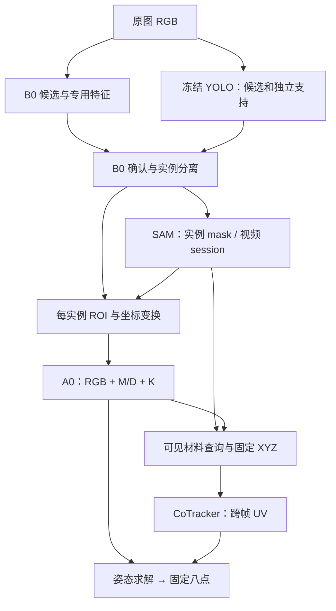
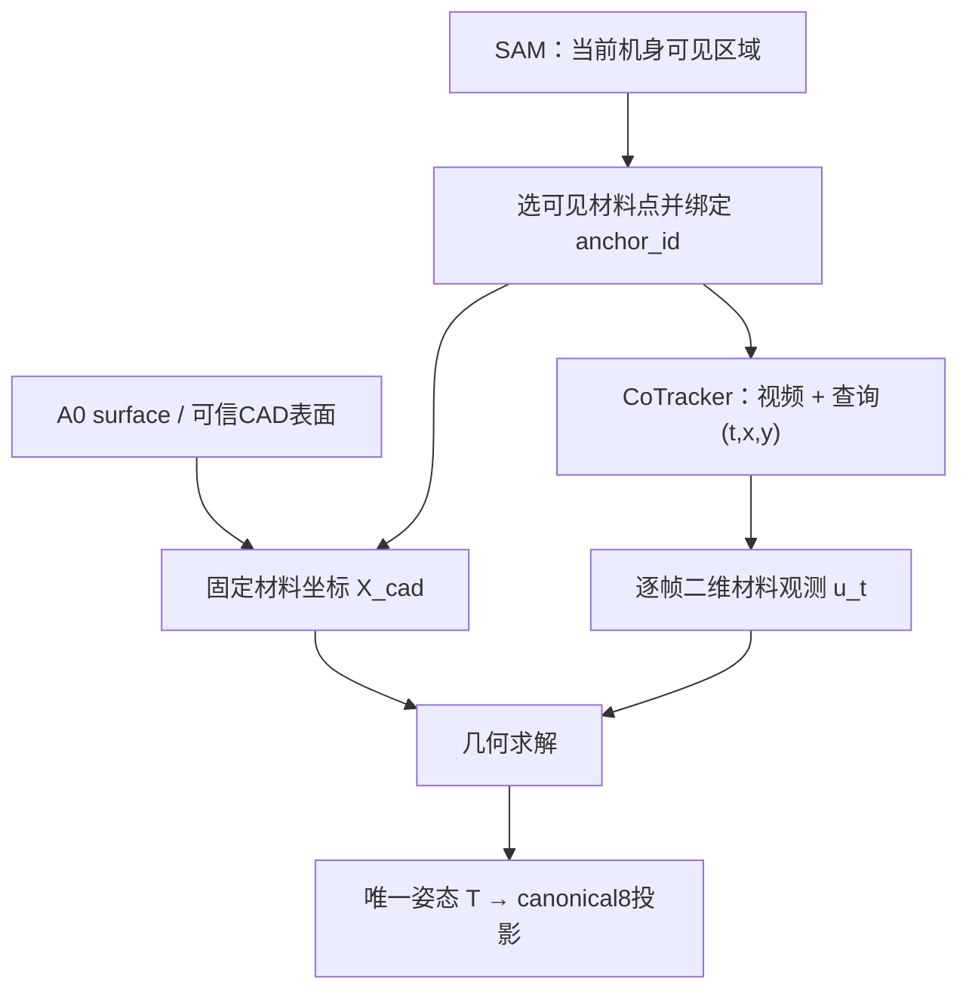

# 批准身份与实施状态

日期：2026-10-24，Asia/Singapore。用户已批准八阶段主稿及五处定点修订，授权阶段一实现、必要小规模检查、通过后1B→固定1B→1A。本计划保留原始1457行稿件的算法、公式、接口和示例，并在所属阶段合并本地执行合同；后期模块不阻塞阶段一。原稿SHA256：`1a419b9b6461eb65fee2fd36bb0cd2d4d5e909daddc2b5cc24393a441a39e5d6`。

当前代码通过/训练完成/效果改善分别以配套conclusion为准，不把文档条款当已完成事实。工作根仅/data/zy/vln/a-test；不改已发布数据、默认权重或其他任务文件。当前数据权威r088，6500已交付，尚未正式训练。本稿实际运行命令须通过不可变RUN_SPEC启动对应原有入口，不能从活动工作树直接导入。

## 本地执行合同（2026-10-24批准；优先于历史示例）

本文件是原始八阶段全文的适配稿，不是摘要。正式源数据保持6500版5200/650/650，不重生成、不重划分、不自动混入phrase1；默认A0 step14000、B0 step3220只读。代码通过、训练完成、效果改善分别记录。阶段一及必要检查获准实施，通过后1B，再固定1B推进1A；阶段六、七不作为阶段一前置条件。数据任务的r088和已有文件保持归属隔离。


# DJI Action4 精准识别、八角点定位与视频跟踪实施方案

本方案保留 **B0 提供并确认实例、A0 在该实例 ROI 内估计几何** 的主链。A0 实际读取扩展后的裁剪区域，八点输出不被 B0 预测框硬性限制；SAM 3.1 提供该实例的可见支持和视频传播，CoTracker3 提供真实材料点的跨帧对应，最终由同一刚体姿态投影固定 canonical8。先用 phrase2 训练并分别选出原结构 B0/A0 best，再逐阶段增加经过独立验收的功能。

YOLOE-26X、SAM 3.1、CoTracker3 的预训练权重全部冻结。phrase2 独立图片用于训练本项目 B0/A0；原始有序视频用于调用外部模型已有的时序能力、校准本项目适配器与选择推理配置。没有视频训练数据不妨碍视频推理，但图片上的成功不能代替原片跟踪验收。SAM mask 可以作为正式 train/eval/inference 输入；正式输入全部来自预测，GT 只进入训练监督和独立评分器。

以下是交给 Codex 的实施合同。标为“新增”的文件、配置、类型和 CLI 均需先实现再运行；官方 API 与项目目标接口分别注明。数值是实施起点或验收目标，不是已经测得的成绩。本文是实施合同，代码/训练/效果的实际完成状态见配套conclusion，不将合同当作已执行事实。

## 总体数据链路与阶段归属

| 模块 | 实际职责与下游作用 | 本项目是否训练 |
|---|---|---|
| B0 + YOLO | YOLO 提供额外候选和局部证据；B0 做 Action4 专用确认，保留独立实例及完整框质量。确认后的实例才获得正式 SAM/A0 调用资格 | 训练 B0；冻结 YOLO |
| SAM 3.1 | 对已确认实例分割；视频中维持 session/memory。输出当前实例 mask，经同一 ROI 仿射成为 A0 的 M/D 输入，同时约束材料点归属 | 冻结权重，更新推理状态 |
| A0 | 读取独立 RGB ROI、预测 M/D、对应 K 与固定 CAD；输出 surface、姿态、固定 ID 角点观测和质量 | 在独立图片上训练 |
| CoTracker3 | 读取真实视频固定裁剪窗与材料 query(t,x,y)，输出同一材料的逐帧 UV、visibility/confidence | 冻结；每个离线窗显式调用 |
| 几何求解 | 消费固定材料 XYZ 与轨迹 UV，修正姿态，再统一投影八点；证据不足回退单帧姿态或显式失锁 | 只优化当前姿态变量 |



**执行顺序与工作归属如下。** 每个阶段内部包含本阶段需要的新资产、接口、训练或校准、eval、选择和退出条件。公共合同只在首次使用时建立，后续阶段读取已封存产物；不要求尚未实现的下游模块提前参与验收。

| 阶段 | 本阶段完成的工作 | 封存并交给下一阶段 |
|---|---|---|
| 一 | phrase2 准入、固定评分；先原结构 B0，再固定 B0 训练原结构 A0 | 新数据 baseline 的独立 B0/A0 best、三 split receipt |
| 二 | YOLO 下载/提示/自身99%验收；原片帧索引与检测标注；B0 融合训练 | 冻结提示、融合 B0、DetectionPacket、原片区域协议 |
| 三 | SAM 下载及单图适配；实例 mask→显式 ROI→A0 的完整连接；训练 SAM 辅助 A0 | A0_sam best、mask/ROI 合同、coarse 路由准入 |
| 四 | 训练固定 ID 角点/质量头；实现并评估实际单帧姿态解码 | A0_corner best、可独立工作的完整图片链 |
| 五 | 原片 SAM 会话、首次传播、临时关联、有限纠偏与重放；冻结后逐帧 A0 | 选定 SAM 视频配置、稳定实例、不可变 mask/ROI/A0 快照 |
| 六 | CoTracker 下载、材料绑定、窗口与查询调度、轨迹标注和实测 | 选定点跟踪配置、固定 XYZ、唯一逐帧 ObservationBatch |
| 七 | 逐帧材料 PnP、15/5 姿态窗口、可见/隐藏八点统一定位及验证 | 选定几何配置、每实例每帧唯一 final pose |
| 八 | 锁定全部依赖，最终 test，整片连续推理与 standard 对照视频 | FINAL_SELECTION、各阶段 best、数值结果与视频 |

源码放 `src/data`、`src/model`、`src/eval` 对应职责，`scripts` 仅做薄入口。训练阶段每次正式 eval 都参加本阶段 checkpoint 选择；冻结模块阶段选择“权重身份 + 提示 + 接口 + 阈值 + 调度配置”，不生成不存在的新 SAM/CoTracker checkpoint。阶段一不以外部模型下载为前置条件。

### 当前并行执行覆盖（2026-10-25最新用户要求）

后续同时运行的子智能体最多1个，主控负责主线实现、资源切换和最终复审。GPU4–7、CPU24–95最多72个逻辑CPU及不干扰其他进程的授权不变；正式训练与已登记验证任务按其独立进程继续，不因子智能体数量调整而停止。该最新明确要求覆盖旧计划/执行快照中的2个子智能体上限。

## 阶段一：准入 phrase2，先训练原结构 B0 / A0 并分别选 best

### 1.1 先明确现有 B0 → A0 的工作区域

现有 `StagedPipeline.predict` 先运行 B0，取通过分数门的 `bbox_full_xyxy`，再调用 `prepare_rois(..., roi_size=448, expansion=2.25)`。每个框独立扩成正方形 ROI，RGB 采样为448×448；surface/pose 使用112网格及变换后的 K。没有合格检测时函数直接返回空，A0不会自行扫描原图补目标。当前 `base.backbone(rois) → a0(features,K,cad)` 也不会自动消费额外保存的 SAM mask；阶段三必须修改真实调用入口。[实际 pipeline](https://github.com/woaijieyang/0003_Action4_Detect/blob/main/src/eval/action4_staged_pipeline.py)；[ROI采样](https://github.com/woaijieyang/0003_Action4_Detect/blob/main/src/data/action4_dataset.py)

**建议沿用“已确认实例条件化的 A0”，允许几何输出修正 B0 框的误差。** B0回答“应定位哪一个目标、从哪里读取图像”；A0回答“这个目标的姿态和固定八点在哪里”。B0框是有误差的输入先验，不能强制把所有输出点夹回框中。以预测框 `(100,100,200,180)` 为例，中心为 `(150,140)`，2.25倍长边得到225像素方形 ROI，连续边界为 `(37.5,27.5,262.5,252.5)`；落在x=210的正确角点虽然超出预测框，A0仍可能从已采到的上下文中定位它。

| 方案 | 作用与限制 | 本方案决定 |
|---|---|---|
| 每实例扩展 ROI 中的 A0 | 保留目标像素分辨率、固定实例身份和现有 CAD/姿态训练；受候选召回及裁剪质量影响 | 采用；用阶段二候选补漏、阶段三 mask/ROI 和阶段五历史恢复改善输入 |
| 把整图缩到448后仍调用现有 A0 | 只改变图像输入；一个 ROI 一个姿态的头不会因此获得多实例检测能力，小目标像素也会减少 | 不作为漏检补救；不混入正式训练/部署 |
| 真正全图独立多实例 A0 | 需要新实例查询、匹配、检测监督及尺度设计，是另一套待验证架构 | 不作为本轮执行依赖；先完成现有链的可测改进 |

输出域还要与输入域分开：姿态头用一个R/t投影canonical8，投影可以在B0框外、ROI外或原图外。**ROI外输出属于几何推断，A0并没有读取裁剪范围外的图像。** 阶段四的有限角点热图只能直接表示其网格范围内的位置；域外点关闭热图定位loss，保留合法姿态监督及最终几何投影，不把外点裁到边缘。原图padding是黑色RGB再按既有均值/方差归一化，网络张量中的padding不一定是0。[姿态投影](https://github.com/woaijieyang/0003_Action4_Detect/blob/main/src/model/action4_gdr_pose.py)

本阶段保持已有 forward，先用新数据记录四类失败：无候选、候选错目标、ROI中有效机身不足、正确ROI下角点不准。所有来源都漏检时记 `no_prediction`；不得给A0补GT框后记作端到端成功。两台机身对应两套ROI；ROI相交合法，实例身份、输入mask、K和输出不能交换。阶段三给出新增接口的精确矩阵与路由规则。

### 1.2 6500 条数据如何使用

以你提供的 **phrase2 约 6500 条新合成数据**为主数据源；已只读核验正式发布和实际清单；6500是图片数，不是实例数。一张包含两台机身的图片，对 B0 是一个图像训练单元，对 A0 是两个实例 ROI 单元。不要把 6500 条记录直接同时填进两种训练器的 `expected_units`。[数据单元实现](https://github.com/woaijieyang/0003_Action4_Detect/blob/main/src/data/action4_stage2_data.py)

当前已发布 **6500 张源图片**，沿用已发布的 **train 5200、eval 650、test 650** 划分，不重新分组。实际分组不能被拆开，因此允许最终数量略有偏差，以冻结 manifest 为准。若 phrase2 已有可靠划分，先检查分组与覆盖，合格则直接沿用，不为凑比例重排。`eval` 是开发验证集，供每阶段选 checkpoint 和阈值；`test` 在整条方案锁定后做一次最终测评，不参与逐阶段调参。

分组键至少包含原始场景生成族、背景来源、人物/腕部装配、同一组相机与物体布局、渲染种子家族；同一原图的亮度、模糊、裁剪增强必须留在同一 split。共享固定 Action4 CAD 本身是任务定义，不必因此把全部数据分成一组；需要隔离的是会造成近重复画面的场景因素。按单机/双机、尺度、遮挡、视角、暗光、腕部与支架干扰分层，避免训练集难而 eval 过于简单。

**phrase1 不自动与 phrase2 合并。** 原 phrase1 中图像或几何质量存疑的样本不进入主训练和主评分。若以后发现 phrase2 缺少某种场景，可从 phrase1 中单独审核并去重，只把合格样本加入训练侧补充清单；新增清单后重新登记数据身份。phrase1 的结果仅作已有场景回归，不能用它替代 phrase2 的 eval。当前最佳 A0/B0 权重仍可作为初始化，初始化来源不决定新训练必须继续使用 phrase1。

### 1.3 数据准入检查及固定产物

所有源数据只读，项目根统一为 `/data/zy/vln/a-test`。将实际 phrase2 路径绑定到 `configs/data/action4_phrase2_consumer_v001.json`，派生索引放 `data/action4_phrase2_index/`，不搬动原始图片。每个 split 的 manifest 保存图片 SHA、尺寸、实例 ID、CAD 身份、标定、姿态、完整/可见框、可见 mask、surface sidecar 和固定八点的引用。

必须先完成以下检查，再启动长训练：

| 检查项 | 实施方式与拒绝条件 |
|---|---|
| 完整性 | 图像可解码；标注、mask、XYZ/region sidecar 一一对应；无重复实例 ID；缺失/损坏样本列出原因 |
| 几何一致性 | 用同一 CAD、K、R/t 重投影 canonical8，核对标注与完整框；米/毫米、OpenCV/渲染坐标按现有转换器处理 |
| 八点身份 | 0–7 点序全数据一致；不得按每张图片从左到右重新编号 |
| 可见/完整标签 | `visible_mask` 是可见机身；`amodal_mask/bbox_full` 包含被遮挡部分；腕带/支架不自动并入机身 |
| 相机 | 记录各图片 K；实际 crop/resize 同步变换 K 和点；核查真实视频拍摄相机的 K、畸变与裁剪 |
| 重复与泄漏 | 图像哈希、近重复图像和场景家族交叉检查；增强副本不跨 split |
| 视觉质量 | 对6500规模先抽约300张、覆盖全部难例层人工看叠图；发现系统问题则审核对应整组，保留困难但标签正确的样本 |
| 负例 | 统计腕带、手表、手机、支架等背景候选，以及零 Action4 的图片；没有某类负物体时，不声称模型已学会排除该类 |
| 数量 | 分别登记 `N_train_images/N_eval_images/N_test_images` 和 `N_train_instances/...`；被忽略实例单列 |

数据准入复用通用检查，新增明确绑定phrase2的三split协议与receipt构建器，保留既有2000张专用校验。ComponentData本身已经读取receipt里的manifest路径；需要扩展的是prepare_validation工厂，不能让它仍生成旧data/train、eval的回执。生成 outputs/action4_improvement/data/PHRASE2_VALIDATED.json 和真实full-training准入回执，绑定三套manifest、source SHA与surface sidecar，不复制旧回执手改数字。[数据消费](https://github.com/woaijieyang/0003_Action4_Detect/blob/main/src/data/action4_component_data.py)；[训练准入](https://github.com/woaijieyang/0003_Action4_Detect/blob/main/src/model/training/action4_stage2_core.py)

### 1.4 基线坐标、目录与运行资源

原图为 `uint8 HWC RGB`；YOLO NumPy 接口单独转换一次 BGR；SAM 使用官方图片加载器；CoTracker 使用 RGB float0–255；A0 沿用项目既有 RGB 标准化。一个像素空间只有一套 K，若去畸变则所有框、mask、轨迹与 GT 一起转换。对每个 ROI 保存：

```text
A_roi448_from_native
A_surface112_from_native
K_surface112 = A_surface112_from_native @ K_native
```

姿态方向统一为 `T_capture_cv_from_cad_m`，将CAD点变换到拍摄相机的OpenCV坐标（x右、y下、z前）；K属于拍摄原视频的相机，不能拿被检测的DJI机身自身相机参数替代。若真实K、畸变或电子防抖裁剪尚未核验，显式标记 `assumed_intrinsics`，不宣称公制姿态精度通过。crop 仅改变像素坐标和 K，不改变物体到拍摄相机的物理 R/t；网络 wrapper 已还原到原图的坐标不得再逆变换一次。所有 CAD 坐标与平移统一为米，三维点序冻结。坐标往返应小于 `1e-3 px`，这只验收适配器，不代表神经网络达到该精度。

工作目录采用 `outputs/action4_improvement/`、候选模型采用 `models/candidates/action4_improvement/`、预计算缓存采用 `outputs/action4_improvement/guidance_cache/`。最新资源授权仅物理GPU4–7可用于本项目训练、预处理和评估，物理GPU0–3全部禁止。CPU合计最多72个逻辑CPU，服务器96逻辑CPU/48物理核，分配池为24–95，优先最高编号；外部模型分进程使用隔离环境。文中 `cuda:0` 指设置 `CUDA_VISIBLE_DEVICES` 后的进程内逻辑设备0，逻辑cuda:0不代表可使用物理GPU0；实际UUID必须来自当前资源授权与可用性检查。评估先按实际余量选择GPU4–7并单进程实测，再增加有吞吐收益的并发；保留其他任务的显存和CPU余量，禁止停止、缩容或挤兑其他任务。CPU预算按全部实际子进程核算。现有 `models/default/A0.pt`、`models/default/B0.pt` 由实际登记和SHA核验后加载，新阶段不会覆盖它们。

本阶段沿用448/112；224角点网格与完整RoiPacket在阶段三定义、阶段四消费。初始化本阶段目录及项目内缓存，不在这里下载未来阶段模型：

```bash
set -euo pipefail
cd /data/zy/vln/a-test
test "$(pwd -P)" = /data/zy/vln/a-test
export ACTION4_ROOT="$PWD"
export HF_HOME="$ACTION4_ROOT/.cache/huggingface"
export TORCH_HOME="$ACTION4_ROOT/.cache/torch"
export XDG_CACHE_HOME="$ACTION4_ROOT/.cache"
export PIP_CACHE_DIR="$ACTION4_ROOT/.cache/pip"
export TMPDIR="$ACTION4_ROOT/runtime/tmp/action4_improvement"
mkdir -p "$HF_HOME" "$TORCH_HOME" "$PIP_CACHE_DIR" "$TMPDIR"
mkdir -p models/candidates/action4_improvement outputs/action4_improvement
```

### 1.5 固定评分、异步 eval 和本阶段 checkpoint 选择

**2026-10-25用户最新选优规则：训练候选与部署门分离（覆盖原文把两者合为一个best的表述）。** 全量All8@2%作为训练候选主指标，按原排序依次比较All8@2%降序、FN002+FP002升序、合法匹配P95升序、optimizer step升序。困难组仍完整单列，但不再否决训练候选。困难组不通过的候选可保留为后续专门优化远距离/高遮挡的训练起点，不称可部署模型。

部署开发门仍保持原发布精度与逐组召回不下降条件，实际阈值及独立reference身份见outputs/action4_training_candidate_selection_v001/DEPLOYMENT_GATES.json；这不是最终test/真实视频通过证明。后续阶段必须分别绑定training_parent与deployment_reference，不能因训练parent困难组较差而下调部署底线。阶段四quality_ready及其他模型准入继续限制部署，不妨碍另行保存研究训练候选。

当前冻结A0 run不热改：复用其每10step完整650图eval，以独立CPU观察器src/model/training/action4_training_candidate.py保留评估中的快照并更新TRAINING_BEST.json；原run/BEST.json仅保留原部署开发门语义，models/default不变。观察器用原selection.lock保留inode，不停止训练/eval。历史已清除权重只记录缺失，不能按分数虚构模型。训练结束后以候选完成回执和实际权重身份做专门训练候选封存，不能直接把旧部署BEST当最高All8训练候选；最终再审查引用，只保留必要best与有价值历史。当前活动候选sealed=false，不作为已完成阶段发布。


先用当前登记的 A0/B0 best 在新 phrase2 eval 保存成绩，再训练原结构模型。图像和 GT 清单、点序、困难分组、评分定义在第一次评估前冻结；后续复用同一合同。本阶段的选择对象如下。

| 本阶段训练 | 实际eval与选择 |
|---|---|
| 1B 原结构B0 | step0、每20 optimizer steps、末步，全量phrase2 eval；按完整框mAP50:95/F1选best |
| 1A 原结构A0 | step0、每25 optimizer steps、末步；固定1B best的预测ROI，按实际输出八点选best |

**识别框评分和角点评分分别定义，避免“宽框允许进入 A0，但评分又强迫它是完整框”。** 检测侧继续用检测器自己输出的 bbox_full 做既有 mAP50:95/F1，不能拿 A0 投影框替换后抬高 B0 的 AP。角点侧增加统一的 pose-associated 协议：每个正式 final pose 投影固定 canonical8，以八点的 min/max 得到预测几何框；不裁到图内、不额外扩框；与 GT canonical8 几何框按 IoU≥0.5建立一对一匹配，再计算固定 ID 0–7 的像素误差。所有阶段包括原结构 baseline 都用同一新增 scorer 重新计分，模型输入和预测过程不变。这个匹配只在 scorer 内执行，不反向选择 pose、ROI 或 SAM 输出。

新增字段明确命名为 pose_all8_at_002_success、pose_all8_at_002_rate、pose_all8_at_005_rate、pose_corner_p95_valid_matched_only、pose_gt_count、pose_output_count、pose_fp、pose_fn、invalid_pose_count；主指标 All8@2% 指 pose_all8_at_002_rate。分母始终是所有非ignore GT实例；八点最大误差≤GT完整几何框对角线的2%才成功。漏检、缺点、非有限/非正深度姿态和未匹配 GT 都失败。以推理预先标记published=true的正式姿态声明为输出集合，内部尝试/明确弃权不算发布。对τ=.02/.05，TPτ=匹配且All8误差通过数，FNτ=GT数−TPτ，FPτ=发布数−TPτ；匹配但角点不准算一个FP和一个FN，无效发布/重复/错误物体也是FP，不能事后删无效声明。pose_fp/pose_fn明确指2%门，另报pose_all8_at_002_precision=TP002/发布数及F1；这与只按投影框匹配的pose-instance precision分别记录。所有GT逐项保存结果和failure_reason，未匹配预测另表，no_prediction不从route分母消失。额外报告严格逐图全成功率，要求精度和困难组不退化；有效匹配才有 EPE，空集合返回 null，不能填0。排序使用最大匹配数、其次总IoU、最后稳定预测ID的确定性规则，不按哪个匹配的角点误差更小临时择优。

保留原 bbox-associated 结果及字段含义：corner_all8_success 仍是原完整检测框匹配下的5%成功个数。新增协议使用 score_schema=action4.pose_projection_all8_002.v1，不能静默改写旧字段。这样 coarse ROI 的好姿态可被正确测量，检测框定位问题也仍会在独立 AP 和 route 分组中暴露。[现有评分与匹配](https://github.com/woaijieyang/0003_Action4_Detect/blob/main/src/eval/action4_staged_eval.py)；[框评分](https://github.com/woaijieyang/0003_Action4_Detect/blob/main/src/eval/action4_bbox_metrics.py)

A0 排名固定为 All8@2%优先，其次端到端失败数FN002+FP002、有效匹配角点P95、较早step；GT失败目标数FN002另列，避免把FP+FN误称失败目标数。选择约束先冻结：正式发布的pose-instance precision不得低于本阶段已封存起点，All8@2% precision不得降低，困难组召回不降低；若无候选满足则保留起点，不只优化GT成功数。B0原结构仍按 mAP50:95、F1、较早step排序；新增候选确认和实例指标作为融合阶段的准入条件。action4_stage2_eval.rank_result、controller复核和最终封存读取同一score_schema，混合schema直接拒绝选优。

**本阶段只扩展phrase2准入和纯评分，原forward不变。** 训练配置明确 `b0_baseline / a0_baseline` 两种模式，异步worker按模式加载当前snapshot及固定counterpart；统一 `rank_result`、controller复核和封存的score_schema。给现有输出补显式prediction_id/source_detection_ids以支持确定匹配，不用GT改变检测或pose。旧 `pose_valid` 只是数值有效性；保留近零深度、超图、超ROI和无预测诊断，不把它当角点准确标志。

每次完整eval成功后更新本阶段best；先复用现有best-only保留机制。1B完成的稳定best作为1A固定counterpart，1A完成后用已有 `action4_stage2_finalize` 成对验证、分别封存；PROFILE的intrinsics_context/demo_reference必须读新配置，不能沿用旧固定来源。新增融合结构、完整best选择身份、SAM/corner异步输入由其所属阶段实现。[异步eval](https://github.com/woaijieyang/0003_Action4_Detect/blob/main/src/eval/action4_stage2_eval.py)；[正式封存](https://github.com/woaijieyang/0003_Action4_Detect/blob/main/src/eval/action4_stage2_finalize.py)

### 阶段一最新执行覆盖：并行A0与每10step完整eval（2026-10-24）

执行状态补充：60update及0/10/20/30/40/50/60完整650eval已全部完成，代码/吞吐准入通过，未获得已准入的短训效果增益。GPU7额外2个完整eval耗时256.46/267.11s且All8计数与原step0一致；保守292.49s/worker和实测90.68s请求中位间隔得到4worker服务/产生率1.2401。80轮p2_a0_parallel80_eval10_v001已由同一测试源码启动：GPU7train，evalGPU4/6/7/7，CPU总69。新增GPU7eval的测量发生在60update训练结束之后，正式联合负载仍持续检查，背压不丢评估。不更改当前B0任务。


用户新授权允许A0和B0同时训练，新增A0评估频率改为每10个实际optimizer step，保留step0与末步；本条覆盖旧1A须等1B完成和每25step的执行顺序/频率。当前已启动B0仍按冻结20step协议完成，不更改运行源码。A0训练从原best step14000新optimizer初始化，eval固定已复制且strict加载核验的中期B0 best step9500（outputs/action4_a0_parallel_admission_v001/FIXED_B0_COUNTERPART.json），不能跟随live best变动；该B0不是80轮最终选择。最终B0若不同，另保存最终固定配对复核身份，不把不同counterpart的分数直接混排。

并行60update吞吐准入p2_a0_parallel_integration_v004：GPU7单rank、batch48/micro2；GPU4与6各1完整eval worker，每10step共7次650图eval。训练allocator上限12GiB、每eval2.5GiB，每卡预留至少8GiB未承诺显存；CPU训练48–53、eval44–47与40–43、控制26–27，连同B0和root控制总预算61逻辑CPU。已有DDP/恢复工程检查不重复；此次验证新增拓扑、ordered RGB预取与更高频完整eval吞吐。

只有同身份integration真实完成、无数值错误且eval服务能力满足预登记1.2倍裕量后，使用现有stage1_prepare/run_snapshot/dispatch以确切测试源码进入80轮全量，不能把60update称80轮完成。A0理论预算为80×ceil(实际有效实例/48)个更新，eval次数为step0+每10step+末步（未对齐另计）；既有3394次总eval旧预算已不适用于新A0频率，启动各阶段时重算。其他增强阶段频率暂不自行更改。

### 1.6 先训练现有 B0，再训练现有 A0，并完成基线验收

本节在阶段二前执行。新增 phrase2准入入口 scripts/action4_prepare_phrase2.py --config configs/data/action4_phrase2_consumer_v001.json，复用现有校验生成 outputs/action4_improvement/data/PHRASE2_VALIDATED.json 及 full-training admission。ComponentData已经消费receipt中的manifest路径；只需替换旧prepare_validation工厂的固定来源，保留通用loader。新receipt必须来自实际检查，不能复制旧回执改计数或把准入布尔值手动置true。

原结构训练配置新增 configs/model/action4_phrase2_baseline_b0.json 与 action4_phrase2_baseline_a0.json，继承现有配置键合同，删除integration子集/停止步数/恢复占位。父权重从实际登记的已选best读取，核对role、selected_step、架构和SHA；不凭示例步数填写。两个新实验均初始化新AdamW和cosine，不沿用旧optimizer当精确resume。

| 参数 | 1B：原结构B0 | 1A：原结构A0 |
|---|---|---|
| parent | 当前已登记B0 best | 当前已登记A0 best |
| 结构/输入 | 保持原B0与原候选/评分路径 | 原RGB448、surface112、K/CAD、原surface/pose头；无SAM |
| 更新范围 | 原backbone、detector、refiner | surface/pose；train_backbone=false |
| full_training / epochs | 80 | 80 |
| global batch / micro / ranks | 32图 / 每rank8 / 2 | 48有效实例 / 每rank2 / 6 |
| 物理GPU | 从4–7实际可用卡选择 | 从4–7实际可用卡选择 |
| LR | backbone 1e-5；detector 5e-5；refiner 1e-4 | surface 1e-5；pose 5e-5 |
| 优化器 | AdamW，wd1e-4，clip norm1，cosine eta_min1e-7 | 同左 |
| eval | step0、每20 optimizer steps、末步 | step0、每25 steps、末步 |
| eval counterpart | B0独立框评分；角点仅诊断 | 固定1B已完成best，不能仍用旧B0 |
| run输出 | outputs/action4_improvement/stage1_baseline/B0/ | outputs/action4_improvement/stage1_baseline/A0/ |

原训练损失和增强先沿用已核验配方，只改变数据绑定与训练预算。A0训练可用GT完整框jitter和GT surface监督，正式eval仍是B0预测ROI。expected_units分别取train图片数和非ignore实例数，expected_eval_images取实际eval图片数。full_training校验必须满足真实admission；现有代码中的 formal_stage2_allowed 是准入键名，本节复用它的实际校验语义。surface_source必须与三split manifest SHA匹配。[训练核心](https://github.com/woaijieyang/0003_Action4_Detect/blob/main/src/model/training/action4_stage2_core.py)；[数据消费](https://github.com/woaijieyang/0003_Action4_Detect/blob/main/src/data/action4_component_data.py)

batch是全局有效单元数，micro是每rank微批上限；满批B0每rank16图分2次，A0每rank8实例分4次。尾批按实际单元和DDP全局分母处理，dummy不计样本。总更新数=80×ceil(N_role/batch)；5200训练图片时B0为13040次，A0由实际实例数计算。训练/eval并发预算按 world_size×(threads+loader_workers)+(2+eval_loader_workers)×eval_workers+1核算并检查实际子进程；首轮threads2/loader_workers4、eval_workers≤8，总计≤72CPU，eval仅从已授权且有余量的GPU4–7选择，禁止物理GPU0–3；CPU从24–95尾部池按最高编号优先分配，按总预算限制并发。

配置必须写入并由代码核验：validation_receipt、integration_or_admission_receipt、expected_units、expected_eval_images、source_identity、parent_bundle、parent_best_step、parent_bundle_sha256、score_schema、dataset_receipt_sha256、canonical_asset_sha256；A0另写 evaluation_counterpart_bundle、evaluation_counterpart_sha256。新增身份键需要真实消费检查，不能只存在JSON里。

以下复用已有入口；新配置和评分扩展实现后按顺序执行。先登记 configs/eval/action4_phrase2_seed.json，内容为真实 a0_bundle / b0_bundle / b0_scoring_policy 及身份。

~~~bash
cd /data/zy/vln/a-test
test "$(pwd -P)" = /data/zy/vln/a-test
export PYTHONPATH="$PWD/runtime/surface_deps:$PWD/src"
CUDA_VISIBLE_DEVICES="${ACTION4_EVAL_GPU_UUID:?set an authorized physical GPU4-7 UUID after resource check}" .venv/bin/python -m eval.action4_staged_eval \
  --selection configs/eval/action4_phrase2_seed.json \
  --validation-receipt outputs/action4_improvement/data/PHRASE2_VALIDATED.json \
  --split eval --output outputs/action4_improvement/stage1_data/seed_eval

.venv/bin/python -m model.training.action4_stage2_dispatch \
  --config configs/model/action4_phrase2_baseline_b0.json
~~~

1B的TRAIN_COMPLETE、EVAL_COMPLETE、CONTROLLER_COMPLETE、BEST必须同一配置/数据身份且覆盖全部计划step，严格重载通过后将该run设为完成、不得覆盖。把 outputs/action4_improvement/stage1_baseline/B0/best.pt 的真实路径与SHA写入1A的evaluation_counterpart，再运行：

~~~bash
.venv/bin/python -m model.training.action4_stage2_dispatch \
  --config configs/model/action4_phrase2_baseline_a0.json
.venv/bin/python -m eval.action4_stage2_finalize \
  --a0-config configs/model/action4_phrase2_baseline_a0.json \
  --b0-config configs/model/action4_phrase2_baseline_b0.json \
  --output models/candidates/action4_improvement/stage1_baseline
~~~

产物为 stage1_baseline/B0/best.pt 与 stage1_baseline/A0/best.pt，分别比较旧best在phrase2上的成绩，保存逐困难组变化。后续融合B0从这个新B0初始化，SAM-A0从这个新A0初始化；两个模型不共享训练参数。**本阶段退出：新数据准入、两轮完整训练、各自eval/选best/重载全部完成，先得到可用的新数据baseline，再引入外部增强。** 若没有改善，先查标签、ROI、K和域差异，不能以未训练新模块掩盖起点问题。


### 阶段一补充：实际数据、像素空间与不可变源码

正式消费configs/data/action4_phrase2_consumer_v001.json和data/phrase2/DATASET_COMPLETE.json、GEOMETRY_ADMISSION.json。实际计数包括可解码/可训练图片、实例、ignore、unobservable及各角色有效单元。当前清单5200/650/650图、10400/1300/1300实例、ignore=0，不把清单数量替代有效性检查。13040/17360更新仅在80轮全部有效、无零监督跳过时成立。

独立边界清单data/action4_boundary_checks_v001/manifest.jsonl不进入正式三split或训练。覆盖单机、无目标、完全出画、仅腕托、严重遮挡、跨边界和重复/混合support；记录source、source_group、标签来源、用途和training_allowed=false。无来源标MISSING_SOURCE；严重遮挡不能删标签冒充空图。新增训练样本须另批准、另清单、重算采样步数。

CameraContract包含pixel_space_id、image_is_rectified、distortion_model、distortion_coefficients、calibration_source、calibration_status、native_to_working_transform、working_to_native_projection_policy、K、image_size。当前原片native=working，K=(2639,2639,1623.5,1231.5)，distortion_model=unknown_assumed_pinhole、coefficients=null、calibration_status=unverified_intrinsics；不是证明零畸变。未来去畸变必须RGB/框/mask/轨迹/GT/K统一转换，非线性映射不能用单一仿射冒充，最终用同模型回原图。

像素中心为整数，整图连续边界[-.5,W-.5]×[-.5,H-.5]；ROI l/t为连续像素边界。实际采样测试包含单位图像、坐标编码RGB、负边界padding、112/224/448映射与原图点，不能只检查矩阵乘逆。FP32坐标误差≤1e-3px；图像单位采样归一前≤1/255。

run绑定不可变代码快照及resolved configs，不仅Git HEAD。code_root与project_data_root分离；数据根仍严格/data/zy/vln/a-test。训练、eval、封存、loader worker来自同一快照，不从可变工作树动态导入。快照包含实际受审查未提交代码、必要依赖；RUN_SPEC记录code/config/data/parent/counterpart/environment/score身份，以及物理GPU、UUID、逻辑设备映射。延迟worker不得导入其他任务随后修改的文件。默认权重不在运行期间动态解析。

仅物理GPU4–7允许，GPU0–3全部禁止；CPU并发合计≤72逻辑CPU，限定24–95且从高编号向前分配。不停止或挤兑其他任务。Python使用现有3.12；Blender=runtime/blender-3.6.23-linux-x64/blender，FFmpeg/ffprobe=runtime/ffmpeg/bin。原片2850张PNG及PTS复用data/action4_real/cache_v001/frames_manifest.json，不重复抽帧。

资源修订执行入口：当前实际GPU/PID以configs/execution/action4_active.json所指权威及resource_dispatch为准。r096明确GPU0–3禁用及CPU尾部72范围；原冻结run config里的旧物理卡号仅作历史身份，不是当前授权。新启动由action4_resource_policy读取实时授权，拒绝GPU0–3；进程内cuda:0可映射到其他已授权物理UUID。当前1B迁移不重启训练，GPU5/6各1eval、GPU7共2eval。B0完成后先运行scripts/action4_seal_completed_role.py，以本run不可变loader逐角色封存B0；读取SEALED_ROLE.json中的bundle、sha256、selected_step供1A固定消费。训练未完成时--check-only返回WAITING_FOR_COMPLETION，禁止提前封存。代码入口与阶段完成/精度验收分开。


### 阶段一实施期数值与资源补充

真实A0微批验证发现冻结backbone整批/单实例特征完全相同，但FP32 surface/pose头批量形状改变会产生约8.39e-5px输出差异；FP64固定特征差异8.88e-14px。采用instancewise_head_v1固定逐实例几何头算术，训练和推理共用，不改网络权重结构。实际两次更新微批梯度相对差4.69e-8、4.30e-6，重载逐位一致。正式source/config记录该策略。

A0多worker张量预取在进程RLIMIT_NOFILE软限1024时暴露ancdata错误；只将本任务训练进程软限提升到16384（不超过系统硬限），loader继承，不修改服务器全局配置。保留失败run及新快照。eval采用有界有序RGB预取4线程/8ahead，顺序/像素/模型不变；CPU预算计入解码线程，完整650图四个checkpoint预测与原串行读取完全一致。正式计算卡按实测占用分配，不抢GPU1–3。

### 阶段一固定评分（自包含）

score_schema=action4.pose_projection_all8_002.v1。推理预先published=true的所有姿态为发布集合；固定ID0–7投影min/max形成未裁图几何框，与GT canonical8框按IoU≥.5一对一匹配，优先最大匹配数、最大总IoU、稳定prediction_id；禁止按角点误差选匹配。非有限、非正深度、缺点不能成功，但正式发布仍计FP。All8阈值τ=.02/.05：八点最大native误差≤τ×GT完整几何框对角线。TPτ为匹配且八点全通过；FNτ=Ngt−TPτ，FPτ=Npublished−TPτ。匹配但点不准一FP一FN；空集合null不填0。

字段：pose_gt_count、pose_output_count、pose_all8_at_002_success/rate、pose_all8_at_005_rate、pose_all8_at_002_precision/f1、pose_fp/fn、invalid_pose_count、pose_instance_precision、pose_corner_p95_valid_matched_only、strict_image_success_rate、per_gt_failure_reason。旧corner_all8_success仍是原5% bbox-associated语义。A0训练候选排序：All8@2%更高、FN+FP更少、合法匹配P95更低、step更早；按2026-10-25用户最新规则，困难组单独报告，不否决训练候选。部署开发门另受独立冻结reference的pose-instance precision、2% precision和困难组召回不下降约束。worker/controller/finalize同schema，不把null误差当优势。


### 阶段一新增：冻结基线视频里程碑（2026-10-24用户授权）

1B与1A完成训练、全部计划eval、选优与成对封存后，先生成一次完整2850帧的原结构B0→ROI→A0基线，作为后续增强的固定对照。不等待阶段八，也不为此提前使用phrase2 test调参。输入必须是同一不可变selection解析的两个已封存权重与配置，不能读运行中的best或默认路径猜版本。

复用现有`eval.action4_staged_video_parallel`的独立帧执行与编码；GPU仅4–7、CPU总预算72且尾部优先，由当前资源策略实际检查。输出统一`outputs/videos/YYYYMMDD-HHMMSS-stage1-baseline/`，保存selection、权重/源码/帧清单/PTS身份、逐帧预测和视频。只有显示布局变化时重编码；同身份完整预测直接复用。此基线是展示与回归，不自动成为有GT的真实角点验收。

之后每个模块完成所属阶段准入、固定配置且稳定接入，可按阶段八新增视频里程碑输出同帧对照。训练进行中仍只做数值eval和固定图片，不每个checkpoint生成全片。

### 阶段一执行补充：A0数据供给提速与连续训练边界（2026-10-25）

实际计时必须区分loader等待、模型/损失/更新、checkpoint写入和eval队列等待；旧STATUS.seconds从loader交付之后计时，不作为端到端速度。当前正式A0保持80epoch、global48/micro2/world1、每10optimizer step完整650eval及原数据/监督/评分。资源仅GPU4–7、CPU24–95内最多72个逻辑核心，按实际占用分配，不挤占其他任务。

本次已定位4个loader各占满一个核而trainer经常等待，优先比较4/12实际数据准备；多GPU训练不是首要修复。资格验证包括正常batch、尾batch、跨epoch的完整tensor/metadata及micro分组一致，主进程RNG不受worker数影响；实际更新对照必须检查模型、optimizer moments、scheduler和RNG，不只检查loss。startup与连续供数分别报告，短暂预取突发不当长期吞吐。

工作树的同item visible-mask一次解码复用已完成独立候选；必须保留原始pixel舍入、origin、crop和dtype并通过真实输入精确等价，不能直接改当前冻结source。其局部耗时改善单列，不替代端到端测试。PNG→NPY大缓存尚未采用，不擅自增加约116GiB缓存或改正式6500数据。

当前trainer无DataLoader热扩容、无formal cooperative stop；直接终止trainer会触发controller清理eval。因此原运行继续，资源变更需要显式checkpoint续训迁移：独立不可变身份、完整optimizer/scheduler/RNG/cursor、旧eval前缀与新后缀的真实来源、候选选择和封存依赖及可执行回退。禁止仅改config_id冒充原run恢复，不将新配置输出混入旧队列。用户已明确批准验证通过后的受控checkpoint切换；实际已在step9450完成迁移，新任务p2_a0_loader12_eval8_v001采用12loader与8个eval进程，保持80轮累计状态和每10step完整650eval。旧任务已受控退役，禁止恢复；失败回退与实际新分支full650验证均有独立回执。默认权重与发布数据未改。

证据入口：`outputs/action4_a0_completion_owner_v001/performance_20261025/`、`outputs/action4_a0_loader_acceleration_v001/`、`outputs/action4_a0_loader_parallel_probe_v001/`、`outputs/action4_a0_loader_training_probe_v001/`。训练仍继续，代码候选通过、实际训练完成、模型精度改善分别记录。

### 相机假设独立核查补充（2026-10-29）

输入为既有原视频361次已按SAM实例归属的矩形AprilTag观测；不重跑检测、不把标记绑定当真实CAD标签。假设屏幕矩形共面、边互相正交，先固定主点/方形像素估计f，再做等权30帧块稳健主点＋f诊断和按时间块四折检验；所有无实数焦距、负解及高残差保留。原2639假设与候选均在全部361观测上报告矩形轴正交残差，不只报告成功子集。

实现 `src/eval/action4_marker_camera_diagnostic.py`；通过已知K、不同矩形长宽的合成投影恢复测试后，产物仅为 `outputs/action4_marker_intrinsics_feasibility_v001` 中的未认证相机假设，畸变仍未知。候选只能通过独立 `action4_intrinsics_pose_probe` 进入冻结A0几何头敏感性实验，更新native K、ROI K、射线、相对深度解码和回原图投影；禁止只把t乘常数。原始K基线严格重放不一致则停止。视觉/几何改善不明确时不替换默认K；矩形残差下降不能当作八角点真实误差下降。

## 阶段二：验证可选 YOLO 增强，准备 B0 融合与实例分离
### 阶段二最新采用规则：继续尝试YOLO，但不阻塞必做链路（2026-10-24用户明确）

YOLO保留为可选增强，继续完成有限官方原生对照，并非放弃或取消研究。采用时仍需满足本稿99%联合门及来源/困难组要求；未达门记录`YOLO_NOT_READY_B0_ONLY_CONTINUE`，不能称YOLO验收通过。该状态允许阶段三至七以已冻结、已验证B0实例提示继续；不再等待可选YOLO才能实现SAM3.1、CoTracker3、八角点与几何链路。这些模块仍是必做项，实际接入和效果验证不能省略。

有限对照顺序：①已准备的cropcontext_v003（相同25%机身/框/mask，只恢复参考crop背景），650合成dev+56真实困难帧；②独立enrollment的正面/背面或原图上下文视觉参考，保持原生单类别与参考/查询隔离；③常见短名词概念的独立text profiles，不把“必须两个”或长关系指令当检测约束。每轮完整记录召回、双机分离、污染/误选与阈值结果；未测真实标签维持unknown。若收益不足，保留负结果，主链先关闭YOLO，后续仍可独立改进；不能通过降低99门或拿B0/SAM修正回填YOLO-only分数。

B0-only选择必须在统一selection与输入包写`yolo_enabled=false`、原因、未启用来源；score0/available0仅表示无外部证据，不是负类。六项真实B0/SAM来源与旧九项B0/YOLO/SAM来源分开，不伪造YOLO SHA。当前旧B0step0导出仅获准dev用途；正式SAM train/eval缓存需来自正式冻结B0并重新验证，不将旧cache改名混入。

未采用YOLO时，阶段二YOLO-only完整框分支及其融合训练不强行启用；阶段一B0直接提供SAM提示。若后来YOLO通过且拟接入，必须生成新组合身份并重做受影响的SAM缓存、A0输入/完整eval与视频对照，不能静默加入正在运行的组合。其余必做阶段的质量门仍保留，不能以失败后永久RGB回退冒充SAM/CoTracker已成功落地。


### 2.1 本阶段输入、YOLO 下载及预测 worker

输入是阶段一已封存的B0/A0、phrase2 receipt与冻结split；本阶段只新增YOLO和B0融合，不要求SAM/CoTracker已经实现。YOLO自身的提示验收必须先于B0融合训练。只选用YOLOE-26X，预训练权重冻结，视觉参考来自独立Blender机身渲染。

| 资产 | 官方地址与固定身份 | 下载/安装位置，相对项目根 |
|---|---|---|
| Ultralytics | [官方源码](https://github.com/ultralytics/ultralytics)，提交 `e6d5fc5918f57d4d39fadb43fc5b2a1aea132ac8` | `upstream/ultralytics/` |
| YOLOE-26X | [yoloe-26x-seg.pt](https://github.com/ultralytics/assets/releases/download/v8.4.0/yoloe-26x-seg.pt) | `models/external/yoloe/yoloe-26x-seg.pt` |
| 文字编码器 | [mobileclip2_b.ts](https://github.com/ultralytics/assets/releases/download/v8.4.0/mobileclip2_b.ts) | `models/external/yoloe/mobileclip2_b.ts` |
| tokenizer依赖 | [ultralytics/CLIP](https://github.com/ultralytics/CLIP)，提交 `7ffa84b3bfa40c42ecc1c77147a855e69cb2dd40` | `upstream/ultralytics_clip/` |

以下新目录不存在才clone；已有目录先核验origin、提交和未提交工作，匹配则复用，不覆盖不匹配资产。依赖安装到本项目隔离环境，安装成功后保存环境锁。[YOLOE官方接口](https://docs.ultralytics.com/models/yoloe/)；[PyTorch配对](https://pytorch.org/get-started/previous-versions/)

```bash
set -euo pipefail
cd /data/zy/vln/a-test
test "$(pwd -P)" = /data/zy/vln/a-test
mkdir -p upstream models/external/yoloe models/external/yoloe/prompt_profiles
git clone https://github.com/ultralytics/ultralytics.git upstream/ultralytics
git -C upstream/ultralytics checkout --detach e6d5fc5918f57d4d39fadb43fc5b2a1aea132ac8
git clone https://github.com/ultralytics/CLIP.git upstream/ultralytics_clip
git -C upstream/ultralytics_clip checkout --detach 7ffa84b3bfa40c42ecc1c77147a855e69cb2dd40
python3.12 -m venv .venv/yoloe
.venv/yoloe/bin/python -m pip install torch==2.7.1 torchvision==0.22.1 \
  --index-url https://download.pytorch.org/whl/cu126
.venv/yoloe/bin/python -m pip install -e upstream/ultralytics_clip
.venv/yoloe/bin/python -m pip install -e upstream/ultralytics
curl -fL --retry 3 \
  https://github.com/ultralytics/assets/releases/download/v8.4.0/yoloe-26x-seg.pt \
  -o models/external/yoloe/yoloe-26x-seg.pt.part
curl -fL --retry 3 \
  https://github.com/ultralytics/assets/releases/download/v8.4.0/mobileclip2_b.ts \
  -o models/external/yoloe/mobileclip2_b.ts.part
```

校验完成再将`.part`改正式文件名；release SHA256分别为 `d08d390a08f98195f7c87807839fe4ff93a5491645fef1bc3bf0700efafdd639` 和 `35d7f213e4d75f38514e4656ad3cb91158bd33e3805d8ac349f23b186f66982f`。配置 `YOLO_AUTOINSTALL=False`、`YOLO_CONFIG_DIR=/data/zy/vln/a-test/.cache/ultralytics`；文字编码器显式本地加载，不在长训练中隐式下载。将 `repo_commit/checkpoint_path/checkpoint_sha256/environment_lock/adapter_identity` 写入 `configs/model/action4_external_assets.json` 的YOLO条目。后续阶段只追加各自资产，不改已冻结身份。

**在这里首次实现公共外部worker，但本阶段只启用YOLO backend。** 新增 `src/eval/action4_external_worker.py`，主控用 `.venv/yoloe/bin/python` 绝对路径启动持久子进程；在选择backend后才import对应模型，权重加载一次。stdin/stdout使用JSONL传控制，日志去stderr；数组写NPY/NPZ/PNG，`allow_pickle=false`。公共请求包含 `request_id,backend,op,asset/config/dependency_sha,pixel_space_id,input_paths,output_dir`；响应包含同一request_id、状态、结果路径和摘要。推理请求不接受GT/annotations字段。

YOLO新增 `predict_image` 操作，读取原RGB与固定prompt lock，内部仅一次RGB→BGR，返回native框、实例mask、score/class/reference_id、去重成员、raw/confirmed状态。先写临时数组和元数据，完整校验后原子提交READY；缺文件或异常返回error，不能返回“成功空mask”。cache绑定图像变体、权重、提示和后处理SHA。主控核验shape/dtype、原图像素空间和来源身份。阶段三扩展SAM操作，阶段六扩展CoTracker操作；不在本阶段实现未来backend的算法。

### 2.2 为 YOLO 验收准备原片索引、区域与框/mask 标注

现有原片直接用于时序推理，不从phrase2随机图片造视频。原片已被多次观察，因此即使现在切出锁定段，也只能称为**前瞻锁定的同片回归**，不能称独立真实测试。本阶段新增 `src/data/action4_sequence_dataset.py`，优先读取已完成的data/action4_real/cache_v001/frames_manifest.json和2850张PNG，校验后建立派生索引；不得重新抽帧。仅缺失或身份损坏时才提交修复。区域输入复用硬链接，目标索引位置为 `data/action4_real/sequences/regression_head_left/frames/000000.png` 等路径，并生成同目录 `frames_manifest.jsonl`，逐帧记录 source_sha256、frame_id、int64 PTS、time_base、float64秒、尺寸、pixel_space_id、K身份和PNG SHA。已有timestamp seek提取的frame_near图片只用于观察现象，不当精确逐帧GT。缺帧、重复或不单调PTS显式报错/分段；不得用frame_id/30替代真实时间。

在新增轨迹标注和参数实验开始前，将当前2850帧原片登记为以下半开区间；若输入SHA/帧数不一致先核验，不机械套用。

| 区域 | frame_id范围 | 用途 |
|---|---|---|
| 开发A | [0,1600) | 选查询、窗口、门控和纠偏参数 |
| guard A | [1600,1720) | 不计分，禁止跨区carry和传播状态 |
| 锁定回归 | [1720,2320) | 配置冻结后一次评价，不用于调参 |
| guard B | [2320,2440) | 同上 |
| 开发B | [2440,2850) | 后段困难与近景回归 |

各区独立冷启动SAM/anchors，CoTracker窗不跨区，不能先跑全片memory再声称隔离。最终冻结并完成图片test后才跑全片连续链路。若根据锁定成绩修改了参数，原结果保留，该段之后就是开发回归，不继续声称未见验证。

不把新增120帧完整mask标注设为前置条件。复用已有真实审核与demo同帧参考；有合法真实框/mask标签才计算对应量化指标，否则not_measured。原片新增人工工作限制为阶段六登记的稀疏材料点和必要关键帧可见框；无法判断的分割失败再补少量轮廓审核。GT不进入推理。

同时冻结 `data/action4_real/sequence_regions.json`，记录各区global frame范围、frame/PTS清单、帧manifest SHA与用途。阶段五复用这些PNG/区域/实例标注开展SAM视频评估；阶段六只新增材料轨迹标注。原片只有一条，区域隔离只能防止本次状态/调参泄漏，不能证明跨场景泛化。

在本阶段先验证全部帧数、PTS单调性、尺寸和输入SHA，开发/锁定区域不得有重合。关键帧标签检查双机独立ID、mask仅含机身、图内可见框与完整几何框含义；纯负图、其他相机型号和小目标覆盖不足显式报告，不让缺失组默认为通过。

### 2.3 Blender 参考、文字/视觉提示及 YOLO-only 验收

固定下载清单中的 `yoloe-26x-seg.pt`，冻结全部权重。文字提示采用 `action camera, camera`，干扰提示采用 `smartwatch, wristwatch, wristband, bracelet, mobile phone`。视觉参考图直接由本项目已核验的 **Action4 Blender 机身资产单独渲染**，不从 phrase2 的多人、多物体或佩戴场景中截取。phrase2 继续用于训练自有 B0/A0，参考库单独登记为 `source=blender_canonical_asset`；制作参考图和提取提示特征均不训练 YOLO。参考图表达具体机身外观，文字提示提供类别补充；先独立验收YOLO的实际识别能力，再由B0在正式融合链做Action4专用确认；两份成绩分开。[官方文字/视觉提示接口](https://docs.ultralytics.com/models/yoloe/)

#### 2.3.1 复用机身加载器，在独立场景生成干净参考图

复用 `src/data/action4_blender_foundation.py::load_r4_core` 的资产读取、packed image 核验及 canonical8/mesh 一致性检查。该函数只显式加载 `Action4_core` 和附着的 `Action4_core_top_id_decal`，适合作为独立参考场景的机身入口；不启动包含人体、腕带、连接座和第二台相机的整套合成场景。具体 `.blend` 路径从项目当前已核验的 foundation 配置读取并记录 SHA；仓库可见配置 `configs/data/action4_global_rig_init_v001.json` 绑定 `data/DJI_Action4_construct/server_r4_realism_v002/DJI_Action4_Editable_Foundation_R4_realism_v002.blend`，执行时先核验实际绑定，不能仅凭文件名认定资产正确。几何仍绑定 `data/DJI_Action4_construct/r3_v001/mesh_v001.npz` 与 `asset_manifest.json`。新增实现放 `src/data/action4_prompt_bank.py`，薄入口放 `scripts/action4_build_prompt_bank.py`，配方放 `configs/data/action4_prompt_bank.json`；这些是待实现的位置，不冒充现成渲染命令。[机身加载器](https://github.com/woaijieyang/0003_Action4_Detect/blob/main/src/data/action4_blender_foundation.py)；[资产绑定](https://github.com/woaijieyang/0003_Action4_Detect/blob/main/configs/data/action4_global_rig_init_v001.json)

**干净参考图还要检查材质内容。** 仓库的 `extract_reference_textures` 会从原片第0帧提取 `rear_screen_reference`、`rear_screen_left_reference` 和 `top_id_reference`；因此，把其他三维物体移出场景后，屏幕显示内容或实例贴纸仍可能成为过强的外观线索。参考渲染的派生场景默认将屏幕显示换为无具体场景的暗屏，保留屏幕边界、镜头、按钮、真实固有商标和机身材质；将 `top_id_reference` 对应的附着贴纸从本参考场景隐藏，不将其误称为天然型号标识。若之后确需保留实物固定贴纸，应另登记提示配方并单独评估。材质与可见性调整只作用于临时加载的副本，冻结 `.blend`、CAD 尺寸和八点顺序保持原资产身份。不要只截取机身矩形后认为框内必然无干扰：框中仍可能含腕带、手腕和背景，而基于整图特征提取的提示也不能被视作严格隔绝框外上下文。[原片纹理来源](https://github.com/woaijieyang/0003_Action4_Detect/blob/main/src/data/action4_render.py)；[YOLOE视觉提示机制](https://arxiv.org/abs/2503.07465)

首轮参考库使用下列**设计起点**，不把它们写成已经证实的最优参数。坐标以已核验 CAD 轴和“正面”定义为准，配方记录实际相机外参，不能仅用文件名猜朝向。通过改变相机位置获得各视角，不对机身逐视角缩放或镜像。

| 项目 | 初始设置与目的 |
|---|---|
| 视角 | 方位角每45°一张，共8向；俯仰角−30°、0°、+30°，共24个视角，覆盖正背面、侧面和斜视 |
| 光照 | 2种固定宽面积光布置，分别偏左上和右上，配中性环境光；不引入带人物/物体图像的环境贴图，不生成强烈遮挡机身的反光 |
| 渲染 | 1024×1024，Cycles 128 samples、开启降噪；沿用已核验的色彩管理并记录实际 view transform/exposure，不要求升级 Blender |
| 构图 | 完整机身可见，投影框长边占画布70%–80%；保留合理边距，所有视角均不裁断镜头或按钮 |
| 背景 | 保存透明 RGBA 母图；另生成背景灰度64、128、192的三套不透明三通道图，均无地面、腕带和投影装饰 |
| 数量 | 24视角×2光照=48张母图；三种背景得到144张候选参考图；这是参考库规模，不是每帧运行144次 |
| 激活参考 | 首轮固定6个视角：正面、背面、左右侧面、前上斜视和后上斜视；其余图只用于覆盖不足时的受控替换 |

在只有目标机身、灯光和拍摄相机的独立场景中启用 `film_transparent=True`，并保存对应机身覆盖 mask；透明背景仅解决合成输出背景，不等于 YOLO 自动理解 alpha。机身 mask 可由单独物体覆盖或 Cryptomatte 导出；普通 Object Index pass 不做抗锯齿，不能把它的锯齿边缘直接当精细轮廓。非机身可渲染几何必须为空；灯光和拍摄相机不计作待检测物体。边缘合成须按实际 straight/premultiplied alpha 约定处理，线性颜色中合成后再做统一显示变换，避免重复乘 alpha 或把透明像素的残留 RGB 带到边缘。最稳妥的做法是在 Blender Compositor 中同时输出 RGBA 母图、覆盖 mask 和三种背景的最终 RGB。[Blender Film](https://docs.blender.org/manual/en/latest/render/cycles/render_settings/film.html)；[Render Passes / Cryptomatte](https://docs.blender.org/manual/en/latest/render/layers/passes.html)

参考生成器的目标入口为 runtime/blender-3.6.23-linux-x64/blender --background --python scripts/action4_build_prompt_bank.py -- --config configs/data/action4_prompt_bank.json；先实现薄入口、加载器与manifest写入，再在已核验Blender环境执行，不直接改冻结资产。

所有路径以下均相对项目根 `/data/zy/vln/a-test`。母图放 `data/action4_prompt_bank/rgba/`，最终参考图放 `data/action4_prompt_bank/rgb/`，机身 mask 放 `data/action4_prompt_bank/masks/`，逐图记录放 `data/action4_prompt_bank/manifest.jsonl`，选中的参考组放 `configs/model/action4_yoloe_prompt_profile.json`，提示特征放 `models/external/yoloe/prompt_profiles/`。记录资产/图像/mask SHA、渲染参数、视角矩阵、材质覆盖、背景、`reference_id`、参考框和 `source=blender_canonical_asset`。这些图是本地生成资产，无需再下载“DJI训练参考数据”；可复用模型的官方下载位置仍按阶段一清单。

#### 2.3.2 将渲染图准确接入官方视觉提示接口

交给 YOLO 的是最终不透明三通道参考图，NumPy 输入统一为 **contiguous uint8 HWC BGR**。参考框从最终分辨率下的机身 mask 自动计算：先取覆盖值≥0.5的非空像素范围，转换为 XYXY 像素边界，四边扩1px后裁到参考图范围；另确认低覆盖抗锯齿边缘未被明显裁断。这里使用实际渲染机身的支持范围，不使用包含虚空区域的 canonical8 包围框。任何参考裁剪、补边或缩放都必须同样变换 mask 和框。`source=target_bgr` 是待检测原图；`refer_image=reference_bgr` 是这张 Blender 图；`visual_prompts.bboxes` 属于参考图坐标，不能误传待测图的GT框。[官方独立参考图用法](https://docs.ultralytics.com/models/yoloe/#predict-usage)

当前固定源码的高层 `YOLOE.predict` 要求非空 `bboxes` 和 `cls`。底层 `YOLOEVPDetectPredictor` 虽有 `masks` 分支，但存在非空 `bboxes` 时优先走框分支。因此主方案用 Blender mask **生成精确参考框和验收参考图**，不把 mask 当第四通道，也不声称在同一高层调用里附加 `masks` 就能把框提示替换为像素 mask。若以后要改用真实 mask 提示，必须实现并验证单独的底层适配器；该扩展不是本阶段收益的前置条件。[高层约束](https://github.com/ultralytics/ultralytics/blob/e6d5fc5918f57d4d39fadb43fc5b2a1aea132ac8/ultralytics/models/yolo/model.py)；[提示预处理](https://github.com/ultralytics/ultralytics/blob/e6d5fc5918f57d4d39fadb43fc5b2a1aea132ac8/ultralytics/models/yolo/yoloe/predict.py)

每张参考图提取一份独立提示特征，保持官方保存的 `(1,1,D)` 形状；D由实际模型head校验，不硬编码，也不压成一维向量。`cls=[0]` 是临时提示组编号，输出的 `object0` 在项目侧映射为 `action4_visual_candidate`；它不是机身实例ID或型号真值。单次 `refer_image` 使用一张参考图，不将6张图片直接拼成一个列表传给它，不把多个视角编成6个物体类别，也不随意平均特征。下面是**待加载验证的接口模板**：先用参考图本身完成提示注册，再调用官方保存接口；注册调用的检测结果不作为评估结果。

```python
from pathlib import Path
import numpy as np
from ultralytics import YOLOE

root = Path("/data/zy/vln/a-test")
model = YOLOE(str(root / "models/external/yoloe/yoloe-26x-seg.pt"))
model.model.requires_grad_(False).eval()
predict_args = dict(
    imgsz=1280, conf=0.05, iou=1.0, max_det=300,
    nms=None, agnostic_nms=False, retina_masks=True,
    device=0, save=False, verbose=False,
)

# reference_bgr: 已按 manifest 读取的三通道 Blender 参考图。
# reference_box_xyxy: 该参考图中的机身框；reference_id 为固定登记标识。
model.predict(
    source=reference_bgr,
    refer_image=reference_bgr,
    visual_prompts={
        "bboxes": np.asarray([reference_box_xyxy], dtype=np.float32),
        "cls": np.asarray([0], dtype=np.int64),
    },
    **predict_args,
)
profile_path = root / "models/external/yoloe/prompt_profiles" / f"{reference_id}.npz"
profile_path.parent.mkdir(parents=True, exist_ok=True)
model.save_prompt_embeddings(profile_path)

# 推理时逐个载入已选6份profile；本示例展示其中一份。
model.load_prompt_embeddings(profile_path)
result = model.predict(source=target_bgr, **predict_args)[0]
```

先为固定6张参考各保存一份NPZ；之后每次使用对应 profile 检测目标图，给结果附上 `reference_id`，再合并为同一 Action4 视觉候选集合。可以按一个 profile 顺序处理完整图片列表/视频帧集，再切下一个 profile，避免每帧重复提取参考特征。文字提示和视觉提示会修改模型内部类别状态，使用独立提示 worker 或显式加载对应 profile，不依赖上一次调用遗留的状态。官方NPZ校验包含结构/模型名称，项目 manifest 还要额外绑定**实际权重SHA、源码提交、参考图/mask/框与预处理参数**，不能把同名checkpoint视为字节相同。[官方提示特征保存与加载](https://docs.ultralytics.com/reference/models/yolo/model/)

`boxes.xyxy` 已还原到当前 target 输入图坐标；`retina_masks=True` 的 mask 也按 target 尺寸消费。若 target 为局部crop，只逆自己的crop变换一次。不要事先把输入缩到1280却丢失变换。固定依赖中 `nms=None` 采用外部NMS路径，`nms=False` 会选择可用的端到端head；保存同一模式。进程内 `device=0` 由 `CUDA_VISIBLE_DEVICES` 映射到获准物理GPU。[实际模型接口](https://github.com/ultralytics/ultralytics/blob/e6d5fc5918f57d4d39fadb43fc5b2a1aea132ac8/ultralytics/models/yolo/model.py)；[坐标后处理](https://github.com/ultralytics/ultralytics/blob/e6d5fc5918f57d4d39fadb43fc5b2a1aea132ac8/ultralytics/models/yolo/segment/predict.py)

#### 2.3.3 让干净参考提供有效证据，保留 B0 的专用判断

实际链路为：**冻结机身 → 独立多视角渲染 → 固定参考组/提示特征 → YOLO在目标原图产生候选与外观证据 → 与B0密集候选求并集 → B0专用确认及完整框恢复 → SAM/A0。** 多参考不是多票品牌认证：一个候选只从空间匹配的YOLO结果取证，同一外观被6张参考同时命中不能算6份独立证据。`visual_positive_score` 起点取这些匹配结果的最高分，保留支持它的 `reference_id` 列表用于审计；不累乘分数、不以多数票强行排除只被一个视角命中的目标，保持下节B0确认头的150维输入定义。增加参考数量会改变最高分的分布，因此先固定激活数、合并规则和提示库，再训练确认头。

干净参考减少腕带/背景被编码为目标特征的风险，但不会自动补齐渲染与真实相机之间的材质、运动模糊、尺度和照明差异，也不保证模型能区分外观近似的其他相机。真实图中的品牌文字可能只有数个像素。**B0仍通过phrase2上的Action4正例、实际存在的困难负例和6维YOLO证据学习专用确认；YOLO负责补候选与提供外观/干扰证据。** 如果没有其他相机型号的有效负例，就不能据此宣称严格型号辨识已经通过。YOLO未检出记为 `unknown`；相机位于人/手腕/腕带大框内也不能直接判负。训练场景可以包含这些干扰，让B0学习区分；它们不应进入正类参考图。

#### 2.3.4 同时验证文字、参考图和 YOLO 自身的识别能力

验收拆成“提示制作正确”和“提示使模型识别正确”两步。先逐张检查纯机身、mask/框/颜色、无腕带/背景贴图污染，生成 outputs/action4_improvement/prompt_bank/QA.json。再核对完整文字数组、class索引、token非空、embedding有限且维度正确；文字/视觉分别保存profile，重新加载后的预测应在预登记浮点容差内一致。空白/全灰参考、错位参考框只作接口负控制，不得进入正式profile。打印参考叠框和类别映射供审查，避免“模型跑得通但提示指错区域”。

文字首轮分别测 [action camera]、[camera]、[action camera,camera] 三组，干扰词固定为 smartwatch、wristwatch、wristband、bracelet、mobile phone。这些文字描述相机类别，不天然证明具体DJI型号；视觉参考提供本项目Action4外观。先在prompt_dev选择文字组，再固定其余比较。下面为固定源码可用的本地文字编码模板；使用显式路径避免隐式从当前目录重新下载编码器，所有路径在实际执行前核对SHA。

~~~python
import torch
from ultralytics import YOLOE
from ultralytics.nn.text_model import MobileCLIPTS

root = "/data/zy/vln/a-test"
text_model = YOLOE(root + "/models/external/yoloe/yoloe-26x-seg.pt")
text_model.model.to("cuda:0").eval().requires_grad_(False)
text_model.model.clip_model = MobileCLIPTS(
    device=torch.device("cuda:0"),
    weight=root + "/models/external/yoloe/mobileclip2_b.ts",
).eval().requires_grad_(False)
classes = ["action camera", "camera", "smartwatch", "wristwatch",
           "wristband", "bracelet", "mobile phone"]
with torch.inference_mode():
    pe = text_model.model.get_text_pe(classes, cache_clip_model=True)
    assert pe.ndim == 3 and pe.shape[1] == len(classes)
    assert torch.isfinite(pe).all()
    text_model.set_classes(classes, embeddings=pe)
text_model.save_prompt_embeddings(
    root + "/models/external/yoloe/prompt_profiles/text_profile.npz"
)
~~~

该路径保留官方text head变换，不把原始CLIP向量直接误当检测head已适配embedding。[固定文字编码实现](https://github.com/ultralytics/ultralytics/blob/e6d5fc5918f57d4d39fadb43fc5b2a1aea132ac8/ultralytics/nn/text_model.py)；[get_text_pe](https://github.com/ultralytics/ultralytics/blob/e6d5fc5918f57d4d39fadb43fc5b2a1aea132ac8/ultralytics/nn/tasks.py)

**YOLO-only验收只准使用同一冻结YOLO的输出和冻结确定性后处理。** 分别报告文字only、视觉only、文字+视觉；不加B0确认、SAM拆mask、A0修框后再称YOLO达到99%。正式模式可以是视觉only或固定组合，按dev结果选一个；文字分支若只证明相机类别正确，就只输出camera_evidence，不能升级为action4_confirmed。没有非Action4相机负例时，型号辨别项记UNVERIFIED，不能把“相机类别精度99%”写成“Action4型号精度99%”。

原始推理 conf=0.05 只用于保留开发候选。另定义实际对外发布的 yolo_confirmed 集合，使用冻结的接受阈值与实例去重；YOLO自身99%指这一集合，不指原始0.05候选池。正式给B0补目标候选/positive_available的来源是已验收的发布策略；未达到阈值或实例歧义的raw结果只保存诊断/unknown，不能悄悄以confirmed形式混入。负类信息保留来源和局部匹配，默认无硬删除权。

多提示合并必须匹配同一局部支持：以原生实例mask重合和局部中心建立对应，跨提示同一实例只算一个，保留原始成员与各分数；两台独立支持即使bbox重叠也不合并。可采用“visual_score≥v_strong，或 visual_score≥v_min且同实例camera_score≥t_min”的固定组合，v_strong=min(v_min+0.15,0.95)；negative只在同一支持上形成冲突标记，首轮不做硬否决。多个参考最高分不是概率累乘。先固定一套光照与6视角，再最多比较灰背景64/128/192×三组(t_min,v_min)={(0.20,0.25),(0.35,0.40),(0.50,0.55)}共9个配方；这是有限开发起点，不预设哪个能达标。若改合并逻辑也算新的配方，不能无限在gate上搜索。

#### 2.3.5 允许宽框，同时严格验收双机独立识别

每个YOLO输出保存原生 bbox_candidate、原生seg mask S、confidence、class、reference_id；另保存实际发送SAM的bbox_sam_prompt及padding参数。识别框可以大于机身，A0上下文ROI还可以更大，两个实例的框或ROI重叠不等于混为一台。**归属与merged判定依靠YOLO自己的实例支持S，不能对大ROI的全部像素要求“只能有一台”。**

单次严格成功起点如下，全部只由scorer使用GT可见机身mask V_i计算；dev核对合理性后冻结，gate不改。这些是单次几何条件，99%是满足条件的样本率，不是要求99%像素分割IoU。

| 条件 | dev起点与含义 |
|---|---|
| 框覆盖 | 实际SAM提示框覆盖≥95%的V_i；原生框同时报告，padding规则固定 |
| 宽松度 | 提示框面积≤4×GT可见框面积；框中心位于GT可见框向各边扩10%的区域；不追求贴边 |
| 自身实例支持 | own=面积(S∩V_i)/面积(V_i)≥0.50；单个support必须确实支持目标 |
| 前景归属 | purity=面积(S∩V_i)/Σ_j面积(S∩V_j)≥0.95，j包括已标注其他相机；分母0不合格 |
| 其他机身串入 | max_j≠i 面积(S∩V_j)/面积(V_j)≤0.05；在mask上算，绝不在宽框/ROI上算 |
| 非目标mask污染 | 面积(S∩V_i)/面积(S)≥0.80作为起点，防止大腕部mask仅含一小块机身也通过；与框背景比例无关 |

预测侧不能用GT切mask；S为空、与多个独立支持混合或无法分清归属时标 AMBIGUOUS_INSTANCE_SUPPORT，严格门不能记成功。裸bbox可以单列类别/覆盖成绩，但不能在困难双机门中代替实例证据。原生mask边缘误差通过dev容差处理，不要求两个mask数学上绝不相交。

scorer先建立“类别正确且上述条件合格”的边，再做一对一最大匹配，以总支持质量、稳定预测ID解平局。一个预测只能匹配一个GT；同support复制两次、一个merged mask支持两台、重复框未去重都不能得两个TP。多余预测计FP，未匹配GT计FN。双机成功要求两台分别被两个独立检测/support命中且无额外目标误报；near_pair组用GT可见框间距≤0.25×较小框短边或框相交来预先定义，不能按算法成功与否选组。真重叠/部分遮挡仍计入；完全不可见实例按事先协议单列“当前视觉不可判”，不能临时排除失败难例。

实现 src/eval/action4_yolo_prompt_metrics.py，独立于B0完整框IoU scorer；后者仍保留作诊断。至少用六个CPU夹具验收：单机宽框通过、双机bbox重叠但support独立通过、一mask吞两台失败、复制support失败、空预测有GT失败、纯负图有误报失败。这样99%不会被“框大一点”或“多报几个框”刷高。

#### 2.3.6 99%验收、配置冻结和推进条件

在第一次提示调参前，将phrase2 eval按场景家族分成prompt_dev和prompt_gate，650图时可约325/325，以分组实际数量为准；test保持不动。baseline训练用全部eval，这里的gate因此只是**不参与提示调参的模块验收**，不是新的独立最终测试。原片的开发/锁定段沿§2.2划分；框/mask关键帧中分别报告真实域。必须补足腕带/手表/手机、其他相机型号、近邻双机和小目标标注；缺少某组证据就标缺失，不假称已通过该类。

用户要求的硬门设置为：YOLO-only严格precision≥99%、recall≥99%、双机独立成功率≥99%、严格逐图成功率≥99%，预登记必需困难组也采用同样99%样本率门，缺组不宣布该组通过；其中逐图成功要求所有可评目标正确且没有多余目标预测，纯负图必须零误检。覆盖/纯度通过率以全部可评GT为分母，漏检不能从中消失。99%是本任务验收率，不是把confidence设为0.99；提高阈值后大量漏检不能通过。

每项保存successes/trials/rate/independent_units/uncertainty，样本0返回null与BLOCKED_MISSING_GROUP。另报95%单侧Clopper–Pearson下界；全成功也需要299个独立单位才使下界达到99%，100个全成功下界约97.05%。同片相邻帧或同场景两台机身不能凑独立样本。观察率达99%与“总体下界已证实99%”分开记 PASS_OBSERVED_99_STAT_UNPROVEN / PASS_OBSERVED_99_AND_LOWER_BOUND；只有一条真实视频不能据此宣称新场景总体99%。这不降低样本率99%要求。[精确比例区间](https://docs.scipy.org/doc/scipy/reference/generated/scipy.stats._result_classes.BinomTestResult.proportion_ci.html)

新增 configs/eval/action4_yolo_prompt_eval.json、src/eval/action4_yolo_prompt_eval.py 与薄入口 scripts/action4_eval_yolo_prompt.py。配置必填asset SHA、reference bank/profile、完整文字/class映射、raw和发布阈值、support合并规则、框padding、三份数据清单、metric_schema、困难组定义。目标CLI如下，需实现parser后运行；只有dev允许搜索，gate强制读已封存lock。编排器在主项目环境运行、调用§2.1的YOLO专用worker；下文官方YOLO API代码在worker环境内执行，不把其依赖import到主训练器。

~~~bash
cd /data/zy/vln/a-test
test "$(pwd -P)" = /data/zy/vln/a-test
export PYTHONPATH="$PWD/runtime/surface_deps:$PWD/src"
CUDA_VISIBLE_DEVICES="${ACTION4_EVAL_GPU_UUID:?set an authorized physical GPU4-7 UUID after resource check}" .venv/bin/python scripts/action4_eval_yolo_prompt.py \
  --config configs/eval/action4_yolo_prompt_eval.json --split dev \
  --output outputs/action4_improvement/prompt_bank/dev
CUDA_VISIBLE_DEVICES="${ACTION4_EVAL_GPU_UUID:?set an authorized physical GPU4-7 UUID after resource check}" .venv/bin/python scripts/action4_eval_yolo_prompt.py \
  --config configs/eval/action4_yolo_prompt_eval.json --split gate \
  --lock outputs/action4_improvement/prompt_bank/YOLO_PROMPT_LOCK.json \
  --output outputs/action4_improvement/prompt_bank/gate
~~~

dev选定后先写YOLO_PROMPT_LOCK.json，绑定权重、源码、reference/embedding SHA、文字、阈值、去重、数据和metric身份，再做一次gate；输出YOLO_ONLY_GATE.json、逐图预测/失败和选中profile。正式eval显式predict再交给独立scorer，不调用从被测数据临时抽视觉参考的默认model.val(load_vp=True)。gate未达99%记BLOCKED_YOLO_99，保留已经完成的原结构baseline，修提示/数据后重新开发并说明原gate已被看过；不能用融合成绩顶替YOLO自身通过，也不能承诺冻结权重必然达标。

通过后才锁定阶段二的YOLO正类来源，开始融合B0训练。每20步eval与阶段封存使用同一提示库。改变提示会改变分数分布，必须刷新YOLO缓存、重新验收B0阈值及依赖候选的SAM/A0缓存。以实际识别收益证明该模块值得保留，下载或成功调用不算性能验收。


#### 官方提示机制复核与下一轮受控对照（2026-10-24）

官方YOLOE文本入口使用类别字符串，官方限制建议接近日常类别名，关系/位置/选择指令不可靠；因此“检测两个DJI”不能作为数量约束。两台是同类的两个实例，参考中的同类示例使用同一cls，双机成功仍由独立支持与实例匹配检查。[官方限制](https://docs.ultralytics.com/models/yoloe#limitations) [官方同类多框示例](https://github.com/THU-MIG/yoloe/blob/main/app.py)

文本候选登记为camera、action camera、compact black action camera、DJI Osmo Action 4 camera的独立有限对照；不把这些词的更精细措辞预设为更高准确率。clothing/hand等只是额外类别及项目负类证据，不是模型理解的排除命令。真实822中原真右机和衣料均为原生camera类；新词组移除了camera，其余目标词低于.25，真伪同时不发布，不能归因于成功的逻辑排除。

参考输入需分别检验目标外观与预处理。官方mask提示仍使用原RGB和独立mask，未规定必须抠灰背景。现灰底25%参考保留历史结果；新增original_crop_context25仅恢复tight crop内非目标像素，固定前景、mask、A和尺度，作为背景因素对照；原始完整frame822作为不同尺度的官方基线备选，不混淆两者。另已查看frame0右机后屏候选以补822前/侧面的外观覆盖，保留贴纸/屏幕可能捷径的限制，不把候选crop当精确GT。frame0与820–824作为enrollment登记，后续新查询排除，既有已跑集合不改。[官方视觉接口](https://docs.ultralytics.com/reference/models/yolo/yoloe/predict)

refer_image会设置视觉类别状态，不能把先set_classes再refer_image调用称为同一次原生文字图片融合。本项目保留独立text/visual预测，再用局部实例证据接B0确认头，记录实际消费来源。[官方用法](https://docs.ultralytics.com/models/yoloe#predict-usage)

官方跨图示例建议较低conf，但未给本任务通用门槛。只在已有raw最低.05上预登记[.05,.10,.25]CPU离线对照：完整650有标注图与56未知真实图分别报告，原.25报告不覆盖，未知真实帧不用于按GT选阈值，99准入不降低。低于.05及max_det截断的候选无法由缓存恢复。[官方跨图示例](https://github.com/THU-MIG/yoloe/blob/main/predict_visual_prompt.py)

### 2.4 扩大候选池，再由 B0 专用特征确认每个候选

B0 的网络输出是密集 `center_logits/offset/ltrb/quality_logits`，并非只能预测两个框。当前 `candidate_union` 从中心分数与中心×质量分数各取top20，随后 `action4_soft_nms.select` 中的 `while pending and len(out)<2` 才把候选压成两个。`return_box_candidates=True` 返回的也已经过这层截断，不能把它当高召回候选池。必须把融合入口前移。[B0输出](https://github.com/woaijieyang/0003_Action4_Detect/blob/main/src/model/action4_online_b0.py)；[候选池](https://github.com/woaijieyang/0003_Action4_Detect/blob/main/src/model/action4_proposal_pool.py)；[两框截断](https://github.com/woaijieyang/0003_Action4_Detect/blob/main/src/eval/action4_soft_nms.py)

把两路topK参数化，首轮各取100，按同一grid index去重；去掉早期 `max_objects=2`。候选池由 **B0高召回池 ∪ YOLO相机/参考外观候选**组成；视频阶段再增加已有可信track的恢复候选。先做跨源匹配、专用身份确认和完整框恢复，再做重复实例消除。最终输出数量由有效证据决定：可以0、1、2或更多；即使当前视频通常有两台，也不能为了凑两个把腕部补进去。

同一实例的重复候选先有局部support一致证据，再用IoU≥0.85、中心距离≤0.05×较小框对角线辅助去重；框相交或分类相同都不构成合并两台的理由。融合前关闭YOLO常规bbox互斥删除：本方案候选调用用nms=None、iou=1.0保留框，随后基于原生mask/support做确定性实例去重；max_det=300为候选预算，触顶必须记录，不能隐瞒可能漏检。不同实例各保留一个代表后再施加max_candidates_to_a0=8资源上限，不将其视为物体数。新增_detect_fused输出§2.5的DetectionPacket、CandidateRecord和InstanceProposal；本阶段给出身份/分离状态，阶段三再决定accepted_for_a0的ROI门，阶段四决定正式pose发布；旧score≥0.3和两框截断仅用于阶段一原结构复现，不再次过滤新路由。


复用 proposal_features：将原图候选仿射到B0画布，在共享feature map采样9点，经BoxRefinement.appearance得到128维外观+16维几何特征。YOLO-only候选也走这条路径，不需要B0在该位置已有grid峰值，所以能够补回B0漏检。拼入6维局部外部证据：text_positive_score、visual_positive_score、negative_score及各自matched_available，新增Linear(150,1)确认头输出p_action4。[候选特征](https://github.com/woaijieyang/0003_Action4_Detect/blob/main/src/model/action4_online_b0.py)；[refiner](https://github.com/woaijieyang/0003_Action4_Detect/blob/main/src/model/action4_box_refinement.py)

available=1表示该证据与当前候选**唯一且局部对应**，不是这张图某处有一个YOLO高分。优先用两个预测实例support的交集/较小support面积≥0.7、局部中心距离≤0.25×较小候选对角线建立关联；无双侧mask时允许单侧support在候选内覆盖≥0.8并结合中心、面积比[0.5,2]检查，bbox IoU≥0.3只作辅助，不独自确认。一个YOLO大mask同时支持两处B0峰值时关联为ambiguous，不能把同一分数复制为两个available=1。负类匹配更严：局部IoU≥0.7、面积比[0.5,2]且无包含两个物体的歧义；大腕部框包着机身不直接判负。阈值是dev起点，按真实近邻组冻结。缺失/歧义证据写score=0、available=0并保留原因。

身份头用类平衡BCE，20%训练样本将外部证据整组dropout；原框质量继续表示几何质量。loss匹配按来源分开：B0完整候选按完整GT IoU≥0.5为正、0.1–0.5忽略；YOLO来源用自身预测support对唯一GT可见实例的own覆盖≥0.5、相机归属purity≥0.95、mask目标占比≥0.8、其他实例串入≤0.05确定身份正例，并检查可见目标被候选框覆盖≥0.95。对这类宽框，bbox IoU低于0.5本身不能取消正例；身份确认后仍监督对应完整框回归。纯负例要求IoU≤0.1且对任何有效目标可见支持覆盖≤5%、不含ignore/遮挡机身/双机混合；大腕部框内含机身属于歧义，不标背景。每图最多64个proposal参与loss、正例最多16，余下优先难负例，不足不重复补齐；eval不受该采样限制。

B0来源保留已有完整框refiner；YOLO-only来源在同一144维特征上新增无grid prior的full_box_head，输出中心/尺度修正4维和quality 1维。正例用完整GT监督，中心偏移按候选宽高归一、宽高log比值，SmoothL1/GIoU各1；quality标签是detach修正框对完整GT IoU，非目标为0。不能伪造center_score=1调用要求grid prior的旧refiner。p_action4和q_full分开保存，不把框准当成型号对。


阶段二局部支持定义澄清（2026-10-24）：当target只有local_box时，面积比固定为source预测bbox面积/target候选bbox面积，沿用[0.5,2]；可见mask像素/target bbox面积另记visible_fill，不参与尺度门。仍需真实mask入框覆盖≥0.8、support质心距离门、辅助bboxIoU和唯一归属。negative在双侧真实mask时使用maskIoU≥0.7；仅单侧mask时明确使用candidate bboxIoU≥0.7，并同时满足上述真实支持与歧义门，不将框伪装mask，不直接硬删。25项合同/局部证据CPU测试由主控复核通过；真实822保存预测维持右机唯一匹配、衣料不跨位置关联。该工程修复尚不是融合训练或召回改善证据。

### 2.5 B0 本阶段的输出合同与实例边界

新增 `src/model/action4_guidance_contract.py`，本阶段先定义CandidateRecord与DetectionPacket，正式消费者是阶段三SAM/A0桥接。所有框为同一原图像素空间XYXY；每条候选保留稳定来源，不能用数组顺序代替实例身份。

| 记录 | 必填内容 | 作用 |
|---|---|---|
| CandidateRecord | image/frame_id、candidate_id、source_detection_id、source/profile、parent_ids、bbox_candidate、source_mask_ref、raw_scores、3组score/available/match_status、p_action4、bbox_full及q_full/source | 保留B0与YOLO证据、身份与几何质量，供确认与提示构造 |
| InstanceProposal | project_instance_id（当前帧）、member_candidate_ids、identity_status、separation_status、support_kind/support_ref、bbox_full/q_full、拒绝原因 | 一个独立物体一个记录；视频持久track_id由阶段五建立 |
| DetectionPacket | image/frame_id、pixel_space_id、图像/模型/prompt身份、全部候选、正式实例、provisional/merged候选与budget信息 | 完整交给下一阶段，不仅传两个最终框 |

`support_kind`只能是mask或local_box。YOLO可提供真实预测mask，B0本身没有实例mask，只有候选框与grid峰证据；不能把矩形填满冒充预测mask。B0-only身份通过后可以local_box弱支持初始化SAM，不能要求“已有SAM mask才允许首次调用SAM”。像素purity/coverage只对真实mask执行。无数据写null/available=false，不造零框或伪概率。

本阶段按局部support合并同一目标的重复来源，p_action4接受门从0.5起做dev校准；q_full与其具体回归来源绑定并分别校准。高bbox IoU不是删除另一台的充分条件，同一个merged支持也不能复制给两台。身份不明或两机分离不清的候选保留provisional/ambiguous，供阶段三最多一轮SAM局部发现再返回B0确认；本阶段训练/eval不依赖该SAM补救，避免将下游尚未实现的能力算入B0成绩。

阶段二结束的正式A0检查仍只使用已准入full路线及阶段一A0。低q_full但身份明确的独立候选保留下来作为阶段三coarse训练/影子eval输入，不能在导出前清空；coarse还没有准入，不在本阶段悄悄启用。所有来源都无候选时明确no_prediction，由scorer保留全部GT分母。

### 2.6 B0 融合训练、缓存、异步 eval 接入与启动

先完成§2.3的Blender参考库验收、提示配置选择与冻结，再新增 `configs/model/action4_b0_phrase2_fusion.json`，从现有B0训练器接入候选池、accept head、YOLO-only完整框分支。更新 `construct/optimizer_for/losses_on_batch/bundle_snapshot/load_bundle`，保存新增分支并严格重载。YOLO冻结且可离线缓存；**训练中的B0仍每步按当前权重产生自身候选**，不能缓存旧B0候选替代所有后续训练。

| 参数 | 执行起点 |
|---|---|
| 初始化 | 阶段一封存的 stage1_baseline/B0/best.pt；新实验新optimizer/scheduler |
| 更新范围 | B0 backbone、decoder、center/offset/box/quality、refiner、新增accept/full-box头 |
| 图像尺寸 / BN | `1024×768`；`freeze_bn=true` |
| epochs / batch / micro | 80 / 32张图片 / 每rank8 |
| DDP | 首轮2 ranks，从物理GPU4–7有余量的卡分配；每rank16图，累计2个micro |
| LR | backbone `1e-5`；detector其余 `5e-5`；refiner与新增头 `1e-4` |
| optimizer | AdamW，weight decay `1e-4`，梯度norm上限1 |
| scheduler | 现有cosine，共同绝对 `eta_min=1e-7` |
| loss | 保留dense与refined原损失；新增身份BCE权重1、无先验full-box回归/质量各1 |
| eval | step0、每20 optimizer steps、训练末尾；完整phrase2 eval |
| 输出 | `outputs/action4_improvement/stage2_b0/` |

若train实际为5200张，更新步数为 `80×ceil(5200/32)=13040`；这是条件计算，不把待核查的数量写成已执行记录。复用当前调度器的80轮full-training门，不缩短后伪装成正式完整训练。

为使 YOLO cache 与训练RGB一致，离线为每个train原图固定原始、光照、轻模糊三个RGB版本，并分别计算冻结YOLO结果；每epoch按固定seed选择一个版本，所有该图实例使用同一版本。沿用光照强度起点：总体应用概率0.8、单项0.5、加性±0.098、乘性0.6–1.4、对比度0.5–2.2、blur sigma≤1.2。接入共享 `rgb_variant_provider` 后，关闭训练器对该样本再次叠加的同类光照增强，防止缓存对应清晰图、模型却看到另一张退化图。epoch按原始图片单位计，三个变体不算三倍独立场景。

启动训练前在 `action4_stage2_core.construct/optimizer_for/losses_on_batch` 实现b0_fusion分支，显式加入accept/full_box参数组且无重复/遗漏；`bundle_snapshot/load_bundle`保存并严格恢复新模块。异步请求模式 `b0_fusion` 只加载本次B0 snapshot和冻结YOLO cache，不能意外调用SAM或角点分支。融合新头未准入时保留阶段一正式路径；step0随机头结果只诊断。

本阶段继续单一best留存，扩展 `commit_result/retention` 的完整身份与准入检查：原子封存后再清理，活动consumer引用的快照不删。新增 `seal_component` 检查单角色完整回执，`seal_pipeline`组合已经封存的组件，不伪造另一角色训练。所有新增配置键必须由实际路径消费，未知键拒绝。新实验从阶段一best初始化新optimizer/scheduler；同一run中断才从完整last恢复optimizer、scheduler、RNG和sampler。

```bash
cd /data/zy/vln/a-test &&
test "$(pwd -P)" = /data/zy/vln/a-test &&
PYTHONPATH="$PWD/runtime/surface_deps:$PWD/src" \
.venv/bin/python -m model.training.action4_stage2_dispatch \
  --config configs/model/action4_b0_phrase2_fusion.json
```


阶段二新增头实现状态（2026-10-24）：src/model/action4_b0_guidance_heads.py复用原BoxRefinement的128+16维共享特征，确认头实际拼接局部6维；YOLO-only独立完整框分支不伪造grid prior。新增框/GIoU/quality损失只作用于YOLO-only，B0原有损失另行保留，避免重复计权；identity覆盖全部合法正负。按整次update全局启用有效计数控制独立头更新，无YOLO本地分支保留连图零。主控复核12项CPU测试通过；已有真实B0特征消费证据，但construct/optimizer/bundle模型封装现已准备并实测；正式候选数据提供器/全局loss计数/异步eval完整接入尚未完成，可继续准备；正式融合训练须满足阶段准入，不得称正式融合已训练。

### 2.7 本阶段 eval、选择与退出条件

每20步同时记录 **B0原始候选召回、融合后候选召回、最终完整框mAP50:95/F1、单机/双机全目标召回、错误目标FP、YOLO引入的真目标与误删数**。GT机身框越界时按原项目完整框语义评分，不将其裁到图内伪造更高IoU。逐阶段图像报告必须展示 B0-only 与 B0+YOLO 的相同样本结果；另在同一新B0权重下关闭YOLO补候选及6维外部证据（available=0），确认收益来自实际候选集合和确认分数变化，而不只是额外训练。

另存严格复现阶段一新B0原路径的 `B0_reference_eval.json`，作为融合改进起点；旧权重起点另外保留。新accept/full-box头随机初始化后的step0只作新增结构诊断，不能拿它被随机门控破坏的低成绩当改进基线；新头未准入时不替换现有正式检测。训练 checkpoint 以固定融合初始配置评分，按完整框mAP50:95、F1排序；同时要求候选召回不低于阶段一B0、近邻双机独立召回不退化，错误实例合并不能以总体AP遮盖。训练完成仅保留准入best，在该best相同eval保存预测上校准预登记有限接受/质量阈值，最终选一组 **B0权重+融合规则**，再用阶段一封存A0作端到端角点检查；此时coarse_policy尚未验收，正式A0仍使用已准入full路线，coarse仅列诊断。首轮门槛是：相对本阶段起点减少错物体，新增真目标误删不超过0.5个百分点；报告分子、分母及小样本不确定性，不能用650张图上的偶然零误删宣称任意场景保证。

产物封存为 `models/candidates/action4_improvement/B0_best.pt` 和 `stage2_detection_best.json`，包含Blender参考资产manifest、激活参考组、逐参考NPZ与SHA、prompt、YOLO资产、完整框策略与阈值。**从阶段三开始冻结这套B0/YOLO候选链。** B0变动会使SAM提示和下游缓存失效，必须显式重算，不能边训练A0边悄悄更换检测器。原staged_eval中“检测与pose列表同序同框”的断言改为prediction_id/source_detection_ids完整性核验，允许合法弃权与coarse路由；检测AP仍只用检测输出。


### 阶段二补充：候选状态和独立头

固定起点identity_accept=.50、identity_provisional=.25、full_box_quality=.50、max_provisional=16、max_candidates_to_a0=8。开发有限18组合：accept∈{.4,.5,.6}、provisional∈{.25,.35}<accept、quality∈{.4,.5,.6}；规则/预算固定。按身份、full可用、q_full、support质量、稳定ID排序。预算截断保留数量和原因，不算正确拒绝。

B0/YOLO-only分别回归；外部available=0不当负类；高身份低q_full保留coarse；mixed support标ambiguous。重复仅由共享实例证据确认，不能大IoU单独删双机；一个大mask、复制mask、独立mask分别处理。pool [P,2304]+geom[P,4]经128+16，拼6外部证据进Linear(150,1)确认；YOLO-only 144→128ReLU→4框+1质量。身份BCE权重1；完整框SmoothL1/GIoU各1；质量VFL形式权重1，target=detach当前框IoU，背景0；mixed/ignore无伪完整框target。明确每项eligible计数和正负归一，优化器覆盖、至少两次更新、strict重载。

YOLO-only分别报告识别P/R、双机独立率、严格逐图率、提示覆盖、support纯度/分离和联合率。99%严格门作用于识别+实例支持联合门，不能简称纯分类；所有YOLO指标只用其自身输出，不用B0/SAM回填。保留分子分母、困难组、独立来源、置信区间，未标注范围未测。


阶段二当前实现回执（2026-10-24）：src/model/action4_yoloe_adapter.py、src/data/action4_prompt_bank.py、src/eval/action4_yolo_prompt_metrics.py已完成独立接口；CPU与独立GPU1合同分别锁定，不使用GPU0。已有官方真实profile加载/重载证据；固定六图开发对照未通过，不得据接口通过启用正式融合。下一轮参考试验仍需预登记与原失败保留，不能用test调参。证据outputs/action4_stage2_preparation_v001。


#### 阶段二执行补充：非 DJI 误选与近邻双机的全量检查

用户补充要求：完整开发集检查高遮挡、近邻双机及非 DJI object 误选。全量指正式 phrase2 eval 的全部650张图、全部合法实例；不得只保留有预测或低遮挡图片。test和锁定视频仍在模型/配置冻结后按原协议使用。

评分保留原始候选与实际发布集合，分别报告一对一匹配、双机合并、同机重复、框偏移、实例支持混合及未知归属。未通过完整机身框IoU不自动等于非DJI：支持仍属于正确机身时属于定位/完整框失败。只有明确负类标注或可追溯人工视觉核对，才能把具体候选归为腕托、手部、衣物或其他物体。与全部可见机身无交集只作为background_or_unlabeled诊断，不能凭此推断具体物体类别。

YOLO完整机身框IoU成绩保留独立诊断语义；§2.3.5–6的99%门继续使用可见实例支持、提示可用性和严格一对一联合成绩，不附加完整框IoU条件，也不降低99%。没有其他型号相机、纯负场景、单目标或完全出画标注时，对应范围记未测；不能据全双机数据宣称型号特异性或无目标误检率通过。

SAM的obj_id、非空mask、交互概率1.0和响应完整性均不构成Action4类别确认。必须记录冻结预测提示的身份、实例归属、SAM可用性及最终下游是否采纳。上游漏检计入端到端失败；条件SAM质量另列分母，不通过只看有提示的目标隐藏漏检。所有严重遮挡GT保留，缺少mask或当前不可见不冒充空场景。以上为评分和数据流约束，不代表已完成全650测评。

### 阶段二本地参考适配候选（2026-10-24用户要求，未训练）

官方CNOS/Tip-Adapter的参考匹配与小adapter适合增补项目专用证据。保留冻结外部权重和原主线，先验证现有128维appearance是否区分机身/非目标，避免将16维几何量直接用于cosine。有限对照：现确认头、+train-only固定reference cache、+小型可学习cache/adapter；同一候选全集、相同预算，dev选择，test不参与。需要单独检查主体召回、附件污染、近邻分离与完整框，而非只看新增分类分数。尚未实现/训练，不得算原生YOLO99成绩；实现需完整构建/优化器/监督资格/bundle/eval接线。来源及适用差异记录于`outputs/action4_local_adaptation_research_v001/RESEARCH.md`，不引入另一个大骨干或自动微调YOLO/SAM。

### 阶段二当前候选接线与独立复审（2026-10-24）

`GuidedB0.forward(...,frame_inputs=...)`已在一次原B0 backbone/decoder前向中，由当前dense输出构造中心/中心×质量各top100的grid去重池，并使用同一活特征采样；旧candidate_union默认top20保持。所有候选标为未确认假设，记录每路预算前峰值数量与截断数量，没有max2约束。YOLO未匹配正类保留独立完整框路径，不伪造B0 priors；missing/ambiguous evidence保持score0/available0。

独立spec审查发现并修复：不能对每个YOLO-only候选重新singleton关联，否则同一个support会反复获得唯一匹配；现在最终保留集合联合关联。初轮匹配只用于候选组织，trace独立记录pre_joint和最终matched集合。模型持有来源token与参数version；optimizer实际更新后旧token拒绝，必须按真实step+1登记，才能产生新候选。checkpoint SHA与“初始化SHA+runconfig+update”两种身份明确区分，不把每步训练权重假称为父checkpoint字节。

root完成重复mask、多B0争support、联合trace改变、实际参数更新后拒旧/接受新token测试；另有真实图片B0前向得到167候选、共享backbone梯度可达的证据。正式训练仍待独立输入生产者、GT监督资格/全局分母和guided eval闭合；普通forward并不等于多rank DDP验收。证据`outputs/action4_b0_current_proposals_v001/REVIEW_CLOSURE.json`。

### 阶段二模型封装执行状态（2026-10-24）

`GuidedB0`以原OnlineB0为主干并注册guidance一次，显式typed proposal packet携带image_id/candidate IDs、native boxes、native→canvas仿射、六维外部证据和真实B0 priors。forward检查当前图像顺序与画布，实际从同一次detector特征采样；GT没有进入forward。construct可从原B0 best逐模块strict初始化；optimizer新增guidance组且覆盖所有可训练参数一次。

新增bundle schema `action4.stage_bundle.b0_guidance.v1`保存整模型及协议，loader核验architecture/config/protocol并strict加载；旧warm/export/inference不允许忽略增强参数。root已实测两次工程更新、梯度到backbone/identity头、保存重载输出逐元素一致、错图像/缺参数拒绝。当前仍缺当前权重候选provider、全局guidance loss计数及融合eval消费者；validate_run_gate明确阻止把该组件当完整融合训练。现有运行B0/A0使用之前冻结的源码，不消费本次准备改动。

### 阶段二新增：学习连接层与有界反馈的职责

YOLO提供类别/外观候选与真实预测support；B0保留专用身份确认、完整机身框及框质量三项职责。当前`action4_b0_guidance_heads.py`复用B0外观128维和几何16维，再显式接入局部YOLO六维证据；确认头不与完整框质量混同。YOLO-only候选使用独立无grid-prior完整框头，不能借不存在的B0网格先验。12项CPU检查及真实特征消费已通过，完整训练器/provider/bundle/异步eval仍须在本阶段闭合，不写成已经训练。

允许的反向信息是阶段三已有的“身份/分离歧义→一次SAM局部发现→保留来源的新候选→同一B0确认”，上限一轮并登记parent候选/generation。SAM mask只提供局部支持，不自行确认DJI身份；A0重投影框不能作为B0真值或强制反推修正。任何新连接层都须列出输入shape、target、eligible、梯度所属参数、负样本与缺失路径，并进入strict bundle及同一eval。

## 阶段三：用冻结 SAM 辅助 A0，完成实例 ROI 内的单帧几何增强


**当前执行入口约束（2026-10-27，覆盖本阶段旧crop示例）：** 从实际封存及选择记录读取parent，当前入口为outputs/action4_fixed_best_video_v001/MODEL_PAIR.json中的A0/B0；当前观察到A0 step1450、B0 step9500，启动时仍须核验引用，不能仅抄step。继承frozen_b0_prediction＋固定1.5 RoiSpec/448输入，不回到旧15770 parent或默认2.25。YOLO当前未准入，使用已完成的B0-only native SAM缓存，99%门继续保持未通过状态。

原图train/eval native缓存已存在且绑定同一B0；已完成light/blur native不重算。新stage3 consumer须显式登记parent、每个RGB leaf及其预测ROI/association/cache来源。现有baseline prediction保护门保持；只有新阶段数据/父模型合同、实际消费及吞吐检查完成后，才可申请相应运行准入。当前SAM provider已支持实际RoiSpec1.5消费，新的protocol/full-variant连接仍未完成。用户已明确仅停止baseline追加，后续独立增强阶段按主稿训练；正式启动仍需本阶段真实输入、更新、完整eval和吞吐准入。

### 3.1 联合目标、输入依赖与梯度路径

本阶段的联合方式是：**冻结SAM产生预测分割，训练A0学会使用分割，同时继续学习RGB、表面几何、姿态和固定八点。** SAM负责给出“哪些像素属于当前可见机身”，A0负责学习“这些像素对应CAD哪里、物体如何旋转和平移、八点应该投在哪里”。分割无法独自确定深度、朝向和隐藏顶点，所以不能把SAM框或mask边界直接变成八点。

训练前固定阶段二最佳B0/YOLO组合，为phrase2 train/eval各原图生成SAM预测缓存；test只在最终锁定后运行同一自动流程。每个训练样本的数据流为：

```text
训练RGB → 冻结B0/YOLO候选 → 冻结SAM预测mask
同一RGB + 同一ROI变换后的预测mask/距离图 + ROI内参 → A0
合成GT XYZ/region/visible-amodal mask/pose/canonical8 → 自有模型loss
loss → 更新A0的surface、pose、mask适配器、质量头
```

SAM、YOLO的权重及预测缓存均不接收梯度；GT可见mask仍用于监督A0自己的mask输出，不能用SAM的错误预测取代真实标签。SAM预测mask作为输入，与GT mask作为监督同时存在，是正常的监督训练设计。

### 3.2 本阶段新增资产与 SAM worker

**当前已落实资产（2026-10-25）：** 实际权重为 `models/external/sam3/sam3.1_multiplex.pt`（SHA `0567debeec80ba4ac6369540c6c248025283cb3ff2b92827509e57e2b3541cb6`）；现有 `.venv/sam31` 已用 Torch2.8/NumPy1.26.4完成官方模型严格加载。下方安装示例只描述原始准备步骤，现阶段禁止照抄重复下载/新装Torch；优先复用该已核验资产和不可变source snapshot。

已完成B0 step9500为本轮B0-only预测输入来源。旧step0开发cache继续独立留档，不能混入新train。新 `action4.sam.single_image_native.v2` 明确train/eval、native_original、B0 release/run/bundle/predictions身份及全部候选；具体冻结入口见 `outputs/action4_sam_selectedB0_{train,eval}_v001/source/configs/eval/` 对应配置。原生推理完成后，只有通过审查的 `b0_completed_native_receipt_v2` exporter/provider可生成消费cache；`available`只表示原生绑定，不等于mask质量或训练准入。训练监督归属必须另建完整GT-unit association清单，不能用GT重新选择SAM输出。

复用阶段二融合B0及YOLO prompt lock；A0从阶段一新数据best初始化。本阶段只在独立图片上调用SAM，不把随机图片装成视频。SAM源码取 [facebookresearch/sam3](https://github.com/facebookresearch/sam3)，提交 `7f473cfd983d5eb43040ff608f66bff0d7bdcb53`，保存 `upstream/sam3/`。权重取 [官方facebook/sam3.1](https://huggingface.co/facebook/sam3.1/tree/daa63191845a41281374e725f4c9e51c7a824460)，revision `daa63191845a41281374e725f4c9e51c7a824460` 的 `sam3.1_multiplex.pt` 和 `config.json`，保存 `models/external/sam31/`。保留源码中的 `sam3/assets/bpe_simple_vocab_16e6.txt.gz`。官方HF需要获得访问许可后由已授权身份下载，token不写入文档或配置。

```bash
set -euo pipefail
cd /data/zy/vln/a-test
test "$(pwd -P)" = /data/zy/vln/a-test
export HF_HOME="$PWD/.cache/huggingface"
mkdir -p upstream models/external/sam31 "$HF_HOME"
git clone https://github.com/facebookresearch/sam3.git upstream/sam3
git -C upstream/sam3 checkout --detach 7f473cfd983d5eb43040ff608f66bff0d7bdcb53
python3.12 -m venv .venv/sam31
.venv/sam31/bin/python -m pip install torch==2.7.1 torchvision==0.22.1 \
  --index-url https://download.pytorch.org/whl/cu126
.venv/sam31/bin/python -m pip install -e upstream/sam3
.venv/sam31/bin/python -m pip install huggingface_hub
.venv/sam31/bin/hf download facebook/sam3.1 sam3.1_multiplex.pt config.json \
  --revision daa63191845a41281374e725f4c9e51c7a824460 \
  --local-dir /data/zy/vln/a-test/models/external/sam31
```

已有目录与文件先核验身份再复用，不覆盖不同资产。成功加载后保存本地权重SHA和环境锁到external_assets的SAM条目。首轮 `use_fa3=false,compile=false,warm_up=false`，先验证实际detector+tracker组合完整加载，不以HF下载成功代替推理验收。

扩展阶段二worker的 `backend=sam31, op=segment_image`：同一进程常驻SAM权重，每张独立图/独立框session用完关闭，不继承其他图片的memory。请求只含RGB身份、阶段二预测候选和提示；返回所有原图mask、session内obj_id、公开分数、匹配所需元数据及拒绝原因。训练器只读取预测缓存，SAM不在A0的反向图中。视频start/prompt/propagate/replay/close操作留到阶段五实现，不能在独立图片训练中误用。

### 3.3 SAM 单图接口及加载验收

使用 `build_sam3_multiplex_video_predictor` 加载本地 `sam3.1_multiplex.pt`，通过该预测器正式支持的单图片路径处理图片；不要把merged 3.1权重塞入另一套image builder后忽略不匹配参数。固定代码的资源加载器支持单图片文件，也支持只含一个RGB PIL Image的list；本方案统一图片文件路径，避免图片与视频帧采用不同resize路径。[SAM资源加载器](https://github.com/facebookresearch/sam3/blob/7f473cfd983d5eb43040ff608f66bff0d7bdcb53/sam3/model/io_utils.py)；[模型构建器](https://github.com/facebookresearch/sam3/blob/7f473cfd983d5eb43040ff608f66bff0d7bdcb53/sam3/model_builder.py)

实现 `src/model/action4_sam31_adapter.py`。权重实例化一次，每个独立图片或独立候选建立新的session，`frame_index=0`，消费 `add_prompt` 的即时输出后close；图片训练不执行跨图片propagation。`reset_session` 不能替代加载下一张图片。两个独立候选分别框提示时使用独立session，或一次文字发现后做图内实例匹配，不能连续发两个框后假定此前对象状态还在。

已核查固定代码的 `start_session` 传入 `offload_state_to_cpu=False`，而对应multiplex `init_state` 不接收它；在适配器加窄兼容层，只移除已确认不支持且为False的参数，True则报不支持。记录最终组装的detector+tracker加载结果，检查所需参数全部加载；构建器中途的单独tracker missing-key提示不能独自证明最终模型错误，也不能把builder返回成功等同于完整兼容。

```python
import inspect
from sam3.model_builder import build_sam3_multiplex_video_predictor

def build_local_sam31(checkpoint_path):
    predictor = build_sam3_multiplex_video_predictor(
        checkpoint_path=checkpoint_path,
        use_fa3=False, compile=False, warm_up=False,
        async_loading_frames=False,
        max_num_objects=16, multiplex_count=16,
    )
    original = predictor.model.init_state
    if "offload_state_to_cpu" not in inspect.signature(original).parameters:
        def compatible_init(*args, offload_state_to_cpu=False, **kwargs):
            if offload_state_to_cpu:
                raise NotImplementedError("State CPU offload is not supported")
            return original(*args, **kwargs)
        predictor.model.init_state = compatible_init
    predictor.model.eval()
    predictor.model.requires_grad_(False)
    return predictor
```

单图最小调用合同如下；`box_xyxy` 必须来自阶段二预测侧：

```python
import numpy as np
from PIL import Image

def segment_one_image(predictor, image_path, box_xyxy=None):
    with Image.open(image_path) as image:
        width, height = image.size
    sid = predictor.handle_request({
        "type": "start_session",
        "resource_path": str(image_path),
        "offload_video_to_cpu": True,
    })["session_id"]
    try:
        request = {"type": "add_prompt", "session_id": sid, "frame_index": 0}
        if box_xyxy is None:
            request["text"] = "action camera"
        else:
            x0, y0, x1, y1 = map(float, box_xyxy)
            assert 0 <= x0 < x1 <= width and 0 <= y0 < y1 <= height
            request["bounding_boxes"] = [[
                x0 / width, y0 / height,
                (x1 - x0) / width, (y1 - y0) / height,
            ]]
            request["bounding_box_labels"] = [1]
        out = predictor.handle_request(request)["outputs"]
        if out is None:
            return {"available": False}
        return {
            key: np.array(out[key], copy=True)
            for key in (
                "out_obj_ids", "out_probs",
                "out_boxes_xywh", "out_binary_masks",
            )
        }
    finally:
        predictor.handle_request({"type": "close_session", "session_id": sid})
```

预测完整框可能延伸到图像之外；只为SAM提示构建独立的有效图内框，并保留原完整框给A0，不回写裁断后的边界。主流程可先一次文字发现生成mask候选，但身份与实例归属由§3.4确认/一对一分配；遗漏的可信实例新session框提示补查，merged候选的拆分结果重新进入B0确认。多个mask匹配冲突按winner margin和跨实例支持判定，不用GT IoU或最大mask挑一个。

公开输出 `out_binary_masks` 为原图可见二值mask，`out_boxes_xywh` 为归一化XYWH，`out_obj_ids` 为session内对象身份。`out_probs` 不是像素概率、mask IoU或角点可信度；点纠偏后该分数可能被设为1。适配器没有公开dense logits时，不编造像素级置信图；也不把 `output_prob_thresh` 当成已经验明有效的质量旋钮。[公开输出与点提示行为](https://github.com/facebookresearch/sam3/blob/7f473cfd983d5eb43040ff608f66bff0d7bdcb53/sam3/model/sam3_multiplex_tracking.py)

### 3.4 B0/YOLO → SAM 的实例归属、拆分与有限纠偏

本阶段接收DetectionPacket，实现 `confirm_instances_and_segment`，先完成预测侧实例归属，再构建RoiPacket。SAM不是Action4身份分类器；只返回mask/局部候选，是否成为正式目标仍由冻结B0确认。处理顺序如下：


1. **产生候选。** 原图分别进入B0高召回池和已验收YOLO；保留每条来源，提取当前B0特征。训练B0变化时自身候选不能使用旧静态cache。
2. **确认身份和分离实例。** B0确认头给p_action4，起点≥0.5；按局部support聚合重复候选，给每个独立目标project_instance_id。frame内ID不等于数组下标，视频另维护持久track_id。身份不明不初始化正式SAM目标；同一大框可能含两台时先标merged，不直接生成一个A0实例。B0两个峰不自动等于两台；允许对merged候选做诊断性SAM发现/独立局部框探测，再将拆出的候选逐个送回B0确认，最多一轮，不把诊断mask直接升级成正式实例。
3. **产生SAM提示。** 每个确认候选以其mask支持或B0 local_box弱证据决定bbox_sam_prompt；完整框可能越界，提示单独裁到图内。框中还有另一台机身并不自动失败，但SAM输出必须再次一对一归属。先批量文字发现可复用计算，文字发现只提供mask候选；最终Action4身份仍由B0确认。遗漏实例用独立box session补查。
4. **选择对应mask。** 用本实例预测support覆盖、局部bbox IoU和中心相容度评分，起点权重0.5/0.3/0.2；与所有待确认实例做一对一分配，winner与次选差≥0.15。实际算法同时检查对另一独立support的吞入；例如对两个support均覆盖≥0.5为merged警报。B0-only的local_box初始化没有像素support时，使用box与预测mask框的IoU/中心及B0候选外观重评分作为预登记弱匹配，并输出match_basis=local_box；不得计算虚构的像素purity。多个provisional候选最终落到同一真实mask时，作为同实例重复合并并保留父ID，再发布最终instance记录；两个独立mask不能因框重叠合并。最高out_probs或最大mask不能直接获胜，GT不参与选择。完整保留候选和选择理由。
5. **有限纠偏。** 独立box session仍合并时，在本实例独有可见内部选2–4正点、另一实例独有内部/明确背景选2–4负点，对指定obj_id做最多一次点纠偏。没有独有支持就不造点。SAM若仅从一个merged候选发现两个mask，每个局部框都重新进入B0确认，确认后才能成为两台；不能SAM一分二就自动认证型号。仍分不开则separation_status=ambiguous，不切一条中线或复制大框假装成功。
通过后建立 `InstanceFrame`：携带阶段二来源ID、最终项目实例ID、独立support、SAM绑定/mask状态及拒绝原因。若诊断SAM把merged区域拆出两个mask，最多一轮将各局部框送回冻结B0提取任意proposal特征确认；确认后各建独立实例。仍歧义则记录未分离，不按中线切框，不以SAM分出两块就认证型号。B0仅弱local_box支持时不得虚构像素纯度。

SAM缺失但身份和合法ROI仍成立可用available=0走RGB；实例未分清则不发布假的双机pose。实际A0调用在§3.6，所有mask选择只使用预测支持与登记规则；GT不选最佳mask。先用单机、双机近邻、同mask重复候选、merged、空mask、B0-only弱框六类小样本验证身份与缺失行为，然后才预计算全量train/eval。

### 3.5 A0 的显式 ROI、坐标合同和越界处理

本节在 SAM 实例归属完成后执行。B0/YOLO确定“是哪一台”，SAM提供“这台当前可见的哪些像素”，ROI builder 决定A0实际读取的图像区域；三者各有职责。阶段二提供的宽识别框不必先变成完美完整框才能尝试A0，但宽框路径必须在本阶段训练并整体验收。默认保持 `full`；`coarse` 先影子运行，整体通过后才启用。`history` 需要视频身份与时间，只在阶段五实现。

| 路由 | 预测侧条件 | 构造及失败处理 |
|---|---|---|
| full | 身份通过、实例独立、所选完整框来源的 q_full≥已校准门，起点0.5 | `side=1.5×max(w,h)`，同中心正方形；继承当前适配parent的实际RoiSpec |
| coarse | 身份通过、单实例support可靠；该策略经本阶段整体eval准入 | 当前未准入，默认关闭。以后仅在独立ROI鲁棒性实验获准后使用明确的完整范围估计；固定比例与完整来源须独立登记，不能把SAM可见紧框当完整框或自动重搜扩张档 |
| unresolved | 无合法身份、实例分离或采样证据 | 保存原因，不把数值PnP成功当解锁条件 |

coarse中的32px/8px只是可见支持与采样分辨率的保护条件，不能证明隐藏机身和八点都被完整采到。减小扩张有提高占用率和减少上下文的双重影响。训练和scorer单独报告目标像素占用、8点落入224中心域的比例、完整范围覆盖、near_pair、遮挡及最终All8；GT不能逐帧选择哪种crop。已确认实例先各留一个代表，再施加 `max_candidates_to_a0=8`，full路线按身份与完整框质量排序，coarse按身份与独立support质量排序，不能因q_full低先删光coarse。

明确区分以下字段：`bbox_candidate` 是识别提议；`bbox_sam_prompt` 是仅供SAM的有效图内提示；`bbox_visible` 来自当前预测mask；`bbox_full` 是自有模型估计的canonical8投影包围框；`roi_bounds_native` 是真正采样范围；`bbox_pose_projected` 来自最终pose。后者不回写检测结果刷AP，SAM提示的裁图也不回写原完整框。完整GT框本身在项目中由canonical8投影min/max定义，不能用可见mask框替换。[数据标签与仿射](https://github.com/woaijieyang/0003_Action4_Detect/blob/main/src/data/action4_adapter.py)

实际ROI为连续正方形 `(l,t,l+L,t+L)`。沿用现有像素中心合同，对n=448/112/224：

```text
A_n = [[n/L, 0, -n*l/L - 0.5],
       [0, n/L, -n*t/L - 0.5],
       [0, 0, 1]]
u_n = (n/L)*(u_native-l)-0.5
u_native = l+(L/n)*(u_n+0.5)
K_n = A_n @ K_native

D_112_from_448 = [[0.25,0,-0.375],[0,0.25,-0.375],[0,0,1]]
D_224_from_448 = [[0.5,0,-0.25],[0,0.5,-0.25],[0,0,1]]
A112 = D_112_from_448 @ A448
A224 = D_224_from_448 @ A448
```

新增 `prepare_explicit_rois` 接受已经选定的边界，一次生成RGB、M、有效图像支持及矩阵；也可对已验证正方形调用旧采样器且显式 `expansion=1.0`，不能二次乘2.25。RGB用现有bilinear/`align_corners=False`，mask用相同目标像素中心采样nearest，图外mask=0，D在变换后的M上计算。每实例独立 `K112=A112@K_native`、`K224=A224@K_native`，姿态R/t仍在同一拍摄相机坐标系。A0回原图用自己的逆矩阵，不能将112矩阵套给224输出。CoTracker在阶段六有另一套明确的resize变换，不借用A0矩阵。

| 情况 | 正式处理 |
|---|---|
| 角点在B0框外、ROI内 | 正常允许，不夹回B0框；是否准确由GT评分 |
| 角点投影不在224热图中心域 `[0,223]²` | 该点 `corner_head_valid=false`，热图/坐标loss关闭；合法pose监督和八点投影保留 |
| 角点在原图外但仍在ROI热图域 | 不因图外自动删点；保留原始坐标并注明无直接图像支持，不把黑色padding当可见纹理 |
| 无SAM或mask被拒绝，但身份/ROI可靠 | `M=D=0, available=0`，使用训练过的RGB回退 |
| 实例未分清、所有ROI都不合法 | 不发布虚假的独立pose，记录unresolved/no_prediction |

`RoiPacket` 至少包含 `image_id/frame_id, instance_id, track_id?, roi_route, roi_bounds_native, roi_policy_id, A448/A112/A224, K112/K224, rgb, mask_aux, valid_image_support, source_dependencies`。`SamBinding` 包含 `session_id,obj_id,generation,chosen_mask_id,match_basis,winner_margin`；`PoseRecord` 包含显式 `prediction_id,source_detection_ids,instance_id,roi_route,raw/final_pose,corner_ids,published,pose_status`。构建器检查shape、有限值、相同像素空间及所有依赖身份；不用数组顺序匹配实例。

首轮关闭A0姿态回写身份、SAM提示与ROI。漏检只能由新的上游图像证据恢复；A0不能用自己的投影框证明识别正确。两个ROI可以互相重叠并含另一台背景，但M、实例身份与K分别保存。启动训练前用CPU夹具检查非整数/负边界ROI、半像素边界、B0框外角点、图外角点、两实例换序与显式crop不二次扩张；float32往返误差≤1e-3原图像素只是适配器验收。

### 3.6 让 mask 真正进入 A0 的实际 forward

保留A0的3通道RGB与448×448输入；当前full路线继承1.5扩张，coarse仅在§3.5所述独立准入后启用；视频history到阶段五才启用，不能二次扩张。SAM只提供当前实例的mask，将其用**与RGB完全相同的ROI仿射**变成M448，标签插值使用nearest；每个实例单独变换K，计算带符号距离图：

\[
D_{448}=\operatorname{clip}
\left(\frac{\operatorname{EDT}(M)-\operatorname{EDT}(1-M)}{16},-1,1\right).
\]

内部为正、外部为负，16的单位是448网格像素。没有有效mask时 `M=D=0, available=0`；这表示没有辅助信息，不能把它理解成确定没有目标。RGB背景不清零，避免丢失边缘、遮挡关系和场景上下文；角点热图也不乘可见mask，否则隐藏/虚拟角点会被错误删去。

扩展实际调用的 `JointSurfaceRGB.forward`：

```text
forward(rgb, K_surface112, canonical_m, *, mask_aux=None, return_aux=False)
rgb:                   [B,3,448,448]
mask_aux.visible:      [B,1,448,448]
mask_aux.distance:     [B,1,448,448]
mask_aux.available:    [B,1,1,1]
mask_aux.metadata:     预测提示、实例归属与缓存身份；无GT
```

当前RGB backbone的C5为2048通道、14×14。用mask/distance经两层3×3卷积（32、64通道，GN+ReLU）编码，resize到14×14后1×1投影到2048，加入原C5：

\[
\widetilde C_5=C_5+a\cdot\operatorname{stopgrad}(\hat q_{\rm mask})
\cdot P_5(G(M,D)).
\]

仅末端 `P5` 的权重与bias初始化为0，其他卷积正常初始化；不要再把第二个乘法门也初始化成0而堵死梯度。原GDRPose的 `XYZ3+rays2+regions64+masks2=71` 输入合同保持。复用同一backbone一次前向，按需暴露C2–C5，不复制第二套不同参数的骨干。[A0入口](https://github.com/woaijieyang/0003_Action4_Detect/blob/main/src/model/action4_joint_surface_rgb.py)；[surface head](https://github.com/woaijieyang/0003_Action4_Detect/blob/main/src/model/action4_surface_head.py)

`q_mask` 是自有质量头：detach后的RGB池化特征、mask面积/形状、候选重合与缺失标记 → MLP128 → sigmoid，值域0–1，bias从0起。训练标签是**实际裁剪、扰动后输入mask**对同网格GT可见mask的IoU，SmoothL1权重0.1；梯度只进入质量头。GT IoU不直接作为门控值。无mask/空预测/dropout样本不计算该质量loss；非空错误mask对应空GT时质量目标为0。训练后缺mask时使用当前A0的RGB路径。

本阶段导出surface坐标、可见/完整mask分数及region分布供后续材料绑定，但不提前引入材料PnP。XYZ按项目CAD归一化合同恢复米制，输出绑定当前ROI变换与像素空间。阶段六负责材料选择，阶段七负责其几何求解。

修改 `StagedPipeline` 的真实forward为构建RoiPacket后调用 `JointSurfaceRGB.forward(..., mask_aux=...)`，再按明确instance_id回填结果；不能仍走 `base.backbone → 旧a0 head` 而让新mask adapter旁路。训练、异步eval、独立图像runner和视频A0 pass共用这一前向接口，不维护互不一致的实现。

### 3.7 phrase2 单图训练、有效样本计数和异步 eval 接入

实施进度（2026-10-25）：完整框监督ownership生产器与provider v2校验已通过独立审查，固定policy位于`configs/data/action4_sam_training_association_v001.json`；真实train关联文件要在10400原生cache完成后生成，不能用bbox-only诊断替代。eval完整650/1300缓存已完成原生绑定验证。

新增 `configs/model/action4_a0_sam_phrase2.json`。B0、YOLO、SAM和RGB backbone冻结，更新原surface/pose及新增mask适配器、mask质量头。只使用独立图片中的实例ROI，不创建clip sampler或temporal loss。

| 参数 | 执行起点 |
|---|---|
| 模式 | `full_training`、`role=A0`、`training_data_mode=independent_images` |
| 初始化 | 从当前MODEL_PAIR及封存回执读取ROI1.5适配best；当前登记为A0 step1450，固定B0 step9500；新optimizer/scheduler，不用旧15770/14000或工程step2 |
| epochs | 80 |
| 全局batch / micro / ranks | 48个实例ROI / 每rank2；world_size按当期GPU4–7资源准入冻结，实际micro分配遵循现有精确全局batch分割，不沿用已撤销的六卡假设 |
| GPU / 每rank线程 | 仅物理4–7；0–3禁止。threads2、loader_workers4按实测资源准入，全部CPU限定24–95且并发不超过72逻辑CPU |
| LR | surface `1e-5`；pose `5e-5`；mask适配器 `1e-4`；mask质量 `1e-4` |
| 优化器/调度 | AdamW，wd `1e-4`，clip1；cosine共同 `eta_min=1e-7` |
| eval | step0、前30个epoch每25个有效optimizer steps、第31个epoch起每10个有效steps、末步；固定phrase2全量650 eval。以全局optimizer step整除当前频率触发，零监督不计步；相同step不重复发请求 |
| 输出 | `outputs/action4_improvement/stage3_a0_sam/` |

更新次数按实际合法预测ROI单位数计算，不能把5200图片或10400 GT实例硬当有效输入数。旧50% GT-jitter/30%预测/20%额外偏移方案保留为历史鲁棒性候选，不用于当前1.5适配parent的默认执行。当前训练裁剪为100%同源冻结B0预测框、固定1.5，GT只提供监督归属及几何；缺预测记录漏检/无有效输入，不回退GT框。若启用light/blur，必须同时切换该leaf的RGB、B0预测框、prediction ID、SAM缓存与association；否则仅使用原图。额外ROI扰动必须按用户已要求的独立有限适配实验另行登记，不能静默加入。每epoch报告实际采样、失败、eligible与optimizer更新数。

对预测mask做20%缺失dropout；其余样本中25%做1–3px腐蚀/膨胀、≤3px平移或少量孔洞，随后重算距离图和质量标签。光照/模糊复用阶段二固定RGB变体，每个变体单独计算SAM；不把一张图的mask拿给另一张RGB。eval保持固定原图，训练增强不改变eval样本内容。

损失沿用现有 `sparse_surface_losses + geometry_losses`：

```json
{
  "xyz": 1.0,
  "region": 0.1,
  "visible_mask": 0.5,
  "amodal_mask": 0.5,
  "rotation_point_matching": 1.0,
  "centroid": 1.0,
  "relative_depth": 1.0,
  "visible_corners": 1.0,
  "hidden_corners": 1.0,
  "positive_depth": 1.0,
  "sam_mask_quality": 0.1
}
```

合成标签中合法但被遮挡的实例仍可监督pose；可见surface无支持时只关闭对应XYZ/region项。错误物体ROI不分配伪姿态/八点标签。扩展 `target_present/pose_valid/surface_support_count`，同时改数据准备、loss、全局有效计数与DDP归一化。

本阶段完成相应工程接入：construct构造 `a0_sam_image`，optimizer加入mask adapter/quality参数，losses传mask_aux，bundle保存完整backbone及新增模块，严格加载父权重并只初始化声明的新层。保留既有训练器和DDP，不另建一套训练循环。新增 `src/eval/action4_image_guided_eval.py`，异步worker模式 `a0_sam_image` 固定阶段二检测、读取同身份SAM预测cache、加载本次A0 snapshot并调用相同forward；上述分段频率计分必须走增强路径，不能仍只评旧头；trainer/controller/封存复用 action4_eval_schedule，并以实际update ledger检查跨epoch和零监督覆盖。

当前 `prepare_online_surface_batch` 与 `sparse_surface_losses` 会拒绝空surface，需要共同支持合法零支持。DDP未开启unused-parameter发现时，全mask dropout、质量项无有效标签等微批次仍要计算对应分支输出并加 `0.0*output.sum()` 保持计算图；不能跳过分支或返回脱图0。非法GT必须在运算前屏蔽/替换成安全占位，`NaN*0` 仍是NaN。所有loss分母按该项eligible样本统计，兼容尾batch与dummy，不能把负ROI计入姿态损失分母。[训练核心](https://github.com/woaijieyang/0003_Action4_Detect/blob/main/src/model/training/action4_stage2_core.py)；[训练循环](https://github.com/woaijieyang/0003_Action4_Detect/blob/main/src/model/training/action4_stage2_train.py)；[bundle加载](https://github.com/woaijieyang/0003_Action4_Detect/blob/main/src/model/action4_release_bundle.py)


配置删除integration子集、停止步数和恢复占位，实际实例计数/数据回执/父bundle SHA/score_schema与本阶段缓存身份均核验后启动：

```bash
cd /data/zy/vln/a-test &&
test "$(pwd -P)" = /data/zy/vln/a-test &&
PYTHONPATH="$PWD/runtime/surface_deps:$PWD/src" \
.venv/bin/python -m model.training.action4_stage2_dispatch \
  --config configs/model/action4_a0_sam_phrase2.json
```

**阶段三正式训练前仍须完成的实现检查（2026-10-25）：** 当前provider已有同RGB的GT-jitter消费和RGB/A112/K112相等检查，生产级prediction→GT关联生产器已通过审查、完整train关联文件待原生cache完成后生成；20% mask dropout与剩余样本25%扰动已通过provider实际消费及独立审查；50/30/20 route sampler已在integration模式接入统一crop_specs，并持久化全rank实际route计数；extra-offset起点±.35/[.65,1]尚未校准，coarse来源未准入，正式stage3仍需实际全量cache小训练与吞吐门。native_original cache只能配同一原图的空间裁剪，不能配未单独运行SAM的色彩/模糊变体。先以关闭photometric的明确integration配置完成实际cache→现有Stage2Units→loss→参数更新验证，这只是接口检查；上述主稿采样和变体合同闭合后才准入完整阶段三训练，不以简化integration替代正式目标。

### 阶段三本地RGB变体执行接口（2026-10-25增量）

复用 `src/data/action4_rgb_variants.py` 与 `configs/data/action4_rgb_variants_v001.json`：固定original/light/blur，参数由原图身份、seed及policy确定；epoch只按image_id选择固定版本，所有实例共享同一选择。现有Stage2Units使用0-based epoch，调用变体选择时转换为epoch+1且仅转换一次；不得将含source_index的实例级crop seed用于RGB版本选择。原图和各变体均为native uint8 RGB，相机坐标/shape/几何不变。

像素落盘入口 `src/data/action4_rgb_variant_manifest.py:materialize` 绑定原始train annotation、policy、明确image IDs及seed，先写EXPECTED，再写派生PNG；原图直接引用原文件。MANIFEST与READY均绑定同一EXPECTED；验证必须读取该预登记集合，核对annotations/policy/seed及完整有序image×variant域，不能靠重写自报数量宣称完整。生成或验证失败不产生可接受READY。当前入口仍为明确子集像素pilot，不是5200全量或Stage3准入。

身份分开保存原始annotation/source文件SHA、实际输入文件路径/SHA、实际RGB像素SHA及recipe身份。新recipe originalID与旧native_original叶子标识分开，legacy_alias_admitted保持false，禁止静默改旧缓存。后续按已审计顺序接入：冻结B0变体预测→预测提示SAM的新版本合同→逐变体cache/association→collection按image/epoch选择→原Stage2Units消费。缺选中变体必须报错；不得退原图伪装成mask缺失，不增加dataset units，不改变eval原图，不叠加postROI photometric。对应代码测试和实际像素pilot证据在配套conclusion中；模型及效果尚须实际检验。

### 3.8 正式预测 mask 的 eval、选 best 与退出

训练和eval都运行 **预测B0/YOLO → 预测SAM → A0**。为避免每25步反复加载大模型，可缓存已冻结的eval检测与SAM结果；缓存只是同一预测流程的预计算，没有GT输入，因此仍是正式部署链的评估。缓存键绑定图像SHA、RGB变体、B0/YOLO/SAM权重、prompt与实际框、实例选择规则、像素空间和适配器。任何相关输入改变必须重算。GT只由独立scorer读取。

报告mask IoU及质量校准、surface误差、pose误差、All8@2%/5%、EPE P95、错实例和缺失mask组表现。每次eval选新的本阶段best，训练结束封存 `A0_sam_best.pt` 与 `stage3_image_best.json`，包含阶段二固定候选链及cache身份。至少验证同权重关闭mask辅助时输出变化、正确/错误mask对结果的影响、缺mask时可用，以及重新加载预测一致。**只看到输入mask文件存在而A0 forward没有消费，视为接入失败。**

阶段一已经提供相同phrase2上的原结构RGB-only训练结果，本阶段必须与其比较；另外在本阶段同权重上关闭mask，检查辅助输入实际价值。额外训练预算仍可能贡献提升，不能把全部增益都归因SAM；需要严格因果结论时再增等预算RGB-only对照。验收同时分full/coarse/mask_missing/near_pair，完全漏检单列no_prediction；阶段四只能从本阶段封存best继续。

本阶段同时封存 `coarse_policy_ready` 和每route诊断：可见支持占用、完整范围/corner域覆盖、pose发布精度、All8与无预测数。只按整个已冻结eval协议启用策略，不用单张GT择crop或择pose。若coarse无收益则保持false，但SAM辅助full路径仍可独立验收；history仍关闭。新增最小集成检查应证明受控mask变化进入C5并影响输出、available=0正确回退、两实例换序不交换K/M、snapshot严格重载与缓存依赖拒错。


### 阶段三补充：监督资格、完整权重和DDP

SAM缓存永远来自冻结预测提示，GT-jitter不能改用GT框调用SAM；预测mask无法合法关联时M=D=0、available=0。正式eval不GT补框。部分机身可见保留合法隐藏点/pose监督；完全无当前目标像素、错物体ROI不强制精确pose；surface零点只关闭对应项；热图域外点关坐标/NLL而valid另算；非法GT在除法、投影、log前隔离，禁止NaN×0。

阶段三配置中的固定loss键和值如下（实现不得另设同义默认键）：

```yaml
xyz: 1.0
region: 0.1
visible_mask: 0.5
amodal_mask: 0.5
rotation_point_matching: 1.0
centroid: 1.0
relative_depth: 1.0
visible_corners: 1.0
hidden_corners: 1.0
positive_depth: 1.0
sam_mask_quality: 0.1
```

mask总权重1。XYZ/region先按实例内有效点均值，再按eligible实例平均；geometry按eligible实例；可见/隐藏角点按eligible点；质量按其有标签单元。

每update、全部rank和micro：C_k=ΣrΣm c_rmk；反传L_rm=Σk λk W S_rmk/C_k。DDP平均后得到全局目标，不能重复除accumulation数。全局C=0为连图零；dummy不进分母。冻结backbone包括BN buffers及train()后eval状态。缓存只允许冻结确定性的结果，不能缓存训练adapter/surface/pose/quality输出。

【批准的零监督修订】has_supervision=任一实际λk>0且全局Ck>0。全局无监督：全rank一致跳过optimizer/scheduler/optimizer_step/eval触发，清grad，记录no_supervision_update；data_update_attempt/data_cursor/epoch/RNG仍前进。局部无监督rank不能单独跳同步。独立头所有监督均无效时，同步后将其grad=None，不发生AdamW动量/weight_decay/per-parameter step；共享模块若仍有其他loss正常更新。参数-loss依赖表显式记录。80轮按数据遍历，不补轮凑step，整个run零更新为失败。先正常更新建立动量再测全零批，另测共享有监督/独立头无监督、多rank与恢复。


阶段三当前准备回执（2026-10-24）：src/model/action4_sam_feature_adapter.py实现独立C5残差/质量分支，configs/model/action4_sam_feature_protocol_v001.json固定输入与统计语义。质量loss返回sum/count，不在模块里替代全局归一；unknown GT先资格屏蔽再数值运算。真实CPU两次梯度更新及主控定点复核通过，尚未接入JointSurfaceRGB/optimizer/bundle/异步eval，正式阶段三前必须完成原§3.7接线，不得只存在独立模块。


阶段三接入进展（2026-10-24，尚非效果准入）：现有StagedPipeline已增加joint_pose_sam显式分支，调用src/eval/action4_sam_pipeline_inputs.py将原生预测mask按同一RGB ROI、A112及K112送入SamGeometryHead，再由surface/pose投影canonical8。增强入口必须显式传SamInferenceContext；原baseline拒绝额外SAM输入以免静默忽略。B0权重SHA必须与mask提示来源一致；预测ID在score过滤前由原始候选ID或image_id+grid_index固定，禁止用过滤后的数组位置领取mask。每实例日志保留available、缺失原因、来源依赖、未校准q_mask、残差范数与消费路径。新增4项工程测试及真实822原生mask/工程权重消费已完成；正式SAM训练、全量效果及高遮挡泛化仍待本阶段准入验证。

### 阶段三本地支持质量对照（2026-10-24）

优先训练并验证已有SAM残差与q_mask门，不添加重复质量网络。固定相同预测mask/ROI/K，比较RGB、SAM残差、SAM残差+现有门，按污染/遮挡/近邻分别计分；GT只监督实际ROI IoU。SAM-6D仅借局部外观支持思路，当前signed-distance D不可替代其真实depth。若现有visible/amodal监督仍无法改善边界污染，再提出独立小像素refiner候选；不能把尚未训练的连接层或原生概率当质量通过。原生提示/点击改进保留版本绑定与全域对照，反馈遵循阶段五预算。

### 阶段三数据入口准备状态（2026-10-24主控复核）

`action4_sam_cache_provider.py`仅索引原native ROI cache v2，不生成或伪造预测。Stage2Units明确接收sam_cache、sam_training_associations及模型侧工厂；训练关联只确定预测candidate与监督GT的归属，不能用GT挑选mask。unknown/mixed/missing/ambiguous走available=0并记录原因。RGB变体、实例、ROI仿射、K必须一致；当前post-ROI photometric无法匹配缓存时拒绝，待同native变体缓存落实后启用。

通用staged_eval和异步stage2_eval已显式传sam_eval_cache/context；上下文只读取RGB与sample_id，不用eval GT补漏。缓存B0 SHA须等于实际strict-loaded B0。来源为GT或未明确允许的工程夹具均拒绝。质量监督在预测输入固定后读取GT visible，并按同实际裁剪计算IoU；available=1或高原生概率不产生质量正例。

主控实际运行6项测试通过：真实一个训练unit进入core、真实一张eval图进入typed pipeline（检测/mask为显式工程夹具）、错身份/错RGB/错ROI/缺依赖拒绝、未知关联回退、默认baseline不改。尚未完成正式训练cache/全量cache-backed eval/DDP吞吐，不得把full-dev原生raw直接改名成训练v2缓存。证据`outputs/action4_sam_provider_preparation_v001/ROOT_REVIEW.json`。

### 阶段三新增：成熟结构的复用边界与消费证据

[GDR-Net官方forward](https://github.com/THU-DA-6D-Pose-Group/GDR-Net/blob/main/core/gdrn_modeling/models/GDRN.py)把坐标特征、可选2D坐标、region与mask attention送入PnP网络。本项目复用的是“中间几何真正进入pose并受pose损失训练”的链路，不能只导出surface图片。现有SAM增强C5已进入surface/pose；阶段四须继续让同一增强C5进入角点FPN。

[SAM-Adapter](https://arxiv.org/abs/2304.09148)证明任务特征适配值得验证，但不是SAM3.1下游包装器的直接替换；本计划保持冻结SAM，在自有A0中训练残差adapter与相应头。[SAM-6D](https://github.com/JiehongLin/SAM-6D)使用RGB-D及独立分割/姿态模块，不能在本项目RGB-only输入中假设存在深度。新增MLP或卷积连接须服务已定义的监督，不为“多模块”任意添加。

实际消费验证按固定RGB/ROI/K，正确mask、错误mask、缺mask三组进行；记录定位logits/pose及adapter梯度。零初始化残差首步相同允许，须在有效更新后检验响应；错误mask导致输出变化并非收益，正式效果须由完整eval与困难组判断。RGB回退保留，GT只作为训练/评分监督不参与推理选路。


### 阶段三RGB变体原生消费进展（2026-10-26T03:15:04.379977+08:00）
复用已完成原图缓存，不重新采集6500。新增`eval/action4_sam_variant_contract.py`验证已冻结B0变体生产回执，保留原图SHA、实际变体文件SHA、像素SHA及variant ID，生成独立manifest；原生worker显式使用`action4.sam.single_image_rgb_variant.v1`，不将light/blur伪装native_original。一张light图、两个真实候选已完成实际原生调用，见`outputs/action4_sam_rgb_variant_native_pilot_v001`。变体exporter/provider、按变体监督关联与按图选择仍未闭合；完成小规模训练/eval消费验证前不得混入正式训练。

## 阶段四：训练固定 ID 角点与质量分支，并让它参与实际姿态解码

**当前状态（2026-10-27）：** 正式阶段三增强best尚未产生；本阶段仍为未准入候选实现，不能把工程head当现有A0。未来从实际通过的阶段三best独立初始化，并继承其明确ROI1.5与预测来源；用户已明确后续独立阶段按主稿训练；本阶段正式训练须待实际阶段三best封存、阶段四完整集成及吞吐准入通过后启动。

实施进度（2026-10-25）：`model/action4_corner_supervision.py`已提供可复用head、loss-only targets、五项local sums/counts与独立参数依赖，规范/质量及CPU实际更新测试通过；root后续须接existingtrainer、global denominator、one-based epoch转换、完整bundle/loader、单帧decoder及整checkpoint quality_ready。当前工程head不得作为正式stage4模型发布。


### 4.1 固定 ID 角点与输出域

SAM改善可见机身支持，A0的surface/pose主分支给出整体几何；本阶段直接增加“每个固定顶点应投影在哪里”的监督，针对点序混淆、局部定位偏差和不可靠角点。**角点预测、实际材料点跟踪、八点最终投影是三个不同环节。** canonical8中有些点位于包围盒顶点而非真实物体表面，训练时可由GT姿态精确算出投影，推理时属于几何预测，不要求落在可见mask上。

新增 `src/model/action4_corner_observation_head.py`，复用同一ResNet的C2/C3/C4（448输入对应112/56/28网格），并将SAM增强C5_tilde经1×1投影到128作为P5，逐级上采样融合C4/C3/C2的128通道投影得到P4/P3/P2，再用两层3×3卷积、GN/ReLU输出 `8×224×224` 热图。mask/distance通过可训练辅助特征融合，不作为硬乘法遮罩。对每个点同时输出 `p_valid`、尺度 `b` 和静态质量 `q_corner`。

热图、解码与label使用 `A_corner224_from_native/K_corner224`，surface继续使用112网格。有效性定义为“属于正确实例、投影有穷、深度为正且落在224热图中心支持域 `[0,223]²`”，**不是图像中肉眼可见**。不在该中心域内的点corner-head valid=0并屏蔽热图/坐标loss，不把真值裁到热图边缘；pose主分支仍监督所有合法投影的八点。

### 4.2 损失与训练参数

热图target为sigma=1.5热图像素的归一化Gaussian，spatial-softmax KL权重1；峰值附近7×7局部soft-argmax解码，坐标误差按同网格GT完整机身对角线归一化，SmoothL1权重1。局部窗口选择不是全局可微，热图loss负责把峰拉向正确位置。

`b=clip(softplus(s)+0.5,0.5,20)`，单位为224网格像素；二维Laplace NLL `(|dx|+|dy|)/b+2log(b)` 权重0.1；valid BCE权重0.1。多峰、宽峰及遮挡不确定性必须保留，不用全图soft-argmax把两个峰平均成一个不存在的位置。

`q_corner` 只学习单图观测质量：detach后的局部/全局图像特征、峰形/熵、valid、b、SAM可用性与mask质量 → MLP128→64→1 → sigmoid。标签是“valid且预测误差≤1%完整机身对角线”，BCE权重0.2；标签由detach预测生成，loss只更新质量头。前5个epoch质量loss权重0，随后启用；warmup时bundle记录 `quality_ready=false`，不用未训练分数做点删除。

新增 `configs/model/action4_a0_corner_phrase2.json`：

| 参数 | 执行起点 |
|---|---|
| 初始化 | 阶段三 `A0_sam_best.pt`；新optimizer/scheduler |
| epochs / batch / micro / ranks | 80 / 48实例 / 每rank2 / 按GPU4–7实际准入的world_size，累积使global batch=48 |
| LR | surface `1e-5`；pose `5e-5`；SAM adapter `1e-5`；mask质量 `1e-4`；角点/角点质量 `1e-4` |
| 固定部分 | B0、YOLO、SAM、RGB backbone、CAD与点序 |
| 数据/增强 | 同一phrase2 split与阶段三ROI、RGB变体、预测mask鲁棒化 |
| 原损失 | 保留阶段三surface/pose/八点几何目标 |
| 新损失 | 热图1、坐标1、Laplace0.1、valid0.1、corner-quality0.2 |
| 优化器/调度 | AdamW、wd `1e-4`、clip1、cosine共同 `eta_min=1e-7` |
| eval | step0、每25optimizer steps、末尾 |
| 输出 | `outputs/action4_improvement/stage4_corner/` |

阶段四原生预测ROI输入实施补充（2026-10-27）：子阶段采用独立 action4.corner_prediction_roi_enhancement.native_v1，实际继承已封存SAM父模型的冻结B0预测/ROI1.5/nativeSAM与关联身份；拒绝退回GT/2.25。corner_prediction 构造器显式绑定ROI，并使用一次认证不可变B0来源表，逐图当前身份核验后仅解析本图，不重跑B0。质量分数独立sidecar通过 corner_refined_quality_bridge 绑定新sidecar、原完整capture、原校准gate和同一B0/base/数据；必须1300逐值相等才能复用旧开发0.5阈值。消费仍验证当前RGB/K/实例，原检测字段不覆盖；缺合法桥接保持unadmitted。现有旧校准仅合成开发范围，不授权声称真实误检已解决。该桥接代码通过不替代未来实际SAM best、corner完整integration、whole-checkpoint质量准入及正式训练。

### 4.3 单帧解码、可靠性准入与每25步实际 eval

实施状态（2026-10-25）：单帧decoder现已实现并经数值/身份反例复审。配置固定在`configs/model/action4_single_frame_pose_v001.json`，右SE3、两个初值合计最多10LM；未定义项的起点显式为7×7外峰比0.8、两解总目标相差<=5%且姿态差>5°或>.05CAD对角线时回退，均需开发校准。head输出、raw pose、ROI、route必须携带同一完整图像/实例/ROI身份，pixel-space另核验。质量未准入可生成diagnostic候选，但最终输出保持raw。下一步是whole-checkpoint校准和async raw/candidate/final消费，不允许仅凭此CPU实现开启正式corner run。

增加 `src/model/action4_single_frame_pose.py`：原A0 network给出初始pose；角点分支给出固定ID二维观测和质量。quality训练成熟后起点采用 `p_valid≥0.8, q_corner≥0.6`，至少6个不同ID且非共面的有效canonical8对应才建立独立PnP候选；这不是阶段六材料点的12点要求。角点不足、异常多峰、候选多解或质量未准入时使用原A0姿态，并记录原因。

正式解码先把角点224网格坐标逆仿射到统一原图。令逆仿射的2×2线性部分为J，使用尺度矩阵 `S_i=J*(b_i² I)*J^T+(2px)²I`；这是需开发校准的误差尺度，不是已认证协方差。残差 `r_i=project(K,T,C_i)-u_i`，角点目标为 `sum(q_i*Huber(sqrt(r_i^T inv(S_i) r_i)))/sum(q_i)`，Huber阈值1.5；加入权重0.1的raw A0姿态先验，旋转按5°、平移按0.05×CAD对角线归一化。以raw A0与有效角点PnP为初值，SE(3) LM最多10轮、阻尼1e-3；不向OpenCV VVS传不存在的 `weights` 参数。

首轮接受门固定为：可靠ID数≥6、几何不退化；新解标准化角点目标比raw A0下降至少10%；全部八点正深度且有限；full路由要求投影完整框与该路由可信完整框IoU≥0.3；阶段五若启用history则继承此几何门；coarse路由不使用未通过q_full的框作硬真值，改验用于精修的观测点处于有效ROI输出域、投影框中心落在该实例预测support对应的候选范围、对本实例可见support覆盖≥0.9；全部八点仍须有限且正深度，未观测的投影可在ROI外；允许投影框与另一台交叠，实例冲突由独立support和身份合同判断；这些coarse保护门先在eval冻结，不要求八点落在可见mask内；相对raw A0旋转变化≤30°、平移变化≤0.5×CAD对角线。超门先回退raw A0并记录，不仅凭PnP成功接受。以上是预测侧保护起点，需在eval验证并冻结，不能用GT逐帧挑较优pose。它们也可能限制纠正原本较大的A0错误，需报告回退组而不是隐藏该限制。完整框支持检查不要求八点在SAM mask内。

A0姿态与角点头来自同一图像和网络，属于相关证据，不当两次独立确认叠加置信度。eval保存候选建立/接受/回退数量和原因，并加入“受控改变可信角点观测应改变被接受的final pose”的消费检查。

warmup时 `quality_ready=false`，角点解码只供诊断，正式输出一律使用raw A0，不参与pose修正。5个epoch仅是开始训练质量头的时间；只有固定eval上质量校准与解码准入通过后才置true，不能按epoch自动宣布成熟。首轮准入起点为：`q_corner≥0.6` 的有效点至少100个，实际误差≤1%对角线的比例≥90%，至少10%的有效实例具备6个可用ID，且固定角点精修分支的端到端All8@2%不低于raw A0；各项分组与分母同时报告。该准入按整份checkpoint的eval结果决定并固化到bundle，不得用某张eval图的GT决定该图是否启用精修。正式阶段best只从 `quality_ready=true` 的完整部署路径快照中选，raw A0路径始终保留作回退；若无快照通过则阶段四未通过，继续使用阶段三最佳路径。每次eval同时报告raw A0、角点观测及最终单帧解码结果；**选优主键用实际部署解码后的八点结果**。不能训练一个热图head，却让异步eval仍只画旧pose的八点，最后再宣称角点分支已提高精度。

### 4.4 本阶段构建、训练启动、异步路由与重载检查

本阶段执行接口补充（2026-10-25，保持原模型职责与准入标准）：

- 完整开发域执行器为 `src/eval/action4_image_guided_eval.py:run_corner_evaluation`，固定不可变 source/RunSpec、实际650图输入、当前checkpoint及B0/SAM依赖；先保存预测，再进入GT评分和整份checkpoint质量校准。不允许逐图GT决定raw/candidate。
- 新角点worker必须先调用 `validate_corner_eval_environment`，再初始化CUDA分配器、模型和数据；物理GPU4–7与实际UUID、逻辑0、CPU affinity、资源余量均按当前授权验证。
- 执行器封存的REPORT不由worker改写。worker耗时单列；report_artifact的路径、SHA及读回内容在提交best、检查已有best和最终汇总时都须与result.report一致。分支质量通过且原pose协议通过，才可选优；全轮无合格快照显式报告NO_DEPLOYABLE_CHECKPOINT并保留父阶段回退。
- 异步仍消费同一冻结源码；source manifest不包含resolved-config以避免自引用哈希循环，RunSpec负责绑定真实resolved-config。已运行的baseline源码不受本轮工作树改动影响。
- 650条工程夹具通过、解析几何夹具通过及接口测试通过，仅证明对应代码合同；实际full650模型执行、吞吐和部署选优另行验收，不自动放开scheduled corner训练。


在阶段三已验收的joint A0路径上扩展C2/C3/C4输出和角点/质量分支。`construct`识别 `a0_corner_image`；optimizer加入corner与corner-quality参数组；loss正确使用224坐标和各项有效分母；bundle同时保存SAM adapter、角点头、质量头、raw pose和正式decoder配置。质量warmup、全域外角点或dummy微批仍运行对应分支并用 `0.0*output.sum()`保持DDP计算图，不能跳过未成熟质量头后导致rank不一致。

异步请求模式 `a0_corner_image` 复用阶段三guided eval，但必须加载本次corner snapshot并实际调用 `action4_single_frame_pose`；保存raw A0、corner observations和final三份诊断，按final部署八点排名。质量准入与decoder规则绑定整份checkpoint，不能训练时选择A、最终视频改用未评估B。没有通过quality_ready准入的快照时，不将随机角点分支替换阶段三已验收输出。

```bash
cd /data/zy/vln/a-test &&
test "$(pwd -P)" = /data/zy/vln/a-test &&
PYTHONPATH="$PWD/runtime/surface_deps:$PWD/src" \
.venv/bin/python -m model.training.action4_stage2_dispatch \
  --config configs/model/action4_a0_corner_phrase2.json
```

封存后复核与异步worker一致的完整eval入口如下；先实现parser，不能假称仓库已有该命令：

```bash
cd /data/zy/vln/a-test &&
test "$(pwd -P)" = /data/zy/vln/a-test &&
PYTHONPATH="$PWD/runtime/surface_deps:$PWD/src" \
CUDA_VISIBLE_DEVICES="${ACTION4_EVAL_GPU_UUID:?set an authorized physical GPU4-7 UUID after resource check}" \
.venv/bin/python -m eval.action4_image_guided_eval \
  --selection models/candidates/action4_improvement/stage4_corner_best.json \
  --split eval \
  --validation-receipt outputs/action4_improvement/data/PHRASE2_VALIDATED.json \
  --output outputs/action4_improvement/stage4_corner/full_eval
```

本阶段新增测试只针对真实风险：224↔native与112不混用；框外但ROI内点不被裁断；域外热图loss关闭但pose仍有监督；非正/近零深度不会产生被当作精确投影的结果；至少6非共面ID门及质量未成熟回退；受控改变可靠角点应影响被接受的final pose。现有GDRPose对分母做clamp_min(1e-4)，新增解码记录最小深度并拒绝落入该夹断区的几何精修候选，不凭旧pose_valid布尔值认证其投影正确。

### 4.5 本阶段 eval、选择与退出条件

每25步在phrase2完整eval计算最终解码的All8@2%/5%、各点EPE median/P95、point-ID交换、隐藏/虚拟点分组、ROI外点、mask缺失/错分组、置信度校准与失败率。选 `A0_corner_best.pt`，绑定阶段二候选链、阶段三SAM接口与当前解码配置，封存 `stage4_corner_best.json`。同一输入重新加载后结果必须一致；当新增角点分支退化时保留阶段三已通过的部署路径，修复问题后再启用。

本阶段退出时，图片任务已经形成完整闭环：**B0+YOLO正确候选 → SAM预测mask → A0联合特征 → 角点观测/姿态 → 固定八点 → 全量eval选best**。接下来只增加真实视频推理状态，不要求再训练一个视频网络。

本阶段汇总图片改进目标：在同一phrase2协议、预测输入和完整失败分母下，八点P95相对阶段一新数据baseline降低至少30%，All8@2%提高，发布精度与困难组召回不下降；同时检查P95不是靠多拒绝样本换来的。该数值是待实测目标，未达到则按检测/实例/ROI/表面/角点分组定位问题。独立图片不调用CoTracker，不能提前把时序收益算入图片成绩。


### 阶段四准备代码状态（2026-10-24主控复核）

已新增`src/model/action4_corner_observation_head.py`，以`JointSurfaceRGB(return_corner_features=True)`从一次backbone前向导出C2/C3/C4及同一增强C5；128通道P5→P2→固定8×224 logits已实际实现。默认返回/state_dict不变，缺mask保持RGB回退。主控重跑现有A0父模型的两次CPU工程更新，定位loss可回传adapter，冻结backbone参数/buffers不变，独立定位头strict重载相同；这是结构消费验证，不是角点精度改善。

该定位扩展尚未成为`a0_corner_image`完整训练/部署模式。阶段三provider与通用staged_eval现已显式接入typed SAM缓存/context，并通过主控6项CPU真实消费者检查；正式预测cache导出、全train/eval覆盖、稳定candidate ID映射及RGB变体仍未具备，缺依赖提前拒绝。阶段四仍须接入224标签/全局分母、valid/scale/quality、准入decoder、bundle和异步eval。逐项对应`outputs/action4_sam_corner_connection_preparation_v001/AUDIT.md`与ROOT_REVIEW，不得用独立forward成功代替这些入口。正式训练仍按阶段一→阶段二→阶段三→阶段四依赖推进。

### 阶段四补充：SAM→角点FPN、质量标签与部署

增强C5_tilde→1×1 128=P5；逐级上采样+C4/C3/C2的128投影→P4/P3/P2；P2产生224角点。RGB保留，热图不乘mask。更新adapter后固定RGB/ROI/K比较正确/错误/缺失mask的logits/UV/final pose，检查corner定位loss回传adapter。零初始化首步不变是设计行为。

阶段四新增项的配置键和值固定如下：

```yaml
corner_heatmap_kl: 1.0
corner_coordinate: 1.0
corner_laplace_nll: 0.1
corner_valid_bce: 0.1
corner_quality_bce: 0.2
```

前5epoch的corner_quality_bce有效权重为0，此后为0.2。coordinate可按完整GT对角线归一；NLL的dx/dy和b均为224像素，b=clip(softplus+.5,.5,20)。

quality二元target=1[有效target且||detach(uv224)-GT224||≤.01×同ROI GT完整框对角线224]。有效包含正确实例、合法几何、当前图像证据及域内；隐藏点也可为正。已知无证据/域外/错误实例为0；未知GT/身份/ignore不计loss；输出非有限为数值故障。质量loss不经标签回传定位。90%条件是整checkpoint准入，不是target。

先整eval生成raw/角点候选/quality统计，再全局决定quality_ready并封存回执；不能逐图GT选pose。阶段四best只从成熟完整路径中选，阶段三best独立保留。decoder/接受门/回执绑定，不读环境默认值。


### 4.12 用户批准的ROI1.15独立75轮适配（2026-10-29）

输入：完整封存stage4 step7300（A0 SHA b8ce72185e7ce46be29a1b62cf8d7086bb6167669959a76f870365b6f09e70b9）、固定B0 step9500、已发布phrase2 5200/650/650、原生预测B0框与SAM缓存。不重生成/划分数据，不改models/default，不恢复已停止的80轮run。

实际处理：严格继承完整geometry/backbone/SAM/corner模块，开新optimizer/scheduler；B0与backbone参数及运行统计冻结，RGB不额外增强；训练/eval均使用实际预测框乘1.15生成448 ROI，同步224/112矩阵、K、mask和监督资格，不用GT修框/补漏/自动扩大。保留既有SAM mask增强；明确identity输入等价与主动扰动的训练用途不同。10400单位实际域统计中12单位的15角出224域，不夹回边缘，按真实loss资格处理。

训练配方：75epochs/global48/micro2/world4；峰值LR surface2e-6、pose1e-5、SAM adapter2e-6、SAM quality2e-5、corner localization2e-5、corner quality2e-5；AdamW原分组weight_decay1e-4、clip1，前200有效更新从0.1倍峰值warmup，cosine到1e-7。没有虚构旧no-decay例外。16275为更新机会预算；零监督全局跳过不推进optimizer/scheduler。step0、每10有效step、末步完整650，无跳过预计1629次。

实现与输出：复用stage1_prepare.prepare_corner→run_snapshot.freeze→stage2_dispatch/trainer/async eval；显式roi_finetune协议保留旧1.5规则。run p2_a0_corner_roi115_finetune75_v001，runtime/action4_runs下不可变快照、outputs/action4_improvement/stage4_corner同名输出，code SHA968d444c7b77a3ac12cdddae33400c635839ece291555e0bd77173e5445e4ee2。GPU4–7四rank及32eval，trainCPU64–95/eval24–55/controller56共65，主控57–63，总计不超72。

验证：真实两次GPU更新、完整415个state键严格继承、CPU同输入重载前向逐bit等价、backbone参数/buffers不变、零监督跳过；真实native SAM辅助张量及encoder/projection一致；67项CPU测试与2张实际开发图接口评估。不是完成650评估或75轮，更不是效果提升。新run首次完整650由step0实际产生。

选优：原PnP/pose报告及质量标志保留。另用PNP_RESEARCH_BEST.json/pnp_research_best.pt按候选All8@2%、FP+FN、P95、较早step选研究赢家，质量门不阻止保留，但不伪造deployment_ready。controller必须核对全部评测，75段sealer严格重载实际best。direct_head_report仅诊断，不替代PnP主指标。最终用户决定保留并适度增强PnP、跟踪和平滑，不生成有无PnP对照视频。

失败处理：数值/输入/来源错误停止受影响run并保留证据；观察超时不重启；已完成预检不重复。每30分钟监控实际PID、step、eval积压/失败、空间和研究best；全eval结束才封存后做实际完整视频，不拿训练平台或接口通过宣称成功。

### 4.13 评分接口修复后的同实验完整状态接续（2026-10-29）

v001完整650推理完成后，旧scoring helper仅注册1.5，拒绝新1.15；这是评分入口遗漏，不是数值训练失败。保留原失败、预测和不可变源。先用独立评分snapshot对原650预测执行真实build_scoring_inputs→calibrate，0新模型前向，确认修复全域通过。

恢复仍使用现有stage2 trainer/controller，不重写旧checkpoint config_id。新v002通过scoring_repair显式绑定旧RunSpec、原last.pt SHA、停止回执、边界step260和精确source delta。数值配方/数据/模型/世界大小/75轮总预算必须相等，只允许评分ROI合同及恢复控制的4个源文件差异；普通resume仍同config严格匹配。旧checkpoint的model/optimizer/scheduler/四rank RNG/epoch1 cursor2064原样加载，CPU实际load逐键一致。只读旧writer检查用共享非阻塞锁，允许4个恢复读者并行，仍拒绝旧排他writer。

旧0..260的27个评测权重通过原bundle_snapshot重导出到新不可变配置，四组件所有tensor/buffer逐键相同，记录原/新SHA与来源，不伪称新推理。新队列补齐这些step的完整评测，并继续原16275更新机会/75epoch，不追加75轮。只有已存在的完整step0预测可用于离线修复验证；未完成的其余预测不当成已评估。原STATUS261而last260，丢弃未保存的最后一次更新并从相同数据/RNG位置重放。

所有规定eval完成后再选PnP研究best和封存。恢复的参数正确性、数据接续、实际更新和最终效果分别报告，不以CPU恢复通过替代GPU续训完成。

## 阶段五：在原始视频中接入 SAM 会话，并固定 A0 的逐帧输入

**当前研究路径（2026-10-27）：** 用户已授权先用当前封存baseline A0 best＋B0＋SAM track检查视频。已完成2850帧、固定1.5、实际bbox_for_a0消费的开发视频；这不是阶段四模型已完成的证明。SAM对ROI跟踪的作用与未来SAM特征注入A0分开登记，未训练/未准入的角点head和质量分支不得参与当前正式预测。

### 5.1 输入、冻结项与图片训练到视频推理的转换

不需要为这一阶段生成合成视频。**训练数据是图片，只决定本项目A0怎样接受监督；推理输入是原始真实视频，就可以调用SAM已预训练的视频能力。** 冻结的是SAM网络权重；同一视频session中的memory、对象状态和mask历史仍会随帧更新，这是有状态推理，不是重新训练。

单图调用是 `start_session(image) → add_prompt(frame0) → close`；视频调用是 **`start_session(ordered_frames) → 在可信帧add_prompt → propagate_in_video → 持续读取同一session结果 → close`**。不能对每帧重新建session，也不能把phrase2随机图片装进一个目录伪装成视频。A0本身仍可逐帧forward，跨帧信息通过“持续实例、传播mask、稳定ROI与后续材料轨迹”进入其输入和解码。[SAM 3.1说明](https://huggingface.co/facebook/sam3.1)；[会话/传播接口](https://github.com/facebookresearch/sam3/blob/7f473cfd983d5eb43040ff608f66bff0d7bdcb53/sam3/model/sam3_base_predictor.py)

### 5.2 复用原片帧协议，建立区域输入并验收像素路径

复用阶段二已校验的全片PNG、frames_manifest、sequence_regions及已有关键帧审核记录，不重做另一套时间轴。为每个dev/locked区域建立独立 `region_frames/000000.png…` 输入和局部索引映射；可在项目内用只读文件的硬链接复用同一PNG，不修改源帧。`local_frame_index=0`代表本区域第一帧，不等于全片frame_id=0；例如locked区首帧global1720对应local0。每条响应立即经manifest还原global frame/PTS。SAM输入目录只含该区域帧，不能传全片目录后仅截取结果冒充隔离。

固定SAM代码的cv2视频文件加载分支将uint8转float32后缺少 `/255` 就减均值/除标准差；图片文件/PNG目录经过正确的to_tensor。因此本方案 **把有序PNG目录传给SAM，不直接传MP4文件**。先验证0/128/255输入在backbone前约为-1/0.00392/1，并核对同一帧走单图与目录路径的RGB、resize、归一化一致。这个问题来自拟接入SAM的固定源码，不据此断言当前B0/A0已有相同故障。[输入实现](https://github.com/facebookresearch/sam3/blob/7f473cfd983d5eb43040ff608f66bff0d7bdcb53/sam3/model/io_utils.py#L329-L364)


复用阶段三的本地builder、冻结权重和归一化box/point转换。先做一次固定dev短段 `[820,940)` 的实际接口检查：至少一个中段seed，验证both覆盖全段、局部/全局索引转换、点纠偏、重新传播、close及重放；接口检查不计正式准确率。两机测试必须分别确认session与project ID不会互换。成功后再按完整区域跑下述有限对照。

### 5.3 只按这一控制顺序运行 SAM 视频状态

本阶段新增 `src/eval/action4_sequence_pipeline.py` 的 `detection → sam → image_a0` 三个pass，扩展SAM worker的会话操作。官方API负责SAM状态，项目controller负责实例、提示日志、frame映射和产物；不直接改SAM内部memory。首轮正式初始化采用**每个独立候选一套box session**，便于明确对象归属；一次文字发现可作为额外候选发现方式，但其结果必须重新经B0确认，不能依赖一次`camera`提示自动认出具体DJI。第二个box不得加到第一个box session里冒充第二个独立目标。

| 顺序 | 输入、官方调用或项目操作 | 完成后固定的结果 |
|---|---|---|
| 0. 冻结检测 | 全区域精确帧 → 冻结B0/YOLO，每帧DetectionPacket；选可信独立候选seed，不读取GT | `detections.jsonl`、`seed_plan.json`，seed键由region/global_frame/candidate确定 |
| 1. 建session | `handle_request(type=start_session, resource_path=region_png_dir, offload_video_to_cpu=True)` | sid只属于本区域与当前generation，同一worker连续持有 |
| 2. 一次初始化 | seed的global frame经manifest换成SAM局部index；`add_prompt`传图内归一化XYWH box，消费即时输出 | 用独立支持匹配目标obj_id；无唯一匹配则该session不成为正式目标 |
| 3. 首次完整传播 | `handle_stream_request(type=propagate_in_video, propagation_direction=both, start_frame_index=seed_index)`，消费完整generator | gen0逐对象逐帧输出；不把到达顺序当时间顺序 |
| 4. 临时关联 | gen0按原PTS排序，与冻结B0候选做一对一关联，执行连续确认和异常诊断 | 临时track→seed→SAM绑定；只用于制订纠偏计划，不提交A0/CoTracker |
| 5. 固定纠偏计划 | 仅由gen0异常和独立B0/YOLO可见支持产生点提示；按§5.4预算排序、截断并锁定 | `correction_plan.json`；点的来源和坐标可追溯，不借A0最终pose或GT |
| 6. 重放并重新传播 | 关闭gen0会话；新建同区域session，重放同seed并完整传播，再重放已锁定点提示并完整传播 | gen1 snapshot；不依赖旧session隐缓存是否正确清掉 |
| 7. 最终时间序关联 | gen1重新按PTS排序，用相同关联规则从区域起点重建项目track状态；无纠偏时用gen0 | `SamVideoSnapshot`，记录每帧mask/缺失、身份、generation、提示摘要 |
| 8. 固定后进入A0 | 对snapshot中的每个已确认实例生成ROI/M/D/K，逐帧调用阶段四A0 | `ImagePoseSnapshot`；此后本轮不再改变上游mask或实例身份 |

“首次传播后临时关联”必须保留：纠偏触发要知道mask属于哪台机身，不能在任何实例关联之前就要求纠偏完成。最终部署状态又必须在纠偏后的整段结果上重建，不能把gen0末帧的速度/身份状态续接到gen1首帧。A0/CoTracker只消费步骤7之后的固定结果，不参与步骤5的提示生成。

新发现的B0独立候选若连续3帧一致且没有对应已确认track，可登记新seed并用**另一个session**补查当前区域；同一独立支持先去重，每帧最多8个正式实例候选。重复session最终命中同一实例只保留一个主绑定，保留来源；证据不足不复制大框或mask。seed索引位于区域中段时完整`both`可以覆盖前后，早于实例真正出现的帧仍须经过图像归属和可见性门，不能一律发布为目标。

#### 5.3.1 可直接封装的官方调用骨架

下面函数只展示一次完整session的初始化、结果收集与点纠偏重放；`seed_prompt`只含官方提示参数，`seed_binding`另存候选ID、独立support或local_box、B0特征与来源摘要。`RegionSpec`包含png_dir、region_id、global frame_ids、int64 PTS/time_base、K/像素空间身份。`bind_target(outputs, seed_binding)`按§3.4预测侧唯一匹配规则在**本次session**确认obj_id；失败返回None，不能复用已关闭session的旧obj_id。`merge_round(prompt_responses, propagation_responses, obj_id, region)`的前两项都是response列表，按region核对完整帧覆盖并还原global索引；保存目标对象完整区域输出与明确的absent帧，不通过dict覆盖顺序决定胜者。这些项目接口均需实现并测试。

```python
def run_sam_region(predictor, region, seed_index, seed_prompt,
                   seed_binding, bind_target, merge_round, point_plans=()):
    sid = predictor.handle_request({
        "type": "start_session", "resource_path": str(region.png_dir),
        "offload_video_to_cpu": True,
    })["session_id"]
    try:
        first = predictor.handle_request({
            **seed_prompt, "type": "add_prompt", "session_id": sid,
            "frame_index": int(seed_index),
        })
        obj_id = bind_target(first["outputs"], seed_binding)
        if obj_id is None:
            raise ValueError("No uniquely matched SAM target")

        def propagate_all(start_index):
            return list(predictor.handle_stream_request({
                "type": "propagate_in_video", "session_id": sid,
                "propagation_direction": "both",
                "start_frame_index": int(start_index),
            }))

        snapshot = merge_round([first], propagate_all(seed_index), obj_id, region)
        if point_plans:
            corrected = []
            for plan in point_plans:
                corrected.append(predictor.handle_request({
                    "type": "add_prompt", "session_id": sid,
                    "frame_index": int(plan["local_frame_index"]),
                    "obj_id": int(obj_id),
                    "points": plan["points_xy01"],
                    "point_labels": plan["point_labels"],
                    "rel_coordinates": True, "clear_old_points": True,
                }))
            # 所有计划已固定；整区域重新传播，不把局部调用当自动滑窗。
            revised = propagate_all(point_plans[0]["local_frame_index"])
            snapshot = merge_round(corrected, revised, obj_id, region)
        return snapshot
    finally:
        predictor.handle_request({"type": "close_session", "session_id": sid})
```

controller先用空point_plans调用得到gen0，锁定计划后再调用一次得到gen1。这里的`list(...)`是小规模接口示例；正式worker逐条落盘，不把整段原分辨率mask全堆进内存。`merge_round`按 `(session_generation,obj_id,local_frame_index)` 建记录、映射回global_frame与PTS，再输出有序目标snapshot；缺帧或目标不在输出中要显式记missing/absent，不能从gen0回填旧mask伪装新传播成功。初始化输出与传播输出可能重复seed帧；最终传播结果优先，提示即时结果只保留为诊断。传播流中的同键重复须一致，否则记录冲突并拒绝该snapshot；不能随意last-write-wins。完整范围内未返回的帧是missing_response，已返回但目标obj缺失是target_absent，两者分开，均不从旧generation补mask。

#### 5.3.2 状态与失效范围

SAM的冻结权重、会话memory和已落盘snapshot是三种不同状态。权重不变；memory由同一worker、同一session内的官方调用更新；snapshot只有完成预定传播、归属和完整性校验后才标READY。同一session请求串行，不能同时propagate和add_prompt。`both`在固定实现中先forward再backward，因此原始输出不能直接驱动单向项目状态。其action_history还可能把重复传播切换成缓存fetch；首轮不使用`max_frame_num_to_track`拼接多个短调用，不以重复调用成功推断所有新帧已计算。[基础会话接口](https://github.com/facebookresearch/sam3/blob/7f473cfd983d5eb43040ff608f66bff0d7bdcb53/sam3/model/sam3_base_predictor.py)；[传播历史处理](https://github.com/facebookresearch/sam3/blob/7f473cfd983d5eb43040ff608f66bff0d7bdcb53/sam3/model/sam3_multiplex_tracking.py)

首轮一次gen0和至多一次固定计划重放，不根据gen1继续循环生成新提示。若仍漂移/合并，记录失败并降级；修改提示规则属于新的dev实验。进程中断且没有受支持的完整状态快照时，从本区域seed与已锁定提示日志重放，不能只加载mask文件恢复“memory”。后续修改上游generation必须重新生成该区域相关ROI/A0、材料anchor generation、相交CoTracker窗口和姿态窗口；正式执行顺序先完成上游再开放下游，避免运行中反复失效。

### 5.4 身份关联、纠偏点来源、预算与失锁

对原始视频每帧预计算冻结B0/YOLO候选。SAM传播结果与这些候选关联，不能让SAM内部检测出的所有 `camera` 自动升级为Action4。维持candidate→confirmed_identity→tracked；full几何不可靠时先检查已准入coarse/history路由，所有路由都不合格才记unresolved_geometry。YOLO缺失不删除已经由B0和图像证据确认的对象；强冲突时标不确定并重捕，而不是仅凭mask连续就永远相信。

同一实例保留三个独立身份：

| 身份字段 | 含义 |
|---|---|
| 项目 `track_id` 与SAM `session_id/obj_id` 映射 | 这是视频中的哪一台机身 |
| `anchor_id` | 这是这台机身上哪一个固定材料位置，阶段六使用 |
| `corner_id=0…7` | 冻结三维包围盒的哪一个顶点，阶段四/七使用 |

两个相同机身交叉时不能按左右位置重新编号。实现一对一关联：起点cost=0.5×(1−预测support IoU)+0.3×clip(中心运动偏差/目标对角线,0,1)+0.2×(1−B0归一化128维外观cos相似度)；最大匹配、最小总cost，稳定ID解平局。中心偏差>0.75对角线、mask显著归属另一台或一个观测对应两条track则阻断；最优与次优cost差<0.15记ambiguous，不按左/右强配。这里support为图像预测，运动以PTS推算，SAM obj_id是持续证据但不是不可质疑真值。连续3帧一致才确认新track；旧track歧义时保留假设与状态，不能因数组重排换ID。失去有效观测后允许最多15帧且不超过约0.5秒短时预测，标记 `predicted`；超过上限进入 `lost`，停止输出“已观测精准锚定”，由新的图像证据恢复。

纠偏不能每帧重发box：固定代码的text/box路径会reset状态。对同一个 `obj_id` 使用可见机身内部2–4个正点、明确背景2–4个负点，`points` 用归一化XY、`point_labels` 为1/0、`rel_coordinates=True`、`clear_old_points=True`。正点可由新检测支持的可靠机身区域取样，不能直接用遮挡框中心、虚拟八点或未经核验的A0投影。base predictor虽然有add_mask路由，但本方案所选multiplex模型缺少它所需的add_tracker_new_mask实现，因此本选定链路不能直接注入YOLO mask；使用已核验的点提示接口，不能把“wrapper存在”误当底层可用。点提示后 `out_probs=1` 也不等于mask完全正确。

自动纠偏触发按gen0临时关联判断：连续3帧SAM对本实例独有预测support覆盖<0.3，或当前mask被判merged；还必须有冻结B0确认的独立可见支持。每个连续错误段最多一次，同track事件间隔至少15帧；首轮每track每区域最多2次、整个区域最多4次，按错误段首次PTS排序截断。全部计划在gen0固定，gen1不继续触发新计划。无独有支持就不造正点；目标或点归属无法重放时记 `replay_identity_failed`，沿已验证无纠偏/单帧策略降级，不按数组索引强绑。

提示日志保存 `event_id,region_id,seed_fingerprint,target_binding,global_frame_id,local_frame_index,points_xy_native,points_xy01,labels,evidence_ids,trigger_reason`。同session点提示不能混带text/box；每次按本session目标ID重绑。S0/S1/S2使用相同冻结检测证据和项目关联规则，不能给某个配置人工选更好的种子。默认 `evict_cached_frame_outputs=false`，避免partial/fetch所需旧输出被提前清掉；其他节省memory策略另行验证，不直接改默认。

### 5.5 固定 SAM 结果后生成 ROI、运行 A0 和交付快照

按§3.4–3.6为每个(track_id,frame_id)建立独立InstanceFrame和RoiPacket：B0/YOLO决定当前身份与局部支持，SAM session绑定给本实例mask，full/coarse/history策略决定crop，最后由同一仿射生成RGB、M、D、K。可见mask因遮挡缩小时不直接缩完整ROI；SAM缺失则available=0，A0仍可使用已验收RGB路径。没有单实例归属就不发布pose，两个crop重叠可以，但M/身份/K不能互换。

首轮配置a0_roi_self_refine=false，固定第一遍符合策略的ROI与A0结果后再建材料点；取消未定义的“A0看起来可信便自动修一次框”。以后若添加一次有界ROI修正，必须登记接受规则、最大位移/尺度、重新forward和cache失效范围，并在原片开发实测后单独准入，不能以自身pose自证身份或mask正确。

历史完整框仅供已确认track短时恢复：距最近可信full框≤15帧且≤0.5秒，当前存在独立机身支持，预测中心距离≤0.25×最近框对角线、尺度比[0.8,1.25]、无身份冲突；在开发回归通过后设history_policy_ready=true，否则关闭。历史不可靠但独立coarse策略成立时走coarse；两者都不成立则unresolved，不拖着旧框假装持续锚定。

视频mask和单图mask分布不同，有合法原片mask GT时测q_mask分桶；没有时q_mask只是预测量，不作为唯一拒绝条件，检查漂移和缺失回退；阶段三的扰动训练只提供鲁棒性，不能替代这个验证。SAM传播状态更新不对A0或SAM权重反向传播，仍是冻结模块的有状态推理。

视频专属history路由在这里实现：先用已校准full；full失败时，若history_policy_ready且所有时效/位移/尺度/独立支持门成立，则用可信历史完整框；否则尝试已准入coarse，再失败则unresolved。帧排序、运动与失锁时间使用PTS。SAM可见mask缩小不直接缩完整ROI，A0也不逐帧投影回框推动自反馈。

本阶段交付 `SamVideoSnapshot` 和 `ImagePoseSnapshot`：前者逐帧有明确mask/absent与project↔session/obj绑定，后者逐实例保存ROI、A448/A112/A224、K、M/D可用性、surface、raw/decoded pose和角点质量。两者都包含region、代码/权重/prompt/像素空间SHA与generation，原子READY后才被阶段六读取。surface导出含原112网格、XYZ米制恢复参数、可见mask/region logits及有效图像标记，材料选择器不能靠未知张量顺序猜坐标。

### 阶段五surface快照接口准备（2026-10-25）

已实现`StagedPipeline.predict(return_surface=True,surface_frame=...)`与`src/eval/action4_surface_snapshot.py`。默认行为不变；opt-in保存同一次forward的XYZ[3,112,112]、visible/amodal logits、65region logits、raw networkR/t、A448/A112/Knative/K112、canonical low/extent米制、图像/预测grid/模型SHA。XYZ不clamp，恢复X=low+normalizedXYZ*extent；frame-local预测ID不冒充持久track。只支持明确raw-network路径，PnP/refined/surface-only不误标成当前采用pose。

root独立6测试通过，27个重算hash的非法affine/intrinsic/bbox语义仍拒绝；真实两实例NPZ加载及此前default/opt-in相同pose证据保留。SAM缺失不以A0预测mask冒充nativeSAM。该接口尚非阶段五READY：连续实例关联、已冻结最终A0/B0/SAM快照和自动材料消费仍待实现。

### 5.6 原片有限对照、配置选择与本阶段退出

固定阶段二检测与阶段四A0，只比较S0逐帧独立SAM、S1持续session无纠偏、S2持续session+§5.3–5.4有界点纠偏。原片dev区调规则，locked区冷启动一次报告，训练图片eval不伪造时序。记录同一实例的mask IoU、GT可见支持覆盖、merged/split事件、ID switch、错目标持续时长、失锁和恢复PTS、ROI中心/尺度突变、A0各route失败率；视频稳定性不能仅以框二阶差分判优。

双机评分使用持久GT实例ID，检测框相交不判错；两台被并为一个SAM obj、两个obj都占同一台、两台交叉后交换track_id分别记merge、duplicate、ID switch。传播质量差的帧仍在分母，不能mask为空就跳过。首轮准入要求dev和locked已标注双机段均无被正式接受的merge/ID switch、全目标覆盖不低于S0、错物体持续时间不增加、mask IoU与A0可用ROI率不退化；欠缺样本标证据不足。这些是工程目标，不是已测结论。

新增configs/eval/action4_sam_video_eval.json，由src/eval/action4_sequence_eval.py编排S0/S1/S2与独立scorer，目标CLI为 python -m eval.action4_sequence_eval --config configs/eval/action4_sam_video_eval.json --split dev --output outputs/action4_improvement/stage5_sam_video/dev，冻结后以--split locked运行；保存阶段五mask原始候选、最终归属、提示、纠偏generation和失败原因。选定后封存stage5_sam_video_best.json，引用相同B0/A0/SAM权重、实例匹配、ROI策略和原片身份。只有mask实际进入A0且实例连续性改善才纳入部署；这里选择的是配置，不产生新SAM checkpoint。

S0/S1/S2先共同关闭history与A0自修ROI，只改变SAM的时序/纠偏方式。若胜者的明确失败来自B0短时完整框缺失，再只对该胜者比较一次history开启；按相同mask/实例/ROI覆盖门验收，成功才记history_policy_ready。不能同时换窗口、A0权重和历史规则后说增益来自SAM track。

本阶段工程退出检查包括：cold reset、两次按PTS关联、重复seed与missing帧、两个session命中同一对象、纠偏后旧mask消失、点提示重放对象绑定、close/异常清理和下游依赖SHA失效。正式dev选配置后锁定，再一次locked冷启动评估。若标注不足则只能通过接口门，不能写视频跟踪准确率通过；若有传播但A0输入一直读单图mask缓存，则时序接入失败。


### 阶段五输入桥实际准备（2026-10-25）

`src/data/action4_video_sam_snapshot.py`复用VideoROIContext与现有ImageFrame/NativeMaskIdentity/RoiRequest/MaskAux/FeatureIdentity。不可变bytes/JSON绑定RGB、K、ROI策略、project/native实例、session、generation、replay和A0 selection；roi_expansion默认2.25、输出448，参数进入身份。显式absent/missing/error，缺失mask为零available，无GT补漏；baseline不得伪称消费SAM。调用方expected/current binding必须来自权威ledger，context本身不含PTS，不能把调用方字段相等当作独立时间或物理身份验证。forward_kwargs校验实际ROI/K并返回现有增强forward所需参数。

主控发现并修复硬编码ROI策略后，10项CPU测试通过。当前尚未接入StagedPipeline增强视频分支、兼容的选定增强A0权重及真实raw pose/surface快照；接口通过不代表SAM信息已在当前baseline模型中参与推理。证据`outputs/action4_video_sam_snapshot_v001/ROOT_REVIEW.json`。

### 阶段五补充：固定片段与会话状态

区域dev_A[0,1600)、guard_A[1600,1720)、locked[1720,2320)、guard_B[2320,2440)、dev_B[2440,2850)。核心dev：[0,120)、[820,940)、[1180,1300)、[1400,1520)、[2440,2560)、[2730,2850)；locked：[1760,1880)、[2140,2260)。上下文最多各40帧且不越所属区，只计核心；每片独立冷启动。训练期间不跑整片。

关联cost=.5(1-IoU_support)+.3clip(d_motion/d_object,0,1)+.2(1-cos(B0_128feature))；mask算maskIoU，local_box算弱框IoU并标basis。最大匹配、最小总cost、稳定ID；中心差>.75对角线拒绝，winner margin<.15 ambiguous；3帧确认，15帧且.5s先到即lost。

session属于track seed/generation，不每帧创建；SamSessionRecord记录track/session/obj/generation/attempt/region/seed/prompt/state/snapshot/termination/worker/GPU。每worker最多2个活session、全局4个，region最多8条track、gen0/gen1；超预算排队/记录。PLANNED→CREATING→SEEDED→PROPAGATING→ASSOCIATED→READY→CLOSED。target_absent、ambiguous_identity、inference_error、missing_response、session_lost分开。瞬时错误/worker异常最多重试1，OOM降并发后1次，不改模型分辨率；schema/身份错不重试。失败保留旧attempt。gen1完整替换责任域，不拼旧mask，重新绑定obj_id；同generation重复帧冲突报错。q_mask未经真实标定不能唯一拒绝；S0/S1/S2/RGB同帧检查。


阶段五当前准备回执（2026-10-24）：src/model/action4_sam_session_contracts.py和action4_sam_response_adapter.py提供会话、原生响应及整域发布合同；固定官方源码已核对，NumPy整数ID按真实类型转Python int，outputs=None不构成absent或成功ack，clear_old_points仅清当前对象当前帧旧点。会话与raw桥接CPU测试通过；官方SAM3.1权重实测401/GatedRepo，实际SAM运行仍待合法资产与隔离依赖，不用其他模型替代。

### 2026-10-25 最新执行优先级：简化B0框跟踪

依用户最新要求，B0视频主线以最近5帧可信位置、完整候选池的一对一关联和平滑更新为核心；补齐失锁后的连续观测重新确认，不再把复杂SAM多锚点纠偏作为该主线运行的前置条件。SAM负责辅助定位和稳定性，退化/冲突时降低作用；不将其可见mask框直接当完整机身框。重新确认后应重置旧运动状态并记录association_epoch，物理身份连续性未证实时不得当作已证实重识别；后续材料轨迹不得跨未确认的关联段继承。

全片分别保留B0-only五帧基线与SAM辅助版本，确认SAM确实产生有益作用。候选不存在或框偏移时不能只靠改阈值画出两个框；必须核查图像与demo参考，并保留未恢复目标。所有版本覆盖2850帧，状态计数与识别准确性分开。

### 2026-10-25 用户追加：有界历史与跟踪接口

运行态普通历史以最近15帧为候选，初始化及最近有效纠偏锚点单列，最多2个；旧原始预测继续在磁盘留档。不能只清主字典而留下每对象视图等张量引用；前向/反向及纠偏必须核对实际读取依赖。当前帧计算期间可临时多保留1帧，提交后普通历史回到15。该策略会限制memory selection可访问的过去范围，必须以实际输出/失锁/近邻/显存曲线验证，不声称与全历史天然等价。

B0负责保留候选和当前检测证据；跟踪管理器负责身份、位置历史、短期预测与失锁恢复；SAM负责独立实例可见支持和显式纠偏；A0只消费来源明确的完整ROI与相机变换。观测、预测、失锁分别输出，重绑定携带generation及原因，不用复制框或复制mask制造双机检出。高分跳框不得直接覆盖原身份，低分且一致候选可按冻结关联规则参与，但质量与身份门不能混同。

### 2026-10-25 用户追加：全原视频及近邻双机验证

SAM视频跟踪与B0关联需覆盖原视频全部0–2849帧，不以短片或抽样通过代替全片。原片明确作为用户授权的开发视频，不再称未见验收；保留2850帧输入/输出清单、每帧候选与track归属、缺失/冲突/失锁/重识别原因，不静默删帧。全片数值运行完成、视觉检查、识别正确及八点准确分别报告。初始化前帧明确标未建立track，不伪造已确认身份；离线双向传播不冒充实时因果跟踪。

近邻专项包括独立重叠框、一个大框覆盖双机、复制候选/共享mask、靠近后分开及冷启动即重叠。允许不同机身框/ROI重叠；同一个候选不可分给两个track。当前新增开发候选规则：候选覆盖至少两条既有预测框各70%以上，且面积至少为其中最大框的1.4倍，记shared_large_box，不能当某一机身的新观测；维持独立轨迹并显式报告缺观测，不能以此冒充双机检出。这是待全片校准的几何歧义规则，不是验证过的真实类别判断。输出记录area_ratio/track_coverage和拒绝原因。其他独立近邻证据不得仅因IoU高而合并。

概念发现仅负责登记种子mask，可只解码至最后种子帧；指定实例传播覆盖完整登记区域。两种操作独立回执。全片B0候选与SAM模型输出尽量复用，不反复运行同身份结果。A0训练保持独立运行；全片视频检查不改变正式图像split或默认权重。

### 阶段五当前实施接口补充（2026-10-26T01:36:08.093677+08:00，保留原结构和门槛）
B0/SAM的目标范围纠偏候选使用`b0_body_scope_prompt`：输入为当前/过去已认证来源的B0原框及同candidate_id校准回执，score和refined_quality均≥0.9，框内中心正点、框外0.15宽高的四边负点，加原生2/3框角点；禁止通过text/bounding_boxes重置主PVS。该阈值和偏移是本次有界开发候选，并非已校准精度门。原始mask、B0候选及旧视频保留。图外负点裁回后若落在框内则丢弃，全无合法负点则拒绝。
237帧实际输入试验已完成，自动触发与正式会话调度未接入。下一步必须由当前/历史证据决定触发，不能硬编码1163或1195；generation责任区完整替换，两个ID独立绑定，缺失/错误不得伪装absent成功。必须同时验证机身范围、转腕、近邻、缺检、接缝与完整2850帧，不能仅凭双ID available判定采用。SAM-only ROI到A0的入口已完成真实NN消费验证，但仍是RGB裁剪，不代表SAM C5注入已完成。


### 阶段五自动重锚和发布框状态进展（2026-10-26T03:15:04.379977+08:00）
自动重锚策略由过去5帧至少3次已接受校准、当前连续3帧B0缺失、最多15帧回看和30帧冷却生成proposal；不硬编码困难帧号。新会话重放到当前帧并验证独立ID后接管责任区，已完成12次实际切换和全2850帧验证。当前运行在候选重放失败时保留失败与原来源并fail-stop，尚未证明失败后在线继续的回退能力；不得把CPU gate保留旧generation等同于实际进程不中断。
发布框包络有独立缺陷：全部mask极值可能包含远处异常区域，且不得把扩大的包络持续写回机身尺寸状态。独立BodyBoxProjection候选需同时验证真实转腕后机身覆盖和异常区域拒绝，不能以更小/更平滑的框代替完整机身。v001实际切掉1195机身已拒绝；v002仍待覆盖检查，当前不替换默认跟踪。


### 阶段五F：六面辅助锚定与五帧历史（2026-10-26用户新增，CoTracker之前）

本子阶段保持八阶段主线，不替换B0→实际ROI→A0；在当前固定1.5、50轮训练及全部eval/best封存后实施，先确认B0/SAM整机ROI链，再完成本方法的验证，最后进入阶段六CoTracker。当前不改运行训练、默认权重或6500发布数据。用户允许在原始2850帧视频调接口和连接层；凡被查看/调参的片段均记开发曝光，不再称未见视频验证，图片test继续保留到整体冻结。

**目标与几何定义。** 每台机身固定6个逻辑FaceID，最终仍输出canonical8固定ID0–7。采用configs/model/action4_six_face_anchor_contract_v001.json从已冻结CAD派生的六面：x_min[0,4,7,3]、x_max[1,2,6,5]、y_min[0,1,5,4]、y_max[3,7,6,2]、z_min[0,3,2,1]、z_max[4,5,6,7]。每角属于3面，每边属于2面；不得按画面左上/分数重新编号。物体轴+y对应rear screen，+z对应top buttons，来自现有asset metadata。

这些是**虚拟包围长方体六面**，不是现成的真实表面分割GT。DJI圆角、镜头凸起、屏幕内凹和按钮使真实物理面片不一定与包围平面重合。先只读分析已冻结mesh，登记可观察物理面片与FaceID的对应、平面偏移/残差及排除区；不得把所有mesh点强压到6个包围平面。未确认真实平面时使用区域/轮廓证据，不声称已取得平面对应。 实际CAD审计已发现front多层和法向背面混淆；后续必须结合SIX_VIEW_FIRST_HIT_AUDIT.json、连通性与平面拟合登记physical patches，不能直接normal argmax或最近包围平面六分类。

**输入。** 完成并严格重载的A0/B0组合、固定1.5 RoiSpec、原图/PTS/K及像素域合同、canonical8/CAD身份、经认证的B0+SAM实际bbox_for_a0、A0原始R/t/八点与surface快照（现有112 XYZ、visible/amodal mask logits、65 region logits）、当前整机SAM可见mask。禁止GT框/姿态或后续视频帧进入因果推理；GT仅用于合成开发集评分/可选监督。B0/SAM整机mask与face mask是不同角色，不能互相冒充。

**实际处理与数据流。**
1. 沿用已确认body_track_id及generation，建立6个固定FaceID；先由A0 R/t和CAD给出投影面、朝向和预期可见性。相机在凸长方体外时通常直接看到1–3面；逻辑六面均保留，背面/遮挡面状态为unobserved或predicted，不生成伪观测。
2. 从现有surface XYZ与真实CAD面片对应提出面内支持候选，与整机SAM支持及有效图像域核验。边界/圆角/XYZ不可靠处保留unknown；A0提出的区域只是初始化先验，不把它再作为独立正确标签。
3. 先试已验证的point prompt接口：可见面内部正点、相邻面/背景负点，分别追踪FaceID。SAM只承诺可提示对象/区域跟踪，不保证自动理解CAD面。若返回整台相机、重复面mask或跨机mask，该face观测拒绝；不通过裁剪输出制造“分面成功”。父物体mask与面mask分属明确的层级/会话，避免互斥多对象逻辑吞掉嵌套mask。
4. 当前真实可见面mask、RGB边缘/稳定外观配准产生测量；可选平面homography仅在有可靠且分布充分的真实对应时估计，不从二值mask单独臆造homography。不把LCD动态画面直接当固定机身纹理。
5. 所有接受面共同约束**一个**物体SE(3)姿态，固定CAD尺寸、共享边与邻接法向；不能让6个面各自自由变形再平均出24个顶点。候选目标由可见区域/真实边缘或有依据的平面配准残差、A0姿态先验、短时相对运动项组成；权重、尺度及接受门统一配置，待有限开发校准。
6. 从该单一姿态重新投影canonical8，输出corners_face_candidate；通过接受门后写corners_final，否则保留corners_raw_from_resolved_roi并写回退原因。绘制层只读保存结果，不能额外EMA、插值、修点或缩回绿色框。

**五帧历史与节点职责。** 每个body/face/corner记录最近最多5个已接受的当前图像观测、真实PTS及状态；预测项单独存放，不作为新观测累积“自我确认”。身体中心/旋转可根据有效时间差估计短时相对运动；面记录可见支持、身份、边界/配准证据；角点历史用于创新残差诊断，最终点仍受同一刚体姿态约束，不独立漂移。历史只用于关联、初始化、异常检测和有限预测，不能作为强制压平快速转动的理由。连续遮挡/不可靠观测时按既定lost/有限预测规则处理，重现面保持同FaceID并记录新generation。不因B0缺失直接否决仍有可靠当前图像支持的SAM轨迹。

**三个相邻面。** 三个相邻、几何条件良好的面可提供更强三维约束，并通过固定立方体拓扑推断其余面与隐藏角点；前提是有正确的面归属及真实边界/配准信息，而不是只有三个mask质心。仅单面时可能出现平面姿态双解/近正视歧义；侧面极窄时约束退化。检查实际观测Jacobian可观测性、解的歧义、正深度和SO(3)合法性，不用强先验掩盖信息不足。所有面几何都来自A0投影时，不计作新的独立证据。

**遮挡防线。** 可见mask缩小不是机身缩小，质心改变不必然是刚体运动。现有静止遮挡10px反例必须纳入测试。区分物体轮廓、面间棱边和遮挡切边；不能把遮挡切边拟合为完整面的外边缘，也不能用minAreaRect补出“真值面四角”。无独立图像支持时回退，不把稳定但偏置的框称精准锚定。

**实现位置与复用。** 在src/model中实现面拓扑/可见性、观测质量与共享姿态约束；src/data保存面片来源/像素变换合同，复用RoiSpec和surface snapshot；src/eval复用sequence/session认证、双路径推理、完整帧域计分与只读视频工具。面状态键为(body_track_id,body_generation,face_id,face_generation)，原生session/obj_id另行映射。先不增加大网络；若原生SAM无法分离物理面，可在后续独立候选增加小型面分配/质量头，监督只来自train的既有CAD/几何标签，遵守预测ROI1.5父契约和全局eligible loss，不自动重写当前50轮或加入eval标签。

**输出字段。** body/face身份与generation、frame/PTS、K/pixel_space/RoiSpec、prior_face_polygon、observed_visible_face_mask_ref、physical_patch_identity、visibility/occlusion/unknown状态、支持来源及质量、history_frame_ids、T_A0_raw、T_face_candidate、观察可用性/退化/接受/回退原因、corners_raw/candidate/final、全部模型/源码/数据身份。逐帧同时保存可见面观测与隐藏面推断，不能输出6份mask就宣称6面均被看到。

**验证与选优。**
- F0：同一冻结A0/B0、1.5 ROI、同一整机跟踪决策，无面分支。
- F1：加入面区域/轮廓与刚体约束，SAM仍提供整机支持，检验真实RGB面证据是否消费。
- F2：再加入独立面提示与SAM跨帧支持，保持其它输入不变。
先用已登记开发段中可见面较充分及高遮挡段做有限pilot；首轮不盲目启动12个面跟踪器。保持全部逻辑FaceID，但只为有证据的可见面建立原生对象；同一凸物体最多约3个当前可见面。门槛在开发段有限选择后冻结，不能按逐帧GT选择分支。
实际消费测试：固定A0/ROI/K，改变合法面观测应改变候选几何残差/姿态；错误面ID、重复mask、跨机输入必须拒绝；关闭面分支逐帧复现F0；三面、一面、掠视、面消失/重现、快速转腕、双机近邻、遮挡质心变化、错误初始A0、非恒定PTS均测试。
使用已有合成eval的同一全GT All8@2%/5%、FP/FN及困难组，不删失败；原视频检查全部2850帧，报告双机持续性、ID/face翻转、失跟时长、重获、异常跳变及运动滞后。无真实角点GT部分只作诊断/与demo一致性复核，不制造像素准确率或“抖动下降百分比”。预测更平滑而位置更错不能通过。

**失败处理与阶段退出。** SAM不能分面时明确face-unavailable，可退回整机区域/已验收A0，而不是把整机mask复制6份。隐藏/退化时保留原始输出与不确定性，不生成假面。F2须有独立当前图像支持、真实消费与全视频复核证据才可认定面跟踪奏效；若面约束未改善，记录负结果并维持已验收组合。本子阶段必须完成并形成结论后才进入CoTracker；通过的面身份/支持区域可为后续材料点筛选提供先验，仍保留材料留出协议。

参考依据（只复用有对应条件的部分）：
- SAM3官方repository提供对象/区域的提示分割与视频跟踪，未提供本项目固定CAD六面保证：https://github.com/facebookresearch/sam3
- GDR-Net原始版本的几何中间表示可用于连接surface与pose：https://arxiv.org/abs/2102.12145v1
- ICG的区域/模型几何跟踪思路可参考；当前RGB视频没有深度，不能套用其RGB-D成绩：https://www.dlr.de/en/rm/research/publications-and-downloads/papers/iterative-corresponding-geometry-fusing-region-and-depth-for-highly-efficient-3d-tracking-of-textureless-objects
- IPPE说明平面位姿存在双解，应保留多解/歧义检查：https://github.com/tobycollins/IPPE

### 5.7 当前图像引导的方向稳定（2026-10-29，开发候选）

- 输入：固定sealed A0 step7300/B0 step9500/ROI1.5的完整保存预测；同一INPUT_LOCK的原生RGB与当前SAM机身mask。图片训练/eval关闭本模块，raw pose、ROI、K、固定角点编号和两机ID不改。
- 实际处理：复用同实例边界带双向LK及RANSAC，不把LCD内部或整个SAM mask自动称静态材料。原生像素距mask边缘>3px且<=短边12%的内边界带，排除另一机身；至少12个点、两端各8×8网格>=4格、完整body bbox归一的凸包覆盖>=0.1。角度<=1.5deg、abs(log scale)<=0.025、去中位平移后的flow median<=0.003×较小body对角线、P95<=0.01×对角线才提供quiet证据。
- 状态：每机MOTION/HOLD。MOTION连续5次有证据quiet后建立固定参考图，转换帧不hold；HOLD以固定参考对当前帧比较，不滚动替换参考掩盖缓慢累积运动。运动、unknown、缺mask、frame/PTS/timebase/track/session/generation变化立即释放。模型缓存最多一个共享previous加每机一个reference，双机最多3张gray。
- 消费：当前图像支持quiet时，现有VideoPoseStabilizer保留上一已输出filtered R，位置与深度仍由当前ROI及原有滤波更新；unknown立即回既有限速滤波，绝不靠缺失观测无限保持。保存policy_id、参考/前帧、当前RGB/mask来源、状态/原因、是否实际保持和最终方向来源。所有六面/八点由同一SE3投影，renderer只读。
- 实现位置：model/action4_image_orientation_evidence.py、eval/action4_video_image_orientation.py、model/action4_video_pose_stabilizer.py、eval/action4_video_stabilization.py。正式入口仍是现有generate，不另建推理链。
- 验证/选优：39针对测试；真实25帧50实例消费、证据关闭精确回退；有序4reader预取必须与同一12帧顺序结果逐字段完全相等。只读原视频开发对照，与已交付bounded v002同模型/输入/阈值，仅新增图像证据。不能把保持比例、少跳变、或低光流残差充当真实八点精度。快速转腕、遮挡和近邻ID仍需同帧视觉复核。所有发生变化和失败保留。
- 输出/失败：outputs/action4_stage5_image_stable_v003保存全2850浮点预测、诊断及只读视频；配置/冻结源见outputs/action4_stage5_image_stable_preparation_v003。缺身份或错误输入停止且保留失败；无可用图像证据只回退已验证限速路径，不伪造观察，不覆盖默认模型、不调用最终test。

### 5.8 低纹理时的弱轮廓低增益候选（2026-10-29）

输入固定为同一完整V3图像观察回执、同一raw预测和INPUT_LOCK，新增相邻SAM mask弱运动hint。只用原生质心差的纯平移nearest对齐：质心位移<=较小bbox对角线0.015、IoU>=0.95、abs log面积比<=0.03；frame/PTS/timebase/session/generation/track身份不连续或mask缺失记unknown。它不设置available/hold，不表示静止、正确材料或姿态。

仅boundary unavailable且当前mask认证、hint通过时，原限速滤波的旋转cutoff上限临时降至0.75Hz、旋转速度上限降至90deg/s；正常分支仍为既有2Hz/beta0.1/max3Hz/180deg/s。boundary已知quiet或motion始终优先，不能被弱hint覆盖。持续更新方向，不冻结；位置、深度、ROI、raw pose、corner IDs不改。无上一有效输出时不采用有状态保持/降增益，保留本帧正常初始化，不能丢帧。

实现复用model/action4_video_pose_stabilizer.py和eval/action4_video_stabilization.py；弱hint为model/action4_mask_motion_hint.py、eval/action4_mask_motion_hint_replay.py。严格逐行合并V3图像观察与hint，校验两流frame/PTS/RGB/track域/policy与完整EOF；不重新运行RGB/LK或模型，不将V3已经滤波的pose再次当原始输入。

验证：模型消费/回归35项、图像producer9项、weak producer8项、saved join4个身份/优先级负例；全5700实例核查真实912次低增益、1455条已知证据不覆盖，raw/ROI/ID/translation均保留。输出outputs/action4_stage5_mask_gain_v004，冻结源与参数outputs/action4_stage5_mask_gain_preparation_v004。本候选只用于原视频开发复核，精度/快速转腕滞后未获真实GT验收，不覆盖默认模型，不把门控计数或角度上限写成定位准确率。


### 5.9 稳定姿态进入后续求解的单一消费合同（2026-10-29）

输入仍为固定7300 A0/B0及同一ROI1.5、当前SAM实例支持；视频稳定输出的唯一权威字段为 `final_pose`，固定8点为 `corners_final`，raw单帧字段单独保留。新输出使用 `action4.video_final_pose.v2`，显式有限性、SO(3)、米制坐标、正深度与固定ID；顶层R/t必须与final一致。下游选择 `selected_A0` 时，由 `src/model/action4_final_pose_record.py` 核验当前K下八点重投影后读取，不得重新消费旧顶层或raw字段。

已有稳定V4缺少finite标志且顶层R/t仍为前滤波输出。只对明确的legacy稳定合同使用只读适配：以实际数值与投影验证补充有效性，记录忽略旧alias，不改原文件或几何。raw_A0路径保持独立；surface本身的raw来源不被擅自改成滤波姿态。

实现与验证：`src/eval/action4_native_clip_prepare.py`→现有native_clip→native_tracking_audit→native_candidate_bridge。检查真实初始化、持续先验、恢复时所消费的路由；原始记录始终保留，数值有效候选只附加、不自动替换最终输出。sealed模型配对必须核对完成状态、strict_load、backbone冻结证据及模型/ROI/CAD/K身份，不以文件存在代替准入。

同帧源数据上进行连续先验开启/关闭的有限配对实验：100–140转动、1190–1220遮挡近邻、2390–2420衣物区域，各独立冷启动，所有其他参数不变。保存原生结果、当前SAM支持、固定8点与异常接续，不按较小抖动自动择优。若图像支持或方向仍错，保留V4，不发布原生候选；不得增加无证据平滑遮住漂移。

### 5.10 五帧旋转一致性低增益候选（2026-10-29）

复用视频刚体滤波器，默认关闭 `rotation_coherence_gain`。只从同一实例最近5次相邻原始旋转增量计算 `c=||Σlog(R_t R_{t-1}ᵀ)||/Σ||log(R_t R_{t-1}ᵀ)||`，至少3个增量才启用；零总运动定义c=1。带宽上限在0.5到原3Hz之间按c²变化，速度上限在60到原180度/秒之间按c²变化；与现有弱轮廓界限取更严格者，既有可靠图像HOLD优先。该量只是预测时序一致性，不能声明为真实运动或物理材料观测。

输入仍为当前7300原始已选输出及同身份SAM、图像证据，不能在V4上重复滤波。输出仍为单一刚体SE(3)投影固定8ID，平移、ROI、raw和来源字段不变。测试须包含默认OFF旧版本数值一致、恒速旋转、往返噪声、真实反转后恢复、独立实例及失效域；在完整2850保存预测重放后，比较突变、图像支持与跟随滞后，再决定是否生成候选视频。低抖动不自动准入，不改变训练或图片eval。

### 5.11 SAM轮廓实际消费候选（2026-10-29）

输入为当前实例独占SAM像素及原RGB；新增默认关闭 `region_input_mode=SAM_visible_support_image`。现有原生轮廓分支使用独立派生二值相机，纹理分支及可视化始终使用原RGB，两者共享K/像素域/相机外参；保持现有刚体、先验、ROI和恢复规则。每个相机由OwnedNativeCamera持有并核验字节，保存当前region梯度及相机来源，不能仅声明SAM已接入。

实现位置 `src/model/action4_region_support_image.py`、`src/eval/action4_native_clip.py`。默认raw_RGB须实际逐值复现；共享像素被排除后不能作为确定背景，当前候选发现任何ambiguous像素即拒绝该实验路径。mask缺失不能构造前景；该路径仍有把遮挡边当物体边的模型风险，故仅作开发候选，不能冒充完整机身mask，也不进入正式输出。三片段配对验证之后，只有同时满足实际视觉与跟踪表现才继续，不能凭mask相容计数或梯度非零发布。

## 阶段六：接入 CoTracker，验证真实材料点的跨帧位置

### 6.1 SAM、CoTracker 与八角点之间的职责

SAM回答“当前哪些像素属于这台机身”；CoTracker回答“上一清晰帧的这个材料位置，现在移动到了哪里”。例如选中机身印字边缘的一个真实纹理位置，SAM保持其所属机身，CoTracker利用视频特征匹配和跨时间、跨点的联合迭代寻找同一位置。它输入视频与 `(t,x,y)` 查询，输出二维位置和可见性等分数，**不输入CAD，也不直接输出三维姿态或canonical8编号**。[CoTracker3论文](https://arxiv.org/abs/2410.11831)；[官方实现](https://github.com/facebookresearch/co-tracker)

项目另外把清晰帧中的材料查询点绑定到固定CAD坐标 `X_j`。这样，CoTracker在后续帧给出的新图像位置 `u_tj`，就与固定 `X_j` 形成3D–2D对应；阶段七用这些对应校正姿态。实际价值是减少“每帧独立重新猜同一处XYZ”的波动，并用后续帧真实图像观测纠正位置。它不是只画一些轨迹供人看，也不是仅替代SAM跟踪框。



### 6.2 本阶段新增资产、worker 与固定上游

阶段五已经选定B0/YOLO、SAM视频策略和A0；本阶段读取其不可变快照，不能在CoTracker每个窗口里重新选择SAM mask、重新裁A0或更换姿态权重。新增点跟踪过程只使用原视频RGB、已确认实例和查询；窗口、查询、门控是待校准的项目配置，CoTracker权重冻结。

源码取 [facebookresearch/co-tracker](https://github.com/facebookresearch/co-tracker)，提交 `82e02e8029753ad4ef13cf06be7f4fc5facdda4d`，保存 `upstream/co-tracker/`。唯一主方案权重是 [scaled_offline.pth](https://huggingface.co/facebook/cotracker3/resolve/main/scaled_offline.pth)，保存 `models/external/cotracker3/scaled_offline.pth`。

实际资产已完成（2026-10-24），以下事实替代原下载/新建Torch环境示例，后续不得重复安装或下载：

- source=`upstream/co-tracker`，detached commit `82e02e8029753ad4ef13cf06be7f4fc5facdda4d`，工作树干净。
- checkpoint=`models/external/cotracker3/scaled_offline.pth`，101890938字节；HF revision `bf55ea50d4390e1820a267f131cd6587240fb2c5`；SHA256 `2670d4562ed69326dda775a26e54883925cd11b6fc9b24cb7aa9f8078bce7834`。
- 服务器直连HF失败，本机从官方固定revision下载并核对LFS SHA后上传，服务器再次核验，详见`outputs/action4_cotracker_native_preparation_v001/DOWNLOAD_RECEIPT.json`及ASSET_VALIDATION。
- 现有`.venv/bin/python`的Torch2.8.0+cu128、NumPy2.5.2已支持core直接导入和strict CPU加载，没有新增依赖或另装CUDA/PyTorch。权重只读冻结。
- 实际模型为`CoTrackerThreeOffline(stride=4,corr_radius=3,window_len=60)`；固定resize384×512，iters6。配置`configs/model/action4_cotracker3_assets_v001.json`。GPU worker仍需独立资源准入，不把CPU通过等同GPU120帧规模通过。


下载时记录响应实际HF revision与本地SHA，校验后改正式名，之后固定加载同一文件。已有不同资产不覆盖；环境锁和实际checkpoint身份追加到external_assets。首次小窗实际前向必须核验网络四元返回、原始visibility/confidence以及输入范围，再开始整片实验。

扩展外部worker的 `backend=cotracker3, op=track_window_raw`：输入WindowSpec、frame paths、固定crop变换、query_txy_model及anchor ID映射；返回native UV、连续v/c、query标记、crop与window身份。CAD XYZ属于项目材料注册表，**不送进CoTracker网络**；worker也不读取GT。模型在进程内常驻，每个offline调用处理当前输入窗，没有可直接接续的SAM式session memory。跨窗连续性由项目controller显式carry查询、固定anchor ID/XYZ和owner拼接实现；仅仅按顺序调用两个窗不构成持续跟踪。

### 阶段六原生core桥接准备状态（2026-10-24）

新增`src/model/action4_cotracker_native.py`：显式固定crop/真实RGB采样、native query→model、36context support及padding过滤、双向T−1−local_t、连续v/c和raw轨迹保留，单独query-corrected数组并标记query，不将其变为几何观测。snapshot绑定角色、全帧PTS、time_base、pixel domain、crop、anchor generation、模型与协议；PTS要求整数tick和严格递增。工程查询与材料候选角色不可共用身份。超过120帧/96材料直接报告预算错误，不截断冒充完整输出。

已完成7项针对测试与原视频0/1两帧实际官方core双向CPU前向（2工程query+36support，v0025.129秒），输出四元合同正确、strict权重0missing/0unexpected。独立规范与质量复审通过。此处尚未选择真实材料、绑定CAD XYZ、执行几何或测跟踪精度；所声明120帧是输入上限，不是该规模内存/吞吐已验证。后续按已有阶段五快照、6.3自动seed、6.7完整短片对照继续，不重复资产获取。

### 6.3 材料锚点的建立、无 PnP 确认与失效

实现 `src/model/action4_surface_anchors.py`。每台已确认机身从清晰关键帧选最多96个点，先8×8网格分层、每格最多2点，再按间距选取，覆盖多个可见面。查询点需落在可信SAM机身内部与A0可靠surface交集；mask腐蚀半径起点为 `clip(round(0.01×可见框短边),1,4)` 原图像素。反光高光、屏幕变化内容、轮廓遮挡边界、腕带和支架不作稳定材料点；少量真实棱边点只有在面归属明确时加入。少于96点就用实际数量，不从背景补满。

三维绑定首先是 **待核验的估计**。A0 surface归一化XYZ恢复米制后，核验与真实CAD表面的距离、面朝向、可见性和面归属；起始距离容差可取CAD对角线的2%，在开发集校准。能够可靠绑定时保存 `mesh_triangle_id + barycentric_coordinates + X_cad_m`；棱边多面歧义不无条件投到最近面。另一种来源是可信初始姿态下的射线与真实mesh交点，但它继承初始pose偏差，不能称为对A0的独立三维验证。

本阶段不调用PnP，也不依赖阶段七先产生更准pose。`provisional → active_for_geometry`只表示这个固定材料对应具备进入几何候选的条件，不证明CAD绑定绝对准确。执行规则为：首次CoTracker输出中至少3个不同的非query帧通过finite/非padding、连续v/c、明确实例归属及可计算的闭环门；在这些预测UV处用保存的A112映射采样A0 surface，恢复CAD米制，要求面归属相容、与固定X距离≤预登记容差（从CAD对角线2%起步）。这是重复预测的一致性检查，不是独立3D真值；未知面或表面无支持不算一次成功确认。不得用未定义的“看起来同一纹理”函数作为自动通过条件。

进入本阶段前必须具备可计算的surface接口：从阶段五导出的可见mask概率与region logits读取本点支持，起点可见概率≥0.7、最大region概率≥0.5；用当前已验收图像pose验证CAD面朝向/投影归属，XYZ距离与mesh三角形相容。二维采样位置必须先变换到112网格并检查范围，不对域外点clamp采样。上述分数不是已认证概率，按本阶段dev的seed/轨迹报告校准；缺字段或mesh面查询未实现时阻断绑定，不拿GT补齐。

初窗结束仍没有3个合格非query帧的材料不升级；明确跨物体/跨材料、绑定冲突的点retire，其他证据不足记provisional_unconfirmed。离线处理中可在整个初窗核验后回溯接受该窗中符合门的非query观测，标明使用未来帧，不冒充在线结果。每个anchor生命周期内XYZ固定；重新绑定建立新ID或generation并重算依赖。不能逐帧改XYZ来配合UV。阶段七另做≥12点、覆盖、退化和姿态接受检查。

每个锚点至少记录：

```text
track_id, anchor_id, anchor_generation
query_frame_id, query_pts, query_uv_native_px
X_cad_m, mesh_triangle_id, barycentric_coordinates
source_a0_sha, source_pose, source_mask_identity
assignment_uncertainty, lifecycle_state
```

### 阶段六CAD暂定绑定准备（2026-10-25）

`src/model/action4_material_mesh.py`读取冻结R3 mesh和训练用64region centers，双精度最近三角面/边/顶点绑定，输出triangle+barycentric+Xcad米制；不是独立真实XYZ。模型语义排除源来自现有renderer `_core`：display component6及glass13/19/20/24/26/28，目前未验证静态屏幕子区域，作为初始模型先验而非真实分割GT。实际策略保存configs/model/action4_material_mesh_policy_v001.json。

距离门2%CAD对角线；初始歧义带0.2%CAD对角线、法向差15°，属于待dev校准的准备参数；broadphase包含distance+ambiguity但最近点仍须通过原distance。另检查朝相机法向、region、正深度及调用者显式预测侧像素门，不旋转/移动输入来凑结果。绑定身份包含mesh/region/policy/semantic/canonical SHA和单位。所有成功仅provisional、geometry_accepted=false；需后续三帧稳定性、≥12点/4格与可观测性再决定几何可用。

7解析/身份测试和真实CAD解析检查通过，后者100个按mesh顺序选的已知face中心中8暂定、92法向歧义；这是结构化几何夹具且采样有偏，不是实际A0材料率，也不作为≥12点验收。自动8×8材料选择器与SAM/A0交集已在src/model/action4_surface_anchors.py实现，每格最多2、总计最多96，输出仍为provisional；稳定子区域证据与实际视频模型消费尚未完成。

### 阶段六材料生命周期实际准备（2026-10-25）

`src/model/action4_material_lifecycle.py`直接消费现有selector seeds/AnchorKey/Binding，固定XYZ/triangle/generation，不另建材料ID规则。至少3个不同非query帧，finite/nonpadding、连续v/c、同实例SAM、predicted surface同面或有来源的兼容面、距离≤2%CAD对角线均需通过；reflection/screen/strap/mount任何unknown不能确认。失锁或track generation变化退休；改XYZ需新anchor generation。不得以A0派生绑定称真实独立3D。

历史active状态与当前观测资格分开，`qualified_binding(frame_id=...)`必须匹配最近消费的观察帧；允许离线反向/乱序调用但不允许历史资格被当作另一当前帧证据。相同重复帧幂等，矛盾重复报错。主控发现并修复帧身份歧义后15项CPU测试通过。尚缺同帧A0 surface采样caller、真实排除证据和CoTracker完整window/carry调度，不能从这些合同测试宣称真实材料精度或几何可用率。证据`outputs/action4_material_lifecycle_v001/ROOT_REVIEW.json`。

### 6.4 冻结 CoTracker 的调用、输入输出与外部窗口

CoTracker已有预训练点对应能力，本项目不需要用6500张独立图片再训练它；是否在这段小机身、反光、遮挡原片跟准，必须由§6.7实测。新增 src/model/action4_cotracker3_adapter.py，加载指定scaled_offline.pth，参数requires_grad=false，inference_mode运行；以下官方加载代码只在cotracker专用worker内执行。官方wrapper返回坐标和阈值化visibility，丢弃连续confidence；正式适配器复用core并保留三者。[官方predictor](https://github.com/facebookresearch/co-tracker/blob/82e02e8029753ad4ef13cf06be7f4fc5facdda4d/cotracker/predictor.py)

~~~python
from cotracker.predictor import CoTrackerPredictor

tracker = CoTrackerPredictor(
    checkpoint="/data/zy/vln/a-test/models/external/cotracker3/scaled_offline.pth",
    offline=True, v2=False, window_len=60,
).to("cuda:0").eval().requires_grad_(False)
# adapter调用tracker.model(video=..., queries=..., iters=6)，保留四元返回中的前三项。
# video_model: float32 RGB [1,T,3,384,512]，0~255。
# queries_model: float32 [1,N+36,3]，每行(local_frame_index,x_model,y_model)。
# coords: [1,T,N+36,2]；visibility/confidence: [1,T,N+36]。
~~~

offline core一次处理传入的整个T，并将时间embedding插值到T；构造参数window_len=60不是自动把120帧再分成60帧内部滑窗。120/40和60/20均由本项目外部调度，性能需要比较。[offline core](https://github.com/facebookresearch/co-tracker/blob/82e02e8029753ad4ef13cf06be7f4fc5facdda4d/cotracker/models/core/cotracker/cotracker3_offline.py)

#### 6.4.1 确定切窗，包含混合和尾段

所有范围用frame_id半开区间，WindowSpec写region_id、track_id、start/end_exclusive、实际frame_ids/PTS、mode、crop和依赖SHA。固定120模式为[0,120)、[80,200)、[160,280)；固定60模式为[0,60)、[40,100)、[80,140)。29.97fps下120个样本首末间隔约3.97秒，60个约1.97秒；速度和恢复时间始终用PTS。

自适应初窗从区域起点建立120帧候选。后续已处理[s,e)时，先尝试下一长窗[max(region_start,e−40), min(e−40+120,region_end))；若按该窗固定crop计算的可信机身最小短边在384×512输入中<80px，再尝试短窗[max(region_start,e−20), min(e−20+60,region_end))。初窗短模式为[region_start,min(region_start+60,region_end))。短窗仍<80px则记录insufficient_resolution，不无限缩窗或把插值放大说成恢复纹理；当前材料分支可降级，已验收单帧路径仍保留。

例如120→60→120为[0,120)→[100,160)→[120,240)，真实交集分别20和40帧。每次必须满足start递增、new_end>old_end、交集非空；到region_end结束。尾窗按真实帧截断，不复制最后一帧伪造时间。区域边界、原片gap、身份丢失之后冷启动，不携带无法证明身份的旧query。

#### 6.4.2 固定crop和精确坐标

每实例每窗以可信完整框并集为起点，四边各扩该并集宽/高25%，补成4:3，形成整数(x0,y0,Wc,Hc)；crop整窗固定，不逐帧追着框移动。选定coarse路由时可用已验收的独立ROI范围形成保守窗，但要记录来源，并接受目标占用率不足时退回单帧。可信范围不足不借GT补框。允许x0/y0为负，越界固定padding并保存pad mask。

正式适配采用显式crop后align_corners=True resize到384×512的core路径，每帧即时resize后堆叠，避免保存120张巨大裁剪图。保存完整仿射：x_model=(x_native−x0)×511/(Wc−1)，y_model=(y_native−y0)×383/(Hc−1)；反变换为x_native=x_model×(Wc−1)/511+x0，y同理，Wc/Hc至少2。K_model=A_model_from_native×K_native；PnP统一回原图后用K_native。

这与A0的align_corners=false裁剪是两套明确变换，不混用。若另外调用官方高层wrapper并传入native crop，其返回已经恢复crop坐标，只加crop原点，不能再乘一次resize逆比例；主方案固定core入口，字段名必须含xy_model/xy_native。CPU float64往返误差≤1e-6px，float32适配路径≤1e-3原图px，这只验收数值变换，不代表模型精度。

#### 6.4.3 查询、双向返回与连续分数

初窗自动选清晰可信帧建立最多96个材料query；local_t通过frame_id查当前窗口索引，不能填PTS秒。加入官方6×6 support grid共36点只供网络上下文，不赋CAD XYZ、不进PnP、不计真实观测数。core正向6迭代、反向视频flip后再6迭代，反向query时间为T−1−local_t；输出flip回原时间，对每点在t<query_t处同时替换xy、visibility、confidence。三项shape和方向必须一致，然后移除36个support点。

复用wrapper的query坐标校正时，另存校正前raw输出；query坐标等于输入是强制写回，不能视为追踪成功。is_query单独标记，不能把confidence伪造为1。首轮几何观测严格 `observed &= ~is_query`；query只用于初始化/接续，不作为本次网络重新测得的位置。其他非query行仍需预测侧可见与归属检查。评分排除最初query的强制零误差，同时单列自动seed正确率；跨窗carry query也要标记，端到端表保留其真实误差，防止频繁reseed逃避难帧。

### 6.5 观测门控、跨窗交接、唯一 owner 和最终消费合同

#### 6.5.1 门控和真正闭环

起点visibility≥0.9、confidence≥0.6，数值有限且位于原图非padding区；分数并非已校准概率。高质量SAM给实例归属检查，明显落在另一台/背景的点拒绝；SAM差时不凭mask内外一票否决全部轨迹，保留B0/图像独立归属诊断并降级。推理仅按预测visibility/confidence与当前图像归属证据判定observed，不读取GT；scorer再将GT遮挡/出画却被接受为可见的输出计false-visible。不能拿隐藏canonical角点补观测数量。

backward_tracking只补query之前的位置，不是闭环检验。真正闭环从该材料的一个非query、可信可见终点t1，以模型预测u1另建反向query，再回原起点t0比较；t0在这次反向调用中不能是query。阈值起点max(2px,0.005×预测完整机身对角线)，坐标回native后算。每anchor每窗最多选一个远端终点，按相同t1批量调用，记录额外调用数；无法检验记cycle_unavailable，不填0。闭环可能稳定跟错，只作拒错诊断，不替代人工轨迹真值。

active_for_geometry材料点至少经过3个不同非query清晰帧核验。相同材料转到背面只是observed=false，物理ID不变；跟到另一面的另一处才是材料身份错误，应retire。active_for_geometry不足48时可补新点，但新点必须经历provisional确认，不能马上凑PnP12点。

#### 6.5.2 跨窗carry和冲突处理

后窗仅在与前窗实际frame_id交集内，从旧窗active_for_geometry材料的非query且确有图像可见支持的预测选择carry位置；优先质量高且远离边界，平局取较早PTS。保留anchor_id、generation和固定X_cad，UV经新crop仿射转换，query_t重算local index。不从被预测为遮挡或没有独立图像可见支持的位置重新设query，因为wrapper会将query强制visible。无合格carry则该轨迹断开；新清晰材料建新ID，不能只因XY接近就复用旧材料身份。

对同(track_id,anchor_id,generation,frame_id)的重叠预测，仅在两窗均非query且均有效可见的帧比较；至少3帧才能判断稳定一致，起点median差≤max(2px,0.005×完整框对角线)、P95≤其2倍。不足3帧记unknown，不能确认为同一材料的连续接缝；超门记conflict，保存双方候选且不平均。每完成新窗立即检查这条接缝，只有通过的anchor才允许继续carry。unknown/conflict切断该anchor的后续交接：新窗该旧anchor全段不发布几何观测，冲突交集中的双方观测均拒绝；已独立通过的旧窗非重叠历史保留。若缓存中已有依赖后窗，沿该anchor依赖链全部失效。恢复需从固定预测seed清单建立新ID/generation并重新确认，不逐帧改X_cad把残差压低。

所有窗完成后确定唯一owner：相邻A=[sA,eA)、B=[sB,eB)交界为floor((sB+eA)/2)，A负责交界前，B负责交界及以后；首窗从区域起点负责，尾窗到区域终点。前述混合例交界110、140，提交[0,110)、[110,140)、[140,240)。每实例每帧只从owner窗取一套轨迹；非owner只作一致性检查，不重复进入PnP。owner缺点就缺失/降级，首轮不暗中按最小残差换另一窗。后续邻窗替补需另登记image-only规则再eval。

#### 6.5.3 正式观测包合同与缺失处理

~~~text
QueryBatch:
  frame_ids int64[T], pts int64[T], time_base rational, timestamp_s float64[T]
  query_txy_model float32[N,3]
  anchor_ids[N], generation[N], query_native_uv[N,2], X_cad_m float64[N,3]
RawTracks:
  xy_native float32[T,N,2], visibility/confidence float32[T,N]
  is_query bool[T,N], direction uint8[T,N], finite/inside_native bool[T,N]
  window_id, crop_transform, dependency_sha
ObservationBatch:
  xy_native float64[T,N,2], X_cad_m float64[N,3]
  observed bool[T,N], weight float32[T,N], reason_bits uint32[T,N]
  cycle_error_px, overlap_error_px, owner_window_id
~~~

anchor的CAD身份、K、A0/SAM SHA和generation进入全部cache键；XYZ在同一生命周期固定，纠正初始化要换generation并重算依赖窗口。

预测侧像素阈值统一先在本阶段计算 `d_gate`：优先用已接受full/history框对角线，没有合格完整框时用当前已确认单实例candidate/support框对角线；保存 `scale_ref_kind`，非有限/非正尺度拒绝。闭环、overlap和下一阶段几何均读取这个字段，不在阶段七另选尺度；不能使用GT，也不使用尚未校验的巨大框。误差评分的归一化另由独立GT框决定。

首轮ObservationBatch权重明确为 `observed.astype(float) * visibility * confidence`，只是相对权重，不当正确概率；绑定、实例归属和可用闭环由前述门控制。阶段七按同一材料网格对总权重封顶，避免一小块高密度点支配求解。`cycle_unavailable`保留NaN和状态，不伪装0误差；是否通过仍需报告该组真实精度与覆盖。

本阶段最终只输出 `MaterialTrackPackage = AnchorRegistry + WindowSpecs + RawTracks + ObservationBatch`。ObservationBatch的observed严格要求active_for_geometry、非query、通过预测侧门且属于唯一owner；权重和reason_bits明确保留可见性、绑定、闭环和重叠状态。无有效查询或观测时输出空包及原因，不调用未来PnP补数。12点/4网格只作为“可供几何尝试的帧比例”诊断，是否能求可信姿态由阶段七决定。

同一材料后窗carry依赖前窗已验收的非query预测，因此同实例这条窗口链顺序执行；独立实例或互不相交的区域可并行。流程固定为 `plan_window → fixed_crop → carry与新seed → 双向core → native恢复 → 预测侧门控 → anchor确认 → 与前窗overlap验收 → 保存本窗并开放合格carry`；所有窗完成后只再计算唯一owner并发布ObservationBatch。暂存窗不是正式观测包，不能在owner未确定时提前将两份重叠点送几何。后窗无合法carry就断开该材料链，不根据距离臆造同一anchor。

本阶段实现函数 `plan_tracking_windows / make_fixed_crop / select_anchor_queries / track_window_raw / gate_observations / stitch_window_owners`；每个函数输入输出对应上面类型，不在下游凭tensor形状猜坐标。阶段五冻结快照变化会使本阶段整条依赖链失效，不能只重跑最后一个窗。

### 6.6 稀疏真实材料点标注与留出

核心段固定开发[0,120)、[820,940)、[1180,1300)、[1400,1520)、[2440,2560)、[2730,2850)，锁定[1760,1880)、[2140,2260)。每段相对帧0/15/30/45/60/75/90/105/119，每台最多6材料；每段最多再加3遮挡边界帧。基础最多864状态，扩展最多约1152，不要求逐帧30720状态、不先生成合成连续视频。

先冻结自动seed，再按预登记网格/材料类型与固定seed抽样，不能挑已跟好的6点。错误seed保留失败，未知不当遮挡。人工UV、visible/occluded/out_of_frame/uncertain及不确定度记录在独立annotation manifest；20%可见状态及关键遮挡边界复核。推理不读annotations；没有人工核对就不能认证GT。TAP式指标只在稀疏合法mask计算。恢复按关键帧区间报告，不声称未标注帧的精确恢复时刻。

每台最多2材料为几何留出，记录XYZ_source、binding frame/quality/generation；其预测UV与人工UV全部排除求解、接受目标及回退选择，详见本节执行合同。无真实八点GT保持not_measured。

### 6.7 原片有限实验、接口检查、配置选择与退出

#### 6.7.1 同时测tracker本身与自动链

§6.6的人工query组件表回答“给定正确材料起点，是否跟准”；SAM+A0自动seed表回答“系统能否找到正确点并持续利用”。后者必须记录seed_invalid、unresolvable、断轨、重建和拒绝，不能人工修seed再称自动。raw tracker表对全部GT可见点计误差；accepted表另计门控后的精度与覆盖，防止全拒绝得到好看P95。原图EPE median/P90/P95、按GT可见框对角线归一的误差、可见precision/recall、GT遮挡上的false-visible率、错物体/错材料事件、恢复时间均分段分困难组报告。恢复仅在稀疏标注关键帧确认，报告重现至确认的PTS区间；没有逐帧标签不声称连续3帧精确恢复；无该类样本填N/A。

复用TAP-Vid的AJ/PCK/OA定义：CoTracker query为(t,x,y)、轨迹[B,T,N,2]，TAP scorer为(t,y,x)、[B,N,T,2]；显式换轴和顺序。仅为TAP指标将native坐标按整原图缩放到256×256，x乘256/W、y乘256/H，不能按每窗crop归一化。δ取1、2、4、8、16，严格距离<δ；GT未知状态加valid mask，不当遮挡。[TAP-Vid论文](https://arxiv.org/abs/2211.03726)；[官方指标实现](https://github.com/google-deepmind/tapnet/blob/main/tapnet/tapvid/evaluation_datasets.py)

对有效非query点帧，V为GT可见、P为预测可见、within为误差<δ：PCKδ=sum(V且within)/sum(V)；TPδ=sum(V且P且within)；FPδ=sum(P且非V或位置错误)，括号明确为P & (~V | ~within)；Jδ=TPδ/(sum(V)+FPδ)，AJ为各δ均值；OA为P==V比例。缺失可见预测在PCK/召回为失败，0分母为null。raw定位PCK不能因预测visible=false把错误点从GT可见分母删掉。本片含unknown与限定段，报告名称为“本片按TAP-Vid定义的指标”，不冒称公开基准成绩。

#### 6.7.2 有限实验、固定其他输入

先冻结B0/SAM/A0、K、自动种子清单和GT材料集合，只比较以下三项；首批公共query取每个区域前60帧内同一自动清晰帧及相同native UV/XYZ，若没有可信起点则所有配置同样等待首次可用起点再建段。后续新增材料候选也由固定全局seed清单提出，各配置的carry/确认/退役差异计入系统覆盖，不能给长窗人工挑更好的seed。全部外部权重不训练。

| run | 唯一主要变化 | 验证目的 |
|---|---|---|
| C0 | 120帧/40重叠，固定crop，96点上限，6迭代，v≥.9/c≥.6 | 工程和精度起点 |
| C1 | 60帧/20重叠 | 更短窗是否改善小目标和快转，以及断点代价 |
| C2 | 80px触发的120↔60自适应 | 检查实际交集、接缝、精度与覆盖 |

只有seed大量落在无纹理区域才增加C3：对胜者使用纹理优先且保持网格配额的查询策略。门控可从同一raw缓存比较(.9,.6)和最多一组预登记(.8,.6)，不重跑模型；先选窗口，再决定是否需要调门控。不能不断加平滑或提高拒绝率规避错误。

初始准入目标：对每个GT可见accepted点计算r50=EPE/max(2px,.005×d_visible)、r95=EPE/max(5px,.02×d_visible)，要求median(r50)≤1、P95(r95)≤1；GT可见点accepted覆盖≥60%，GT不可见点错误可见率≤5%，标注段无被接受的跨实例材料事件。清晰且上游有效的标注帧，满足12点及覆盖门的比例起点≥80%；全遮挡不纳入“清晰可用”分母。困难组单报，缺证据标缺失；这些是待实测目标，不是预训练模型保证。按轨迹/片段报告不确定性，不把数万个相关点帧当独立样本。

新增 configs/model/action4_cotracker_windows.json 和 src/eval/action4_point_tracking_eval.py。主项目环境运行编排器，按§6.2启动cotracker专用worker；推理入口只读帧、上游预测及配置，scorer单独读取GT。目标命令如下，先实现后运行：

~~~bash
cd /data/zy/vln/a-test &&
test "$(pwd -P)" = /data/zy/vln/a-test &&
PYTHONPATH="$PWD/runtime/surface_deps:$PWD/src" \
CUDA_VISIBLE_DEVICES="${ACTION4_EVAL_GPU_UUID:?set an authorized physical GPU4-7 UUID after resource check}" .venv/bin/python -m eval.action4_point_tracking_eval \
  --config configs/model/action4_cotracker_windows.json \
  --regions data/action4_real/sequence_regions.json --split dev \
  --upstream-selection models/candidates/action4_improvement/stage5_sam_video_best.json \
  --annotations data/action4_real/annotations/track_gt_manifest.json \
  --output outputs/action4_improvement/stage6_tracking/dev
~~~

该编排器应分子进程调用无GT推理与评分；配置记录C0/C1/C2、模型输入、carry、owner、score schema和候选预算。dev选择后写stage6_point_tracking_best.json，再以--split locked在锁定区域冷启动跑一次；最终整片推理不读取annotations。标注未完成时可以输出工程诊断，但不能写track_accuracy_passed=true。

#### 6.7.3 本阶段最小测试与观测包验收

必需小测试覆盖6组实际风险：坐标往返及TXY/TYX；120→60→120/尾窗/非等间隔PTS；xy/v/c同步双向合并和query强制值；anchor generation与单owner去重；完美、错点、全不可见、unknown的AJ/PCK/OA计数；无query空包、非query计数与active确认不依赖PnP。完整标签fixture需与官方TAP scorer一致，mask版未知标签不传播NaN。二维已知变换夹具只验证接口，不作为真实视频能力证据。

本阶段消费检查停在ObservationBatch：固定query身份、按同一inverse映射得到native UV、接缝冲突阻断后续carry、被拒点不标observed、query和support不计几何、两窗重复点只有一个owner。真正的“材料观测进入PnP并影响八点”在阶段七实现和验收，不能把下游尚未实现当本阶段先决条件。

封存 `stage6_point_tracking_best.json`、anchors.jsonl、tracks.npz、窗口/仿射/query、raw与accepted报告、seed和anchor确认失败原因。只有接口正确且原片材料轨迹实测通过才交付正式包；没有新CoTracker checkpoint。失败时保留阶段五单帧输出，不能仅凭轨迹变平滑称角点增强成功。


### 阶段六补充：core职责、稀疏评分与共同域

适配层显式负责crop/resize/query/support/双向/还原，不假定core执行wrapper逻辑。6×6support模型坐标x[8,504]、y[8,376]，正向local0，padding过滤后≤36；无XYZ不进几何。反向local_t=T-1-t，三项xy/v/c同步翻回。raw不覆盖；写回query另存标志，不进准确率或新几何测量。T=1无时间观测；短尾不复制帧。

d_gate来自冻结上游full/history/candidate支持，记录kind/source_frame/valid，算法共用，禁GT。d_visible只能独立可见框标签；缺框只算native EPE、PCK2/5/10，归一指标未测。最多6材料从冻结自动seed按预登记抽样，不挑已跟好点；不能证明96点或12对应真值准确。

评分A=annotation_valid,V=gt_visibility,Q=is_query,P=finite prediction_available,O=accepted。M=A&~Q，G=M&V；PCKδ=sum(G&P&error<δ)/sum(G)，缺预测失败；raw EPE仅G&P同时报coverage，accepted另报误差/coverage/false-visible。unknown不当遮挡。TAP稀疏mask显式参与，不能补0稠密评分。

闭环阈值max(2px,.005×d_gate_start)；不可算记cycle_unavailable非0。overlap至少3共同非query有效帧，z_t=UV差/max(2px,.005d_gate_t)，median≤1且P95≤2；不足unknown、超门conflict，切carry不平均。owner b=floor((sB+eA)/2)，A负责b前，B负责b后，owner缺失不择更好窗。

【批准的共同域修订】C0/C1/C2同时保留实际运行报告与共同域报告。M_common=A&~(Q_C0|Q_C1|Q_C2)，query来自已登记请求，不依评分改变；共同域不能再与预测可用/accepted交集。缺预测仍PCK失败。保存标注/query并集/mask身份、排除位置比例、组计数、缺失数。新增方案导致query并集改变时全体重算共同域；全链coverage仍以原标注域计。共同域空或必需组空为缺证据。

【批准的几何留出修订】heldout_anchor_ids在几何前冻结，记录XYZ_source、绑定帧/质量/generation。其预测UV和人工UV都排除RANSAC/PnP/LM/窗口/接受目标/内点及退化计数/逐帧回退选择。fit_mask=observed&~is_query&~heldout，12点4网格在过滤后计。solver只拿fit包，三处ID不交断言。固定fit、任改heldout UV不得改变求解/接受/回退。P0/P1/P2同留出XYZ和标注；A0估计XYZ只能称固定估计绑定下的二维一致性。


### 阶段六新增：原生网络与项目反馈的边界

[CoTracker3官方core](https://github.com/facebookresearch/co-tracker/blob/main/cotracker/models/core/cotracker/cotracker3_offline.py)已有相关性MLP与迭代更新网络，联合消费相关特征、相对坐标、visibility/confidence。先保留原生预训练网络并验证完整坐标适配；项目不无监督地再加MLP覆盖其输出。SAM实例support用于材料候选资格，CoTracker二维观测进入阶段七几何，几何输出不倒灌为同帧独立观测。已有有界SAM纠偏保留；A0自修ROI默认关闭，只有独立实验与新准入后才可开启，不能形成自身预测互相证明正确的循环。

## 阶段七：消费材料轨迹修正姿态，统一定位可见与不可见八点

### 7.1 阶段目标、输入输出和隐藏角点语义

**阶段六负责“跟住真实材料点”；本阶段负责“利用点轨迹把物体姿态估准，并据此定位八个固定角点”。** 减小错误抖动是结果之一，首要目标仍是位置与方向正确。每个时刻只求一个刚体旋转R和平移t，而不是让8个点各自自由平滑。

若某材料点的CAD坐标是 `X_j`，CoTracker给出其当前图像位置 `u_tj`，则求：

\[
u_{tj}\approx\pi\!\left(K_t(R_tX_j+t_t)\right).
\]

得到可信姿态后，固定八点 `C_k, k=0,\ldots,7` 统一输出：

\[
\hat c_{t,k}=\pi\!\left(K_t(R_tC_k+t_t)\right).
\]

背面的顶点、被手挡住的顶点或不在真实表面的包围盒顶点，只要刚体姿态有足够观测约束，就可以由几何关系投影出来；这是**基于姿态的推断**，不是声称跟踪器看见了那个点。SAM只提供可见机身区域，既不要求这8个投影落在mask内，也不决定八点点序，因此与上述求解不冲突。[PnP与投影定义](https://docs.opencv.org/4.x/d5/d1f/calib3d_solvePnP.html)；[固定八点定义](https://github.com/woaijieyang/0003_Action4_Detect/blob/main/src/data/action4_canonical_export.py)

| 当前证据 | 姿态与八点的处理 |
|---|---|
| 多面材料点清楚可见、对应可靠 | 主要由当前2D–3D观测修正姿态，A0提供外观与初值支持 |
| 部分遮挡，但仍有足够分布良好的可见材料点 | 只用可见可靠点求姿态；隐藏角点由同一姿态推断，记录较低可靠性 |
| 材料点不足，但A0单帧证据仍可信 | 回到已验证的A0/角点解码，标 `pose_only` |
| 全遮挡或所有图像证据失效 | 最多短时运动预测，标 `motion_predicted`；超时lost，不能继续标成精准观测 |
| 两台机身身份不清或几何退化 | 保留不确定/多候选，等待新证据，不按平滑程度强行选一个 |

本阶段首次新增几何输出 `PoseResult(frame_id,track_id,status,raw_T,final_T_or_null,canonical8_uv_or_null,inlier_anchor_ids,source_dependencies,rejected_reasons)`。输入是阶段六固定MaterialTrackPackage与阶段五ImagePoseSnapshot，不重新选SAM mask或修改材料XYZ。材料修正的pose状态在本阶段统一发布：accepted材料解为observed_pose；材料不足但图像pose有效为pose_only；无当前可信图像时短时运动外推为motion_predicted，超时lost。图像pose有效不表示误差已经实测通过。

### 7.2 逐帧材料 PnP、几何接受与回退

实现 `src/model/action4_temporal_pose_fusion.py`，第一步先关闭时序正则，只做当前帧几何。每个实例使用固定 `X_cad_m` 和当前 `observed=true` 的原图像素；不混入另一个机身的点，不用遮挡预测点凑数量。

| 项目 | 起始设置 |
|---|---|
| 可靠材料对应 | 至少12点，至少4个空间网格，尽量覆盖多面 |
| RANSAC | EPNP，`iterationsCount=1000, confidence=0.999` |
| 内点阈值 | 原图 `max(2px,0.01×完整机身框对角线)` |
| 精修 | `solvePnPRefineVVS`，或自有加权重投影LM |
| 计算类型 | float64；R保持合法旋转，t单位米 |
| 候选 | 当前材料PnP、阶段四单帧姿态；必要时保留多解 |
| 必查 | 正深度、CAD与像素单位、覆盖、内点比例、3D分布、Jacobian条件数、异常跳变 |

12点是工程准入起点，不保证可观测性；全部点集中在一个小块或近同一直线时仍可能不可靠。严格共面点可用 `solvePnPGeneric(..., SOLVEPNP_IPPE)` 保留多解，借助A0外观姿态与后续多面观测消歧；近共面不能直接假装满足IPPE严格共面条件。角点分支的6点PnP与材料轨迹12点门槛分别记录。

逐帧材料pose首轮接受规则写入配置：RANSAC后内点≥12、内点率≥0.5、覆盖≥4网格；八点正深度有限；以旋转5°/平移0.05×CAD对角线的无量纲增量构建Jacobian，其JᵀJ条件数≤1e8；内点重投影median≤max(2px,0.01×预测机身对角线)。相对同帧image-only姿态，材料标准化目标至少下降10%，旋转差≤30°、平移差≤0.5×CAD对角线，否则首轮回退image-only并记录；大偏差纠正受此门限制，需在dev单列回退组。共面多解只有一个候选通过独立图像/覆盖门才接受，仍歧义就不提交材料pose。这些是保护起点，仍须独立eval，低残差不等于绝对准确。

OpenCV RANSAC/VVS没有这里所需的逐点加权接口；其阶段使用门控与内点，连续权重只在自有优化器生效。预测侧阈值读取阶段六ObservationBatch的d_gate/scale_ref_kind，延续闭环/overlap所用尺度，不另行择框；eval误差尺度仍为独立GT可见/完整框。初始3D材料坐标有偏时，再低的重投影误差也可能对应错误绝对姿态；必须保留对A0、CAD表面归属与独立标注的检查。不能只因为自拟合残差降低就替换原单帧输出。

工程消费检查在这里完成：≥12个active且observed非query材料点、至少4网格才尝试；RANSAC后再次检验；11点、12个共线/不可消歧点或只含query/support的输入必须回退同ROI同权重的阶段四解码。禁用全部材料输入应精确复现该单帧路径。受控改变合格UV应改变被接受的final pose，错误点应被门控/鲁棒求解拒绝；只能证明信息被消费的夹具不代替原片精度测评。

没有可信图像pose时，最多允许15帧且距末次可信PTS≤0.5秒的运动预测，先达到任一上限即lost；完全遮挡不能增加虚构observed点。状态恢复必须依靠当前独立图像证据，不能让历史pose自证身份。所有帧均输出状态与原因，失效不从评分分母删除。

### 7.3 15/5 姿态窗口、唯一提交和有限对照

在逐帧定位通过后，用 **15帧窗口、步长5、重叠10帧** 优化通过材料准入帧的姿态，材料XYZ始终固定。首轮optimize_mask[t]仅对P1已通过材料接受门的帧为true；材料不足而pose_only的帧硬固定为阶段四输出，不被相邻帧/时间正则改写。它们可作运动项边界常量但不是额外独立测量；motion_predicted/lost不进入材料优化段。禁用全部材料观测时必须逐帧回到阶段四相同结果。目标分三项：

\[
E=\operatorname{mean}_t E_{\rm point}(T_t)
 +\lambda_p\operatorname{mean}_t E_{\rm image}(T_t)
 +\lambda_m\operatorname{mean}_t E_{\rm motion}(T_{t-2:t}).
\]

- `E_point`：材料点重投影的加权Huber误差；每帧按有效总权重归一化，初始权重读取阶段六的v×c，闭环/机身归属/三维绑定通过门控处理；同一8×8材料网格内用 `w_j/max(1,sum_grid(w))` 将总权重封顶，再按帧总有效权重归一。
- `E_image`：阶段四已完成角点辅助解码的单帧姿态先验。它已含A0/角点信息，不再把同源角点当另一份独立先验重复加权。
- `E_motion`：基于实际PTS计算的速度变化约束；约束变化噪声，不把“尽量不动”当目标。

起始像素尺度 `sigma=max(2px,0.005×完整框对角线)`，标准化Huber阈值1.5；姿态先验旋转以5°、平移以0.05×CAD对角线归一化。`lambda_p=0.1`；先验收 `lambda_m=0` 的几何定位，再启用 `lambda_m=0.05`。时间项明确使用：

\[
v_t=\frac{p_t-p_{t-1}}{\Delta t_t},\qquad
\omega_t=\frac{\log(R_tR_{t-1}^{\mathsf T})}{\Delta t_t}.
\]

线/角加速度由相邻速度差除平均时间间隔得到，初始归一化尺度分别为5×CAD对角线 m/s²、360°/s²；实现中的角度转为弧度，缺失边界项跳过。可信角速度超过180°/s或材料点中位速度超过2倍机身对角线/s时，将运动权重降至0.01，避免手腕快转被拖慢。这些是开发起点，不是所有动作通用的保证值。

使用SE(3)指数映射增量的float64 Gauss–Newton/LM，最多10次迭代、初始阻尼1e-3、相对目标变化小于1e-6停止；提交域按下节算法，不按输出到达顺序覆盖。新窗沿用明确track/anchor身份。

首轮不把完整CAD轮廓强行拟合到SAM可见mask，轮廓loss权重设0。被遮挡mask本来就小于完整机身轮廓，强贴边会把正确几何拉偏；SAM在这里主要负责实例归属、可靠可见支持和异常漂移诊断。质量低的mask不硬删除所有轨迹。最终角点由同一final pose投影，不能对8个点再各自做独立EMA破坏刚体关系。

#### 7.3.1 15/5窗口的提交域、首尾和遮挡分段

只在身份确定、PTS连续、当前仍有材料或可靠图像pose的半开区间[a,b)优化。完全无可信图像证据的遮挡段独立走motion_predicted/lost，不从两侧插值后标为observed；恢复后重新建立优化段。不得跨lost、原片gap、身份歧义边界或开发/锁定区域边界。连续两帧PTS间隔>2×该原片正常间隔作为gap起点，实际阈值写入序列协议；保留真实时间，不把gap补成虚假帧。

目标调度函数如下，窗口和提交区都半开；可直接用CPU整数测试验证。完整中间窗只提交中心5帧，首尾覆盖到段端，尾窗自然11–15帧，无需复制末帧。

~~~python
def pose_windows_with_commits(start: int, end: int):
    if end <= start:
        return []
    windows = []
    s = start
    while True:
        e = min(s + 15, end)
        windows.append((s, e))
        if e == end:
            break
        s += 5
    result = []
    for i, (s, e) in enumerate(windows):
        c0 = start if i == 0 else s + 5
        c1 = end if i == len(windows) - 1 else s + 10
        result.append({"window": (s, e), "commit": (c0, c1)})
    return result
~~~

17帧段的窗为[0,15)、[5,17)，提交[0,10)、[10,17)；21帧段的窗为[0,15)、[5,20)、[10,21)，提交[0,10)、[10,15)、[15,21)。总长≤15只做一次实际长度优化；少于3帧无法定义二阶运动项，lambda_m=0。短段也不能降低12材料点等逐帧观测门槛。

按确定顺序处理，前窗结果只作初值/边界连续性参考，不再次作为独立图像测量加权；E_image始终来自缓存的阶段四输出。P2逐帧复用§7.2材料接受门，且材料重投影目标不得超过P1的1.05倍+1e-3（同一标准化尺度），不得把pose_only提升为observed。若求解失败、不收敛、非有限或任一待提交帧违反该门，整个提交域回退已验收P1逐帧结果（其中pose_only保持阶段四）并写原因；不能丢帧。每个frame_id最终一条状态，每个track_id/frame_id至多一个pose，提交域无交集且并集等于处理段。首轮不增加“按GT或最小残差选多个窗中最好一份”。

#### 7.3.2 有限对照及具体运行产物

固定阶段六轨迹和所有单帧结果，只跑P0=image-only、P1=材料逐帧PnP（lambda_m=0）、P2=15/5融合（lambda_m=.05，快转=.01）；lambda_p先固定.1。不先搜索大参数网格。P1先证明位置改进，再看P2是否减少观测噪声而不拖慢快转。新增configs/model/action4_pose_windows.json，绑定阶段六selection、K、anchor generations、PnP门、15/5提交函数与loss尺度。

目标入口src/eval/action4_pose_fusion_eval.py分别输出三项的predictions.jsonl、匹配/拒绝、按frame_id的raw/final差异、窗口边界报告、数值评分与低成本debug视频。实现后执行：

~~~bash
PYTHONPATH="$PWD/runtime/surface_deps:$PWD/src" \
.venv/bin/python -m eval.action4_pose_fusion_eval \
  --config configs/model/action4_pose_windows.json \
  --upstream-selection models/candidates/action4_improvement/stage6_point_tracking_best.json \
  --regions data/action4_real/sequence_regions.json --split dev \
  --output outputs/action4_improvement/stage7_pose/dev
~~~

冻结胜者再跑locked一次；不根据锁定段好坏逐帧选择P0/P1/P2。无数值八点GT时以可见材料独立留出点、错误身份、恢复与人工视频审查作辅助，不能把低重投影误差、短窗更平滑直接写成隐藏八点精度证明。留出材料XYZ仍来自A0估计，其偏差限制必须保留。

### 7.4 本阶段 eval、选择、证据边界与退出

固定阶段六轨迹，分别评估单帧姿态、材料PnP、材料+短窗融合。合成独立图片可验证单帧解码与解析3D夹具；真实有序视频用于跟踪、遮挡与运动检查。若有合法数值八点GT，报告固定ID EPE median/P95、All8、可见/隐藏分组和误差抖动：

\[
e_t=\hat c_t-c_t^{GT},\qquad
J_t=(e_t-e_{t-1})/\Delta t_t.
\]

用J的RMS/P95衡量误差变化，同时检查快速运动的幅度、滞后与恢复时间。没有连续GT时，轨迹二阶差分只能作诊断，不能把“更不动”写成“更准”。孤立有标注帧可以测定位，不能据此测整段误差抖动。

用P0/P1/P2有限对照选择stage7_pose_best.json，先在dev定配置再跑locked；首轮不扩张参数网格。若具体失败表明先验过强/过弱，再单独登记一个替代值并说明依据。输出raw/final pose、固定八点、内点、支持状态与拒绝原因，检查错目标、点序翻转、全遮挡和所有窗口接缝。

真实连续八点GT具备后，本阶段以位置误差不退化、误差抖动降低50%为视频开发目标，同时核对快转幅度、滞后和恢复。该值是待测目标；若失败，按实例归属、材料绑定、轨迹和几何退化定位原因，不通过增强平滑掩盖位置错误。图片阶段的30%P95目标在阶段四验收，不把CoTracker时序收益算进独立图片结果。

若老师提供数值pose/八点，核对K、CAD、点序与PTS后计算真实All8/EPE；只有画线standard MP4时不能把线条当精确隐藏点GT。材料点人工轨迹能验证点跟踪，但不能证明所有虚拟八点准确。真实八点无GT时报告 not_measured，选择依据写清“合成八点精度、真实检测与材料轨迹、原片回归”。

未有数值八点GT时可以封存“材料观测与接口回归通过”的候选配置，但真实八点精度字段必须为not_measured，最终说明不能写该项已通过。P1/P2仅凭自拟合更小不具备替换依据；至少核查独立留出材料、错误身份、几何跳变和开发视频逐段审查。无法排除稳定锁错则最终组合继续使用已验收P0，并保留失败记录。


### 阶段七补充：量纲、可观测性与接缝

T=capture←CAD，左扰动T'=exp(hat(deltaξ))T，deltaξ=[角弧度,平移米]。Sξ=diag(5π/180重复3,.05dCAD重复3)，deltaξ=Sξ z。残差working像素；σ=max(2px,.005d_gate)，J_obs=∂(r/σ)/∂deltaξ Sξ。权重归一后Jw，H_obs=JwᵀJw仅含材料观测，不含先验/阻尼；rank6、cond≤1e8，relative SVD tol1e-8。

时间Δi=τi-τi-1，v_i=(t_i-t_i-1)/Δi，ω_i=log(R_iR_i-1ᵀ)/Δi，中点m_i=(τi+τi-1)/2；a_i=(v_i-v_i-1)/(m_i-m_i-1)，α同理。尺度5dCAD m/s²、2π rad/s²；只约束相对拍摄相机运动，不称世界运动。缺三帧/gap/lost不建项；快转门/回退保持。

【批准的接缝修订】15/5唯一提交函数保留。保存相邻窗同帧候选，D_R=||log(RA RBᵀ)||，D_t=||tA-tB||/dCAD，Dproj为固定非heldout材料投影差median/P95；无共同材料未测。区分同帧窗差、实际相邻运动、P1差和GT夹具误差。匀速、快转、短坏观测、交界坏观测，长度1/2/15/16/17、短尾/lost/身份切换测试。旋转>5°或平移>.05dCAD或投影median>max(2px,.005d_gate)为诊断触发而非精度认证。实测发现问题才比较固定已提交上下文或后窗提交域回退P1，开发选一次；不得最终八点套EMA。两者均失败则保留P1，阶段未通过。


## 阶段八：冻结已验收组合，最终 test 并生成完整对照视频

### 8.1 冻结全部依赖，复用正式图像链完成最终 test

输入必须是前七阶段各自已封存的权重/配置与证据。五轮自有网络训练（1B、1A、2、3、4）分别保留best.pt、完整80轮训练回执、step0/每20或25步/末步eval记录与选择依据；阶段五、六、七分别保留最佳推理配置。冻结外部模块没有新训练checkpoint。若某增强阶段未过门，最终选择中明确关闭该分支，不用未验收结果顶替已通过路径。

生成 `models/candidates/action4_improvement/FINAL_SELECTION.json`，绑定A0/B0权重SHA、YOLO prompt lock、SAM单图/视频接口、CoTracker查询/窗口/阈值、ROI/坐标/K、几何求解配置、数据与score schema。复用阶段三建立、阶段四已验收的guided image eval入口，对phrase2 test只做一次正式测试；独立图片模式不开视频tracking。

```bash
cd /data/zy/vln/a-test &&
test "$(pwd -P)" = /data/zy/vln/a-test &&
PYTHONPATH="$PWD/runtime/surface_deps:$PWD/src" \
CUDA_VISIBLE_DEVICES="${ACTION4_EVAL_GPU_UUID:?set an authorized physical GPU4-7 UUID after resource check}" \
.venv/bin/python -m eval.action4_image_guided_eval \
  --selection models/candidates/action4_improvement/FINAL_SELECTION.json \
  --split test \
  --validation-receipt outputs/action4_improvement/data/PHRASE2_VALIDATED.json \
  --output outputs/action4_improvement/final_test
```

若test不达标，保留结果后再开发；被查看的test不再称未见测试。这里不新设训练阶段、不第一次接入SAM/corner异步路由，也不在test上再选择prompt、threshold或checkpoint。

### 8.2 按已有依赖执行全片连续推理

运行阶段五至七已经实现和验收的 `src/eval/action4_sequence_pipeline.py`；阶段五维护SAM/项目身份，阶段六维护anchor/window，阶段七维护pose提交。现有 `action4_staged_video_parallel` 是独立帧分片，并不交接SAM、材料点和窗口状态，不能直接拿来运行此时序链。[现有分片实现](https://github.com/woaijieyang/0003_Action4_Detect/blob/main/src/eval/action4_staged_video_parallel.py)

| 顺序 | 实际处理 | 必须交付给下一步的结果 |
|---|---|---|
| 1 | 原片解码；B0+YOLO融合；SAM持续实例 | 原始帧/PTS、独立实例、mask归属、full/coarse/history路由与ROI条件 |
| 2 | 按RoiPacket调用选定A0，首轮不自动自修ROI | 固定ROI、每实例K/仿射、raw pose、surface、角点观测/质量 |
| 3 | 建立材料点；CoTracker重叠窗口追踪 | 固定材料XYZ与逐帧二维观测、可见性、置信和闭环结果 |
| 4 | 逐帧PnP与短窗口pose融合 | 每帧唯一final pose与固定八点、证据状态、失败原因 |
| 5 | 只读数值结果渲染/编码 | 全片对照视频、逐帧审查与时间轴验收 |

A0可在输入固定后跨帧并行；当前归一化/批组成行为要以同一原图全部ROI为单位保留，跨原图合批需先验证逐预测等价性。同一anchor的carry窗口链按依赖顺序运行；只有独立实例或独立区域可以并行，不能把独立冷启动片段直接拼接成持续轨迹。若阶段七已对选中组合生成同身份的全片预测，直接复用渲染，不为了换目录再做全部推理。

复用阶段五至七的sequence evaluator，不在最终渲染时重新发明评分。ground_truth_mode=none只输出工程诊断，数值八点为not_measured。每个原始帧即使漏检也保留记录，所有pose/轨迹在统一native或统一去畸变空间计算，展示缩放单独处理。修改renderer样式只重新渲染；若上游模型/提示/generation改变，按所属阶段依赖重算，不复用不匹配缓存。

最终展示使用全片独立一次连续处理，不将开发/锁定区冷启动结果拼接成“全片连续track”；原片最终连续结果属于展示与回归，不能替代隔离评估。若阶段七已生成同身份完整预测则直接复用，避免仅换目录重跑。

### 8.3 生成 standard 对照视频并检查时间轴与困难段

有序runner已在阶段五至七分步实现；本阶段新增只读 `src/eval/action4_sequence_video.py` 负责渲染，复用数值结果，不在renderer里调用模型、选择轨迹或改角点。执行合同如下：

```bash
cd /data/zy/vln/a-test &&
test "$(pwd -P)" = /data/zy/vln/a-test &&
PYTHONPATH="$PWD/runtime/surface_deps:$PWD/src" \
.venv/bin/python -m eval.action4_sequence_pipeline \
  --selection models/candidates/action4_improvement/FINAL_SELECTION.json \
  --video-manifest data/action4_real/sequences/regression_head_left/frames_manifest.jsonl \
  --output outputs/action4_improvement/final_video
```

```bash
cd /data/zy/vln/a-test &&
test "$(pwd -P)" = /data/zy/vln/a-test &&
PYTHONPATH="$PWD/runtime/surface_deps:$PWD/src" \
.venv/bin/python -m eval.action4_sequence_video \
  --predictions outputs/action4_improvement/final_video/predictions.jsonl \
  --video-manifest data/action4_real/sequences/regression_head_left/frames_manifest.jsonl \
  --reference data/action4_reference/demo_standard.mp4 \
  --output outputs/action4_improvement/final_video/render
```

当前回归原片为3248×2464、2850帧、`2997/100 FPS`，time base为`1/11988`、已核查前5帧PTS为0/400/800/1200/1600，尚不能据此声称全片无gap；执行时顺序检查全部PTS并用实际输入身份复核。保留真实PTS，不直接改成整30 FPS。生成 `standard_vs_improved.mp4`，左侧老师standard、右侧选中组合，采用同一帧对齐与显示变换；原有1900×750布局可继续使用，每侧950×720加顶部30px。数值误差不在显示分辨率上计。

八点0–7固定颜色并显示点号，track_id固定；`observed_pose / pose_only / motion_predicted / lost` 区分显示。材料点另用debug开关，不混称八角点。完整检查已知困难区间870–885、1237–1250、2467–2479、2801–2813及f1452腕部误检附近，同时检查所有新失败和120/40、15/5窗口交界；这些帧号只用于回归审查，不进入推理条件。

### 8.4 最终交付与逐层接受条件

最终保存阶段一原结构B0/A0 best、阶段二融合B0 best、阶段三SAM-A0 best、阶段四corner-A0 best，以及YOLO提示验收和阶段五、六、七的最佳pipeline配置；每项可独立加载、说明实际eval证据。冻结外部权重引用无需复制成每阶段“新权重”，自有模型bundle必须包含推理必需backbone与所有新头。交付目录至少包含：

- `models/candidates/action4_improvement/`：独立自有模型、各阶段选择JSON、最终组合。
- `outputs/action4_improvement/`：phrase2准入、训练完成回执、每阶段eval、最终test、全片预测与失败记录。
- `outputs/action4_improvement/final_video/render/`：完整standard对照视频与必要debug视频。
- `configs/model/action4_external_assets.json`：所有外部资产下载位置、SHA、代码提交、环境锁和适配器身份。

每一层只在自身eval表明有效后进入最终组合：检测层要少错物体且不丢真目标；SAM辅助层要提高实际A0单帧几何表现；角点层要改善固定ID定位；视频SAM要维持正确实例而非稳定跟错；CoTracker要提供同一材料的有效观测；几何层要改善定位并保留真实运动。**能够执行、画面平滑和八点真正准确是三个不同验收项，最终报告逐项给出证据。**


### 阶段八补充：成本、完整选择与清理

两轮B0各653eval，三轮A0各696，共3394次、2206100图次（全部有效无跳过条件）。正式80轮前integration最多60更新、至少3完整eval，测update/eval/显存/IO/队列；服务能力起点≥产生速度1.2倍。不降20/25频率、不丢eval。缓存只在在线RGB等价后启用；冻结参数/buffers/变体/ROI/dtype/TF32/批组成入身份。

训练期间仅数字eval和固定图片；参数选择仍限登记短片。按最新用户授权，阶段一A0/B0训练选优封存后先输出完整2850帧基线；后续模块每次通过所属阶段准入并冻结组合后，可输出一次同帧模块对照，stage5/6/7分别标注SAM传播、材料tracking与几何组合身份。每次输出保存父selection与唯一变化；不得把所有模块同时改变后的收益归给单个模块。视频统一outputs/videos/时间-阶段名/，同身份预测复用。完整视频被查看且用于继续修改时登记曝光，不再称其锁定段未见；正式图片test仍留在最终组合冻结后一次运行，视频展示不替代test或真实标注精度。锁定集用于改动后记录曝光。best是权重+代码+配置+数据+counterpart+外部资产+准入回执整体，quality未成熟不能靠raw成绩成为增强best。先存不可变A0/B0及SELECTION，再原子更新单selection指针；默认两.pt仅便利副本，不能分开解析作为权威。清理检查eval/复核/子阶段/归档/恢复消费者，不按年龄删除。每阶段分别报告代码通过、训练完成、效果改善。


## 修改闭环表与当前状态

|原章节|问题|修订位置|消费位置|验证|状态|
|---|---|---|---|---|---|
|1.5|新评分尚未接入|阶段一固定评分|staged_eval/stage2_eval/controller/finalize|匹配/FP/FN/null/排序夹具|待实现|
|1.4–1.6|工作树动态导入|阶段一执行合同|paths/run snapshot/dispatch|延迟worker与数据根隔离|待实现|
|3.7|全局分母与零监督|阶段三执行合同|losses/stage2_train|单卡DDP、动量零批、恢复|待实现|
|4.1–4.3|SAM角点链及质量target|阶段四执行合同|FPN/adapter/quality/eval|实际梯度和重载|所属阶段实施|
|5.3|会话/错误/替换|阶段五执行合同|session controller|故障注入、gen1替换|所属阶段实施|
|6.7|窗口分母不一致|共同域修订|point tracking scorer|缺预测仍在共同域|所属阶段实施|
|6.8/7.3|留出预测UV泄漏|几何留出修订|solver/acceptance/fallback|改留出UV不改变解|所属阶段实施|
|7.5|唯一提交不保证接缝|接缝修订|pose window diagnostics|同帧跨窗/快转/坏观测|所属阶段实施|
|8|成本和整体发布|阶段八执行合同|benchmark/retention/selection|吞吐与原子选择|待实施|

配套结论：[2026-10-24-1-conclusion-Action4第二阶段识别与八角点增强.md](2026-10-24-1-conclusion-Action4第二阶段识别与八角点增强.md)


## 2026-10-26T06:50:22.576989+08:00 当前执行衔接（不改八阶段结构）
阶段一80轮训练与四候选视频已完成。阶段五跟踪ROI已接入A0完整视频，但姿态稳定性尚未验收。阶段三下一准入为已封存A015770上的真实变体两次更新/严格重载；通过后补齐原图、light、blur清单覆盖及吞吐，复用已有原始SAM缓存，不重算已通过输入。阶段四SAM增强C5到角点分支、阶段六材料跟踪和阶段七几何继续按原门槛实现，不以框跟踪替代。

阶段三RGB抽样执行补充（2026-10-26T07:01:26.796907+08:00）：正式主稿语义使用sam_rgb_variants.selection_rule=native_policy_one_based_v1，要求三个已完整覆盖的叶子各1/3，内部复用既有select_variant(original_image_id,epoch_zero_based+1,seed)。integration_weighted_v1仅为历史限定接口检查，不能替代主稿。三叶配置、变体选择与原始图像身份一起进入运行快照。

阶段三父模型固定补充（2026-10-26T07:45:40.067921+08:00）：新实验显式引用configs/model/action4_stage3_parent_registry_v001.json的A015770和固定B09500；不能回到models/default的旧A0，也不能以legacy部署门BEST11710替换用户要求的全量训练最佳。parent_bundle_sha256必须由实际构造入口消费，新optimizer/scheduler，不改默认加载指针。


### 2026-10-27T00:45:21.602580+08:00 五F局部执行约束补充
A0的面可见性是先验，不能在当前surface/body支持相反时永久阻断图像查询。仅在显式候选policy v2中允许先验冲突probe，保存冲突和全部失败；几何采用仍需当前独立图像证据，未观测面不制造mask。SAM分出的顶面按钮、屏幕内容均按part/region-on-face记录，不等同完整逻辑面或物理平面。单刚体候选必须使用已核验CAD曲线或显式估计绑定，真实RGB边缘/配准残差与A0先验分开；不以曲线bbox或mask最小外接矩形伪造LCD四角。当前normal-edge pilot与border-LK尚未准入，负结果保留，不修改corners_final。


### 2026-10-27T02:17:02.513403+08:00 五F观测域与面内显示特征候选
法向边缘的candidate ownership、RGB采样有效域、peak correspondence eligibility必须分开；读取当前LCD侧边缘对比不等于将其动态内容用作长期固定纹理。raw mask完整保留，seed提示点支持的连通分量只能作为独立候选观测资格，未确认分量保留unknown，原生质量分母不得改变。
在保持B0→实际ROI→A0主链前提下，可对原图可解码显示标记做面内对应诊断；只有同detector version/参数/字典/返回点序才能消费对应CAD binding。既有appearance贴图映射不是实物metric标定，所有相关XYZ须标estimate/not_GT；平面多解、缺检测、跨实例冲突和动态布局未验证均保留，不以低四点误差代替八点精度或全视频通过。这个候选不替代六面/CoTracker要求，也不授权重新训练A0或改发布数据。


### 2026-10-27T06:23:41.794286+08:00 五F局部输入约束落实
面内part观测需绑定实际frame/PTS、scoped body、原生session/obj/generation和operation；add_prompt与propagation同帧输出也需分别认证，不以文件SHA相同于旧中间产物代替原始来源闭合。清晰seed双向轮廓拟合不自动适用于后续遮挡帧；触参数界、optimizer失败、缺marker/part和不可见性均保留于完整帧分母。CAD凸包与预测part边界仅作候选初始化，条件数和拟合残差不等于真实角点验收。


### 2026-10-27T06:57:15.256153+08:00 五F历史与部分区域资格
最近五帧只提供候选初始化时，不作为独立观测或时序损失；当前/历史初始化须在同一当帧范围内，经同一数值、正深度、朝向门后按当前目标比较。body或单个part失效不自动清除其它合法当前观测，但任何剩余组合须独立通过可用性检查；不得复用seed mask补缺。世代更新清历史，旧世代拒绝。候选、fallback与切换接缝按完整帧域共同报告，不能只报成功连续片段。当前人工区域审查是开发诊断，不自动推广到整片视频。


### 2026-10-27T07:25:14.210013+08:00 五F计算域不变性与区域归属
几何计算裁剪只允许坐标平移及同步K变换，不得改变同一观测的目标函数；超工作裁剪的模型投影仍计算到实际观测边界的距离，不使用依赖画布尺寸的常数。增加实图padding/K等价与外部域梯度信息测试。当前分量归属按实际不同cue一致性，不能以预览bounding范围或最大分量面积代替归属证据；raw mask和未知分量保留，清晰全可见假设与自动关联明确分开。开发短片从已保存浮点结果只读编码，保持正式全视频发布入口约束。


### 2026-10-27T08:16:56.855222+08:00 五F正面与部分边界合同
观测部件法向须按显式物理部件假设传入，不能把前镜头区域按顶面按钮处理；没有背面marker时不沿用其对应。可在独立开发候选中使用当前预测B0位置范围筛选原始轮廓点，范围外为unknown；不得用裁剪后的mask边界作真实边界，也不得钳制最终八点。单向部分边界仅统计实际观测残差，不混入不存在的模型外缘观测。部件缺失保留实例与原输出，数值收敛、残差下降或平滑不等于物理面/八点精度验收。


### 2026-10-27T09:16:02.730847+08:00 用户明确后续训练授权
用户答复：只停止baseline追加，后续独立阶段按主稿训练。此前训练范围等待解除；保留已封存baseline，阶段三/四等增强阶段按对应合同及准入推进独立实验，不重新追加baseline、不覆盖默认权重，继续固定已选B0和当前ROI1.5/预测框父合同。未知或未验收接口仍先做对应必要检查，不把授权视为检查通过。


### 2026-10-27 定点执行更新：SAM评估频率与六面观测

用户明确前30轮之后改每10有效更新完整评估。本变更仅用于尚未启动的独立SAM80，不修改已终态integration或baseline源码/回执。当前10400 units、batch48时无跳过预算17360更新：1–30轮为6510更新，随后10-step；需重新核算完整评估服务能力，不能沿用旧3394总预算作为当前事实。正式资源GPU4–7、CPU24–95总72内，最多两个子智能体。

六面复用优先检查DLR M3T的RGB Region/Texture共同刚体优化（https://github.com/DLR-RM/3DObjectTracking/tree/master/M3T），保留B0→ROI→A0；六面与八点由同一固定CAD和SE3导出。SAM区域不能自动成为物理全边界。近圆盘部件轮廓对轴向转动不充分，需非对称当前图像对应；A0初始化/估计XYZ要保留先验身份。现有遮挡/实例回归继续，纹理方法先固定开发片段验证，不把更平滑或低残差当几何正确。


执行登记（2026-10-27T14:07:24.207583+08:00）：独立SAM80现运行p2_a0_sam_prediction15_formal80_v001，snapshot与调度见runtime/action4_runs同名目录；准入证据outputs/action4_stage3_native_prediction_v001/FORMAL_EXECUTION_GATE_v001.json。采样加速严格等价且16完整eval服务门通过，但训练并发稳态尚待实际日志。65CPU正式/7CPU其他，GPU4–7，不启用备用prepared缓存、不新增baseline训练。完成后必须消费全部eval与严格封存，不根据PID/初始化声明训练完成。


六面原生接口增量（2026-10-27T16:02:57.557450+08:00）：原版M3T与实验support版二进制分开放置；support版仅CPU软件GL，当前实例SAM用于纹理keypoint/descriptor筛选，region梯度不声称已消费。关闭须复现原生baseline，开启须保存source/frame/像素支持与实际keypoints及pose变化，任何空/过期/重复身份不得作为正常充分观测。当前15帧真实消费已证实，几何效果未通过，不自动发布或替换A0输出。


六面当前证据恢复开发合同（2026-10-27T16:29:07.378060+08:00）：native tracker需记录低纹理支持与当前已确认B0/SAM分歧；连续2帧严重分歧才提议当前A0重新定位，逐实例重新启动原生观测缓存、ID不变、增加recovery_id，不能隐式每帧reset。固定开发参数与证据见outputs/action4_m3t_recovery_v001/PREREGISTERED.json，阶段全片准入尚未通过；缺可靠当前观测时withhold/lost，不用GT或旧渲染框补救。完整执行必须核对重置次数、每次前后pose、实际原生调用、恢复后局部误差及全部失败。


原生数值状态合同补充（2026-10-27T16:53:26.094243+08:00）：独立rigid版本默认关闭逐更新旋转重投影，只有原始raw.linear近proper rotation通过原epsilon预算才处理；平移与固定CAD不变，拒绝明显非刚体，不能先用Eigen Affine.rotation消掉scale再声称输入合法。真实对照必须保留数值通过与效果准入区别。SAM-only当前观测连续性与B0参与reseed资格分开，不因当前B0缺检直接否决仍有当前图像支持的跟踪；新开关需显式启用/验证，不能静默改变已冻run。


固定面实体ID执行补充（2026-10-27T18:04:24.837265+08:00）：每个已登记机身具有6个persistent_face_id及8个固定corner_id；persistent_face_id不含frame、屏幕位置、SAM session或face_generation。会话重建另用session_track_id，保存原映射和来源，禁止直接改变实体归属。实体ID稳定不等于物理面观测已认证：必须分别记录当前观测/几何推断/遮挡/丢失或歧义；所有面仍由同一刚体pose及固定CAD角点拓扑关联，不让6个面各自漂移。


### 阶段三至五的视频实际消费补全（2026-10-27T19:30:09.413274+08:00）

用户最新要求由主控独立推进，禁止新派/续派子智能体。正式80轮冻结运行仍独立继续。视频复用现有 action4_roi_video.run_part，增强模型显式配置 video_sam_features=current_native_v1、ratios=[1.5]，不得走旧2.25结果复用或RGB基线旁路。当前B0/SAM与历史实例决策生成的完整范围进入同一个RoiSpec、RGB采样及K；当前已认证native mask另经同一仿射构造MaskAux，实际进入增强C5与A0。surface导出保存真实当前mask来源、ROI和时间身份，供后续材料/六面分支消费，不标为真实三维。

0–3帧沿用已有“第4帧离线确认”规则，只使用各帧实际B0框与各帧RGB，明确无当前SAM、available=0；不把后续mask移到前帧，也不宣称实时无前视。第4帧起启用项目机身登记。正式视频必须等待80轮及全部eval、实际best封存和独立重载后绑定不可变视频源码，当前工程step2只检查接口，不能用于发布或选视频效果。


### 六面约束沿用已决策完整ROI（2026-10-27T19:47:05.199524+08:00）

用户纠正：B0原始漏检只作为诊断分组，不是视频实例丢失判据。六面候选以当前B0＋SAM track实际决策的bbox_for_a0作为区域一致性参考；原始B0框只保留独立来源。可靠当前SAM支持可延续原生跟踪，无需当前B0原框；当前纹理不足导致六面候选暂不准入时保留原A0路径，不清空该实例。不把SAM可见紧框当完整范围，不把ROI一致性当独立姿态真值。固定双机身份、12面/16角点ID仅约束实体对应，仍需实际观测验证。


### 六面原生纹理目标的有限对照（2026-10-27T20:05:09.987517+08:00）

保持B0＋SAM决策ROI、原A0、CAD与两段开发输入固定，只比较默认关闭的Tukey导数权重候选。原上游公式rho(e)/e²在超尺度时仍非零；候选采用rho导数/e的IRLS形式，尺度仍20像素、同时改变域内权重，不能称只过滤外点。先验证标量有限差分、实际梯度/Hessian和默认关闭时旧姿态逐值一致，再运行同两段各120帧。不得仅凭与ROI一致或更接近原A0决定发布；无一致视觉收益则保留原默认并结束本候选搜索。


### 阶段四预测来源与质量记录一致消费（2026-10-27T20:47:35.790526+08:00）

完整eval preflight与逐图corner推理必须使用同一已核查的质量capture桥。桥绑定实际B0权重/config/step、完整候选域与原校准记录，不重算分数或改阈值。SAM producer与配置的B0预测副本路径可不同，但两份实际文件必须各自验证且具有相同SHA；保留producer/consumer双来源，不允许仅按声明或文件名放行，逐图继续检查来源变化。训练保留固定预测ROI1.5，正式阶段四仍从实际SAM80封存best建立新run，不使用工程step2作为正式父模型。


### 阶段四空间softmax偏置与恢复合同（2026-10-27T21:24:25.366586+08:00）

后续新阶段四配置显式设置corner_softmax_bias_frozen=true：保留heatmap.bias张量与旧checkpoint严格加载兼容，但该每通道空间常数对softmax位置分布没有可辨识作用，不进入optimizer，不允许动量或weight decay更新。旧候选默认行为保持兼容，不静默修改既有实验。其余角点参数保持训练；从已有corner bundle建立新训练时必须恢复角点模块的requires_grad，不能沿用推理loader的整体冻结状态。

完整模型DDP准入需复用真实预测ROI输入验证全局分母、单rank无监督、全局零监督及恢复状态；CPU Gloo通过不能替代后续四GPU/NCCL与完整650 eval吞吐。仍从实际阶段三封存best初始化正式阶段四。


### 阶段四独立运行准入与收尾边界（2026-10-27T21:49:06.045868+08:00）

新增独立stage4_prediction_roi_admission.v1合同，复用现有stage2_train/dispatch入口。必须从实际完成80轮并严格封存的SAM父模型初始化，继承同一6500数据、预测ROI1.5、B0与SAM缓存来源；不得替代成工程step2或baseline。正式80轮/global48/micro2/每25有效step完整650eval，不静默继承阶段三后30轮每10step的分段频率。集成允许最多6个小epoch、256个明确列出的真实单元，以覆盖质量头前5轮预热及启用分支；它不等于正式阶段训练。

正式放行还须同一不可变源码下完成GPU集成/恢复、完整650异步eval、吞吐、全checkpoint质量选择及封存解码合同。当前未签发放行回执。已有控制器的“完成但无准入checkpoint”终态应保留，不用raw回退成绩冒充增强best。封存须只在合格报告中选优并绑定decoder/calibration；该消费闭合后才可放行正式阶段四。


### 阶段四封存消费合同（2026-10-27T22:40:40.597786+08:00）

复用action4_seal_completed_role独立CPU验证器，corner分支只对deployment_eligible=true的报告排名，未成熟raw回退不参与增强best；没有合格候选就不封存增强模型。corner报告本身已完整不可变，不能套用旧baseline的“剥离计时字段”比较；完整650图片域从校准回执的raw/candidate image_ids核验，不要求不存在的bbox_only字段。

独立验证必须绑定实际checkpoint/source/data/B0/SAM/cache/decoder、整checkpoint质量决定和原pose准入；封存completion保存corner_inference_contract、校准回执、decoder配置、阶段reference与独立父回退。真正部署还须消费这份合同，不可只加载候选pt绕开它。sealed_decoder_contract作为正式训练前的工程合同要求，不要求事先已有通过精度的正式corner模型；真实best封存与效果验收在训练后另行完成，避免循环阻塞。


### 阶段四已选checkpoint的推理消费（2026-10-27T23:21:56.363020+08:00）

以from_sealed_corner/predict_sealed_corner显式消费封存合同，保留现有研究候选入口。加载绑定不可变源码、实际权重/config、四份终态回执、校准/decoder/reference及父回退；whole-checkpoint分支固定为封存选择，不用当前图GT选择姿态。实例几何候选未接受时，final必须逐值保留同checkpoint raw输出；接受时只复制现有decoder坐标，不在绘图层修改。输出schema=action4.selected_corner_prediction.v1，区别于待校准研究payload，保留raw/candidate诊断。

当前入口仅消费已登记图片缓存；视频当前SAM＋resolved ROI和最终test输入提供者另行准入，不能把图片缓存入口宣称为全视频或test能力。正式corner模型正向端到端封存消费在真实训练产生合格模型后复核；训练前的工程合同测试不等于精度通过。


### 阶段四GPU分布式工程检查范围（2026-10-27T23:47:40.803046+08:00）

复用已准备的真实预测ROI输入和完整模型检查器，可先做有界GPU/NCCL数值对照以排除CPU独有结论。该检查使用工程父模型，不替代正式阶段所需的实际SAM80封存best、scheduled trainer新进程数据游标恢复、四卡拓扑和完整650异步评估吞吐。显存检查与独立进程分配只能使用GPU4–7，CPU总预算72；已完成有界进程退出，不保留空转进程。


### 当前SAM80运行的附加评估资源（2026-10-28T01:44:18.257700+08:00）

用户最新要求加速并充分利用资源。保留原训练与16个eval进程，额外worker16–19直接调用原RunSpec中的worker/evaluate/commit/rank，使用同一队列的原子claim，不重复已完成checkpoint，不改源码、配方、步数或eval频率。计算代码仍来自原不可变快照；新增的启动/安全退场编排独立冻结并记录身份。

总20eval、GPU4–7各5个，达到原max_pending20的有效并发上限。训练CPU64–95和原eval32–63不变，辅助worker以nice19共享25–30及32–63，controller31/root24；CPU并集72，不把共享掩码多次计为独占资源。辅助工作期间其它检查仅CPU24。

两个扩展supervisor在step16160发SIGUSR2，辅助worker只在原commit成功完成或空闲无claim时退出，留1200更新余量，避免原controller收尾时仍有附加评估在途。失败不得被退场掩盖。吞吐须以实际稳定窗口判断，进程数量不代表加速比例；不在运行中强开未接入的输入缓存。


### 阶段四：完整预测后的评分修复与复用入口（2026-10-28补充）

若完整650图预测已由不可变运行保存，后续评分因接口错误失败，保留原PREDICTION_ARTIFACT、INFERENCE_EXECUTION_RECEIPT和FAILED；禁止为评分错误重跑模型。使用src/eval/action4_corner_rescore.py（薄入口scripts/action4_corner_rescore.py），通过现有action4_run_snapshot冻结配置和源码、由该快照launch.py启动。配置preserved_corner_scoring必须绑定predictions、execution、inference_source、annotations四项path/SHA；运行需核对原650图执行与A0身份，冻结decoder一致，且评分消费实际checkpoint的input_contract及验证质量侧车。独立输出COMPLETE/FAILED与CALIBRATION_RECEIPT，绑定新的scoring_run_spec，不覆盖原失败。离线评分通过不自动成为正式训练、质量准入或部署通过；原推理源码和新评分源码身份分别保留。


### 阶段四配置准备入口（不启动训练）

使用现有src/model/training/action4_stage1_prepare.py中的prepare_corner，经scripts/action4_prepare_corner.py薄入口调用。调用参数为--config已填齐实际父模型和资源的阶段四配方、--run-id新实验ID；通过后再调用原run_snapshot.freeze及原stage2_dispatch，不另建训练器。准备入口先验证正式SAM80封存父模型、实际权重SHA、阶段四配方及模式专属准入；正式模式还必须有完整stage4_execution_gate。仅验证成功后生成本run的PARENT_REGISTRY、ADMISSION和配置，输出归入outputs/action4_improvement/stage4_corner。不会读取默认权重决定父模型，不调整输入配方/学习率/epoch，不覆盖已有run，不自行启动。实际封存父模型未就绪时保持等待，不用工程step2替代。


### 阶段四服务容量计时补充

同进程原始RGB验证凭据仅用于评分阶段避免重复PNG解码，预测侧仍逐图验证当前像素；离线无凭据、进程变化或文件指纹变化回原解码/拒绝。当前全650原新scoring结果逐项相同。下一次完整服务验证使用同一原模型/数据/评分器，先让训练拿到实际首批tensor，再启动eval初始化；记录训练预热等待，服务时钟从真正eval启动计，仍包括完整模型/依赖初始化、预测、评分与剩余GO等待，不事后扣成本。每次更新实际重叠要求仍按原32live/>=16prediction规则，不修改模型/评分和20%服务余量。


### 2026-10-28 原视频六面接口定点对照

用户再次明确原视频允许直接调试和过拟合，作为开发域而非未见验收。针对352帧关键帧频繁重建和A0方向跳变，只改变原生SoftConstraint旋转三个方向为关闭，保留平移先验；其余RGB、B0/SAM、ROI、纹理、region和恢复规则不变。使用同一4–355帧、与continuous_prior比较，记录重建/匹配/失败、相同帧叠图；低抖动不得单独作为通过标准。候选不覆盖默认和正式训练快照。


### 2026-10-28 用户确认阶段四、五并行

阶段五不等待阶段四增强完成：以已封存SAM80 A013180与B09500、ROI1.5固定组合推进原视频B0/SAM实例关联、实际ROI消费、有限会话、六面/八点身份和可见观测/推断分离。阶段四保持独立训练/全650评估及部署准入，不运行中切换阶段五父权重。新增强best准入后，在同一视频输入/跟踪配置下替换A0作对照，避免混淆接口与模型收益。阶段五全视频检验应覆盖双机近邻、遮挡/恢复、角点/面身份、持续偏移和跳变；当前原视频属开发域，不称未见精度。用户认为阶段六可能不再需要：待四/五实际结果及验收后决定，不将阶段六作为当前前置，不提前宣称可以省略，也不启动无必要的下游复杂度。


### 2026-10-28 五帧旋转先验定点对照

在固定前三阶段权重、同4–355原视频与原生region/texture接口上，用近期最多5个具备当前支持且原生尺度内匹配>=12的native旋转观测构造相对相机角速度先验，替代当前A0旋转先验；平移仍取当前A0。按真实PTS计算速度，超0.5秒无合格历史则停用，速度>8rad/s标快速运动不建模而不强行截断；重置后的姿态不继承重置前匹配计数。12匹配是开发代理量，不认证正确对应或准确姿态。每帧记录历史来源、接受/拒绝、实际anchor和最终候选；不改raw A0与只读renderer。该实验响应用户近期5帧跟踪要求，不默认替换主链。


### 2026-10-28 用户优先交付基础稳定V1

按最新要求，先交付可复核的基础视频track，精细六面增强继续而不阻塞本版。固定前三阶段SAM A013180/B09500/ROI1.5；实际当前B0+SAM ROI已供A0读取，新增视频后处理在A0输出后、保存/只读渲染前执行。当前A0只有单个姿态，使用当前＋历史5帧SO(3)一致性medoid，不虚构多候选概率；角度成本截断45度，历史权重0.8。方向用SO(3)低通，中心/尺度在当前完整机身ROI相对坐标和米制CAD深度比中处理，保持当前SAM定位跟随；不对八个点分别平均。min cutoff3Hz、beta0.5、导数cutoff1Hz，断帧>0.25秒重置。低通思路参考作者页面https://gery.casiez.net/1euro/，历史选择与ROI归一为项目实现。图像训练/eval不启用；未修改default权重。V1属于原视频开发交付，不等于真实角点GT精度/最终全部阶段验收。


### 阶段五局部修订：用当前图像证据检查残余跳变（2026-10-28T13:33:02.817898+08:00）

用户复核 stable V1 后指出仍有剧烈变化，V1 不视为稳定性验收通过。保留原输出及正式 stage4 不可变训练。原 5 历史＋当前姿态中位选择缺少图像一致性准入；速度自适应不能把不一致候选自动解释为快转。
在现有 VideoPoseStabilizer / StagedPipeline.predict_video 内增加默认关闭的 image-motion veto：同一 track、连续帧和同 session/generation 的 SAM 可见支持中提取双向检查纹理对应，排除另一实例像素；不将隐藏角点当可观测纹理。当前估计姿态的 ray-cuboid 绑定仅是估计 XYZ，不是独立 GT。用同一批二维对应比较候选姿态与保留前姿态方向、采用当前平移两分支，只有后者有足够低残差而前者明显冲突时拒绝候选。缺纹理、跨实例、跨会话、低覆盖保持 unknown，不放宽准入，不靠画图修正。接口仅在视频启用，原始 A0、ROI、K 与训练保持原值。
固定开发片段与参数见 configs/model/action4_video_motion_veto_probe_v001.json；六段各51帧，两方案相同冷启动/上下文，核心各11帧。此轮只比较默认 source-clock 与开启 image veto，不同时改裁剪、模型或时间阈值。入口 scripts/action4_probe_video_motion.py --source outputs/action4_motion_veto_preparation_v001/source_v002。先审阅逐帧原图、刚体姿态与快转控制，再决定是否扩大；低抖动不构成准确性验收。


### 阶段五：历史参考资格及当前父模型面输入（2026-10-28T14:41:57.233741+08:00）

先验证历史参考本身，再允许其否决当前A0。新增默认关闭 require_reference_shape/require_rigid_texture：当前认证SAM可见支持经其它实例排除后，与固定CAD投影作必要相容性检查。0.90覆盖、0.40可见/投影面积及1%对角线容差仅为有限开发诊断参数，非已校准部署门；低可见面积是信息不足，不是物体消失；轮廓相同不能证明面ID/180度方向。参考不合格时取消相应运动否决和方向保持，不把错误参考续成可靠状态。
落实原稿的LCD动态排除：缺当前/前帧动态区域排除记录的纹理，不可宣称刚体支持；旧全机mask光流保留诊断但不可按刚体对应部署。新增参数实际进入现有predict_video→VideoPoseStabilizer，当前mask复用已认证VideoSamFeatureContext，不改原A0/ROI/K。
修复action4_face_pilot_inputs对joint_pose_sam遗漏当前mask特征的入口；复用正式视频同一load桥。新增prepare_saved从封存SAM80的真实surface快照和当前原生mask生成面提示，校验模型、frame/PTS、RGB、实际bbox_for_a0及K，不重推模型。scripts/action4_prepare_saved_faces.py为薄入口。
仅用一段1195–1209独立SAM区域试验获得动态LCD排除候选。先使用已核surface面提示；若吞整机，最多一次基于当前帧视觉复核的单点标签修正，明确人工开发提示、非GT/非物理面姿态测量。CPU60–63/GPU7/8GiB，正式训练资源与数字配方不变。成功分割后仍须审查首尾及连续身份；失败不降低whole-body/负点门槛，也不把6面固定ID当分割成功。


### 用户更新：All8优先候选及质量头同批审计（2026-10-28T15:58:15.436488+08:00）

用户明确允许全量All8@2%提高的候选继续视频验证，不再由质量头90%门单独阻断。保持运行中stage4源码/配置/旧controller选择回执不动；在独立候选记录中以同一完整650图的raw和corner_candidate报告排序，依次All8@2%、较少FN+FP、较低P95、较早step。质量校准状态单独保留，不把quality_ready=false改写为true；最终视频用选中路径实际预测，不能逐帧用GT挑分支。严格重载与视频验证前只叫进行中开发候选，不叫80轮最终封存，也不覆盖默认。材料子任务最多一名，已限定CPU58–59且需主控审核。
本轮质量核查固定同一step6375、同650图/1300实例/10400点，实际训练target builder、真实GT mask采样、输出UV、评分标签及decoder准入ID逐项比较；不把质量1%单点事件与All8@2%姿态事件混称同指标。


### 阶段五固定估计绑定与120帧有限对照（2026-10-28）

在既有ray来源与材料跟踪接口内，先完成不发布姿态的估计绑定诊断：固定A0 step7300/B09500/ROI1.5与frame4初始化；每机按anchor_id字典序预留3个heldout，先过滤heldout再计算12点/4格，再RANSAC/LM。heldout仅进入独立投影计分，不进入求解、接受和回退。纯观测Jacobian采用右扰动、旋转5度/平移0.05CAD尺度，不加先验或阻尼计算条件数。结果只称固定估计绑定下的二维一致性，不升级为生命周期通过或真实八点准确性。

有限特征提案对照仅将goodFeaturesToTrack qualityLevel由0.01改为0.003（默认保持0.01），保持所有SAM/动态屏幕/真实mesh/2%短边点距/每格最多2点/96点预算。新增点需重新实际跟踪与闭环，不复用旧点ID结果。输出outputs/action4_stage5_ray_track120_v002与cycle120_v002；不为凑点数降低12点和4格准入。准确稳定全视频仍需后续复核，当前不调用最终test或改默认模型。


### 120帧固定crop根因修复与转面失败保留（2026-10-28）

离线材料窗口增加显式crop_policy=offline_frozen_prediction_union候选，使用冻结B0+SAM完整机身框的窗口覆盖，不用于宣称因果在线速度；默认initial_prediction不变。窗口固定crop中完成RGB采样、query转换、core跟踪和坐标回映。真实转面时材料ID仍固定，但不可见的旧材料必须进入inactive/unknown；新可见面要单独创建带来源与generation的绑定，不能复用旧物理点身份去解释新纹理。闭环失败保留并阻止几何发布；全六面准确尚未达成。


### 当前best全片与刚体限速滤波（2026-10-29）

按用户最新优先级，先完成当前best的稳定视频；不把未滤波baseline作为增强版。现有VideoPoseStabilizer增加显式selected_A0_pose输入，保留raw_network_pose和corners_raw，消费已保存且receipt验证的阶段四选择结果。两机各自五帧历史、同一SE3滤波后投影canonical8/六面，图像训练关闭。有限候选：rotation cutoff2Hz、beta0.1、上限3Hz、旋转速度180deg/s；ROI相对xy与log-depth每秒上限0.6/0.6/1.2，PTS实时间隔计算。旧默认与身份不变，不逐点平滑、不裁回框内、不让renderer修点。完整同输入V1控制与候选比较，必须保留快速转腕滞后和原方向/厚度错误，数值限速不充当准确性证据。

native新增selected_A0输入通路使初始化/prior/reseed可以真正消费当前已选corner结果，原raw字段仍保留。新关键帧提交事务与host保护独立验证，未真实通过不混入稳定视频。


## 2026-10-29 用户暂停、整理与发布

用户明确要求暂停工作、清理无用文件并push GitHub。本轮停止继续训练、eval、模型/跟踪增强和视频实验；只做必要的终止、保留、目录索引、清理和源码发布。当前权威r147，自动检查action4-roi1-15-75已PAUSED。

核验并终止44个本项目进程（含v002遗留loader）；停止回执无剩余live进程。ROI1.15 v003从step400完整状态恢复后仍在历史eval队列容量等待，无新的STATUS更新；保留v002 last.pt的模型、优化器、scheduler、RNG和数据cursor。原75轮没有完成，v003规定eval尚未完成，不伪造TRAIN_COMPLETE或最终best。

v001完整650评分入口未登记1.15导致失败；复用保存预测修复后初始PnP候选549/1300。v002在step400保存后因rank0队列等待、其他rank提前进入NCCL而失败；v003用CPU主机等待令牌协调发布，三项线程测试和真实双GPU超时对照通过，但暂停前未取得完整生产eval结果。单独复用step50预测的PnP候选455/1300低于起点549，不能据raw改善宣称总体收益。

阶段四A07300保持研究封存，650开发All8@2%=1116/1300，quality_ready=false、formal80=false。V5完整2850视频已交付但方向/厚度/遮挡仍未准确验收。后续ROI1.15视频统一入口的41项工程检查不是新模型或完整视频验收。

清理只针对已终态、已完成评估、无外部消费者或保留用途的中间快照，以及可重建缓存；历史失败、逐项成绩、选中模型、恢复依赖、正式数据与并行生成任务资产保留。逐文件动作与实际统计以outputs/action4_pause_cleanup_20261029为准。源码推送仅代表整理后的研究工程发布，不代表项目效果通过。
